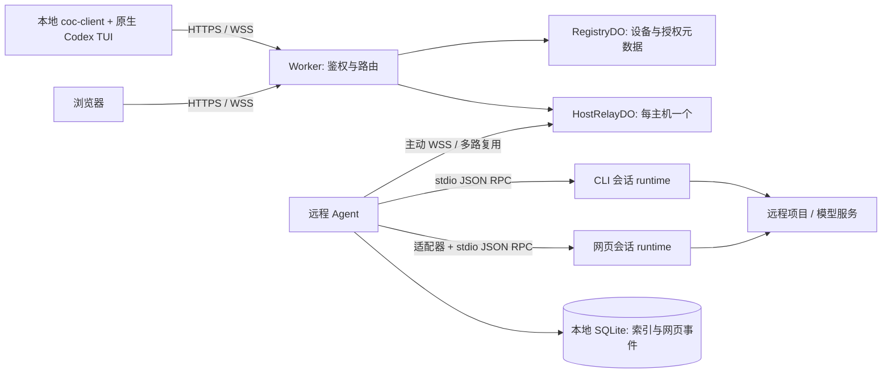

# 技术架构与选型

> 2026-11-03 连接授权变更：本机实现采用[连接授权契约](WORKER_CONNECTION_AUTHORIZATION.md)。授权在准入与逻辑通道握手时检查；稳定数据帧不复查凭据或查询租约，授权变化由独立控制事件使连接失效。下文旧的逐包检查要求由该契约替代。尚未部署。


[文档索引](README.md)

本文包含总体设计与版本演进。当前通信规则见 [现行协议](RELIABLE_TRANSPORT.md)，资源及状态见 [状态盘点](TRANSPORT_STATE_INVENTORY.md)，实际验证见 [测试报告](TEST_REPORT.md)。带旧版本/日期的章节保留当时设计，不覆盖现行规则。

当前 0.6.0 本地候选：唯一 delivery:2、全部业务写入口、端点持久恢复和统一逻辑预算已实施；P0–P7 的本机范围证据见 TRANSPORT_STATE_INVENTORY。历史阶段记录中的“待迁移 / 待收口”不作为当前状态；真实旧更新器、安装后完整 E2E 和隔离备份恢复已通过；未发布部署。任务终态可附 history 不可变引用，绑定原 Agent / 会话 / 修订、长度和摘要；客户端保存引用即可确认，ACK 不删除历史，过期返回 CONTENT_UNAVAILABLE，不重做业务。

项目执行端资源已加入独立固定预算：整个 Agent 的项目目录、按主体 / requestId 绑定的永久身份、短结果尾部、已移除项目 ID、原子替换副本和结果预留共用 16 MiB。永久身份 / 已移除 ID 各最多 1024，结果最多 16 项 / 4 MiB；保守计量同时预留原文件与一次原子替换，Linux 在下一次写入前清理并同步旧的未发布临时文件。目录创建前检查包含 available 字段的目录响应上限，先持久保存 started 与结果空间。结果尾部淘汰后返回 RESULT_UNAVAILABLE，原编号仍拒绝重开；执行中退出变为 RESULT_UNKNOWN。旧项目配置保留，旧业务 receipts 不导入新版 journal。其它资源的完整预算及本机测量见 TRANSPORT_STATE_INVENTORY 的当前统一资源表。

Agent 的 Codex 子进程分为最多 16 个会话进程与独立 4 个临时历史读取进程，在创建子进程和保存新会话之前预留；关闭中的对象及异步 I/O 未释放前继续计数。普通未完成 RPC 每进程最多 64 条 / 2 MiB、全局 512 条 / 16 MiB；中断独立每进程 8 条 / 512 KiB、全局 128 条 / 2 MiB。输入队列（含正在写入的帧）普通每进程 128 条 / 2 MiB、全局 1024 条 / 16 MiB；中断及审批回复独立每进程 32 条 / 512 KiB、全局 256 条 / 2 MiB，不打断已开始写入的帧，随后优先发送。字节计量包括固定元数据开销，未完成 RPC 另按参数编码的四倍加 16 KiB 预留闭包与定时器空间；条数和字节任一满即 BACKPRESSURE，不借用另一类容量。CLI 请求使用不复用的内部安全整数 ID，返回时恢复原客户端字符串 / 数字 ID；超时或进程退出后未确认结果保持 RESULT_UNKNOWN，迟到内部回复丢弃，不映射给新的请求。任务先取得请求与输入两项预留，随后才更新运行状态、记录用户事件并发送。统一预算及故障验收见 TEST_REPORT。

Agent 的 Web 待执行队列（含正在处理的项）每会话最多 100 条 / 2 MiB、全局 512 条 / 16 MiB；priority 独立每会话 8 条 / 512 KiB、全局 64 条 / 2 MiB。实际保留的帧与闭包按编码八倍加 16 KiB 计量；取消未开始的原任务立即归还其队列额度。待决审批每会话最多 32 条 / 1 MiB、全局 128 条 / 8 MiB，另限制全部审批的保守线编码为每会话 64 KiB / 全局 1 MiB，保证与历史快照一起可在单帧内返回；条数、内存和线编码任一先满均拒绝。共享审批的原件与镜像持有同一额度，直到最后一份实际引用释放。外部审批连接的内部请求另限每连接 4 条 / 64 KiB、全局 64 条 / 1 MiB。完全相同的待决审批重发沿用原版本；未解决 ID 被用于不同内容时断开对应运行时。普通进程审批超额明确拒绝；外部审批超额断开转发并保留原服务器待决状态，不自动答复。结果路由仅保留执行中或未确认的流，确认及关闭后回收；查询已退休路由不创建持久元数据。probe / metrics 仅报告这些集合的条数与计量字节，不含正文。

## CW 工作台与交互终端（开发分支）

`workbench/` 装配现有会话组件、懒加载目录/预览和共享事件的只读输出面板；`markdown/` 统一对话、侧栏、独立预览的格式化。主题仅作用于 CW 工作台，管理页面保持原有布局。页面标题展示执行/审批状态，后台页面通知由用户单独开启且只含通用提示；不新增服务端通知或页面关闭后的推送通道。预览读取绑定 host/project/session 并可取消，内联限制 1 MiB；布局偏好使用带版本且校验范围的本地配置。文件读写和历史同步继续走原权限及可靠操作路径。

公式、代码高亮、xterm 动态加载。Mermaid 引擎作为本地静态资源按需装入规范静态路径 `/diagram`（`/diagram.html` 的重定向目标）：iframe 只允许脚本且无同源权限，专用 CSP 禁止网络和应用嵌入；父页面只向该 frame 发送源码和经白名单解析的深 / 浅色主题，不能接受它发起业务请求。图表路径及其 HTML 别名均设置专用 CSP，并移除普通资源的 X-Frame-Options；普通网页继续禁止内联脚本；允许内联样式以支持 React 尺寸、KaTeX 及 xterm 的定位样式，字体仅允许同源和构建器内联的 data 字体。主题变化以新沙箱重绘已打开图表，系统主题使用 matchMedia 实时跟随，独立预览窗口监听偏好存储变化。图表没有任意 HTML/iframe 内容或回调通道。具体限制和未完成项见 [实施记录](CW_WORKBENCH.md)。

`POST /api/v1/hosts/:id/terminal` 只接受 Web 身份和显式的 info/open/read/input/resize/close 契约；非 info 操作由 Relay 事务验证活动项目 writer、完整 control proof、账号及会话归属。Agent 再验证当前持久控制代次、运行时连接代次、会话模式与项目。创建/关闭进入原可靠 operation 账本，输入/缩放按 runtime + 严格递增序号在内存去重，不把按键逐条写入业务数据库；相同上一序号只接受完全相同摘要。写入结果无法确认或部分写入会关闭 runtime 并报告 RESULT_UNKNOWN，不能重新编号重放。

Linux `Terminals` 使用独立 PTY、会话/进程组、bubblewrap user/PID/mount/network 等命名空间，清除 capabilities/环境，只绑定当前 canonical 项目根到 `/workspace`。系统 `/usr`、`/bin`、`/lib`、`/lib64` 只读，HOME 独立，`/tmp` 私有，固定 Bash 参数数组启动，禁止降级到未隔离执行。`prlimit` 在 PID namespace 内施加 NPROC=32，子进程继承 AS=256 MiB、NOFILE=64、CPU=300 秒、CORE=0、FSIZE=64 MiB；均为每进程限制，不承诺 cgroup 总 CPU/内存/磁盘配额。不可验证的平台禁用。

每个 Agent 最多 4 个 runtime，每项目一个活跃终端；退出记录保留至满 60 秒后在下次创建时回收。每终端输出环形缓冲 256 KiB、读取分块 32 KiB、单次输入 4 KiB，偏移以字节计，缺口显式返回 gap；不写入会话历史。每 200 ms 检查退出/心跳，60 秒无授权读取终止进程组。detach、较新控制代次、会话结束和 Agent 断开/退出立即清理；bubblewrap die-with-parent 与 PID namespace 清理子进程。终端与助手项目写任务相互排斥，权限不能由 UI 推导。

## 执行端业务回执

A 的 transport2_operations 在执行前提交主体 / 原 requestId / Agent instance 与 action / data 摘要，重复请求返回原结果或执行中状态，进程重启后的执行中项固定为 RESULT_UNKNOWN。终态先持久化再回复，C 确认后释放正文并保留有界拒绝身份；预算为全局 128 MiB、主体 32 MiB、1024 项总身份，独立于会话窗口。Worker 为携带可信 intent 的写请求提供共享有界内存转发，owner 由鉴权绑定，结果仅携带匹配的执行端证明；停止及确认保留会话模式检查。

CC 的创建 / 观察、停止、排队、审批及项目修改已接入 transport2_local_operations：发送前保存完整固定意图，原结果先提交再确认，进程中断后由 request 原编号恢复。该表按凭据前缀隔离，在既有全局命令预算内预留 32 MiB，限制 32 项未确认及 1024 项总身份；确认后压缩输入，保留 16 项 / 4 MiB 结果尾部，缓存清理不移除该表。待原结果与待确认均仅重查原身份，快速阶段后进入 30–60 秒抖动恢复；存储 / 权限 / 实例冲突停止。网页、上传及其余预定入口已迁移；旧业务路径已移除，强制唯一 delivery:2。

网页创建 / 停止会话和项目修改已接入同样的原请求账本。首次意图先以 IndexedDB 原子 read-modify-write 占用既有 32 MiB 预留，再查询并持久绑定 Agent 实例；Web Locks 在同一主体 / 主机范围串行网络交换，并以四个全站槽限制在途交换，BroadcastChannel 唤醒其它标签页。最多 32 项未确认 / 1024 项身份，终态提交后才确认，确认后回收输入并保留 16 项 / 4 MiB 结果尾部及永久拒绝摘要；无待办停止恢复。管理员项目管理使用实际 owner 哈希及同一主机范围，云端 identity / probe 仍验证 owner 和主机有效性。上传使用独立正文账本，预定业务写入口的旧分支已移除。

上传执行端已将回执从普通 cache 移入 transport2_uploads；开始创建暂存文件前持久绑定主体 / 项目根 / uploadId 与原路径、大小、覆盖选择和完整 SHA-256 的意图摘要，并预留完整暂存大小和 16 KiB 元数据。全局最多 4 个未解除资源承诺 / 80 MiB 暂存，每主体最多 2 个；拒绝身份全局 1024 / 每主体 256，总预算 96 MiB。分块推进连续偏移前同步文件；完成和取消先回收暂存资源再释放对应预留，永久保留旧身份，清普通缓存和旧一天期限不重新放行。重启中的上传固定为 unknown；无法证明资源已回收时保守保留预留，不能通过重启扩大磁盘承诺。网页首发前持久保存完整文件、目标与摘要，恢复沿原编号 / 实例 / 连续偏移；云端仅作有界内存转发。

Worker 的全部非 ticket / attach 请求现均只使用 128 条 / 8 MiB 的内存关联，pending / completed 各最多 20 秒，不持久保存业务正文或结果。权限事务使用独立 permission-operation / permission-wire，最多 64 条 pending / 256 条总记录，每条 16 KiB；输入仅保留准入字段，get 仅保存 mode / sandbox。记录、wire 和到期索引同事务提交，重建恢复到期调度；权限事务、租约和 epoch 原地保存在 HostRelayDO。执行端旧业务分支已删除，资源与真实旧升级验收见 TEST_REPORT。


## 控制类写入口的唯一原请求路径（2026-11-01，仅本机）

Worker 和 Agent 对 create / stop / queue / answer、项目修改以及上传 begin / finish 强制要求原请求 intent，缺失证明在执行副作用前返回 UPGRADE_REQUIRED。读取、ticket / attach、可靠会话 OPEN 和按原上传编号 / 偏移校验的 chunk / cancel 不进入此 HTTP 原请求账本；读取携带写证明仍拒绝。两端使用同一组 23 项分类样例，Worker 保留会话模式与项目管理授权检查。

会话创建 / 外部观察不再写 create:<key> 的旧 requests / request_states 副本，成功或失败只由 transport2_operations 返回原结果；create 控制帧移除旧 key 字段。删除 GET /hosts/:id/requests/:id、control request 及相应生成协议，CLI request 只使用此前保存的完整本地原意图。外部队列和审批的 HTTP 路径已通过持久操作账本，不再进入旧网页回执或外部 submission 普通缓存；不确定的队列回复重复查询仍返回原 RESULT_UNKNOWN，不生成新提交。裸会话写入分支、旧 Store 回执 API / 表创建和可选持久化 TUI 分支均已移除。

## 在线配置管理通道

平台 owner 经 `/admin/hosts/:id/configuration` 读取目标、替换配置和重启；HostRelay 使用不依赖 Storage 的 `ManagementRequests` 将活跃 HTTP 请求关联到实际目标 WebSocket，20 秒超时按原请求编号恢复。配置正文与结果不进入普通持久 Operation、D1、attachment 或业务日志；发送及返回前重新鉴权，目标回复按 socket 绑定。Agent 在 capabilities 上报管理元数据，CLI 使用独立、主机凭据限定的 `/ws/v1/client-management/:hostId` 通道；Agent 重连不会关闭其它机器上的客户端管理通道。

共享 C++ `RemoteConfiguration` 限定本进程启动配置路径，执行 64 KiB / 语义校验、SHA-256 CAS、私有锁、原文备份及原子替换。本地 `.remote/` 回执以请求摘要去重，替换的 prepared 回执以文件 before/after 摘要恢复；重启在确认前写至多一次回执。Agent 在回复后延迟关闭 runtime，CLI 清理 TUI 后重执行原 argv。独立客户端有随机实例 UUID，受控重启通过仅在重执行时传递、由新管理实例消费并清除的环境变量保持 UUID；它不传给新 TUI，也不是认证凭据；Worker 目标 ID 额外绑定认证摘要，凭据变化后属于新目标。CLI 退出即结束管理线程，无守护进程。详见 [配置管理边界](REMOTE_CONFIGURATION.md)。

## 运行版本展示

管理员主机目录在现有读取中合并 `hostStatus` 的连接状态和 Agent 已校验的 `build.version`，统一读取所属 HostRelayDO；停用主机不触发状态读取。单个主机查询失败时仅将该行标为状态未知，不伪造成离线或阻止其他管理操作。网页仅对在线主机展示运行版本；功能菜单在构建时导入包版本，不依赖下载清单、远端 health 或新增轮询。

版本列表使用独立的管理 Tab 与关联 tabpanel；“杂项”tabpanel 承载 Agent 更新及后续辅助功能。杂项面板在其他管理 Tab 下隐藏并保留组件实例，避免切换到版本页或 API Key 页时丢失在途通知、错误与完成状态；隐藏内容不进入可访问的活动面板或键盘焦点序列。

## CW 工具详情分组

`groupToolEvents` 以用户消息、Codex 正文、面向用户的告警 / 终止状态为分界，其余连续过程输出统一归入同一折叠组，不依赖工具类型白名单。代码差异、执行计划、`largeRpc` 和新增过程类型均适用。各条详情继续由 `EventView` 按展开状态读取并渲染，代码差异使用既有高亮；保持事件原序，不移动或删减历史记录。

## 端到端传输架构（0.6.0）

[传输架构设计](TRANSPORT_ARCHITECTURE.md) 将 Worker 职责收敛为权限控制、控制代际隔离和有界的尽力转发；发送头、连续确认、重传、接收信用、去重与结果恢复全部由 A / C 持久维护。云端保留授权与租约等控制状态，新版业务帧不再登记可靠传输进度。该设计取代下述旧协议的目标分工；当前分支 Worker 已移除全部传输进度读写及 heads 补齐，控制代际核验独立保留；版本统一为 0.6.0，仅保留原生升级链路兼容：本轮选择停服后手动 `coc-agent update`；client 使用 `coc-client update`，不保留旧业务协议、旧流恢复或降级路径。具体实施与切换见设计第 8 节。当前分支已实现信用后发布、exchangeId 恢复隔离、端点慢速重试、独立结果完成日志、transfer 全文确认和 CC 输出先落盘，以及 CONTROL_READY 控制隔离、原任务取消与 runtime / version 审批绑定；完整本机验收及字段去向见 [传输状态盘点](TRANSPORT_STATE_INVENTORY.md)。

## 可靠会话通道（0.5.18，历史基线）

[可靠传输协议](RELIABLE_TRANSPORT.md) 定义按主机 / 会话 / 设备 / 通道划分的持久序号与信用。Worker 只登记进度和转发，Agent SQLite 保存命令接收 / 开始 / 完成状态及原 CC 的未确认 RPC 输出；CW IndexedDB 与 CC SQLite 保存发送缓冲和连续接收位置。接收确认与业务结果分开，信用只由接收方执行缓冲决定，未知副作用不自动重执行。

传输身份绑定 Agent 数据库实例及控制代际，重建 Worker 不重置逻辑流，替换设备或数据回退不复用旧确认。HTTP 可靠命令须具有当前 controller 证明，readonly snapshot / delivery 查询按既有授权执行；原 TUI 的恢复还要同时匹配 owner、原逻辑流和恢复证明。窗口耗尽保留 priority 资源。帧头随业务消息传播，稳定空闲没有新轮询；待确认请求的查询按退避重试、合并并发，结束后停止，且不会生成新的命令身份。

## CW 初始化与连接恢复

错误分类与认证状态分离：非 AppError 的 Zod / JSON 语法错误保留 INVALID_REQUEST / 400，未知服务异常返回不含内部细节的 INTERNAL_ERROR / 500。Host 转发、主机状态查询、Registry 通知及浏览器 Cookie 聚合只将明确 401 / 403 视作认证拒绝，其他失败不得伪造成 4001 / UNAUTHORIZED；Host 状态查询失败须保留 HTTP 错误，不能当成缺少 online 的正常主机目录；转发故障使用 1011 触发有限恢复。CW 快照错误保留旧数据，仅在明确认证拒绝时清空对应登录状态。

工作区目录初始化由单个在途 Promise 合并；可重试身份请求失败采用 1/2/4 秒有限重试，手动刷新和页面重新可见可重新启动，实例切换取消旧请求及计时器。目录初始化成功后刷新不重复清空工作区。刷新在 probe / 会话确认前触发目录 revision，避免失败分支跳过目录读取。

通知通道以 subscribed、历史通道在 history-ready 后完成当前订阅 exchange 的 history-window、控制通道以 sync 完成为握手确认。15 秒超时直接退休当前 socket；历史先快速恢复再以 30–60 秒抖动继续，关闭事件晚到及旧消息由连接身份检查隔离；确认后解除握手计时器，不引入空闲业务心跳。IndexedDB 打开在 blocked 或 5 秒超时后拒绝缓存操作，允许调用方继续网络初始化；迟到成功打开的数据库立即关闭。Relay issueTicket 与 reserve 一致，仅把尚未关闭的已鉴权控制连接视为占用，仍保留显式 takeover 和租约 epoch 隔离。

## CW 底部手势刷新

消息滚动区使用 `useBottomRefresh` 记录向下滚轮、单指滑动与键盘翻页的用户意图，仅在到达底部时调用现有 `refreshView`。同一手势只消费一次，并与正在执行的刷新及短冷却合并；切换主机 / 会话或退出 CW 时清除手势。程序自动跟随消息不创建意图，工具输出内仍可向下滚动时不外溢触发同步，不增加空闲轮询。刷新仍等待 probe、控制与历史同步响应，沿用失败恢复及草稿保留。

## Agent 邮箱关联与更新通知

Host 目录记录 `agentAccessEmails` 和可选 `accessEmailsOverride`，管理员覆盖优先，空覆盖禁用，缺省使用 Agent 来源；有效邮箱列表不向普通主机列表暴露。Agent 通过已认证 capabilities 或 `/api/v1/agent/access-emails` 仅修改自身主机，管理员通过 `/api/v1/admin/hosts/:id/access-emails` 设置数组或 `null` 恢复默认。邮箱数量无固定配额，C++ / Zod 使用共享样例校验，保留本地部分大小写并规范化域名。

`emailHosts` 合并既有邮箱授权和当前验证 issuer / 邮箱命中的关联主机；`emailRestore` 惰性创建带 `association` 标记的现有 EmailGrant，沿用 Cookie、generation、账号及主机绑定。移除关联在同一存储事务撤销仅关联来源的 grant / auth，返回受影响凭据以关闭连接并清理 Host 鉴权缓存。每次鉴权另核对有效关联，独立配对会将关联来源升级为独立授权，后续移除配置不影响该授权。显式撤销关联 grant 会保存排除该邮箱的管理员覆盖，防止 Agent 下一次同步重新授权。配置及授权保存于 RegistryDO 原生存储。

管理员网页更新按钮读取当前已部署下载清单，仅提交 version / commit 到现有 `/api/v1/admin/releases`。后端继续验证所有包可用及发布身份，Registry 幂等广播，客户端保持自动更新开关和空闲安装规则。

## CW 文件预览、工具同步与 Agent 自动批准

聊天链接和工作区文件中的 Markdown / 文本文件单击后在新窗口打开；顶部“下载”保存完整原文件。Markdown 支持表格和代码块，HTML、代码等其他文本按纯文本显示。图片、音频、视频单击在页面内展开，媒体使用浏览器播放控件；再次单击收起，不支持的格式可下载。预览沿用项目授权、路径限制和版本固定的分块读取；文件内容不会作为 HTML 脚本执行。

“自动批准当前会话”由新版 coc-agent 保存和执行，网页关闭或重连后继续有效。只处理当前 web 会话的命令、文件修改和本轮额外权限；其他交互仍需人工处理，不更改 sandbox 或原客户端策略。关闭开关阻止之后的自动批准，已提交决定不撤回；停止会话后关闭，其他会话默认关闭。启用时该会话不因网页离开满 30 分钟而自动停止。旧 Agent 不提供此开关能力，须升级 Agent。

Agent / CW / CC 使用已接收修订游标及最大修订号同步。条目 seq 可以保持不变，revision 随工具状态和输出更新递增；连续传输直接推进游标，前序修订不匹配时补读缺失范围。缓存提交游标前先保存对应事件；展开的工具输出在修订变化后按需重读，避免依赖顶部刷新。查看较早历史时仍更新已显示工具的状态。

## DO 原生持久状态 · 2026-11-03

Registry 与 Host 均直接使用所属 DO 原生存储。所有 Registry 调用经 RegistryDO，Host 状态及权限回执统一经 HostRelayDO；无后端选择、D1 直读、归档、恢复、定时全主机回收或迁移路由。有限到期索引在 DO 内驱动一次性 alarm。现有 namespace、epoch、租约和回执保持原状，旧迁移标记不参与路由。删除范围、开发与部署约束见 [清理记录](DO_ONLY_STORAGE_2026-11-03.md)。

## 空对象存储边界 · 2026-10-29

过期迁移首次发现整个存储为空时仅在 WeakSet 中记录无旧数据，不持久化完成标记；新有限期记录继续由 expireAt 建立索引。Host changed 在没有 socket 时跳过通知 revision 写入，后续订阅仍读新快照，已存在的版本和控制元数据不重置。不按会话退出执行 deleteAll：DO 是每主机一个。平台只读核查、存储口径与候选对象限制见 [审查记录](relay-storage-audit-2026-10-29.md)。

## CW 恢复与管理视图增补 · 2026-10-29

CW 手动刷新已选会话时直接读取新的 Agent 在线 snapshot，同步控制状态与历史增量并完成本地持久化；不再重复 probe，也不依赖两个会话 WebSocket 响应。未初始化会话的回退分支保留 probe。健康通知通道保留，断开或刷新失败时修复，20 秒总期限继续生效。正常同步保留控制连接与草稿，不自动接管或以新请求重发任务。

管理表格由统一 AdminTable 按调用方提供的原始字段在 React 渲染前排序，保留授权行的稳定 key；设备分组及明细共享排序状态，分组按 hostId 或客户端角色 / 邮箱 / 名称构建，仅影响展示。所有撤销仍使用原授权 ID，名称归组不作为身份或权限依据。

Auth 与 EmailGrant 新增可选 lastSeen；Registry 在 auth / authHash / authHost 的校验事务中更新非 owner 凭据，按凭据最多一分钟一次写入，并同步其活动邮箱授权。管理列表返回时间及邮箱，不回填旧数据，不把列表访问作为目标设备活动，不发送额外通知或调度轮询；长连接持续业务不保证该认证时间持续前移。

## 访客 CW 与公开下载 · 2026-10-29

`/guest` 命名空间承载完整 CW、资源、API 和 WS，按请求关闭邮箱流程并移除内部路由前缀；普通路由保持 Access 保护。访客 Cookie 使用 `coc_guest_…` 和 `/guest` Path，与邮箱入口隔离；CoC 凭据、角色、主机、审批、撤销及 Origin 校验仍是服务端权威。Registry 仅接受内部调用方生成的邮箱要求标记，客户端不能用 Header 或请求体切换普通入口的策略。`/downloads` 前缀默认公开；Cloudflare 边缘需同步配置访客和下载公开例外。

## Cloudflare Access 与邮箱持久授权增补（2026-10-28）

可选 `ACCESS_ENABLED` 在 Worker 外部入口校验固定团队 JWKS 的 RS256 JWT、issuer、audience 和时间；Service Token 准入完全由 Cloudflare Access 处理；Worker 仅提取已验证 JWT 的邮箱用于账户关联，无邮箱时沿用 CoC 机器凭据鉴权。来源配置 `config/cloudflare-service-token.json` 仅供 CMake 生成原生常量及 Python 运维工具使用，Worker 和网页不导入。原生共享 Access 初始化优先使用成对环境凭据，随后是私有文件、编译默认值；凭据覆盖不改变 origin 列表，也不写回磁盘。`run_worker_first: true` 覆盖 Assets，访客与下载默认公开且需同步边缘例外，健康检查可显式配置；本地开发缺省保留 CoC 认证。

RegistryDO 以 issuer / 邮箱摘要作为账户 ID，持久保存 `emailAccount` 和按账户 / 主机索引的 `emailGrant`。首次 CW 配对领取的同一事务才建立授权；新浏览器按授权恢复独立 web Cookie，Auth 绑定账户和授权代次。恢复与撤销串行化，旧代次不能复活。HostRelay 保留原有角色、会话、票据和撤销机制；邮箱授权撤销关闭全部匹配凭据连接，A 撤销级联失效。

管理员邮箱仅通过已验证用户 JWT 匹配 `ADMIN_EMAIL` 后签发 owner；其他邮箱保留 OWNER_SECRET 登录。owner 记录绑定账户、登录来源、配置版本及原有 ownerVersion；配置变化后自动登录来源失效，原生机器身份不会转换成邮箱 owner。管理权限与网页会话控制权保持独立。现有无邮箱网页授权必须显式迁移，不能按申请名称或留言认领。

浏览器先读取邮箱与授权列表，选择 A 时恢复网页凭据；邮箱切换清除旧页面会话，缓存继续按凭据隔离。Access 过期不删除持久授权。新增流程、API、生命周期和配置边界见 [接入说明](cloudflare-access-coc-auth.md)。

## 管理快照与本地操作恢复 · 2026-10-27

管理页通过同一个 `readAdminSnapshot` 并发读取设备、API Key 和主机快照，在三者均成功后一次更新对应 React 状态。本地管理操作成功后显式等待此读取，不依赖自身变更通知；手动管理刷新也等待快照后才结束加载。通知与本地刷新合并到同一个在途 Promise，期间发生新刷新时丢弃旧批并补读，避免变更前快照覆盖本人操作结果。通知恢复和有限重连保持原策略，没有新增周期查询；分开的 HTTP 读取不声称服务端原子快照。

## 管理主机列表的协议边界 · 2026-10-27

Registry 的 `hosts` 管理快照仅返回 `version:2` 的主机，网页继续排除 `disabled` 主机；版本发布通知也要求当前协议且未停用。这与既有单主机查询、唤醒配置修改及凭证校验的版本要求一致，避免旧登记记录仍被当作可配置或可批准的服务器。读取不迁移或删除旧记录，不凭名称关联凭证；当前协议的无凭证残留不由此过滤掩盖，需要独立排查。

## DO 通知范围与迁移读取 · 2026-10-27

Registry 的登录 / 退出、API Key 创建和未指定主机的申请仅更新 Registry 订阅者。配对、授权撤销、API Key 登录 / 撤销及主机配置变更只向受影响 HostRelay 发短通知，同批 hostId 去重；仅版本发布扫描并通知全部有效主机。未领取申请到期仍执行权威撤销，通知仅发往原目标或已批准的主机，不为尚未批准的 Agent 预分配 ID 创建 HostRelay。`registry_change.notifiedHosts` 记录本次目标数，通知失败仍由快照恢复，不安排持续重试。

到期迁移完成状态使用按 storage 实例关联的 WeakSet 提示，跳过热路径重复读取 `expiryMigration`。该提示只在持久完成状态已确认或最后一页写入成功后设置；有界迁移继续读取游标，休眠 / 重建后再次核对持久状态，不缓存业务授权或删除到期任务。实际用量分析与边界见 [DO 平台用量分析](do-usage-2026-10-27.md)。

## 0.5.12 按需通讯实现

HostRelay 的控制路径为持久异步状态机：保存调用者 scope、Agent epoch、wire ID、阶段、socket ID、原业务 requestId，发送后返回 202；Agent 结果到达后推进 get / attach / ticket 等阶段或完成回执。HTTP handler 和 history / auth WS handler 均不持有等待 Agent 的 Promise 或控制 timer。结果通知仅送同凭证订阅，领取再次验证身份；迟到 wire / epoch 不匹配时忽略。临时数据分片避免超出单存储值限制，五分钟回收；权威业务去重仍在 Agent。每主机 64 个在途、256 个总回执限制使用持久事务，重建不能绕过；同凭证只读 probe 合并。

`/ws/v1/hosts/HOST` 是独立的入站 Hibernation 通道，无需会话和 A 在线，不授予控制权；Registry `/ws/v1/admin` 与 `/api/v1/auth/device/events?id=ID` 分别验证管理员和申请秘密。秘密仅用 Bearer 或 HttpOnly Cookie，Origin 规则保留。先订阅，再收到 revision 边界后读权威快照；通知为失效信号，无正文增量依赖，重复 / 乱序被忽略，断口和重连重读快照。跨 DO 各自有 revision，不声称全局原子性。Registry→Host 短调用失败不持续重试。

A 不发送 JSON heartbeat 或后台审批轮询；Beast 的自动 idle timeout / keep_alive_pings 仍关闭，由仅 Agent 启用的 transport 定时器每 30 秒发送协议 Ping，90 秒无匹配 Pong 关闭连接并触发原有有限重连。控制帧与业务写入串行；计时在 relay_io 网络线程上执行，普通入站数据不重置 Pong 期限，关闭时取消定时器。维护 timer 仅执行本地回收和已触发更新的安装检查，不周期下载。CW 无状态定时查询，CC 的等待和交互共享各自单调度器，最多十秒一轮。Host 出站 receipt 累计预算存 attachment，跨休眠保留；真实转发使用独立接收者队列和按需鉴权。活动鉴权保留五秒缓存、同 hash 在途合并及撤销 token 防护。

`due:` 排序到期索引只存临时设备、限流、owner、票据、握手与回执期限；alarm 每批至多 64 项，完成后只安排真实下一期限。历史库按每页 64 项有界迁移；永久设备授权不加入队列。构造器不调度，无到期工作时删除 alarm；没有连接的票据仍可清理。保留 agentEpoch、lease 和权威请求身份。

`registry_call` 按 Worker / Host 归因，`host_frame` 记录角色、字节、处理时间与缓存命中 / 合并计数，`control_accepted` / `registry_change` 标记实际操作；不写计量存储，不记录凭据、正文或唤醒 URL。当前日志仍是平台 10% 采样，不能直接当完整用量；分别以 A、A–CW、A–CC 场景核对平台请求 / duration / SQLite 指标。

> 计费优化设计：见 [Durable Objects 计费优化方案（2026-10-26）](do-billing-optimization-2026-10-26.md)。2026-10-28 调整为 A 使用协议 Ping/Pong 检测连接存活，不恢复 JSON 心跳或周期业务复核；CW 使用事件通知和刷新按钮，CC 运行期间每 10 秒刷新。C 查询或操作时按需确认 A，业务鉴权缓存仍最多 5 秒。实现说明见下节，平台长稳与节费证据见测试记录。

## 代理与实例名称补充（2026-10-26）

原生 `proxy.cpp` 共享 HTTP CONNECT / SOCKS5 异步隧道，HTTP 和 WebSocket 在目标 DNS 分类后选择直连或代理；私网与本地结果直连。HTTP 沿用同一可取消 DNS / 请求总期限，代理握手使用最低层 tcp_stream 超时，TLS 保留目标主机验证。进程启动前设置代理配置，网络线程只读，不修改环境。`tui_bridge.cpp` 在启用代理时提供 loopback 随机端口和远程票据鉴权，双向转发有界 WebSocket 消息，让独立 Codex TUI 使用同一网络策略；本机 app-server 独立连接保持直连。

Agent 配置 `codexUseProxy` 为严格布尔值、默认 false。Codex 子进程使用独立环境副本，默认移除大小写 HTTP / HTTPS / ALL / NO_PROXY；启用且有效 Agent 代理非空时才显式设置代理变量，并保留 loopback 绕过。POSIX 在 fork 前构造完整环境，通过 execvpe 交给子进程；Windows 在 CreateProcessW 的 Unicode 环境块中按大小写不敏感键合并。环境策略同时覆盖 app-server 和 Agent 版本探测，不修改父进程全局环境或 CLI TUI 的票据 / 环境路径。

`displayName` 与客户端条目的目标主机 `name` 分离。`POST /api/v1/instance/name` 只接受 agent/cli Bearer，Worker 从已验证身份注入 hash；Registry 事务复核凭证、API Key 与主机状态，仅更新自身 auth，Agent 同时更新其 host.name。Agent capabilities 可登记 displayName，API Key 登录更新实例名并保留 Key 管理名称。管理员视图按五个 Tab 展示功能；待授权、设备、唤醒和 API Key 使用共用原生表格、行标题和局部滚动区域，不改变管理权限范围。

## 离线唤醒补充（2026-10-25）

RegistryDO 的主机记录新增可选 `agentWakeUrl` / `wakeUrlOverride`，有效地址为管理员覆盖值（含空字符串禁用）优先，否则使用 Agent 地址。Agent 连接 capabilities 中可选 `wakeUrl`，或经独立已鉴权配置接口登记；旧程序省略字段不清除数据。普通主机列表剥离地址，仅提供 `wakeConfigured`。

CW / CC 用各自主机授权调用 `POST /api/v1/hosts/:id/wake`，Worker 校验角色及目标后交给 HostRelayDO。后者复查主机可用性和当前连接，离线时从 RegistryDO 获取有效 URL，事务写入持久化 `wakeUntil` 后发起 GET。事务在网络请求前提交，防止多客户端并发及 DO 重启重复访问；失败也保留 60 秒窗口。不转发调用方 Header，不跟随重定向，10 秒超时，丢弃响应正文，仅 2xx 成功。唤醒状态不等于 Agent 上线，客户端仍以已完成协议协商的连接为准。

CW 对选中的离线且可唤醒主机请求一次唤醒；后续通过事件或用户刷新确认，显式重试受一分钟限流。CC 列表命令触发但不等待，业务命令等待最多 60 秒；明确 HOST_OFFLINE 的 HTTP 请求仅在恢复后以相同幂等标识重试一次。离线历史缓存不访问中继。

> 实现进展：本文件保留初始目标基线；当前开发版本的实际能力与测试结果见 [README](../README.md) 和 [测试记录](TEST_REPORT.md)。

> 状态：0.5.6 增加离线 Agent 唤醒，支持管理员和 Agent 配置，由 CW / CC 自动触发，保留完整本地历史；目标与实际状态对照见文末。日期：2026-10-25。
> 对应 [项目需求](REQUIREMENTS.md)，保留 [原始构想](IDEARS.md) 作为背景记录。

## 1. 架构结论

采用 **Cloudflare Worker + 每主机一个 Durable Object + 出站 WebSocket Agent**。CLI 优先复用原生 Codex TUI 的远程连接能力；网页通过 Agent 的 Codex app-server 适配器提供结构化交互。

首版为个人自托管系统。服务器执行所有 Codex 工作；云端负责鉴权、设备登记、连接路由及少量控制元数据，不托管模型会话进程或持久化对话正文。

## 2. 已核实能力与验证边界

### 2.1 本机 Codex

通过以下命令检查本机 `codex-cli 0.164.0`，未读取用户认证文件：

```bash
codex --version
codex --help
codex app-server --help
codex app-server generate-json-schema --out /tmp/coc-codex-schema
```

观察结果：

- CLI 提供 `--remote <ADDR>` 和 `--remote-auth-token-env <ENV_VAR>`，可连接远程 app-server WebSocket。
- `codex app-server` 支持 stdio、Unix socket 和 WebSocket；帮助文本将其标记为 experimental。
- 导出的协议包含 `initialize`、`thread/start`、`thread/resume`、`thread/read`、`turn/start`、`turn/interrupt`，以及流式事件和服务端发起的审批请求。
- 协议同时含有文件、命令、配置和账号操作，不能直接把全部 RPC 无条件暴露给网页。

当前已用原生 TUI 经本机 Worker、Durable Object 和 C++ Agent 完成初始化及一轮模型对话；这只覆盖已测方法，不表示全部 TUI 功能兼容。CLI 再附着仍未实现；CW 支持通过同一 Codex home 恢复已持久化线程（不会恢复旧进程），具体证据见测试记录。

### 2.2 Cloudflare

Durable Objects 支持 WebSocket Hibernation：空闲时可保留连接、重新初始化对象；内存变量不能作为唯一状态来源。本方案由 Agent 和客户端主动连接 DO，使 DO 在两条链路上都充当 WebSocket 服务端。[官方 WebSocket 文档](https://developers.cloudflare.com/durable-objects/best-practices/websockets/)

前端构建产物通过 Workers Static Assets 与 API 同域部署。[官方静态资源文档](https://developers.cloudflare.com/workers/static-assets/)

平台额度随计划和时间变化，部署时检查官方限制；本文的消息大小与容量是项目自身的保守限制，不是平台上限。[官方限制文档](https://developers.cloudflare.com/durable-objects/platform/limits/)

## 3. 组件与连接拓扑



| 组件        | 职责                                                 | 不承担的职责           |
| ----------- | ---------------------------------------------------- | ---------------------- |
| Worker      | 静态页面、REST、鉴权入口、WS 升级与 DO 路由          | Codex 执行和输出存档   |
| RegistryDO  | 所有者凭据摘要、设备登记、授权版本和撤销记录         | 高频流量中转           |
| HostRelayDO | Agent 连接、会话通道、连接票据消费、控制租约、帧转发 | 模型调用和完整事件回放 |
| Agent       | 项目白名单、进程管理、协议适配、幂等、审批、事件日志 | 公网监听               |
| coc-client  | 登录、选择主机/项目、创建会话、启动及管理 TUI        | 自行执行远程项目命令   |
| Web UI      | 对话、工具状态、差异、审批和重连                     | 任意原始 RPC 控制台    |

连接由 Worker 转交到对应 DO；DO 不能回连内网。Agent 的单条上行连接承载多个隔离通道，每个通道映射到独立 runtime。

Web UI 的中文 / English 语言状态独立于认证与会话，默认中文，使用本机 localStorage 保留并同步同源标签页；不可用时退回内存。React 通过外部状态订阅更新界面与日期格式，文档 `lang` 和标题同步更新。语言切换不重建连接、不重置草稿或审批；翻译表仅覆盖界面文案，不改写对话、命令、路径或协议载荷。

CW `/model` 为本地界面命令，通过现有已授权、带控制租约的 WebSocket 发送 `models`（可选 cursor）；Agent 仅转为 `model/list`，每页 100 项，不暴露任意 RPC。模型选择写入按 origin / credential identity / host / session 隔离的 IndexedDB；后续 `prompt` 可携带受限 model 标识，Agent 转为 `turn/start.model`。model 纳入幂等指纹，缺省旧请求指纹保持兼容；服务端工作目录、sandbox 与审批规则保持权威。模型目录只按需读取，不增加轮询。外部会话拒绝 `models` 及含 model 的队列输入，保持原 writer 控制权。

### 3.1 设备授权模型

R 为 Cloudflare 中转，A 为 `coc-agent`，CC 为 `coc-client`，CW 为网页客户端。只分发两个本地程序，原 `coc` 退出支持。A 的配置和登录由自身完成，客户端不再承担 Agent 登记或撤销管理。

A / CC / CW 共用 deviceStart → approve/reject → devicePoll 协议。申请有 5 分钟期限及独立高熵轮询秘密；配对码和公开请求 ID 仅用于核对。原生程序在终端显示授权地址，不自动启动 GUI。CW 的轮询秘密存入 HttpOnly 临时 Cookie；批准后以事务交付角色专用凭证：CW 原子消费请求并单次交付；A / CC 凭原轮询秘密可在原申请期限内重取同一结果，每次复核授权和主机状态，不重复签发。CC / CW 接受 name 和选填 message（trim 后最多 1000 字符），留言仅在临时申请中保存，以纯文本显示，不写入长期凭证。A 仍由管理员批准并创建主机。未领取请求到期清理。R 仅保存持久凭证的摘要；交付前的短期请求暂存待领取令牌，CW 交付后删除；原生请求记录 delivered 标记并保留至原申请到期，alarm 仅清理已交付请求，不撤销已领取凭证；从未领取的批准结果仍按原规则撤销。

0.5.5 的指定目标审批增加 `requestedHostId`：仅 cli / web 可提交，deviceStart 校验为有效、未停用的 version 2 主机并原样返回。旧 `hostId` 输入继续忽略，未指定的新旧申请均由管理员选择目标。新 CC 的 `login --host` 与 CW 的选填目标输入发送新字段，并核对申请响应及领取结果，不支持的旧 Relay 不会静默降级。指定目标只允许对应 Agent 或管理员批准，任何审批方均不能改绑；未指定时 deviceApprove 仍强制接收管理员的 hostId。原有凭证、Auth version 2 与 API Key 登录兼容。

Agent 使用 Bearer 访问 `/api/v1/agent/requests` 及单请求 approve/reject。Worker 校验角色，并将服务端解析出的凭证摘要传入 RegistryDO，不信任请求体中的身份或主机。Registry 在同一个事务中重新验证 Agent 凭证、关联 API Key 和主机仍有效，且请求必须为明确指定该主机的 cli / web。列表只返回本机未过期 pending 请求的核对字段，不返回全局授权、令牌或轮询秘密；扫描受现有 200 条临时请求配额约束。审批与原管理员路径共用事务签发逻辑，竞争只成功一次，领取仍须原轮询秘密。Agent 不具有全局管理、撤销或新 Agent 授权能力。

原生 `requests / approve / reject` 直接读取 Agent 配置，使用既有 HTTPS 客户端，不启动 Codex runtime、不打开 Store 或占用 dataDir 锁，服务运行或停止时均可明确操作。

Agent 在协议握手后同步一次客户端申请，之后只由指定主机的申请变化通知触发。单线程 `approval_pool_` 执行最多一个在途 HTTP GET，超时 5 秒；结果回到业务执行器处理，不占用文件传输池或阻塞 relay 处理。查询结果再次核对目标和客户端角色，只向 stderr 输出新请求的白名单字段与人工审批命令；名称和留言使用 JSON 转义，配置路径使用 POSIX shell 单引号转义。按当前 pending ID 集合去重，空间随有效待处理申请有界；进程重启后重新提示。失败保留去重状态、连续失败仅提示一次，恢复后继续发现新申请。退出时等待有界请求结束且丢弃结果，不在停止后发出审批提示。

Auth version 2 使用 agent / cli / web 三种独立角色，hostId 固定绑定，设备凭证 expires 使用安全整数最大值表示无固定到期。管理身份 owner 独立，仍为 8 小时。旧认证记录拒绝使用，不自动提升为新授权。CC / CW 的 HTTP、会话票据、WebSocket 都按角色和目标 A 校验，不能调用管理接口。CC 仅控制 cli 模式，CW 仅控制 web 模式。管理员身份不能直接操作会话。

CC 按 R / A 保存多份私有文件凭证；CW 按 A 保存独立 HttpOnly / SameSite=Strict Cookie，HTTPS 加 Secure，使用时续写浏览器有效期。请求路径决定选择哪个 A 的 Cookie，多标签页不依赖全局选中身份。页面脚本不读令牌。

撤销单个客户端凭证后，Registry 删除其摘要并通知对应 HostRelayDO 关闭匹配连接。撤销 A 禁用主机、删除其所有客户端授权并关闭相关连接。帧处理和转发前重新校验，不再周期复核连接，alarm 只执行有限到期工作；本地 logout 只删除本地凭证，不停止任务或删除 R 授权。永久凭证不依赖轮询 alarm 保活。

API Key 与设备配对并行。管理员通过 `/api/v1/admin/api-keys` 创建和列举，`/api/v1/admin/api-keys/revoke` 撤销。创建时强制 agent / cli 角色，cli 必须选择有效 hostId；不提供修改或改绑接口。agent Key 首次 POST `/api/v1/auth/api-key` 时在 RegistryDO 事务中创建主机并写入不可变绑定，并发使用返回同一主机。cli Key 创建即绑定目标 A，可直接作为 Bearer 使用；登录接口只校验角色与目标、返回元数据，不签发新令牌。

完整 Key 由高熵随机值生成，仅创建响应返回一次；Registry 只存摘要及元数据，Auth 的 hash 等于 Key 摘要，并关联 apiKeyId。请求和 WebSocket 都通过原有角色 / hostId 校验，Key 不能充当 owner。撤销删除 Key 和对应 Auth，A 撤销还删除该主机所有配对凭证与客户端 Key；HostRelayDO 立即关闭匹配连接。程序实例不参与绑定，持有者共用 Key 身份。API Key 登录独立使用每 IP 每分钟 10 次限流，不消耗配对 / 管理登录的共享限流桶。

本地共用 login.hpp / login.cpp 的命令选项、登录协议、路径与状态接口；网络、TLS、进程和 SQLite 继续由 coc_core 共用。

## 4. 技术栈选择

本机程序采用 **C++17 + CMake**，生成独立的 `coc-agent` 和 `coc-client`；运行时不依赖 Node.js。Codex 仍为独立程序，不嵌入或重写其模型执行能力。Cloudflare 中转和网页保留 TypeScript，通过 JSON 消息与 C++ 互通。

| 层次            | 选择                                                      | 理由与代价                                                                                                         |
| --------------- | --------------------------------------------------------- | ------------------------------------------------------------------------------------------------------------------ |
| 本机语言 / 构建 | C++17、CMake ≥ 3.16                                       | 可直接使用 Linux 进程、信号和文件权限；增加编译与跨平台适配成本。                                                  |
| 网络            | Boost.Asio / Beast ≥ 1.71、OpenSSL                        | 同时支持 HTTPS、WSS 和异步队列；TLS 校验证书、主机名/IP 并设置 SNI；使用 OpenSSL 验证参数，不使用旧 RFC2818 回调。 |
| 子进程          | POSIX fork/exec、管道、waitpid、进程组                    | 参数数组执行，无 shell 拼接；异步 stdin/stdout，退出时 TERM，3 秒后 KILL。                                         |
| 本地存储        | SQLite3 C API                                             | 沿用 sessions/events/requests、WAL 及请求去重记录，兼容现有数据库。                                                |
| JSON / 校验     | nlohmann/json ≥ 3.7、显式字段和策略校验                   | 与云端 Zod 独立实现相同协议，避免本机运行时依赖 JavaScript。                                                       |
| 中继            | Workers TypeScript、RegistryDO、HostRelayDO               | 保留设备认证、路由、票据和控制租约。                                                                               |
| 网页            | React、Vite、CSS                                          | 保留结构化对话和审批交互。                                                                                         |
| 测试 / 格式     | CTest、clang-format；Vitest、Playwright、ESLint、Prettier | C++ 测策略、SQLite 和进程协议；跨语言端到端启动真实 C++ 可执行文件。                                               |

TLS 身份校验使用 [OpenSSL SSL_set1_host](https://docs.openssl.org/1.1.1/man3/SSL_set1_host/) 和 IP 验证参数，SAN 不匹配时拒绝连接；本地 CA 测试覆盖信任链和主机名错误。

C++ Agent 使用一个 Asio 事件循环串行管理会话、SQLite 和网络；每个连接分别串行化发送，每个子进程独立维护 RPC 超时。WebSocket 限制单帧 256 KiB、待发队列 8 MiB，超限断开；本地 Codex 单条 RPC 约 8 MiB 缓冲限制与网络单帧分开；网页大内容发送引用，超大 CLI RPC 转为历史分块读取提示，不断开整台 Agent。网页命令按会话排队，CLI 消息按白名单转发，不在网络回调里等待 Codex 响应。Beast 的并发约束见 [官方说明](https://www.boost.org/doc/libs/latest/libs/beast/doc/html/beast/using_websocket/notes.html)。

本机当前验证平台为 Linux x86_64。Linux 二进制依赖系统 Boost.System、OpenSSL、SQLite、libstdc++ 等动态库，不宣称静态单文件分发；必须在目标兼容发行版构建。Windows x64 增加 MSVC / vcpkg 静态构建及独立平台实现；macOS 尚待适配。Windows 子进程通过 CreateProcessW 参数引用、受限句柄继承、重叠命名管道和 Job Object 管理进程树；私有状态使用受保护 DACL，SQLite 使用 UTF-8 路径，OpenSSL 加载 Windows ROOT。工作区操作持有祖先目录句柄，拒绝 reparse point / junction、设备名和备用数据流。项目目录允许必要的写共享并禁止移动；子路径通过 `NtCreateFile` 的父目录句柄、单个组件和禁止 reparse 的选项打开，枚举直接读取目录句柄，发布通过 `NtSetInformationFile` 提交相对名称，避免重新解析路径或 Win32 的 `RootDirectory` 兼容限制。Windows 使用手动 ZIP 升级，Linux 原有原子更新流程保持。实际验收范围见 TEST_REPORT.md。只有构建中转、网页和测试工具时需要 Node.js ≥ 22.17。

不引入 D1、KV、R2、Redis 和消息队列：首版设备目录规模小，正文留在远程主机。后续跨主机查询或附件服务出现实际需求时再增加存储。

### 4.1 关键替代方案

| 决策     | 采用方案                       | 替代方案与取舍                                                                                   |
| -------- | ------------------------------ | ------------------------------------------------------------------------------------------------ |
| CLI 交互 | 原生 TUI + app-server 远程协议 | PTY 转发接近完整终端，但有终端转义、resize、重连和平台适配成本；仅在 M0 失败后单独评估。         |
| 网页集成 | app-server 结构化协议          | `codex exec --json` 更适合批处理，不能直接替代完整多轮审批生命周期。                             |
| 中继拓扑 | 每主机一个 HostRelayDO         | 每会话一个 DO 隔离更细，但需额外调度与 Agent 多连接；首版单主机 4 会话无此必要。                 |
| 网络接入 | 自建应用级 WSS 中继            | SSH/VPN/Cloudflare Tunnel 可做个人远控，但不直接提供会话管理及统一网页产品。                     |
| 本机实现 | C++17                          | 按本次架构要求替换 TypeScript Agent/CLI；保持云端 API 和配置，承担两种语言的协议一致性测试成本。 |

## 5. Codex 集成与会话模型

### 5.1 双模式，共用进程管理

每个会话启动独立的 `codex app-server --listen stdio://` 子进程，以白名单项目的真实路径作为 cwd；使用参数数组，禁止拼接 shell 命令。共享同一系统用户的 Codex 配置和登录，避免按会话复制认证信息。

- **CLI 通道**：本地原生 TUI 连接中继 WSS；Agent bridge 将 app-server JSON 消息转换为 stdio 帧并反向转发。握手由 TUI 发起，适配器不得抢先初始化。必须处理请求、通知和服务端请求三个方向。
- **网页通道**：Agent 作为 app-server 客户端完成初始化，维护 thread/turn 关联，将网页操作映射成经过校验的 RPC，将事件转换为稳定 DTO。

CLI 原始 JSON-RPC ID 不跨通道复用；所有回应必须回到原通道。CLI 首版不持久化原始 RPC 以伪造重放；网页则持久化转换后的事件。两种模式共享会话管理规则，但恢复机制不同。

### 5.2 协议能力与权限

协议适配器按 Codex 版本生成明确允许的方法和字段，未声明方法拒绝并返回兼容错误。网页仅暴露创建/恢复线程、读取历史、启动/中断轮次和审批等必要操作；不开放账号管理、配置写入、通用文件 API、任意 `command/exec`。

CLI 需要的额外方法通过 M0 实测补充，不能简单放开 `*`。对 cwd、可写目录、沙箱及审批策略等参数在 Agent 二次验证。需要本机文件附件、账号登录或修改服务端全局配置的 TUI 动作明确标记不支持。

服务端策略设定可允许的最大权限；不通过隐藏参数禁用审批或沙箱。CLI 是受信任所有者的远程开发工具；共享 Codex home 和系统用户不构成项目间强安全隔离。

### 5.3 会话与项目并发

本地 `sessionId` 与 Codex `threadId` 分别存储，不假定一一永久相等。首版每个项目默认只允许一个会话执行活跃轮次，其他会话可读取或等待；不同项目可并行。后续通过 Git worktree 提供同项目并行写入。

Agent 重启后将旧 runtime 标记为中断，检查线程历史后允许用户显式恢复。Codex 历史可恢复不代表外部命令具备事务回滚能力。不能自动重启并再次发送最后一条 prompt。

## 6. 连接协议与 API 草案

### 6.1 HTTP 控制接口

统一使用 `/api/v1`；所有带 ID 的接口都验证所有者关联。会改变状态的 POST 接受 `Idempotency-Key`。

| 方法与路径                                                                              | 用途                                       |
| --------------------------------------------------------------------------------------- | ------------------------------------------ |
| `POST /auth/login`、`POST /auth/logout`                                                 | 管理身份登录 / 清除本地管理 Cookie         |
| `GET /auth/me`                                                                          | 查询独立管理身份                           |
| `POST /auth/forget`                                                                     | 清除指定 A 的本地 CW Cookie，不撤销 R 授权 |
| `GET /agent/requests`                                                                   | Agent 查看明确指定自己的待处理客户端申请   |
| `POST /agent/requests/:id/approve`、`POST /agent/requests/:id/reject`                   | Agent 明确批准 / 拒绝本机申请              |
| `GET /hosts`、`GET /hosts/:id/projects`                                                 | 获取设备及经 Agent 同步的项目描述          |
| `POST /auth/device/start`、`POST /auth/device/poll`                                     | 统一申请 / 领取角色和 A 专用授权           |
| `GET /admin/devices`、`POST /admin/approve`、`POST /admin/reject`、`POST /admin/revoke` | 查看、批准、拒绝、撤销设备授权             |
| `GET /sessions?hostId=...`、`POST /sessions`                                            | 查询会话、请求创建会话                     |
| `POST /sessions/:id/attach`                                                             | 申请控制权与短期连接票据                   |
| `POST /sessions/:id/takeover`                                                           | 显式接管并增加控制权版本                   |
| `POST /sessions/:id/stop`                                                               | 中断并结束会话                             |
| `GET /healthz`                                                                          | 中继存活检查，不泄露主机和用户信息         |

主机离线时不排队等待执行创建/停止等命令；返回 `HOST_OFFLINE`，用户恢复连接后重试。设备列表可返回最后已知状态，但必须标记过期。会话列表以 Agent 为准，离线时标记不可确认。

### 6.2 WebSocket 数据接口

- `/ws/v1/agent`：设备凭据使用 Authorization header，建立 HostRelayDO 上行连接。
- `/ws/v1/cli/:sessionId`：使用 `--remote-auth-token-env` 携带短期票据；中继终止认证后才建立 CLI 通道。客户端一侧仍是 Codex 原生协议，不添加项目外层字段。
- `/ws/v1/web/:sessionId`：先验证同源网页 cookie，再消费首帧的一次性 attach 票据；认证完成前不能路由任何业务消息。

浏览器握手无法随意设置 Authorization header，因此不把长期令牌放到 URL。所有票据禁止进入访问日志，默认 60 秒有效且只能消费一次；重连重新申请。

Agent 链路使用项目自定义信封，例如：

```json
{
  "v": 1,
  "type": "rpc",
  "channelId": "ch_123",
  "sessionId": "ses_123",
  "connectionEpoch": 3,
  "requestId": "req_123",
  "payload": { "method": "turn/interrupt", "params": {} }
}
```

示例 payload 只展示结构；实际 Codex 请求必须按生成 schema 填写完整参数。信封类型包括 `hello`、`open`、`rpc`、`event`、`ack`、`close`、`ping/pong` 和分片。网页事件另带 `seq`；请求带 `clientRequestId`；审批带 `approvalId`。大内容通过只读历史通道的引用按需读取，不一次重组全部内容；单帧和队列仍限制内存占用。

错误统一含 `code`、`message`、`retryable`、`requestId`；业务错误至少区分 `UNAUTHORIZED`、`HOST_OFFLINE`、`SESSION_BUSY`、`STALE_CONTROLLER`、`PROTOCOL_MISMATCH`、`REPLAY_GAP` 和 `RESULT_UNKNOWN`。日志和 UI 不暴露原始秘密值。

## 7. 可靠性与控制权

### 7.1 断线与重复提交

- Agent 以 1 秒起步、最大 30 秒、带随机抖动的指数退避重连；成功握手后重置计数；前五次快速重试耗尽后改为每次失败后固定等待 180 秒继续尝试，计数饱和在五次以避免长期运行溢出；成功握手后恢复快速退避。单个 `steady_timer` 继续承载重试，显式恢复和关闭会取消旧计时器；4001 授权撤销及不兼容协议仍停止，不进入慢速重试。
- Agent 使用 30 秒协议 Ping / 90 秒 Pong 期限发现失效连接；登记连接与查询时的实际确认分开显示。
- HostRelayDO 持久化递增 `connectionEpoch`，只接受当前 Agent 连接；旧连接及旧控制端帧直接拒绝，Agent 同样检查版本。
- 状态变更写入本地事务记录后才回复 accepted；请求身份与确定结果长期保留。已转交 Codex 但未确认结果的请求记为 unknown，不自动重试。
- 保证应用层去重，不声称网络与 Codex 子进程之间具备 exactly-once。崩溃窗口通过查询线程历史和人工确认处理。

### 7.2 网页回放与 CLI 恢复

网页事件在 Agent SQLite 递增编号并写入后发送。重连提交 `lastAckSeq`，按顺序补发；客户端按序号去重。保留窗口外返回 `REPLAY_GAP`，随后提供当前状态及可获取的线程历史，展示缺失提示。

CLI 断线后不重放已经发送的请求和响应。M0 验证同一 app-server 能否安全重新初始化并附着；不能时关闭旧 runtime 的传输，明确中断状态，再由用户选择通过新 runtime 恢复线程。重新显示线程历史不能保证恢复未结束工具的全部终端状态。

### 7.3 审批与控制租约

一个会话仅一个控制租约，携带递增 `controllerEpoch`。接管由 HostRelayDO 原子更新并关闭旧连接；Agent 只接受新版本请求。客户端断开不自动将审批授权给其他会话。

目标（尚未实现持久审批）：审批持久化 pending/resolved 状态，并关联会话、线程、轮次、原始 RPC ID 和 runtime 实例 ID。答复使用 compare-and-set，重复答复返回已有结果；进程重启后旧审批不可提交给新 runtime。超时默认拒绝；Codex 的其他服务端请求如用户问答也必须有明确映射或返回不支持，不能永久挂起。

## 8. 存储与 DO 休眠

| 位置                 | 数据                                    | 生命周期                                    |
| -------------------- | --------------------------------------- | ------------------------------------------- |
| RegistryDO SQLite    | 所有者/设备凭据摘要、设备归属、撤销版本 | 持久，撤销保留必要审计记录                  |
| HostRelayDO SQLite   | 当前连接版本、租约、短期票据消费状态    | 持久控制元数据；票据与结束租约定期清理      |
| WebSocket attachment | 连接角色、主机/会话 ID、版本、过期时间  | 仅连接存续期；不存正文和原始凭据            |
| Agent SQLite         | 会话索引、请求日志、网页事件与正文块    | 历史与请求结果长期保留；审批仅 runtime 内存 |
| 服务器 Codex home    | Codex 原生配置、认证和线程历史          | 遵循 Codex 自身配置与人工管理               |

DO 使用 Hibernation API 接受连接，唤醒后从 attachments 和持久记录重建映射；路由不依赖构造函数之前的内存 Map。Agent 的协议 Ping/Pong 由 WebSocket 运行时处理，不进入 DO 业务 handler；DO 不设周期连接 alarm；真实业务、有限清理和日志仍可能产生成本。

事件正文不落云端存储；DO 只做有界转发，慢端溢出后关闭客户端连接。网页从 Agent 恢复，CLI 明确提示重新附着。SQLite 不按历史总量或时间清理会话正文；磁盘由运维管理，客户端缓存支持显式清理。

HostRelayDO 对每条 WebSocket 连接串行执行消息鉴权与转发，防止异步 RegistryDO 校验完成顺序改变流式片段顺序。各连接独立排队，避免客户端等待 Agent 控制响应时阻塞 Agent 返回消息；待处理原始消息累计超过 8 MiB 时关闭连接。网页合并实时与回放消息时按稳定 `seq` 排序，并保留最大的 `revision`，避免旧快照覆盖新输出。

## 9. 身份、访问与撤销

0.3.0 使用第 3.1 节的角色 / 目标 A 专用授权，所有者密钥仅供管理身份登录。登录申请和管理登录共用每 IP 每分钟 10 次限流。公开配对信息不能兑换凭证，领取需要独立轮询秘密；审批与领取分别使用 RegistryDO 事务，拒绝并发重复处理。

- 浏览器 Cookie 使用 HttpOnly、SameSite=Strict，HTTPS 加 Secure；状态变更接口和 WebSocket 校验 Origin。
- A / CC / CW 凭证互相隔离，CC / CW 按 A 绑定；管理身份只管理授权，不能操作会话。
- 会话票据绑定凭证摘要、会话、模式、接管标记及期限，60 秒内单次原子消费；消费时重新检查长期授权。
- 握手、业务帧和向客户端转发前校验最新授权；管理撤销主动通知对应 DO 关闭连接，空闲连接由 alarm 定期复核。
- 项目路径在 Agent 用 realpath 校验，运行用户、沙箱和项目权限共同决定最终执行范围；主机级授权不替代系统级隔离。

Cloudflare 可见传输内容；TLS 保护传输但不提供中继不可见性。若将来要求端到端加密，需另设计客户端/Agent 密钥配对与加密信封，并重新评估云端校验能力。

## 10. 工程布局与开发约定

实际布局：

```text
native/include/coc/  # JSON、策略、网络、进程和 SQLite 接口
native/src/          # C++ Agent / CLI 及共用实现
native/tests/        # CTest 策略、存储、进程及真实 Codex smoke
apps/relay/          # TypeScript Worker 与 Durable Objects
apps/web/            # React 页面
packages/protocol/   # 云端与网页的 Zod 类型和协议约束
tests/               # 协议、跨组件、浏览器及 C++ 进程测试工具
scripts/             # 本机初始化与完整 TUI smoke
docs/                # 需求、架构、用户手册和测试证据
```

C++ 使用 2 空格、clang-format 和 snake_case；类名 PascalCase。TypeScript 保持 strict、ESLint、Prettier。C++ 和 TypeScript 协议校验都必须覆盖权限、超大帧和会话隔离；不能依赖共享编译类型保障跨语言安全。

构建顺序：`npm run build:native`、`npm test`、静态检查、网页/Worker 构建、端到端。独立安装执行 `cmake --install build --prefix /usr/local`。真实 Codex smoke 使用临时项目，不在普通 PR 中自动调用模型。详细命令见 [开发说明](DEVELOPMENT.md)。

## 11. 验证、部署与运营

### 11.1 测试重点

使用假 app-server 验证请求/响应关联、服务端审批、畸形帧、分片和拒绝未知方法；使用 Workers 测试环境验证票据一次消费、休眠恢复、控制权和撤销。集成测试覆盖 Agent 断连、DO 重建、Codex 崩溃、重复提交、回放缺口、路径越权和慢客户端。

真实 Codex 测试必须验证 CLI 与网页各自的多轮任务和审批。对照需求 A-01 至 A-09 保存测试结果。覆盖率暂不设置任意百分比，关键故障路径必须有可重复测试。

### 11.2 部署与回滚

1. 配置独立开发/生产 Worker 环境、DO namespace、域名和 secrets；不要复用测试设备凭据。
2. 构建前端并随 Worker 部署，API/WS 路径必须进入 Worker，不被 SPA 静态资源回退拦截。
3. 安装固定版本 Codex 与 Agent，配置项目和设备凭据，以非 root 用户启动 systemd 服务。
4. 配置 Agent SQLite 持久目录、日志轮转与磁盘配额；SQLite 数据库用其备份机制或停机复制，禁止直接复制仍在写入的单个数据库文件。
5. 部署时先停止接收新会话，通知客户端可能断连；Agent runtime 不随云端部署退出。协议同一主版本兼容至少前一个已发布次版本。
6. 回滚前检查协议和数据库兼容性；schema 采用可兼容新增迁移，破坏性 DO migration 单独发布，不能假设回退 Worker 自动回退数据。

### 11.3 可观测性与成本

记录主机数、连接数、活跃 runtime、重连次数、传输字节、事件延迟、队列水位、拒绝原因及审批超时，不记录正文。跨链路使用 requestId/sessionId 关联，并限制这些高基数字段只进入日志。

成本主要来自 Worker 请求、DO 消息/执行与存储、前端流量以及远程模型服务。先用四会话连续运行测试收集真实用量，再估算月费；不承诺固定零成本或固定月费。空闲心跳、授权刷新、正文碎片数量均纳入测量。预算告警和主机/会话配额在首次公开使用前配置。

## 12. 实施关卡与未决问题

| 事项                 | 初始决策 / 完成条件                                                          |
| -------------------- | ---------------------------------------------------------------------------- |
| 原生 CLI 最小 RPC 集 | M0 实测确定；不通过则记录缺口并重新评估 PTY 或简化 CLI，不能静默降级。       |
| CLI 断线附着能力     | 验证 app-server 重初始化行为；无法保留临时状态时明确恢复线程而非原进程状态。 |
| 大输出与资源占用     | 验证 256 KiB 分片、8 MiB 上限、4 会话及 8 小时负载，必要时调整默认值。       |
| 单所有者身份实现     | 首版自托管密钥；需要组织账户时另评估 OIDC/RBAC，不复用个人密钥。             |
| 本地 SQLite API      | C++ 使用 SQLite3 C API；保留旧表结构，验证已有数据、去重记录和重启行为。     |
| 发布准入             | 固定 Codex 版本兼容报告、需求验收记录、故障恢复演练与安装/回滚文档齐备。     |

## CW 工作台与本地历史恢复

顶部功能菜单由 React 管理 CW / 管理员模式及当前功能页，两种模式只渲染对应功能入口，底部按钮切换，列表独立滚动。默认 CW，设备授权 hash 直接选择管理员模式；管理员认证仍由服务端 Cookie / API 校验。切换页面或模式保留当前会话连接与草稿，只有选择其他会话或主机才断开；异步登录 / 配对完成时仅在对应模式导航，避免覆盖用户已切换的模式。会话状态、输入可用性与审批仍由已有 Agent / WebSocket 协议控制。

`GET /api/v1/hosts/:hostId/threads?projectId=...&cursor=...` 仅接受目标 A 的网页凭证。Agent 使用相同运行用户、Codex 配置和 home 启动短期 app-server，通过 `thread/list` 以注册项目 cwd 和更新时间查询非归档交互线程，每页 50 条；返回前再次校验 cwd，只转发摘要元数据与分页游标。Agent 同时只接受一个历史查询，计入独立 4 个临时历史读取进程预算；最多 16 个任务 runtime。

`POST /api/v1/sessions` 新增可选 `threadId`（仅 web 模式）。Agent 先检查项目、线程 ID 和活动 runtime，初始化 app-server 后用 `thread/read` 的元数据核对原 cwd，然后以固定项目目录、服务器 sandbox、`on-request` 和 `approvalsReviewer=user` 调用 `thread/resume`。恢复时使用 `excludeTurns=true` 跳过完整历史，用户 / 助手消息和工具结果随后按需分页导入本地日志，重连使用消息版本排序与去重。恢复不自动执行新轮次；错误会关闭新 runtime。CLI RPC 白名单与原有线程隔离不放宽。

聊天文本通过 react-markdown / remark-gfm 渲染，不启用原始 HTML；链接保留 URL 协议过滤并隔离新窗口，图片显示替代文字，避免历史内容自动请求远程图片。工具详情默认使用原生 details 折叠，审批单独显示，默认逐项明确操作。CW 用户可显式开启仅当前会话有效的自动批准，包含命令、文件及本轮额外权限；开关通过 autoApproval 命令提交，Agent 保存会话设置并执行审批；网页关闭后继续生效，停止会话清除。Agent 对外部审批使用稳定请求身份和原有去重日志，未知 / 不支持 / 已提交请求跳过；保持原 RPC allowlist 和 sandbox。256 KiB 单帧限制继续适用；历史总量不再触发自动清理。

### 专注聊天布局

CW 使用 `100dvh` 的独立聊天布局，消息区域在弹性容器内滚动，输入区不参与页面滚动。主机 / 项目选择及 CW 登录 / 授权操作统一放在会话记录 dialog 顶部，列表与搜索 / 分页位于下方；管理员登录 / 退出在管理员模式。会话记录和会话状态 / 管理操作通过 CW 功能菜单打开原生 dialog，关闭后卸载面板内容。dialog 提供焦点约束、Escape 和遮罩关闭；切换或关闭弹窗不重连当前会话。普通轮次开始 / 成功结束和已处理审批记录不占消息流，错误、工具详情、待决审批与断线提示仍可见。停止本轮按钮在执行时直接显示于输入区。

### 工作区文件传输

CW 对话通过 Markdown 文本转换和纯文本路径识别生成下载链接，使用当前会话的项目 ID / 根目录解析相对路径、绝对路径与行号定位。路径只在浏览器转换为项目相对路径，项目外路径不提供下载；Agent 继续执行权威路径、文件类型与大小检查。对话与工作区面板共用网页 `downloadFile`，首块确定版本后最多四块并行读取，完整性校验成功才创建 Blob 并交给浏览器保存；组件卸载或下载目标改变时取消在途请求。无路径分隔符或扩展名的普通词语不自动转换，避免将命令或自然语言识别为文件；可用显式 Markdown 链接或 `./文件名` 引用无扩展名文件。

`POST /api/v1/hosts/:hostId/files` 仅接受对应主机的 CW 网页凭证，沿用 Origin、撤销、请求体大小及控制通道限制。Zod 只允许 list/read/begin/chunk/finish/cancel/status，Worker 注入项目 ID 与认证凭证 hash 作为上传所有者；客户端不能伪造 owner。Agent 再校验注册项目、根目录及 sandbox，不开放 shell 或任意 Codex RPC。文件传输不创建任务 runtime，也不触发模型或替代 Codex 的工具审批。

上传 begin 必须携带完整文件 SHA-256，并随原路径、大小、覆盖选择一起纳入持久意图摘要；begin 的 Agent 实例由必需的 HTTP 原请求证明固定。chunk / status / cancel / finish 均必须携带原 agentInstance，finish 还须携带与 begin 相同的 SHA-256。Agent 在处理前拒绝缺失或错误实例及格式不合法的摘要；发布前重新读取暂存全文校验，原摘要、finish 摘要或实际字节不一致时均不发布。相同上传身份更改内容意图返回冲突，已完成或退役身份不能重新创建暂存文件。WorkspaceFiles 必须使用持久 Store，删除内存回执实现；不导入旧的缺摘要 / 无实例业务格式。

`WorkspaceFiles` 使用目录 fd 与逐级 `openat(O_NOFOLLOW)` 访问相对路径，拒绝绝对路径、空路径分量、点 / 上级分量、保留临时文件名前缀、符号链接和特殊文件。列表分页 100 项，仅列普通文件和目录；下载以 64 KiB 分段、base64 传输，版本由 inode、大小和纳秒时间戳组成，每段检查，单文件最多 20 MiB。上传最多四个，在同一目录以 0600 创建排他临时文件，按偏移顺序写入，重复段须与已存内容一致。全部写完并 fsync 后发布；新目标用 linkat 防止意外覆盖，替换目标先核对版本再 renameat，继承原普通权限位。上传绑定根目录及凭证 hash，取消 / 正常退出 / 十分钟无操作清理临时文件。强制进程退出可能遗留隐藏临时文件；这仍是可信操作者环境，不提供抵御同一 Unix 用户并发恶意修改目录的系统级隔离。

### 双向历史通道与客户端缓存

Agent 与客户端均主动连接 Worker，经同一 HostRelayDO 转发；双方可以独立发送消息。新增 `/ws/v1/history/:sessionId` 只读连接，使用已有凭证认证并核对会话模式。该连接不消费控制票据、不修改控制租约，Agent 主动推送与读请求响应可以交错；控制端接管不会关闭历史读取端。正文和内容块只在中继内存中暂时经过，不写入 DO 存储。`/api/v1/client/identity?hostId=...` 只返回当前已认证身份的摘要，供本地缓存隔离。

Agent SQLite 保留原始事件，并事务更新 `history` 消息投影。文字增量合并为稳定 `seq` 的消息，以原始事件序号作为 `revision`；按 `seq` 向前分页，按 `revision` 补齐变更。首次快照返回 `snapshotSeq`，每次补发只从响应游标推进，客户端不能因收到较新的主动事件而跳过尚未回放内容。每页最多 200 条 / 96 KiB，超过 16 KiB 的记录只返回内容引用，内容每块最多 4096 个 Unicode 字符并校验版本。

既有 Codex 线程先以 `excludeTurns=true` 恢复，再用 `thread/items/list` 按降序每个本地 RPC 读取 1 项，最多连续读取 10 项组成一批，用户翻到已导入历史边界时才读取下一页。归档页与游标在本地事务中保存，负 `seq` 保证其排在新消息前；归档导入不干扰活动文字流。已结束会话在 Agent 在线时仍可读取；必要时通过临时 app-server 读取尚未缓存的 Codex 条目。

CW 在站点 `localStorage` 中仅保存 `coc:last-host` 主机选择提示，启动时先用 `/hosts` 结果确认主机仍获授权，再请求身份摘要并打开对应 IndexedDB 范围。目录范围的 `workspace` 记录保存项目 ID 与当前会话元数据，复用现有 `pages` 对象存储，不升级数据库版本。`restoreWorkspace` 校验会话结构、主机前缀、项目及 web 模式，优先采用服务器列表中的最新会话状态；目标不在最新分页内时保留经过校验的本机快照，实际历史和控制连接继续接受服务端鉴权。主机切换时关闭旧目录缓存并取消请求，待身份范围初始化后再刷新目录，避免异步目录响应将恢复的项目重置为第一项。已移除项目清除对应会话选择，元数据不会授予控制权或触发任务重发。

CW 在 IndexedDB 中保存带身份范围的消息、版本同步位置、历史页、内容块和目录；实时界面使用有界消息窗口，向上加载时按 seq / revision 去重合并，完整保留所有已加载消息并保持阅读锚点，不再施加条数或总字节裁剪；在线页与缓存页共用此行为，返回最新时恢复有界窗口。消息区向上滚动到顶部附近触发异步分页，同步请求锁防止滚动事件重复提交，超时 / 错误 / 断线解除加载状态；读取前及合并前记录阅读锚点，在 React layout effect 中恢复滚动位置，避免异步渲染导致跳动。CC 保留原生 TUI，并使用独立只读连接缓存最新页，`history` 命令分页 / 分块读取和离线访问，`cache-clear` 删除当前身份缓存。缓存身份包含中继、凭证身份和主机，会话键独立；本地目录 / SQLite 权限分别为 0700 / 0600。缓存不可用不应被视为云端有历史副本。

## 2026-10-24 稳定化实现状态

[原始评估](audit-2026-10-24.md) 是基线；当前实现记录见 [整改跟踪](stabilization-2026-10-24.md)。本轮保留 C++ Agent + 每主机 DO + React 的分工。

- 会话元数据使用 SQLite JSON 表达式索引；列表采用 ID keyset 游标和 100 条/96 KiB 双预算。活动检查只读 ready/starting/closing 集合。超大控制结果转为请求错误。
- DO 租约包含 epoch/active/pending(id,epoch,expires)。事务拒绝重叠预约；Agent attach 仅预约，首个新控制帧才激活，超时不会提前切断旧控制。旧连接 close 以事务条件更新，保留正在进行的预约。
- 请求日志分 received/submitted/completed/failed；旧格式或丢确认保守视为 unknown。具体请求与结果永久保留以免长延迟重试重复执行。创建键包含凭证 hash；任务结果查询校验主机与模式。
- 流式消息继续保留原始事件作为事实日志。小投影内联有界正文，大流使用 bodies/chunks 追加；seq 稳定，revision 递增，按字符偏移有界读取。原始事件、分块和投影同一事务提交。历史迁移按需导入旧投影。存储和业务状态运行在独立串行 Asio 执行线程；网络与心跳使用独立事件循环，跨线程入站/出站各限 8 MiB，存储故障停止接受副作用并关闭 Agent。
- 原生 HTTP 使用统一 deadline；DNS 在独立 getent 进程执行，取消时 kill/reap，不依赖不能中断的 Asio getaddrinfo 工作线程。TLS 验证仍检查 CA 与主机名。
- 连接入站队列按连接 8 MiB、主机 16 MiB；HTTP pending 最多 64；连接数量仍受平台资源约束；任务 runtime 与临时归档进程现分别按 16 / 4 个独立预留，取代原无固定数量配额。历史/网页出站通过 receiptId 回执限制累计 8 MiB/1000 帧，慢端单独关闭。原生 CLI RPC 仍受平台没有通用 bufferedAmount 的限制，不宣称已测得整个平台出站内存上限。
- Registry 鉴权缓存最长 5 秒/128 项，显式撤销清缓存并关闭连接，alarm 保持复核。缓存不延长凭证有效期。
- Agent hello 报告 build/protocol/capabilities，显式不支持的 v 被拒绝；存储 schema、业务协议 1 和认证 version 2 独立。共享 JSON 样例由 C++/Zod 双方验证。
- CW 拆出 WorkspaceHeader、ApprovalQueue、ConversationView；消息按相邻工具活动分组且默认关闭。IndexedDB v2 保留旧库，连接显式 close/versionchange；缓存以身份/主机/会话隔离；已读取历史和正文保留到用户显式清理或浏览器配额处理，不按条数/字节自动修剪。草稿和待确认身份属于操作状态。
- 上传发布后 fsync 父目录，完成状态与摘要写入 Agent SQLite；结果保留 24 小时。文件系统发布与 SQLite 不是跨资源原子事务，断电窗口须人工核对。

仍需独立验证或后续设计：CLI 原始 RPC 的平台背压、完整跨语言代码生成/多版本兼容窗口、跨 DO 真正休眠/升级、八小时四会话负载、精细指标与显式 stderr 诊断提取。JSON Schema 与共享样例已生成/校验，不能替代多版本运行验证。这些目标不可因新增字段或测试脚本视为已验收。

| 设计目标             | 当前状态与边界                                            | 验证入口                         |
| -------------------- | --------------------------------------------------------- | -------------------------------- |
| 持久幂等与结果恢复   | 请求日志已实现；不明状态不自动重发，旧 runtime 不恢复     | core / e2e / ui-stability        |
| 持久审批与完整状态机 | 审批仅绑定当前 runtime；重启后不恢复待审批，旧会话终结    | core / e2e；持久审批未验收       |
| 网络不被同步存储阻塞 | 独立网络循环与串行业务线程；队列有界                      | e2e；心跳抖动长稳未测            |
| 协议协商和兼容窗口   | protocol 1 握手、能力及构建检查已实现；暂无多版本窗口     | relay-order / protocol-fixtures  |
| DO 休眠和升级恢复    | 持久租约和 attachment 重建路径；真实平台升级未验收        | 本地 Wrangler 与租约竞争测试     |
| 观测与诊断           | 元数据日志、SQLite 分类错误、doctor；无正文和 stderr 提取 | core / native --version / doctor |
| 平台出站背压         | 网页与历史回执预算已实现；CLI 原始 RPC 总量仍受平台限制   | relay-order 慢读者用例           |

### 原生发行更新（0.5.2）

共享 updater 从配置中继的公开下载清单选择当前平台，验证归档 SHA256 和 ELF 构建身份。下载不携带凭据，HTTP deadline/大小、候选子进程时间/输出均有界；只将 tar 指定成员读入内存，不解包其他路径。更新锁按程序路径隔离，暂存目录 0700，候选与备份 fsync 后同目录原子 rename，保留上一版。Agent 独立后台准备，用原子标志交接重启请求，仅在 runtime/历史读取均为空时关闭并在析构 Store 后 exec；CLI 成功命令结束后更新，后续启动生效。配置可关闭并热重读 Agent 的更新设置；不做提权、数据库回退或发布签名。具体支持平台与权限见用户手册。

## 0.5.4 性能改进（2026-10-25）

对应 [性能审核](perf-audit-2026-10-25.md) 与 [实施记录](perf-fixes-2026-10-25.md)。按完整历史阅读要求保留全部已加载消息和正文，本次不采用历史窗口淘汰方案。

- Agent 以 10 ms / 128 条 / 128 KiB 阈值收集纯 delta；输入控制、非 delta 和关闭先 flush。Store 的 event_batch 在一个事务中写入各原始事件、正文与投影，失败整体回滚；网络只发布该批每条流最后一个已提交投影，保持 revision 次序。SQLite 最多缓存 64 条 prepared statement；小投影直接拼接有界正文，不再扫描所有 chunks 聚合。磁盘持久化参数未降低。
- 文件执行器为独立单线程，最多 8 个在途/待执行请求、512 KiB 请求载荷，周期清理最多排队一次，使用独立非权威 Store 连接保存上传结果。SQLite 仍是同一数据库，写锁竞争上限沿用 250 ms；业务线程不直接执行文件 I/O。目录名称快照按目录身份/mtime/ctime 校验并有 30 秒期限，名称估算预算 4 MiB；超预算目录回退到原有有界扫描。每页重新校验文件类型，符号链接策略不变。
- 上传最多四块并行，Agent 对乱序、重叠和重复内容分别校验；每次只提交连续前缀。开始响应 window=4 是可选能力，旧 Agent/旧网页保留串行兼容。上传结果通过表达式索引每次清理至多 100 个过期记录；30 秒维护不再扫描 request_states。请求去重身份与权威历史仍保留。
- Relay 接收者各有顺序转发队列（8 MiB/1000 项，主机总计 16 MiB），鉴权等待使用 waitUntil 管理，不阻塞其他接收者；Web/history 回执使用 O(1) 字节计数，并增加主机 16 MiB 未确认总预算。进入平台 WebSocket.send 后的原生 CLI 缓冲仍不能由此证明有界。
- 同凭证在途鉴权合并，撤销使对应在途结果失效；alarm 按唯一凭证最多四路并发复核。仍保留最长 5 秒缓存与周期复核，不以延迟撤销换取休眠。新版 Web auth 可声明 events=history，使控制连接不再重复接收实时事件；旧客户端不声明时保持兼容。
- 浏览器按 seq/revision 合并 20 ms 内的实时缓存写入，最多一个写事务和有界待写批次（400 条/192 KiB）。已保存数据不自动淘汰；清理使用当前 scope 范围游标并保留草稿/待确认请求。缓存记录原始分页边界，也能从覆盖当前游标的缓存页读取子范围，避免返回最新后重新下载旧页。服务端回放仍负责补齐缺失修订，checkpoint 不依据未经确认的实时事件提前推进。
- 纯流式显示按约 16 ms 合并，字节计数按不可变事件对象复用；对话/消息 memo 隔离输入状态变化，折叠工具只在展开后挂载正文。已加载历史完整呈现，已展开正文不再裁掉前文。

## 外部 writer 观察与队列（0.5.7）

ExternalThread 独立于原 writer，以 thread/read 验证项目后，使用 thread/items/list 或 legacy thread/turns/list 的双向游标轮询落盘历史。观察进程不 resume、start、interrupt 或处理原客户端审批。正常恢复仅在明确 active writer 错误时转观察。SQLite external_items 保存 thread turn/item 对应的稳定 seq 和内容指纹；同内容不写日志，增长保存后缀，重写替换正文，投影增加 revision，已有历史/分块/重连协议继续工作。归档使用保留的负序号，避免与普通归档冲突。

queue 控制接口同时验证凭证角色、会话角色、项目目录及外部队列配置。现行开发版先持久保存原操作/命令和独立历史预留，clientUserMessageId 从 Agent 存储实例、会话及原请求作用域确定性派生，不另存映射。发送 thread/queue/add 后，直接回执也要核对关联 ID 和输入；回复未知时只进行一轮有界 queue/list 核对，不自动再次添加。只有扫描完成且唯一匹配原 ID、完整输入和所属项目时才记录 queued；消费后缺失、冲突、查询失败或超出扫描边界均保留原未知语义及预留。已持久发送给客户端的未知结果不会被悄悄改写；跨重启后的核对视图仍在实施。实验性队列 API 仅在 Agent 的 Codex 初始化启用，原生 RPC allowlist 继续拒绝直接调用该 API。

### 外部审批桥接

ExternalApprovals 单独连接原共享 app-server，Linux 使用原生 Unix WebSocket，所有平台可用本机 WebSocket。先 thread/read 验证项目和已加载状态，再以无配置覆盖的 thread/resume 订阅并重放待办。仅处理匹配 threadId 的请求；服务端 serverRequest/resolved 清除待办。只允许命令 / 文件单次决策和本轮精确权限授予；不响应账户或设备身份请求。共享服务连接失败每 15 秒重试，不影响只读历史。独立 stdio 进程没有可连接的审批通道，不能热插拔。

原请求 ID 保留在桥接器内，CC / CW 只能提交本会话已收到的审批 ID。写持久请求身份后转发一次，结果标为 approval-submitted，不推断最终决策归属；待解决通知才清除待办。断开不发送拒绝，不复用普通会话的十分钟审批超时。HTTP 审批及 WebSocket 审批均复核角色、会话、明确开关和活动桥接，仍不暴露任意原 app-server RPC。

审批桥接同时把原服务的命令 / 文件 item 上下文写入稳定历史投影，供审批界面展示差异。原服务本机连接允许读取至 8 MiB，Relay 连接仍保持原有 256 KiB 单帧限制；大工具内容保留有界类型元数据并使用既有正文分块。

### 外部观察游标与默认配置补全

ExternalThread 的增量起点绑定最近一次摘要查询所标识轮次的最早已观察条目，而非每轮刷新都滑动到最近 16 项窗口。forward 从保留起点读取，跨轮时先补全旧轮再记录新轮起点；每个 RPC 仍 limit=1，避免整轮装入内存。同一稳定 item 的更新由 Store 指纹去重和 revision 合并。初始窗口与更早历史的按需分页保持原有规则。

Agent 登录成功后调用既有 agent_config 补齐并规范化配置，补出 wakeUrl 及完整 autoUpdate 对象（平台默认空字符串）。保留用户配置的选项值；不在运行时重写用户文件。Windows 审批入口未配置时直接报告需要显式 loopback WebSocket，不再尝试构造 Unix socket 路径。连接初始化异常保留底层诊断，仍不打印凭据。

## 单实例多项目与管理员身份

实现设计见 [multi-project-design.md](multi-project-design.md)。hostId 标识 Agent 实例，不标识物理机器；多个系统用户分别保存身份、Codex 登录、数据库和本地控制端点。操作系统负责文件权限，CoC 负责远程主体与目标实例授权。

Agent 的 Projects 组件统一处理本机和远程目录操作。dataDir/projects.json 首次导入配置项目，此后为权威目录，保存 revision、退休 ID 和最近 64 个成功请求回执；目录与回执通过同一次原子文件替换提交。会话仍按 projectId 绑定固定目录，不支持路径重绑定。实例状态锁阻止两个进程同时写同一 dataDir。在线本机命令使用 127.0.0.1 随机端口及私有文件中的随机令牌，最多 16 条连接、16 KiB 请求和 5 秒连接时限；端点 hostId 必须匹配配置。离线命令只在取得相同状态锁后执行。

新增控制动作 projectManage，包含 list/browse/add/rename/remove。HTTP 入口为 GET/POST /api/v1/hosts/:id/project-management，平台管理入口为 /api/v1/admin/hosts/:id/project-management。变更需要 requestId 和预期 revision；Worker 将 requestId 与凭证 hash 绑定，HostRelay 在发送命令及返回结果时重新校验管理身份。Agent 保留实际路径、并发和活动任务检查。变更通过 projects-changed / projects 通知刷新客户端。平台管理操作使用 /api/v1/admin/hosts/:id/operations/:operationId 领取原调用者的异步回执，不开放平台身份对普通会话的控制。

Registry 保存 agentAdminEmail 和可选 adminEmailOverride，后者优先。管理员邮箱同时获得实例访问资格，但独立于 accessEmails。验证基于服务端邮箱与 issuer/accountId。CC login --manager 请求明确目标，经 /api/v1/auth/manager-device/:id 由已验证邮箱管理员或平台管理员核对配对码，颁发 30 天、限定实例的 CLI 身份。普通批准路径拒绝这种请求；拒绝申请可沿用原入口。每次认证重新检查当前邮箱关联或平台管理员版本；普通 CC 无法通过自报邮箱获得权限。目录管理不提权，不新增机器级文件系统隔离承诺。

### 数量配额调整（2026-10-30）

此节记录旧配额移除；2026-11-01 新传输资源预算已改为最多 16 个会话 Codex 进程，另留 4 个临时历史进程，以下旧 runtime 数量规则不再作为现行容量承诺。

取消 Agent 登记 5 个、runtime 4 个、runtime 与临时历史读取合计 6 个、项目和关联邮箱各 20 个、主机连接 40 条、Registry 通知连接 240 条及待处理登录申请 200 个的固定配额。Registry 与邮箱授权的完整目录扫描通过有界分页读取，避免平台默认页上限截断；对外原有分页接口保持分页。实际容量仍受平台、内存与协议帧大小约束，并非无限资源保证。同一 dataDir 单实例、同一 Agent 身份单连接、会话控制权互斥、单个查询防重复、背压和防滥用限流保持有效。


## 开发中的 Agent 命令信用预留（2026-11-01）

`transport2_credit` 在 OPEN 事务中分配单调 streamSerial、不可变 creditGeneration 及预算预留，作用域由会话与可信控制主体绑定。重复 OPEN 不重复计费。normal 全局 512 MiB / 单会话 128 MiB，priority 全局 256 MiB / 单会话 64 MiB；另为控制元数据计量保留 16 MiB。每流预留公告的正文窗口、每槽 2 MiB + 16 KiB 结果空间和最多 1024 条命令每条 8192 字节的身份 / 索引空间。该计量是逻辑资源承诺，不是 SQLite 文件或 WAL 的物理预分配；I/O 失败不得确认。

received / started 和未确认结果都占命令槽；RESULT ACK 在同事务压缩正文及内容，保留摘要、请求身份和连续水位。关闭先持久拒绝旧代际，再释放可释放资源；尚未确认的终态、started 命令或 session.activeTask 仍锚定该流时保持预留。每流最多 1024 条命令，结果全部确认且无未完成命令后退役。分配和 tombstone 总数最多 1024，不能压缩时停止新分配；不是无限增长或删除最后拒绝边界。CW / CC 保存流序号与代际，当前恢复快照不匹配时冻结。

这是 R4 的 Agent 命令 / 结果阶段；完整输出 / 历史及客户端全局配额、唯一 delivery:2 和其余业务的去状态仍见 TRANSPORT_STATE_INVENTORY。


## 开发中的客户端全局计量与输出背压（2026-11-01）

CC 的 transport2_local_credit 事务登记不可静默撤回的本地承诺：命令 / 结果每份 32 MiB、总量 512 MiB，输出每份 8 MiB、总量 128 MiB，键及分配记录有界。CommandDelivery 初始化及输出 WINDOW 发送之前先预留，所有该键的 cache 写入校验包含序列化正文与元数据的保留空间。普通 cache_clear 不释放承诺；不能证明安全退休时停止新分配。命令的两 lane 各自保留现有条数 / 字节 / 结果上限，normal 不能使用 priority 的份额。

CW 使用 coc-history-v3 隔离旧缓存。在同一个包含 pages 的 readwrite 事务内串行更新正文、事件 / checkpoint 与全站账本；不同标签页的事务共享配额。命令账本共享当前浏览器配置文件中同一站点的 512 MiB 逻辑预算（最多 1024 份账本），不同设备 / 配置文件不共享；空闲 / 完成的 delivery:2 记录、全部确认的 HTTP 原请求和不再保留文件块的终态上传按实际序列化大小与记录开销计费，有未决命令、未接齐结果、未确认 HTTP 回执或上传正文时保留 32 MiB 余量。未知旧格式保守保留余量。首次新写事务原子迁移旧固定预留，仅调整账本数值，不重写或删除原身份；普通缓存另有 64 MiB / 100000 条全站上限、16 MiB / 10000 条单作用域上限、最多 1024 个普通缓存作用域。删除 / 替换正文同时更新计量；超限 abort 整个事务，不发布 checkpoint。history clear 保留 outbox 和必要余量；完成交付后的下一次账本写入释放固定余量。普通缓存不足时，只回收数字分页投影和 content 正文缓存，优先当前作用域，再检查其它作用域；事件、checkpoint、订阅证明、草稿和原命令不自动删除。单项过大或保护数据仍超额时 abort 整个事务（含回收），不产生部分提交。此账本是逻辑计量，不等于浏览器提供物理空间保证。

CC 的输出接收信用取连续 consumed + 32、consumedBytes + 2 MiB；落盘和 TUI 消费分别登记，消费回调再发 WINDOW。A 输出日志以 transport2_output_budget 保存事务计数，含每条 512 字节计量开销；全局 64 MiB / 16384 条，单流 8 MiB / 4096 条，最多 1024 个输出流头。连续 ACK 删除正文并释放相同计数；不能靠增加会话绕过。满时停止对应 Codex runtime，保存会话 outputError=BACKPRESSURE，不淘汰先前未确认输出。

关闭 / exhausted 只停止新命令的发布，仍允许原结果查询与确认；同身份重新 OPEN 关闭流不会重开信用。会话 runtime 退出时关闭该会话输入流，未确认结果继续保留。完整历史订阅、A 权威历史和其它业务资源仍需统一预算及最终新版协议切换。


原生 CC 缓存进一步收敛为所选 cache-dir / COC_HISTORY_DIR 下的 transport-v3 公共 SQLite；relay / host / token 的 SHA-256 前缀隔离 cache 与 local_credit 键，各身份 / 连接共享同一预算事务。旧凭据分库原样隔离，不读取旧 outbox，也不删除旧文件。普通缓存独立维护 transport2_cache_entries / transport2_cache_budget，全局 64 MiB / 100000 条、单身份 16 MiB / 10000 条、最多 1024 个缓存作用域。正文、索引 / 键开销与计数同事务；替换、清理及已到期上传回执回收同步扣账。清理只影响当前身份的普通缓存，保留所有已预留的可靠 outbox / 输出，其他身份不可见且不受清理影响。已有持久承诺不能通过新凭据再放大。


## 开发中的历史端到端订阅

Agent 的 transport2_history_subscriptions 保存主体 / 会话 / C 实例 / 逻辑流、单调 streamSerial、稳定 creditGeneration、连续 received 和已公布 published。最多 1024 个分配 / 退休记录，各身份字段有长度上限，每项记录及索引以 8 KiB 保守估算不超过 8 MiB；不能压缩时停止新分配。关闭先留下拒绝边界，不删除最后的去重身份。在线路由最多 128 个，只保留内存连接 / exchange 和调度状态；重连不改变持久订阅身份。历史正文仍共享权威 events / history / chunks，不按订阅复制。

CW 先保存订阅身份，OPEN 冻结本次已提交游标，核验 Agent 实例、serial / generation 和权威回退边界。实时事件只在订阅恢复完成后进入缓存。IndexedDB 提交事件及 checkpoint 后才调度 ACK；Agent 事务提交后返回确认，CW 保存该确认下界。在线旧 ACK 忽略，不将其解释为回退；过期连接 / exchange 响应丢弃。ACK 不得越过本端实际公布水位。

Agent 对未确认的最新历史发送小型 history-dirty 通知，单一调度器合并每个订阅，先 1 / 2 / 4 秒再 30–60 秒抖动重试；CW 根据原连续 revision 分页补齐，不能用提示直接确认。全部追平后取消计时器；关闭订阅路由或 Agent 断线暂停在线重试，恢复时读取持久状态。CW 确认队列限制 32 条 / 64 KiB，单条控制元数据至多 4 KiB。普通分页及正文读取维持有限超时，不进入执行窗口。

Worker 在受鉴权 socket 上覆盖 owner / route，重新核验通知接收者权限；历史 OPEN、订阅 ACK、分页与正文直读仅使用已有 20 秒 / 128 条 / 8 MiB 内存关联。Worker 不再保存历史 send-head / receive-head / head-instance，也不补齐历史 heads；旧 /progress 入口删除。综合 snapshot、列表、线程、审批读取、文件 list / read / status 及项目 list / browse 已迁入同一有界内存关联，不持久保存正文或结果；剩余写业务 Operation 与旧归档清理属于后续全业务收敛，不能把本阶段称为 Worker 整体去状态或完整 R4。

CC 附着期间的历史观察器使用 HistorySubscription 与共享 SQLite 的原身份恢复，页 / 实时缓存提交后才确认；过期连接页与旧 exchange 忽略，实例、分配代际与当前权威回退检查同 CW。移除原先每 10 秒的空闲读页，仅在缺口、重连或请求超时恢复时发起读取；历史缓存错误暂停其确认，不影响 TUI 的独立可靠输出。单次 coc-client history 是有限只读，不建立长驻订阅。


## 读取转发与本地取消身份

只读控制关联共用 128 条 / 8 MiB 内存容器；pending 最多 20 秒，完成后结果另保留最多 20 秒供查询，无定时补发、持久到期索引或完成通知计数写入。内存容量不足时返回 BACKPRESSURE，拒绝正文不随错误回执继续占用。D1 不查询这些临时编号；DO 重建使编号失效，C 重新读取 A。审批列表保留前置会话模式检查，项目管理 list / browse 保留管理权限复核。CW 的显式只读请求及 CC GET 使用最多三次有限恢复；写请求继续按原身份对账。

本地取消的身份拒绝与诊断正文分开：每份 outbox 持久保存最多 1024 个 SHA-256 身份，终结后不随 64 条 / 512 KiB 正文尾部淘汰。满时拒绝后续取消，原排队项仍在。CC 摘要包含 RPC 请求方向和 JSON ID 类型，不能将数字 / 字符串或审批答复混用。集合纳入既有 32 MiB 客户端预留；完整的 A 历史及其它业务统一预算仍待实现。自动审批的尝试标记随当前审批对象回收，不再累积所有已解决版本。


## A 权威历史计量

持久账本对事件、历史投影、分块、正文描述、流索引和外部条目索引逐行计量，UTF-8 正文、重复副本、键和保守开销分别包含；SQLite 触发器在同一事务收费、替换和退还。全局 256 MiB / 250000 条、每会话 64 MiB / 64000 条、非空历史作用域 1024 个；没有按订阅复制正文。单条事件、批量事件、外部更新和归档均在事务中写入，失败不推进已发布 revision。

计量首次建立时保留并核算已有历史，超额仍允许读取和释放，不再增加占用。容量不足返回 BACKPRESSURE，调用既有存储失败回调停止 Agent 新副作用及 runtime；命令终态预留不被历史消耗，已登记内容不因配额被淘汰。现有指标记录 historyBytes / historyRecords。逻辑计量不等于 SQLite 文件 / 空闲页 / WAL 的物理配额；其它业务及控制资源仍须纳入完整 R4。


## 私有原子替换的遗留回收（2026-11-01）

Linux 私有配置、凭据及更新状态的原子替换在父目录锁内清理同一目标的精确 `.tmp-UUID` 遗留，再写入新暂存文件；清理与发布均同步父目录。锁随进程退出由内核释放，活跃写入期间其它私有写入返回 CONFIG_BUSY，不删除对方文件；不增加回执目录中的锁文件，不跟随遗留符号链接，也不清理其它命名文件。重复崩溃不会为同一目标无限累积暂存正文。


中继收入队列在每连接 8 MiB / 全局 16 MiB 之外，限制每连接 1024 / 全局 2048 条；转发另限制每连接 1000 / 全局 2000 条，同样限制字节。零字节帧仍占条数。不同身份在途鉴权最多 128 项，相同身份合并；完成或失败释放。拒绝 / 溢出 / 鉴权失败只记录数量及原因类别，无正文和凭据。

### 数据确认与引用释放的独立完成条件（2026-11-02）

CW / CC 同时请求 receivedRevision 与 releasedRevision 时，仅数据水位达到目标不能完成该 ACK；必须等待引用释放水位也达到目标。期间保留 requestId、目标水位和退避进度，避免服务端释放水位暂未前进时立即生成新 ACK。未协商引用释放的连接沿用仅数据确认条件，OPEN 完成仍独立处理。

### CW 有界刷新与结束确认

底部刷新复用当前会话只读确认，手动状态刷新才包含身份、目录及主机探测；两者均合并并发调用，并设 20 秒总 UI 等待上限。超时信号向当前会话快照传播，各阶段之间检查取消，finally 释放按钮。正常 AbortError 不展示，TimeoutError 保留可操作提示。IndexedDB 历史页缓存继续按原会话、分页及代际边界复用。

结束操作仍由可靠操作日志持久化并提交一次。收到 closing 后以独立取消信号查询快照，直至 closed/failed，最长 60 秒；离开会话产生的取消不阻断该最终状态确认。未确认时明确显示待确认，不重新发 stop。

### 同项目唯一写会话

HostRelay 从 Agent 的 get 响应取得权威 projectId；连接 reserve 事务同时保存会话 lease 的 projectId 与 project-writer 指针。另会话有未过期 reservation、连接票据或有效控制 WebSocket 时，竞争者收到 PROJECT_READ_ONLY；普通 attach 和显式 takeover 都不能跨会话抢占项目写权限。OPEN 激活及后续 HTTP/WebSocket 控制变更再次核对项目指针。断开的旧连接和已过期的准备不阻止下一次显式申请，历史连接独立保留。原生 Agent 的执行互斥保留，无需升级 Agent。

CW 遇到 PROJECT_READ_ONLY 停止自动控制重试，展示历史和显式获取入口，不展示任务输入。当前会话快照与命令回执恢复不再串行等待，手动刷新时身份/目录恢复在后台独立进行；辅助恢复的完成不定义当前历史刷新是否成功。

结束写会话的成功响应（closing/closed/failed）以及 Agent 的 sessionClosed 事件原子撤销 lease 的 active/准备有效期，并仅在项目写指针仍指向该会话时删除指针，随后关闭控制连接。旧 WebSocket 仍处于 closing 不再阻止下一会话；重复关闭事件不能删除后来写者的权限，历史通道及可靠结果日志保留。

任务完成快照与可靠 prompt ACK 可乱序。ACK 引用的原始 user 事件 seq 不高于已确认会话状态水位，且会话已不运行时，不重新进入 waiting；更早快照或缺少事件引用不能据此判完成。此约束保持快照与命令回执解耦，同时避免迟到 ACK 恢复已结束的等待指示。

工作台操作按钮通过 React portal 渲染到 App 的功能菜单容器，偏好与 Terminal runtime 状态仍属于持续挂载的 Workbench。分隔条用 Pointer Capture 管理拖动，丢失捕获或组件卸载后停止；不使用全局鼠标监听，尺寸沿用同一份本地偏好，不写 Relay / Agent。

窗格和 Markdown 内嵌元素共用全屏栈，栈顶负责键盘、背景 inert 和滚动锁定；嵌套进入或退出时重建隔离并恢复原始值。全屏采用原 DOM 上的 fixed 视口布局，不移动或重挂载文件预览及 xterm；全屏期间将祖先链上的旁支设为 inert，并在退出时恢复原值、焦点与滚动。Esc 退出仅在全屏时拦截，先退出栈顶元素，分隔条尺寸仍由原偏好管理。

OpenAI 风格的 `\(...\)` / `\[...\]` 由 micromark 文本扩展在 Markdown 转义及强调解析之前识别，代码和链接目标由原解析器隔离。公式节点仍进入统一的受限 KaTeX 按需预览；块公式以短语节点配合块级样式显示，兼容闭合分隔符后紧接正文，不在 paragraph 内插入非法的 div / pre。

表格 / 代码块 / 块公式使用局部元素全屏状态，原预览状态与 DOM 保留。Mermaid frame 只接收经验证的主题、布局布尔值及白名单语言；沙箱内部的 Esc 消息必须匹配该 frame 的 contentWindow，且该 frame 属于当前全屏栈顶元素后才可退出。

Markdown 的工具栏由调用方显式启用，仅文件预览启用；对话默认纯阅读。AutoRich 用 IntersectionObserver 延后离屏块，120 ms 去抖后自动调用受限渲染器。ResizeObserver / MutationObserver / FontFaceSet 事件检测内容溢出，内嵌全屏入口按需出现。Mermaid 沙箱尺寸消息必须来自对应 frame 且为有限正数，父页面仅据此限制 iframe 高度及全屏入口；全屏缩放、平移和键盘操作均留在沙箱，不传递业务请求。

### Terminal 流式字节通道

`GET /ws/v1/hosts/:host/terminal` 以 Web Cookie / Origin 鉴权升级；首帧 bind 固定 project/session/runtime/control 与输出 offset。Agent 通过 terminalStreaming:1 能力和 info.streaming:1 协商支持。后续 input/resize 带严格递增 seq，ready/ack 返回 next；output 为有界 base64 字节与结束 offset/gap，ack 只允许已发送范围，另有 ping/pong 与 exit/error。Relay 不把此帧开放给通知 / 历史 / CLI socket，也不允许终端 socket 执行其它业务；使用 socket route 与 runtime/session 双重匹配回包。Agent 每次操作及输出推送再次验证真实控制状态。

字节流沿既有 Agent WebSocket 转发，不创建临时 operation、正文日志或云端持久进度；原 delivery:2 助手正文与 lifecycle HTTP 不改变。Relay 沿用短期鉴权缓存及撤销 / 到期校验，租约与 writer 从本地权威活动状态复核，输出仅发给仍获授权的目标。终端 socket 关闭不走控制连接的 detach 路径，不会把整个会话设为 inactive；父控制连接 detach / 接管 / 会话结束会关闭对应终端流。

64 KiB 输出信用由浏览器 xterm.write 完成回调释放；Agent 输出环最多 256 KiB，在线接收方慢时暂停异步 PTY read，内核进一步背压 Shell。仅断线或历史尾部不足时允许显式 gap。输入仍按序确认且不自动重放，超过 15 秒未知输入关闭流；20 秒握手时限、15 秒 WebSocket 心跳，Agent 60 秒无授权活动终止 runtime。所有字节 / 确认均易失，不能与原可靠操作的持久 ACK 混淆。
