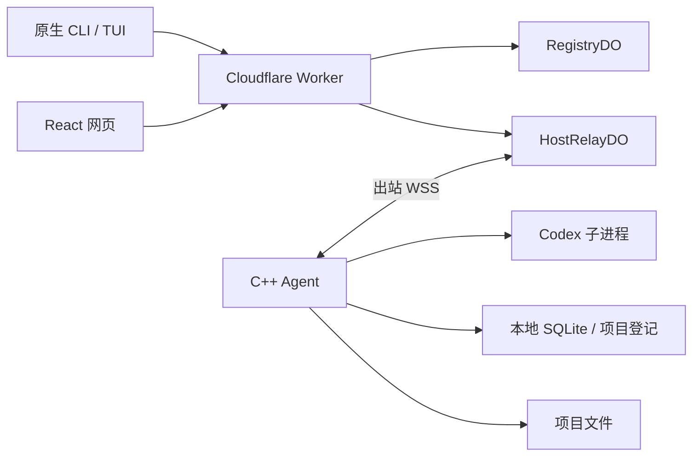

# 技术架构

## 组件与连接

Agent / CLI 使用 C++17、Boost.Asio/Beast、OpenSSL、libsodium、SQLite 和 nlohmann/json；Relay 使用 Worker 与 SQLite-backed Durable Objects；网页使用 React、IndexedDB 和 Web Locks。协议 schema 位于 `packages/protocol`，C++ 接收端独立校验相同约束。

RegistryDO 保存身份、邮箱、授权、主机目录与失效事件；HostRelayDO 仅保存身份绑定、在线连接、权限失效确认和唤醒冷却，不保存业务状态。租约、控制代际、项目单写与 ticket 由 Agent 的 SQLite 管理。当前唯一云端存储为 DO 原生存储，没有 D1 运行依赖、后端选择或跨库归档路径。保留既有 namespace 和 class migration；临时记录使用有界到期索引与一次性 alarm，没有到期工作时不新增周期维护。Agent SQLite 将已支持的版本 0/1 升为版本 2，保留原请求、历史及拒绝屏障；旧二进制拒绝新版本。首次进入新 HostRelayDO 会关闭旧连接，清除旧云端业务记录并保留唤醒冷却。升级与回退边界见用户手册。

## 业务可靠性与控制

Agent 和客户端保存业务身份、命令、结果、信用及历史订阅进度；Worker 只做加密通道的有界转发，不承担业务持久 ACK。网络、HTTP 或 WebSocket 成功不代表副作用已持久完成。加密使用 libsodium 的 X25519 `crypto_kx` 和双向 XChaCha20-Poly1305 secretstream，绑定本次可信身份。具体封装与信任边界见 [不透明中继设计](OPAQUE_RELAY_DESIGN.md)。协议见 [可靠传输](RELIABLE_TRANSPORT.md)。

会话以持久 controlEpoch / controlId / owner 绑定控制权，连接代次单独变化。接管先拒绝旧端新写入，Agent 确认新代际后新端才能发布命令。同一项目只能有一个 Web 写会话，其他会话可读；已开始任务不会因连接关闭或接管回执自动变成停止状态。

控制面 HTTP 每次授权；Worker 在物理通道握手时绑定角色、主机、权限和公开握手材料。会话、控制权与逻辑流握手均在端点加密处理。稳定数据流不逐包查询授权或租约。撤销、邮箱和管理员变化以持久控制事件使旧连接失效，到期通过 alarm 关闭。Agent 继续校验业务格式、控制代际、允许列表、沙箱与审批。详见 [连接授权](WORKER_CONNECTION_AUTHORIZATION.md)。

Agent 的连接失败路径固定每 30 秒重试，包括认证拒绝和不兼容的 Relay 握手，不结束主进程。`run` 的外层恢复循环为初始化和运行故障创建新的执行器与实例：先清理失效资源，再等待 30 秒重新读取配置、校验 Codex 与存储；不沿用故障存储继续工作。SIGINT / SIGTERM 在运行与初始化重试等待阶段都能取消恢复并正常退出；受控更新和配置重启仍优先执行。

## Codex 进程与项目

Agent 以参数数组启动 Codex，Web 任务使用 app-server，CLI 通过受限桥接访问原生 TUI。版本探测只要求 `codex --version` 成功且输出非空，不固定安装版本。Codex 子进程的代理模式为 inherit / direct / agent，版本探测、会话和历史读取统一应用该策略。

每个 dataDir 只允许一个常驻 Agent；项目首次从配置导入，之后以 `dataDir/projects.json` 为登记权威。本机在线修改通过私有控制通道，离线修改取得同一实例锁。项目 ID 不重复使用，路径不原地更换，重复和重叠目录被拒绝；取消注册不删除文件或历史。

系统用户与 dataDir 隔离实例。目录管理使用 Agent 的系统权限，无提权和额外 allowedRoots；普通会话访问与项目管理权限分开。平台 owner 的远程配置通道只管理实际启动配置文件，内容仅以密文中转；目标端原子替换并保存私有备份和请求回执，见 [远程配置](REMOTE_CONFIGURATION.md)。

## 历史与恢复

Agent SQLite 保存会话、事件投影、正文、原请求、交付状态和恢复元数据。Codex 本地会话是可验证条目的原始来源；回源核对 thread / turn / item、修订、长度及摘要，不能用当前内容冒充旧正文。

正文、事件和遗留积压默认一周，容量压力允许提前回收；准入代次和单调屏障阻止清理后的旧请求再次执行。活动任务及输出预留受保护，配额满时对相应入口背压；无法容纳受控任务输出时停止对应 runtime 并明确标记不完整。客户端持久缓存与恢复凭证不能替代备份。配置见 [数据保留](HISTORY_STORAGE.md)。

CW 通过独立历史通道接收事件，IndexedDB 保存页面、草稿和原请求；先保存页面再确认。CC 输出先落盘，交给 TUI 连续消费后推进信用。Agent 重启标记旧运行实例失败，保留真实未知结果；显式恢复 Codex 线程不会恢复旧进程。

## 工作台与 Terminal

网页共享 Markdown 管线，公式按需加载 KaTeX；Mermaid 在无同源、无网络权限的沙箱内渲染。禁止原始 HTML / MDX 和远端图片自动请求。文件读取、上传与下载沿用项目根目录、文件版本和容量校验。

Linux Terminal 默认关闭，使用 bubblewrap、prlimit 和 Bash。项目作为 `/workspace` 挂载，系统运行文件只读，无主机 HOME、其它项目或网络。Shell 与模型任务竞争同一项目执行资格。隔离进程限制地址空间 256 MiB、CPU 300 秒、64 个描述符、单文件 64 MiB，禁用 core dump；进程数还由启动参数中的 prlimit 限制。这些不是整个项目的 cgroup 总量限制。

终端创建/关闭使用可靠请求；`streaming:2` 使用通道内独立逻辑流 传送易失输入、尺寸和输出确认，不纳入持久业务正文日志。输入有序且未知按键不重放，输出由 xterm 渲染完成后确认；慢消费者触发 PTY 背压。断流最多保留 60 秒重连宽限，Agent 重启不恢复。具体限制见 [用户手册](USER_GUIDE.md#交互式-terminallinux)。

## 生命周期与运维

Agent 使用协议 Ping/Pong 检测上行存活；网页按通知、手动刷新和明确恢复同步，无空闲状态轮询。未确认请求使用有限快速恢复和 30–60 秒抖动慢速恢复。

Web 控制连接断开后，无邮箱会话保留 30 分钟、有邮箱会话保留 1 小时；自动批准会话豁免。Agent 约每 30 秒检查，到期关闭 runtime，历史按独立保留策略处理。邮箱归属用于欢迎页筛选，不能替代服务器访问授权。

构建、测试和部署分别见 [开发说明](DEVELOPMENT.md)、[测试说明](TEST_REPORT.md) 和 [发布操作](RELEASE.md)。资源预算以 [资源盘点](TRANSPORT_STATE_INVENTORY.md) 及源码为准，不将逻辑预算当成进程 RSS 或安装目录硬上限。

启动修复入口位于 native `startup_repair.hpp`，由 Agent 初始化失败路径和 Client 本地配置初始化及 attach/connect 会话启动失败路径调用。同步启动独立 Codex exec（参数数组，无 shell），每进程最多一次，继承禁用标记防止诊断验证再次触发修复。修复不是数据库兼容层：配置校验、存储版本校验及启动重试仍由原组件负责，模型退出码仅作为诊断状态，不作为健康证明。诊断子进程以当前用户完整权限运行，权限边界与禁用方式见 USER_GUIDE。

Client 将启动标记保持到认证的 TUI 在传输握手完成后发出 `initialized` 通知，之后该标记不再因断线复位。Codex 版本校验提前到 connect 的会话创建之前，避免本地 Codex 不可用时创建远端任务；启动失败离开 attach 时先清理 TUI 子进程及桥接资源，再进入诊断，管理通道主动重启仍沿原路径处理。
