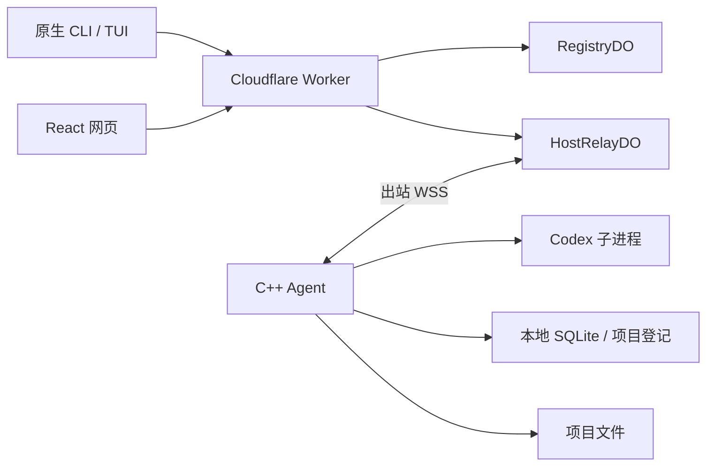

# 技术架构

## 组件与连接

Agent / CLI 使用 C++17、Boost.Asio/Beast、OpenSSL、libsodium、SQLite 和 nlohmann/json；Relay 使用 Worker 与 SQLite-backed Durable Objects；网页使用 React、IndexedDB 和 Web Locks。协议 schema 位于 `packages/protocol`，C++ 接收端独立校验相同约束。

RegistryDO 保存身份、邮箱、授权、主机目录与失效事件；HostRelayDO 仅保存身份绑定、在线连接、权限失效确认和唤醒冷却，不保存业务状态。租约、控制代际、项目单写与 ticket 由 Agent 的 SQLite 管理。云端身份与授权状态保存在 DO 原生存储，没有 D1 运行依赖、后端选择或跨库归档路径。独立 SETTINGS KV 仅保存平台邮箱自助授权开关，不保存设备凭据或业务状态。保留既有 namespace 和 class migration；临时记录使用有界到期索引与一次性 alarm，没有到期工作时不新增周期维护。到期调度比较现有 alarm，仅在目标时间变化时写入或取消，避免连接关闭和 DO 重建反复写同一 alarm。Agent SQLite 将已支持的版本 0/1 升为版本 2，保留原请求、历史及拒绝屏障；旧二进制拒绝新版本。首次进入新 HostRelayDO 会关闭旧连接，以可续跑事务分页备份旧记录、退休旧控制状态并保留唤醒冷却；未决权限操作会阻止迁移。备份暂存于原对象的隔离键，须在发布窗口导出、核对后处理，不能作为新业务日志。升级与回退边界见用户手册。

## 业务可靠性与控制

Agent 和客户端保存业务身份、命令、结果、信用及历史订阅进度；Worker 只做加密通道的有界转发，不承担业务持久 ACK。网络、HTTP 或 WebSocket 成功不代表副作用已持久完成。加密使用 libsodium 的 X25519 `crypto_kx` 和双向 XChaCha20-Poly1305 secretstream，绑定本次可信身份。具体封装与信任边界见 [不透明中继设计](OPAQUE_RELAY_DESIGN.md)。协议见 [可靠传输](RELIABLE_TRANSPORT.md)。

会话以持久 controlEpoch / controlId / owner 绑定控制权，连接代次单独变化。接管先拒绝旧端新写入，Agent 确认新代际后新端才能发布命令。控制权按 session 隔离，同一项目的多个 session 可同时连接及执行轮次；同一 session 仍要求显式接管，项目 Terminal 仍与模型任务互斥；已开始任务不会因连接关闭或接管回执自动变成停止状态。

普通 attach 的冲突判定由 EndpointService 提供当前可派发的控制连接状态；持久 connectionGeneration 仅用于隔离旧连接，不表示连接仍在线。不同 claim 在旧连接已断开且无未消费的有效票据时可建立新控制代际。同 claim / 已验证 stream 恢复保持原代际；在线连接或未消费票据仍要求显式 takeover。

控制面 HTTP 每次授权；Worker 在物理通道握手时绑定角色、主机、权限和公开握手材料。会话、控制权与逻辑流握手均在端点加密处理。稳定数据流不逐包查询授权或租约。撤销、邮箱和管理员变化以持久控制事件使旧连接失效，到期通过 alarm 关闭。Agent 继续校验业务格式、控制代际、允许列表、沙箱与审批。详见 [连接授权](WORKER_CONNECTION_AUTHORIZATION.md)。

Worker 的 DO 转发和 Host 的通道升级在错误边界内等待异步结果；失败转换为既有结构化错误，保留认证、权限及背压状态码。Host 接受新 socket 后若调度、欢迎消息或升级响应失败，会退休该连接；清理异常不覆盖原升级失败。消息处理失败时尽力发送 `channel-error`，通知再次失败也执行连接退休。服务故障记录 `relay_failure`、阶段及协议错误码，不记录原始异常文本、凭据或消息正文；阶段包括 `worker-fetch`、`host-fetch`、`host-message`、`host-channel-error` 和 `host-upgrade-cleanup`。未恢复的存储／运行时错误仍可能由平台报告，不能通过这些处理保证消除全部线上异常。

Agent 的连接失败路径固定每 30 秒重试，包括认证拒绝和不兼容的 Relay 握手，不结束主进程。`run` 的外层恢复循环为初始化和运行故障创建新的执行器与实例：先清理失效资源，再等待 30 秒重新读取配置、校验 Codex 与存储；不沿用故障存储继续工作。SIGINT / SIGTERM 在运行与初始化重试等待阶段都能取消恢复并正常退出；受控更新和配置重启仍优先执行。

历史订阅到期或被容量清理属于单路订阅失效：Agent 按 stream / instance / exchangeId 发送一次异步过期通知，停止该路通知重试；通知不依赖端点仅为直接响应保留的 requestId。网页及 CLI 按订阅身份重建，不关闭 Codex 或其他会话。实际存储故障仍进入全局停止与恢复路径。

## Codex 进程与项目

Agent 以参数数组启动 Codex，Web 任务使用 app-server，CLI 通过受限桥接访问原生 TUI。版本探测只要求 `codex --version` 成功且输出非空，不固定安装版本。Codex 子进程的代理模式为 inherit / direct / agent，版本探测、会话和历史读取统一应用该策略。

每个 dataDir 只允许一个常驻 Agent；项目首次从配置导入，之后以 `dataDir/projects.json` 为登记权威。本机在线修改通过私有控制通道，离线修改取得同一实例锁。项目 ID 不重复使用，路径不原地更换，重复和重叠目录被拒绝；取消注册不删除文件或历史。

系统用户与 dataDir 隔离实例。目录管理使用 Agent 的系统权限，无提权和额外 allowedRoots；普通会话访问与项目管理权限分开。平台 owner 的远程配置通道只管理实际启动配置文件，内容仅以密文中转；目标端原子替换并保存私有备份和请求回执，见 [远程配置](REMOTE_CONFIGURATION.md)。

## 历史与恢复

Agent SQLite 保存会话、事件投影、正文、原请求、交付状态和恢复元数据。Codex 本地会话是可验证条目的原始来源；回源核对 thread / turn / item、修订、长度及摘要，不能用当前内容冒充旧正文。

正文、事件和遗留积压默认一周，容量压力允许提前回收；准入代次和单调屏障阻止清理后的旧请求再次执行。活动任务及输出预留受保护，配额满时对相应入口背压；无法容纳受控任务输出时停止对应 runtime 并明确标记不完整。客户端持久缓存与恢复凭证不能替代备份。配置见 [数据保留](HISTORY_STORAGE.md)。

CW 通过独立历史通道接收事件，IndexedDB 保存页面、草稿和原请求；先保存页面再确认。CC 输出先落盘，交给 TUI 连续消费后推进信用。Agent 重启标记旧运行实例失败，保留真实未知结果；显式恢复 Codex 线程不会恢复旧进程。

## 工作台与 Terminal

`tool-model.ts` 统一工具标签、状态、历史包装识别及复制正文；`tool-presentation.tsx` 按命令、文件、MCP／动态工具、搜索、代理和其他活动分型渲染。`streaming-json.ts` 只解码已到达的 JSON 前缀，未完成的 key／转义／Unicode 代理对等待后续分块；限制嵌套深度并使用无原型对象，不执行输入。前端保留未知工具；`events.ts` 合并内联 MCP 进度、计划、推理增量，引用正文与独立输出段保持隔离。原始缓存和内容偏移保持原值，不修改协议、RPC allowlist 或审批。外部媒体不会自动请求。

`streaming-diff.ts` 从历史的完整或部分序列化事件中提取顶层 `diff` / `data.diff` 字符串，支持跨分块 JSON 转义及 Unicode，保留原始缓存文本和 SQLite 字符偏移，不改变历史协议。`EventView` 在差异与外层工具分组均展开时按 revision / offset 自动续读，折叠后暂停；新 revision 首块前保留上次内容，首块起替换，禁止跨 revision 追加。所有非聊天工具详情采用同样的展开后续读、折叠暂停与 revision 替换规则。

`session-tab-labels.ts` 根据所有已打开标签计算显示名：标题以小写判重，冲突时增加项目工作目录，同目录冲突再增加项目名。工作目录保留文件系统大小写；目录和项目来自各标签的已认证项目目录，元数据更新或关闭标签时重新计算。显示标签、悬停提示、读屏和关闭按钮采用相同的区分信息。

独立文件预览的视口高度、工具栏和正文滚动布局统一定义在 `style.css`，避免工作台样式与通用样式的加载顺序覆盖 flex 布局、使 `overflow: hidden` 裁剪长文。正文是可聚焦的独立滚动容器。

`session-tabs.tsx` 管理页面内的会话标签与双面板布局；每个标签挂载独立的 `App` 会话控制器，隐藏标签保持挂载，避免切换导致断开控制连接或丢失草稿、审批、终端和滚动状态。焦点标签提供唯一的导航侧栏，并保存最后浏览位置、更新页面标题。会话打开按主机与 session ID 去重；关闭标签只卸载控制器，沿用断开连接语义，不发送停止任务命令。布局不新增远程协议或权限，服务端继续执行 session 控制权与项目 Terminal 互斥。

网页共享 Markdown 管线，公式按需加载 KaTeX；Mermaid 在无同源、无网络权限的沙箱内渲染。禁止原始 HTML / MDX 和远端图片自动请求。文件读取、上传与下载沿用项目根目录、文件版本和容量校验。

Linux Terminal 默认关闭，使用 bubblewrap、prlimit 和 Bash。项目作为 `/workspace` 挂载，系统运行文件只读，无主机 HOME、其它项目或网络。Shell 与模型任务竞争同一项目执行资格。隔离进程限制地址空间 256 MiB、CPU 300 秒、64 个描述符、单文件 64 MiB，禁用 core dump；进程数还由启动参数中的 prlimit 限制。这些不是整个项目的 cgroup 总量限制。

终端创建/关闭使用可靠请求；`streaming:2` 使用通道内独立逻辑流 传送易失输入、尺寸和输出确认，不纳入持久业务正文日志。输入有序且未知按键不重放，输出由 xterm 渲染完成后确认；慢消费者触发 PTY 背压。断流最多保留 60 秒重连宽限，Agent 重启不恢复。具体限制见 [用户手册](USER_GUIDE.md#交互式-terminallinux)。

欢迎页按 ready / starting / closing 分别读取授权主机的全部活动会话分页，邮箱入口附加 mine 归属过滤；主机和项目选择前即可按卡片续接。左栏将历史首页与完整活动目录合并，保留历史游标，按运行中、其他活动、历史排序。合并以会话 ID 去重，较新的状态和删除屏障优先，避免迟到的活动页覆盖结束或删除。当前所选会话的运行标记跟随在线快照和任务事件，状态同时使用文字及适配明暗主题的颜色。

## 生命周期与运维

Agent 使用协议 Ping/Pong 检测上行存活；网页按通知、手动刷新和明确恢复同步，无空闲状态轮询。未确认请求使用有限快速恢复和 30–60 秒抖动慢速恢复。

Web 控制连接断开后，无邮箱会话保留 30 分钟、有邮箱会话保留 1 小时；自动批准会话豁免。Agent 约每 30 秒检查，到期关闭 runtime，历史按独立保留策略处理。邮箱归属用于欢迎页筛选，不能替代服务器访问授权。

构建、测试和部署分别见 [开发说明](DEVELOPMENT.md)、[测试说明](TEST_REPORT.md) 和 [发布操作](RELEASE.md)。资源预算以 [资源盘点](TRANSPORT_STATE_INVENTORY.md) 及源码为准，不将逻辑预算当成进程 RSS 或安装目录硬上限。

启动修复入口位于 native `startup_repair.hpp`，由 Agent 初始化失败路径和 Client 本地配置初始化及 attach/connect 会话启动失败路径调用。同步启动独立 Codex exec（参数数组，无 shell），每进程最多一次，继承禁用标记防止诊断验证再次触发修复。修复不是数据库兼容层：配置校验、存储版本校验及启动重试仍由原组件负责，模型退出码仅作为诊断状态，不作为健康证明。诊断子进程以当前用户完整权限运行，权限边界与禁用方式见 USER_GUIDE。

Client 将启动标记保持到认证的 TUI 在传输握手完成后发出 `initialized` 通知，之后该标记不再因断线复位。Codex 版本校验提前到 connect 的会话创建之前，避免本地 Codex 不可用时创建远端任务；启动失败离开 attach 时先清理 TUI 子进程及桥接资源，再进入诊断，管理通道主动重启仍沿原路径处理。

## CW 普通会话排队与调度

普通网页会话使用 `enqueue`、`queueCancel`、`queueRun` 命令。入队走 normal delivery lane，取消与立即执行走 priority lane，沿用服务端控制证明与可靠请求去重。Agent 将有界 `promptQueue` 保存在 sessions JSON，队列修改、`promptQueueChanged` 历史事件及请求最终回执在同一 SQLite 事务提交。快照包含当前队列，浏览器也从队列事件更新状态；历史补读不触发执行。

队列使用独立历史预算 reservation，最多 16 条 / 96 KiB 编码内容，不依赖浏览器存活。调度只在会话 ready、当前轮空闲且命令处理空闲时启动队首；开始前持久化 starting，再通过既有 history_turn_admit 保存原任务身份和用户消息后调用 turn/start。成功移除队列条目，明确失败保留 failed，未知结果保留 unknown 并阻塞后续条目。

立即执行验证点击时的原 activeTask 身份，将指定条目提升至队首并保存 stopping，提交 turn/interrupt 后等待匹配的 turn/completed；中断 ACK 不释放执行条件。陈旧任务身份不能中断新轮次。已有队列在控制权转移后继续属于原会话，新控制端可管理它。运行时关闭及 Agent 重启沿用现有会话失败语义，不重建 Codex runtime、不搬运旧队列、不重放未知任务；原队列保留供用户核对。

原生 HTTP 与 WebSocket 在目标 DNS 解析前选择代理路由：除 localhost 和本机 / 内网 IP 字面量外，配置代理时只解析代理地址，将原目标域名交给 HTTP CONNECT / SOCKS5。TLS SNI、证书主机名校验及应用 Host 保留原目标，代理失败不回退直连；内网域名也由代理解析。

## Codex 会话归档与删除

加密端点 `POST /hosts/:host/thread-management` 接受 `projectId`、`threadId`、`operation=archive|unarchive|delete`，删除另需 `confirm=true`；角色由端点身份注入，沿原操作协议保存与确认结果。`GET /hosts/:host/threads?projectId=...&archived=true` 查询归档。云端仅转发密文。Agent 用独立 reader 遍历普通/归档目录及所有来源，按 `parentThreadId` 或 `source.subAgent.thread_spawn.parent_thread_id` 追踪派生子树，不使用 `forkedFromId` 级联。调用 Codex `thread/archive`、`thread/unarchive`、`thread/delete` 前检查项目 cwd、临时/运行状态、CoC runtime/角色、排队任务及未决命令预留；全局串行管理并阻止新建/历史导入竞争。

SQLite 新增有界 `transport2_thread_jobs` 与 `transport2_thread_state`。扫描最多 64 页 / 4096 线程，单计划最多 128 线程 / 64 KiB，管理身份最多 4096；超限拒绝而非截断处理。原 RPC 前落盘计划，成功后重新扫描验证，CoC 状态、历史清理、终态原结果在同一事务提交。归档根成功但子会话部分失败时只标记实际已归档项并返回 `partial`。未知结果保留原计划；重启后重复原请求只读核对，不重新调用变更 RPC。计划与对应原操作不被常规保留期清理，仍受操作总预算限制；无法证明的请求会占用容量并阻止该线程再次操作，需要保全状态排查，不能删除计划来绕过。目录扫描无法给独立 Codex 客户端提供事务锁，外部并发变化是明确边界。

删除保留最小会话 tombstone 供目录同步及旧请求拒绝，移除 Agent 中的事件、历史、正文、来源映射、订阅及已确认命令/结果正文，保留闭合流身份。浏览器按身份/主机/会话事务清理缓存；`deleted` 标记参与缓存预算并阻止其他标签页的迟到写入。未确认原请求仍保留恢复证据；归档不清理历史缓存。其他离线客户端和备份不由远程操作擦除。

## 邮箱自助授权

管理员鉴权后的 `/api/v1/admin/email-self-service` 通过 Registry 读写 `SETTINGS` KV 的 `email-self-service` 设置，缺省拒绝自助注册；设置修改与自助处理在 Registry 串行执行。成功写入后当前 Registry 立即使用新值，重建时从 KV 恢复；KV 复制遵循最终一致性，实例迁移后的读值可能短暂滞后。不要通过直接编辑 KV 代替管理页面操作。

原生申请继续使用原有短期 device 记录及秘密领取；浏览器 `/api/v1/auth/device/:id/authorize` 仅接收 Worker 验证的 Access 身份，确认终端配对码后事务建立 Agent 或限定主机的 CLI 凭据。自助 CLI 要求目标 Agent 的管理邮箱匹配，不能修改申请目标；管理 CLI 仍走独立身份验证。平台管理员批准与用户自助批准共用发凭据逻辑，Agent 主机记录保存 `approvedAdminEmail`，作为管理邮箱首选值，本机配置不能覆盖。CW 沿用已有邮箱关联与按浏览器恢复流程。审批结果通过原 device 通知唤醒申请者，不增加轮询。

SETTINGS 采用 Wrangler 按 Worker 自动创建的 KV 绑定；r2 部署拒绝带固定生产 KV ID 的配置，确保测试与生产开关独立。欢迎页根据当前邮箱的有效主机管理邮箱判断是否显示配置引导，共享授权及主机在线状态不作为已拥有 Agent 的依据。
