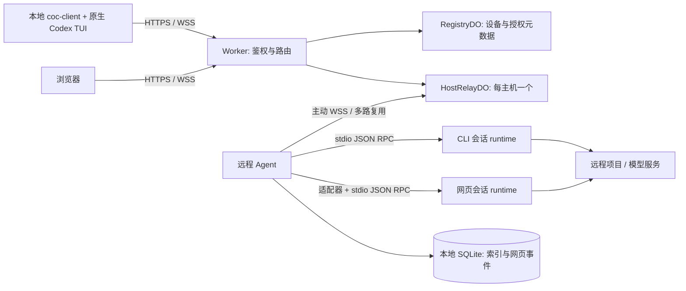

# 技术架构与选型

> 实现进展：本文件保留初始目标基线；当前开发版本的实际能力与测试结果见 [README](../README.md) 和 [测试记录](TEST_REPORT.md)。

> 状态：0.5.5 增加指定目标的 Agent 审批及运行提示，保留完整本地历史；目标与实际状态对照见文末。日期：2026-10-25。
> 对应 [项目需求](REQUIREMENTS.md)，保留 [原始构想](IDEARS.md) 作为背景记录。

## 1. 架构结论

采用 **Cloudflare Worker + 每主机一个 Durable Object + 出站 WebSocket Agent**。CLI 优先复用原生 Codex TUI 的远程连接能力；网页通过 Agent 的 Codex app-server 适配器提供结构化交互。

首版为个人自托管系统。服务器执行所有 Codex 工作；云端负责鉴权、设备登记、连接路由及少量控制元数据，不托管模型会话进程或持久化对话正文。

## 2. 已核实能力与验证边界

### 2.1 本机 Codex

通过以下命令检查本机 `codex-cli 0.164.0`，未读取用户认证文件：

```bash
codex --version
codex --help
codex app-server --help
codex app-server generate-json-schema --out /tmp/coc-codex-schema
```

观察结果：

- CLI 提供 `--remote <ADDR>` 和 `--remote-auth-token-env <ENV_VAR>`，可连接远程 app-server WebSocket。
- `codex app-server` 支持 stdio、Unix socket 和 WebSocket；帮助文本将其标记为 experimental。
- 导出的协议包含 `initialize`、`thread/start`、`thread/resume`、`thread/read`、`turn/start`、`turn/interrupt`，以及流式事件和服务端发起的审批请求。
- 协议同时含有文件、命令、配置和账号操作，不能直接把全部 RPC 无条件暴露给网页。

当前已用原生 TUI 经本机 Worker、Durable Object 和 C++ Agent 完成初始化及一轮模型对话；这只覆盖已测方法，不表示全部 TUI 功能兼容。CLI 再附着仍未实现；CW 支持通过同一 Codex home 恢复已持久化线程（不会恢复旧进程），具体证据见测试记录。

### 2.2 Cloudflare

Durable Objects 支持 WebSocket Hibernation：空闲时可保留连接、重新初始化对象；内存变量不能作为唯一状态来源。本方案由 Agent 和客户端主动连接 DO，使 DO 在两条链路上都充当 WebSocket 服务端。[官方 WebSocket 文档](https://developers.cloudflare.com/durable-objects/best-practices/websockets/)

前端构建产物通过 Workers Static Assets 与 API 同域部署。[官方静态资源文档](https://developers.cloudflare.com/workers/static-assets/)

平台额度随计划和时间变化，部署时检查官方限制；本文的消息大小与容量是项目自身的保守限制，不是平台上限。[官方限制文档](https://developers.cloudflare.com/durable-objects/platform/limits/)

## 3. 组件与连接拓扑



| 组件        | 职责                                                 | 不承担的职责           |
| ----------- | ---------------------------------------------------- | ---------------------- |
| Worker      | 静态页面、REST、鉴权入口、WS 升级与 DO 路由          | Codex 执行和输出存档   |
| RegistryDO  | 所有者凭据摘要、设备登记、授权版本和撤销记录         | 高频流量中转           |
| HostRelayDO | Agent 连接、会话通道、连接票据消费、控制租约、帧转发 | 模型调用和完整事件回放 |
| Agent       | 项目白名单、进程管理、协议适配、幂等、审批、事件日志 | 公网监听               |
| coc-client  | 登录、选择主机/项目、创建会话、启动及管理 TUI        | 自行执行远程项目命令   |
| Web UI      | 对话、工具状态、差异、审批和重连                     | 任意原始 RPC 控制台    |

连接由 Worker 转交到对应 DO；DO 不能回连内网。Agent 的单条上行连接承载多个隔离通道，每个通道映射到独立 runtime。

### 3.1 设备授权模型

R 为 Cloudflare 中转，A 为 `coc-agent`，CC 为 `coc-client`，CW 为网页客户端。只分发两个本地程序，原 `coc` 退出支持。A 的配置和登录由自身完成，客户端不再承担 Agent 登记或撤销管理。

A / CC / CW 共用 deviceStart → approve/reject → devicePoll 协议。申请有 5 分钟期限及独立高熵轮询秘密；配对码和公开请求 ID 仅用于核对。原生程序在终端显示授权地址，不自动启动 GUI。CW 的轮询秘密存入 HttpOnly 临时 Cookie；批准后原子消费请求，向发起方单次交付角色专用凭证。CC / CW 接受 name 和选填 message（trim 后最多 1000 字符），留言仅在临时申请中保存，以纯文本显示，不写入长期凭证。A 仍由管理员批准并创建主机。未领取请求到期清理。R 仅保存持久凭证的摘要；交付前的短期请求暂存待领取令牌，交付后删除。

0.5.5 的指定目标审批增加 `requestedHostId`：仅 cli / web 可提交，deviceStart 校验为有效、未停用的 version 2 主机并原样返回。旧 `hostId` 输入继续忽略，未指定的新旧申请均由管理员选择目标。新 CC 的 `login --host` 与 CW 的选填目标输入发送新字段，并核对申请响应及领取结果，不支持的旧 Relay 不会静默降级。指定目标只允许对应 Agent 或管理员批准，任何审批方均不能改绑；未指定时 deviceApprove 仍强制接收管理员的 hostId。原有凭证、Auth version 2 与 API Key 登录兼容。

Agent 使用 Bearer 访问 `/api/v1/agent/requests` 及单请求 approve/reject。Worker 校验角色，并将服务端解析出的凭证摘要传入 RegistryDO，不信任请求体中的身份或主机。Registry 在同一个事务中重新验证 Agent 凭证、关联 API Key 和主机仍有效，且请求必须为明确指定该主机的 cli / web。列表只返回本机未过期 pending 请求的核对字段，不返回全局授权、令牌或轮询秘密；扫描受现有 200 条临时请求配额约束。审批与原管理员路径共用事务签发逻辑，竞争只成功一次，领取仍须原轮询秘密。Agent 不具有全局管理、撤销或新 Agent 授权能力。

原生 `requests / approve / reject` 直接读取 Agent 配置，使用既有 HTTPS 客户端，不启动 Codex runtime、不打开 Store 或占用 dataDir 锁，服务运行或停止时均可明确操作。

`Agent::start` 在连接调度前发起一次客户端申请检查，之后由 30 秒维护周期触发。单线程 `approval_pool_` 执行最多一个在途 HTTP GET，超时 5 秒；结果回到业务执行器处理，不占用文件传输池或阻塞 relay 心跳。查询结果再次核对目标和客户端角色，只向 stderr 输出新请求的白名单字段与人工审批命令；名称和留言使用 JSON 转义，配置路径使用 POSIX shell 单引号转义。按当前 pending ID 集合去重，空间随有效待处理申请有界；进程重启后重新提示。失败保留去重状态、连续失败仅提示一次，恢复后继续发现新申请。退出时等待有界请求结束且丢弃结果，不在停止后发出审批提示。


Auth version 2 使用 agent / cli / web 三种独立角色，hostId 固定绑定，设备凭证 expires 使用安全整数最大值表示无固定到期。管理身份 owner 独立，仍为 8 小时。旧认证记录拒绝使用，不自动提升为新授权。CC / CW 的 HTTP、会话票据、WebSocket 都按角色和目标 A 校验，不能调用管理接口。CC 仅控制 cli 模式，CW 仅控制 web 模式。管理员身份不能直接操作会话。

CC 按 R / A 保存多份私有文件凭证；CW 按 A 保存独立 HttpOnly / SameSite=Strict Cookie，HTTPS 加 Secure，使用时续写浏览器有效期。请求路径决定选择哪个 A 的 Cookie，多标签页不依赖全局选中身份。页面脚本不读令牌。

撤销单个客户端凭证后，Registry 删除其摘要并通知对应 HostRelayDO 关闭匹配连接。撤销 A 禁用主机、删除其所有客户端授权并关闭相关连接。帧处理和转发前重新校验，DO alarm 另作兜底；本地 logout 只删除本地凭证，不停止任务或删除 R 授权。永久凭证不依赖轮询 alarm 保活。

API Key 与设备配对并行。管理员通过 `/api/v1/admin/api-keys` 创建和列举，`/api/v1/admin/api-keys/revoke` 撤销。创建时强制 agent / cli 角色，cli 必须选择有效 hostId；不提供修改或改绑接口。agent Key 首次 POST `/api/v1/auth/api-key` 时在 RegistryDO 事务中创建主机并写入不可变绑定，并发使用返回同一主机。cli Key 创建即绑定目标 A，可直接作为 Bearer 使用；登录接口只校验角色与目标、返回元数据，不签发新令牌。

完整 Key 由高熵随机值生成，仅创建响应返回一次；Registry 只存摘要及元数据，Auth 的 hash 等于 Key 摘要，并关联 apiKeyId。请求和 WebSocket 都通过原有角色 / hostId 校验，Key 不能充当 owner。撤销删除 Key 和对应 Auth，A 撤销还删除该主机所有配对凭证与客户端 Key；HostRelayDO 立即关闭匹配连接。程序实例不参与绑定，持有者共用 Key 身份。API Key 登录独立使用每 IP 每分钟 10 次限流，不消耗配对 / 管理登录的共享限流桶。

本地共用 login.hpp / login.cpp 的命令选项、登录协议、路径与状态接口；网络、TLS、进程和 SQLite 继续由 coc_core 共用。

## 4. 技术栈选择

本机程序采用 **C++17 + CMake**，生成独立的 `coc-agent` 和 `coc-client`；运行时不依赖 Node.js。Codex 仍为独立程序，不嵌入或重写其模型执行能力。Cloudflare 中转和网页保留 TypeScript，通过 JSON 消息与 C++ 互通。

| 层次            | 选择                                                      | 理由与代价                                                                                                         |
| --------------- | --------------------------------------------------------- | ------------------------------------------------------------------------------------------------------------------ |
| 本机语言 / 构建 | C++17、CMake ≥ 3.16                                       | 可直接使用 Linux 进程、信号和文件权限；增加编译与跨平台适配成本。                                                  |
| 网络            | Boost.Asio / Beast ≥ 1.71、OpenSSL                        | 同时支持 HTTPS、WSS 和异步队列；TLS 校验证书、主机名/IP 并设置 SNI；使用 OpenSSL 验证参数，不使用旧 RFC2818 回调。 |
| 子进程          | POSIX fork/exec、管道、waitpid、进程组                    | 参数数组执行，无 shell 拼接；异步 stdin/stdout，退出时 TERM，3 秒后 KILL。                                         |
| 本地存储        | SQLite3 C API                                             | 沿用 sessions/events/requests、WAL 及请求去重记录，兼容现有数据库。                                                |
| JSON / 校验     | nlohmann/json ≥ 3.7、显式字段和策略校验                   | 与云端 Zod 独立实现相同协议，避免本机运行时依赖 JavaScript。                                                       |
| 中继            | Workers TypeScript、RegistryDO、HostRelayDO               | 保留设备认证、路由、票据和控制租约。                                                                               |
| 网页            | React、Vite、CSS                                          | 保留结构化对话和审批交互。                                                                                         |
| 测试 / 格式     | CTest、clang-format；Vitest、Playwright、ESLint、Prettier | C++ 测策略、SQLite 和进程协议；跨语言端到端启动真实 C++ 可执行文件。                                               |

TLS 身份校验使用 [OpenSSL SSL_set1_host](https://docs.openssl.org/1.1.1/man3/SSL_set1_host/) 和 IP 验证参数，SAN 不匹配时拒绝连接；本地 CA 测试覆盖信任链和主机名错误。

C++ Agent 使用一个 Asio 事件循环串行管理会话、SQLite 和网络；每个连接分别串行化发送，每个子进程独立维护 RPC 超时。WebSocket 限制单帧 256 KiB、待发队列 8 MiB，超限断开；本地 Codex 单条 RPC 约 8 MiB 缓冲限制与网络单帧分开；网页大内容发送引用，超大 CLI RPC 转为历史分块读取提示，不断开整台 Agent。网页命令按会话排队，CLI 消息按白名单转发，不在网络回调里等待 Codex 响应。Beast 的并发约束见 [官方说明](https://www.boost.org/doc/libs/latest/libs/beast/doc/html/beast/using_websocket/notes.html)。

本机当前验证平台为 Linux x86_64。二进制依赖系统 Boost.System、OpenSSL、SQLite、libstdc++ 等动态库，不宣称静态单文件分发；必须在目标兼容发行版构建。macOS / Windows 尚待进程与平台层适配。只有构建中转、网页和测试工具时需要 Node.js ≥ 22.17。

不引入 D1、KV、R2、Redis 和消息队列：首版设备目录规模小，正文留在远程主机。后续跨主机查询或附件服务出现实际需求时再增加存储。

### 4.1 关键替代方案

| 决策     | 采用方案                       | 替代方案与取舍                                                                                   |
| -------- | ------------------------------ | ------------------------------------------------------------------------------------------------ |
| CLI 交互 | 原生 TUI + app-server 远程协议 | PTY 转发接近完整终端，但有终端转义、resize、重连和平台适配成本；仅在 M0 失败后单独评估。         |
| 网页集成 | app-server 结构化协议          | `codex exec --json` 更适合批处理，不能直接替代完整多轮审批生命周期。                             |
| 中继拓扑 | 每主机一个 HostRelayDO         | 每会话一个 DO 隔离更细，但需额外调度与 Agent 多连接；首版单主机 4 会话无此必要。                 |
| 网络接入 | 自建应用级 WSS 中继            | SSH/VPN/Cloudflare Tunnel 可做个人远控，但不直接提供会话管理及统一网页产品。                     |
| 本机实现 | C++17                          | 按本次架构要求替换 TypeScript Agent/CLI；保持云端 API 和配置，承担两种语言的协议一致性测试成本。 |

## 5. Codex 集成与会话模型

### 5.1 双模式，共用进程管理

每个会话启动独立的 `codex app-server --listen stdio://` 子进程，以白名单项目的真实路径作为 cwd；使用参数数组，禁止拼接 shell 命令。共享同一系统用户的 Codex 配置和登录，避免按会话复制认证信息。

- **CLI 通道**：本地原生 TUI 连接中继 WSS；Agent bridge 将 app-server JSON 消息转换为 stdio 帧并反向转发。握手由 TUI 发起，适配器不得抢先初始化。必须处理请求、通知和服务端请求三个方向。
- **网页通道**：Agent 作为 app-server 客户端完成初始化，维护 thread/turn 关联，将网页操作映射成经过校验的 RPC，将事件转换为稳定 DTO。

CLI 原始 JSON-RPC ID 不跨通道复用；所有回应必须回到原通道。CLI 首版不持久化原始 RPC 以伪造重放；网页则持久化转换后的事件。两种模式共享会话管理规则，但恢复机制不同。

### 5.2 协议能力与权限

协议适配器按 Codex 版本生成明确允许的方法和字段，未声明方法拒绝并返回兼容错误。网页仅暴露创建/恢复线程、读取历史、启动/中断轮次和审批等必要操作；不开放账号管理、配置写入、通用文件 API、任意 `command/exec`。

CLI 需要的额外方法通过 M0 实测补充，不能简单放开 `*`。对 cwd、可写目录、沙箱及审批策略等参数在 Agent 二次验证。需要本机文件附件、账号登录或修改服务端全局配置的 TUI 动作明确标记不支持。

服务端策略设定可允许的最大权限；不通过隐藏参数禁用审批或沙箱。CLI 是受信任所有者的远程开发工具；共享 Codex home 和系统用户不构成项目间强安全隔离。

### 5.3 会话与项目并发

本地 `sessionId` 与 Codex `threadId` 分别存储，不假定一一永久相等。首版每个项目默认只允许一个会话执行活跃轮次，其他会话可读取或等待；不同项目可并行。后续通过 Git worktree 提供同项目并行写入。

Agent 重启后将旧 runtime 标记为中断，检查线程历史后允许用户显式恢复。Codex 历史可恢复不代表外部命令具备事务回滚能力。不能自动重启并再次发送最后一条 prompt。

## 6. 连接协议与 API 草案

### 6.1 HTTP 控制接口

统一使用 `/api/v1`；所有带 ID 的接口都验证所有者关联。会改变状态的 POST 接受 `Idempotency-Key`。

| 方法与路径                                                                              | 用途                                       |
| --------------------------------------------------------------------------------------- | ------------------------------------------ |
| `POST /auth/login`、`POST /auth/logout`                                                 | 管理身份登录 / 清除本地管理 Cookie         |
| `GET /auth/me`                                                                          | 查询独立管理身份                           |
| `POST /auth/forget`                                                                     | 清除指定 A 的本地 CW Cookie，不撤销 R 授权 |
| `GET /agent/requests` | Agent 查看明确指定自己的待处理客户端申请 |
| `POST /agent/requests/:id/approve`、`POST /agent/requests/:id/reject` | Agent 明确批准 / 拒绝本机申请 |
| `GET /hosts`、`GET /hosts/:id/projects`                                                 | 获取设备及经 Agent 同步的项目描述          |
| `POST /auth/device/start`、`POST /auth/device/poll`                                     | 统一申请 / 领取角色和 A 专用授权           |
| `GET /admin/devices`、`POST /admin/approve`、`POST /admin/reject`、`POST /admin/revoke` | 查看、批准、拒绝、撤销设备授权             |
| `GET /sessions?hostId=...`、`POST /sessions`                                            | 查询会话、请求创建会话                     |
| `POST /sessions/:id/attach`                                                             | 申请控制权与短期连接票据                   |
| `POST /sessions/:id/takeover`                                                           | 显式接管并增加控制权版本                   |
| `POST /sessions/:id/stop`                                                               | 中断并结束会话                             |
| `GET /healthz`                                                                          | 中继存活检查，不泄露主机和用户信息         |

主机离线时不排队等待执行创建/停止等命令；返回 `HOST_OFFLINE`，用户恢复连接后重试。设备列表可返回最后已知状态，但必须标记过期。会话列表以 Agent 为准，离线时标记不可确认。

### 6.2 WebSocket 数据接口

- `/ws/v1/agent`：设备凭据使用 Authorization header，建立 HostRelayDO 上行连接。
- `/ws/v1/cli/:sessionId`：使用 `--remote-auth-token-env` 携带短期票据；中继终止认证后才建立 CLI 通道。客户端一侧仍是 Codex 原生协议，不添加项目外层字段。
- `/ws/v1/web/:sessionId`：先验证同源网页 cookie，再消费首帧的一次性 attach 票据；认证完成前不能路由任何业务消息。

浏览器握手无法随意设置 Authorization header，因此不把长期令牌放到 URL。所有票据禁止进入访问日志，默认 60 秒有效且只能消费一次；重连重新申请。

Agent 链路使用项目自定义信封，例如：

```json
{
  "v": 1,
  "type": "rpc",
  "channelId": "ch_123",
  "sessionId": "ses_123",
  "connectionEpoch": 3,
  "requestId": "req_123",
  "payload": { "method": "turn/interrupt", "params": {} }
}
```

示例 payload 只展示结构；实际 Codex 请求必须按生成 schema 填写完整参数。信封类型包括 `hello`、`open`、`rpc`、`event`、`ack`、`close`、`ping/pong` 和分片。网页事件另带 `seq`；请求带 `clientRequestId`；审批带 `approvalId`。大内容通过只读历史通道的引用按需读取，不一次重组全部内容；单帧和队列仍限制内存占用。

错误统一含 `code`、`message`、`retryable`、`requestId`；业务错误至少区分 `UNAUTHORIZED`、`HOST_OFFLINE`、`SESSION_BUSY`、`STALE_CONTROLLER`、`PROTOCOL_MISMATCH`、`REPLAY_GAP` 和 `RESULT_UNKNOWN`。日志和 UI 不暴露原始秘密值。

## 7. 可靠性与控制权

### 7.1 断线与重复提交

- Agent 以 1 秒起步、最大 30 秒、带随机抖动的指数退避重连；成功稳定连接后重置计数。
- Agent 心跳初始间隔 30 秒；连续 3 次无响应即重建连接。离线状态基于最后活动时间计算，不能依赖关闭事件必达。
- HostRelayDO 持久化递增 `connectionEpoch`，只接受当前 Agent 连接；旧连接及旧控制端帧直接拒绝，Agent 同样检查版本。
- 状态变更写入本地事务记录后才回复 accepted；请求身份与确定结果长期保留。已转交 Codex 但未确认结果的请求记为 unknown，不自动重试。
- 保证应用层去重，不声称网络与 Codex 子进程之间具备 exactly-once。崩溃窗口通过查询线程历史和人工确认处理。

### 7.2 网页回放与 CLI 恢复

网页事件在 Agent SQLite 递增编号并写入后发送。重连提交 `lastAckSeq`，按顺序补发；客户端按序号去重。保留窗口外返回 `REPLAY_GAP`，随后提供当前状态及可获取的线程历史，展示缺失提示。

CLI 断线后不重放已经发送的请求和响应。M0 验证同一 app-server 能否安全重新初始化并附着；不能时关闭旧 runtime 的传输，明确中断状态，再由用户选择通过新 runtime 恢复线程。重新显示线程历史不能保证恢复未结束工具的全部终端状态。

### 7.3 审批与控制租约

一个会话仅一个控制租约，携带递增 `controllerEpoch`。接管由 HostRelayDO 原子更新并关闭旧连接；Agent 只接受新版本请求。客户端断开不自动将审批授权给其他会话。

目标（尚未实现持久审批）：审批持久化 pending/resolved 状态，并关联会话、线程、轮次、原始 RPC ID 和 runtime 实例 ID。答复使用 compare-and-set，重复答复返回已有结果；进程重启后旧审批不可提交给新 runtime。超时默认拒绝；Codex 的其他服务端请求如用户问答也必须有明确映射或返回不支持，不能永久挂起。

## 8. 存储与 DO 休眠

| 位置                 | 数据                                    | 生命周期                                    |
| -------------------- | --------------------------------------- | ------------------------------------------- |
| RegistryDO SQLite    | 所有者/设备凭据摘要、设备归属、撤销版本 | 持久，撤销保留必要审计记录                  |
| HostRelayDO SQLite   | 当前连接版本、租约、短期票据消费状态    | 持久控制元数据；票据与结束租约定期清理      |
| WebSocket attachment | 连接角色、主机/会话 ID、版本、过期时间  | 仅连接存续期；不存正文和原始凭据            |
| Agent SQLite         | 会话索引、请求日志、网页事件与正文块    | 历史与请求结果长期保留；审批仅 runtime 内存 |
| 服务器 Codex home    | Codex 原生配置、认证和线程历史          | 遵循 Codex 自身配置与人工管理               |

DO 使用 Hibernation API 接受连接，唤醒后从 attachments 和持久记录重建映射；路由不依赖构造函数之前的内存 Map。心跳由 Agent 发起，不在 DO 中设置永久 interval。心跳与日志仍会消耗请求资源，休眠不代表系统零成本。

事件正文不落云端存储；DO 只做有界转发，慢端溢出后关闭客户端连接。网页从 Agent 恢复，CLI 明确提示重新附着。SQLite 不按历史总量或时间清理会话正文；磁盘由运维管理，客户端缓存支持显式清理。

HostRelayDO 对每条 WebSocket 连接串行执行消息鉴权与转发，防止异步 RegistryDO 校验完成顺序改变流式片段顺序。各连接独立排队，避免客户端等待 Agent 控制响应时阻塞 Agent 返回消息；待处理原始消息累计超过 8 MiB 时关闭连接。网页合并实时与回放消息时按稳定 `seq` 排序，并保留最大的 `revision`，避免旧快照覆盖新输出。

## 9. 身份、访问与撤销

0.3.0 使用第 3.1 节的角色 / 目标 A 专用授权，所有者密钥仅供管理身份登录。登录申请和管理登录共用每 IP 每分钟 10 次限流。公开配对信息不能兑换凭证，领取需要独立轮询秘密；审批与领取分别使用 RegistryDO 事务，拒绝并发重复处理。

- 浏览器 Cookie 使用 HttpOnly、SameSite=Strict，HTTPS 加 Secure；状态变更接口和 WebSocket 校验 Origin。
- A / CC / CW 凭证互相隔离，CC / CW 按 A 绑定；管理身份只管理授权，不能操作会话。
- 会话票据绑定凭证摘要、会话、模式、接管标记及期限，60 秒内单次原子消费；消费时重新检查长期授权。
- 握手、业务帧和向客户端转发前校验最新授权；管理撤销主动通知对应 DO 关闭连接，空闲连接由 alarm 定期复核。
- 项目路径在 Agent 用 realpath 校验，运行用户、沙箱和项目权限共同决定最终执行范围；主机级授权不替代系统级隔离。

Cloudflare 可见传输内容；TLS 保护传输但不提供中继不可见性。若将来要求端到端加密，需另设计客户端/Agent 密钥配对与加密信封，并重新评估云端校验能力。

## 10. 工程布局与开发约定

实际布局：

```text
native/include/coc/  # JSON、策略、网络、进程和 SQLite 接口
native/src/          # C++ Agent / CLI 及共用实现
native/tests/        # CTest 策略、存储、进程及真实 Codex smoke
apps/relay/          # TypeScript Worker 与 Durable Objects
apps/web/            # React 页面
packages/protocol/   # 云端与网页的 Zod 类型和协议约束
tests/               # 协议、跨组件、浏览器及 C++ 进程测试工具
scripts/             # 本机初始化与完整 TUI smoke
docs/                # 需求、架构、用户手册和测试证据
```

C++ 使用 2 空格、clang-format 和 snake_case；类名 PascalCase。TypeScript 保持 strict、ESLint、Prettier。C++ 和 TypeScript 协议校验都必须覆盖权限、超大帧和会话隔离；不能依赖共享编译类型保障跨语言安全。

构建顺序：`npm run build:native`、`npm test`、静态检查、网页/Worker 构建、端到端。独立安装执行 `cmake --install build --prefix /usr/local`。真实 Codex smoke 使用临时项目，不在普通 PR 中自动调用模型。详细命令见 [开发说明](DEVELOPMENT.md)。

## 11. 验证、部署与运营

### 11.1 测试重点

使用假 app-server 验证请求/响应关联、服务端审批、畸形帧、分片和拒绝未知方法；使用 Workers 测试环境验证票据一次消费、休眠恢复、控制权和撤销。集成测试覆盖 Agent 断连、DO 重建、Codex 崩溃、重复提交、回放缺口、路径越权和慢客户端。

真实 Codex 测试必须验证 CLI 与网页各自的多轮任务和审批。对照需求 A-01 至 A-09 保存测试结果。覆盖率暂不设置任意百分比，关键故障路径必须有可重复测试。

### 11.2 部署与回滚

1. 配置独立开发/生产 Worker 环境、DO namespace、域名和 secrets；不要复用测试设备凭据。
2. 构建前端并随 Worker 部署，API/WS 路径必须进入 Worker，不被 SPA 静态资源回退拦截。
3. 安装固定版本 Codex 与 Agent，配置项目和设备凭据，以非 root 用户启动 systemd 服务。
4. 配置 Agent SQLite 持久目录、日志轮转与磁盘配额；SQLite 数据库用其备份机制或停机复制，禁止直接复制仍在写入的单个数据库文件。
5. 部署时先停止接收新会话，通知客户端可能断连；Agent runtime 不随云端部署退出。协议同一主版本兼容至少前一个已发布次版本。
6. 回滚前检查协议和数据库兼容性；schema 采用可兼容新增迁移，破坏性 DO migration 单独发布，不能假设回退 Worker 自动回退数据。

### 11.3 可观测性与成本

记录主机数、连接数、活跃 runtime、重连次数、传输字节、事件延迟、队列水位、拒绝原因及审批超时，不记录正文。跨链路使用 requestId/sessionId 关联，并限制这些高基数字段只进入日志。

成本主要来自 Worker 请求、DO 消息/执行与存储、前端流量以及远程模型服务。先用四会话连续运行测试收集真实用量，再估算月费；不承诺固定零成本或固定月费。空闲心跳、授权刷新、正文碎片数量均纳入测量。预算告警和主机/会话配额在首次公开使用前配置。

## 12. 实施关卡与未决问题

| 事项                 | 初始决策 / 完成条件                                                          |
| -------------------- | ---------------------------------------------------------------------------- |
| 原生 CLI 最小 RPC 集 | M0 实测确定；不通过则记录缺口并重新评估 PTY 或简化 CLI，不能静默降级。       |
| CLI 断线附着能力     | 验证 app-server 重初始化行为；无法保留临时状态时明确恢复线程而非原进程状态。 |
| 大输出与资源占用     | 验证 256 KiB 分片、8 MiB 上限、4 会话及 8 小时负载，必要时调整默认值。       |
| 单所有者身份实现     | 首版自托管密钥；需要组织账户时另评估 OIDC/RBAC，不复用个人密钥。             |
| 本地 SQLite API      | C++ 使用 SQLite3 C API；保留旧表结构，验证已有数据、去重记录和重启行为。     |
| 发布准入             | 固定 Codex 版本兼容报告、需求验收记录、故障恢复演练与安装/回滚文档齐备。     |

## CW 工作台与本地历史恢复

顶部功能菜单由 React 管理 CW / 管理员模式及当前功能页，两种模式只渲染对应功能入口，底部按钮切换，列表独立滚动。默认 CW，设备授权 hash 直接选择管理员模式；管理员认证仍由服务端 Cookie / API 校验。切换页面或模式保留当前会话连接与草稿，只有选择其他会话或主机才断开；异步登录 / 配对完成时仅在对应模式导航，避免覆盖用户已切换的模式。会话状态、输入可用性与审批仍由已有 Agent / WebSocket 协议控制。

`GET /api/v1/hosts/:hostId/threads?projectId=...&cursor=...` 仅接受目标 A 的网页凭证。Agent 使用相同运行用户、Codex 配置和 home 启动短期 app-server，通过 `thread/list` 以注册项目 cwd 和更新时间查询非归档交互线程，每页 50 条；返回前再次校验 cwd，只转发摘要元数据与分页游标。Agent 同时只接受一个历史查询，独立于最多四个任务 runtime。

`POST /api/v1/sessions` 新增可选 `threadId`（仅 web 模式）。Agent 先检查项目、线程 ID 和活动 runtime，初始化 app-server 后用 `thread/read` 的元数据核对原 cwd，然后以固定项目目录、服务器 sandbox、`on-request` 和 `approvalsReviewer=user` 调用 `thread/resume`。恢复时使用 `excludeTurns=true` 跳过完整历史，用户 / 助手消息和工具结果随后按需分页导入本地日志，重连使用消息版本排序与去重。恢复不自动执行新轮次；错误会关闭新 runtime。CLI RPC 白名单与原有线程隔离不放宽。

聊天文本通过 react-markdown / remark-gfm 渲染，不启用原始 HTML；链接保留 URL 协议过滤并隔离新窗口，图片显示替代文字，避免历史内容自动请求远程图片。工具详情默认使用原生 details 折叠，审批单独显示且必须明确操作。256 KiB 单帧限制继续适用；历史总量不再触发自动清理。

### 专注聊天布局

CW 使用 `100dvh` 的独立聊天布局，消息区域在弹性容器内滚动，输入区不参与页面滚动。主机 / 项目选择及 CW 登录 / 授权操作统一放在会话记录 dialog 顶部，列表与搜索 / 分页位于下方；管理员登录 / 退出在管理员模式。会话记录和会话状态 / 管理操作通过 CW 功能菜单打开原生 dialog，关闭后卸载面板内容。dialog 提供焦点约束、Escape 和遮罩关闭；切换或关闭弹窗不重连当前会话。普通轮次开始 / 成功结束和已处理审批记录不占消息流，错误、工具详情、待决审批与断线提示仍可见。停止本轮按钮在执行时直接显示于输入区。

### 工作区文件传输

`POST /api/v1/hosts/:hostId/files` 仅接受对应主机的 CW 网页凭证，沿用 Origin、撤销、请求体大小及控制通道限制。Zod 只允许 list/read/begin/chunk/finish/cancel，Worker 注入项目 ID 与认证凭证 hash 作为上传所有者；客户端不能伪造 owner。Agent 再校验注册项目、根目录及 sandbox，不开放 shell 或任意 Codex RPC。文件传输不创建任务 runtime，也不触发模型或替代 Codex 的工具审批。

`WorkspaceFiles` 使用目录 fd 与逐级 `openat(O_NOFOLLOW)` 访问相对路径，拒绝绝对路径、空路径分量、点 / 上级分量、保留临时文件名前缀、符号链接和特殊文件。列表分页 100 项，仅列普通文件和目录；下载以 64 KiB 分段、base64 传输，版本由 inode、大小和纳秒时间戳组成，每段检查，单文件最多 20 MiB。上传最多四个，在同一目录以 0600 创建排他临时文件，按偏移顺序写入，重复段须与已存内容一致。全部写完并 fsync 后发布；新目标用 linkat 防止意外覆盖，替换目标先核对版本再 renameat，继承原普通权限位。上传绑定根目录及凭证 hash，取消 / 正常退出 / 十分钟无操作清理临时文件。强制进程退出可能遗留隐藏临时文件；这仍是可信操作者环境，不提供抵御同一 Unix 用户并发恶意修改目录的系统级隔离。

### 双向历史通道与客户端缓存

Agent 与客户端均主动连接 Worker，经同一 HostRelayDO 转发；双方可以独立发送消息。新增 `/ws/v1/history/:sessionId` 只读连接，使用已有凭证认证并核对会话模式。该连接不消费控制票据、不修改控制租约，Agent 主动推送与读请求响应可以交错；控制端接管不会关闭历史读取端。正文和内容块只在中继内存中暂时经过，不写入 DO 存储。`/api/v1/client/identity?hostId=...` 只返回当前已认证身份的摘要，供本地缓存隔离。

Agent SQLite 保留原始事件，并事务更新 `history` 消息投影。文字增量合并为稳定 `seq` 的消息，以原始事件序号作为 `revision`；按 `seq` 向前分页，按 `revision` 补齐变更。首次快照返回 `snapshotSeq`，每次补发只从响应游标推进，客户端不能因收到较新的主动事件而跳过尚未回放内容。每页最多 200 条 / 96 KiB，超过 16 KiB 的记录只返回内容引用，内容每块最多 4096 个 Unicode 字符并校验版本。

既有 Codex 线程先以 `excludeTurns=true` 恢复，再用 `thread/items/list` 按降序每个本地 RPC 读取 1 项，最多连续读取 10 项组成一批，用户翻到已导入历史边界时才读取下一页。归档页与游标在本地事务中保存，负 `seq` 保证其排在新消息前；归档导入不干扰活动文字流。已结束会话在 Agent 在线时仍可读取；必要时通过临时 app-server 读取尚未缓存的 Codex 条目。

CW 在 IndexedDB 中保存带身份范围的消息、版本同步位置、历史页、内容块和目录；实时界面使用有界消息窗口，向上加载时按 seq / revision 去重合并，完整保留所有已加载消息并保持阅读锚点，不再施加条数或总字节裁剪；在线页与缓存页共用此行为，返回最新时恢复有界窗口。消息区向上滚动到顶部附近触发异步分页，同步请求锁防止滚动事件重复提交，超时 / 错误 / 断线解除加载状态；读取前及合并前记录阅读锚点，在 React layout effect 中恢复滚动位置，避免异步渲染导致跳动。CC 保留原生 TUI，并使用独立只读连接缓存最新页，`history` 命令分页 / 分块读取和离线访问，`cache-clear` 删除当前身份缓存。缓存身份包含中继、凭证身份和主机，会话键独立；本地目录 / SQLite 权限分别为 0700 / 0600。缓存不可用不应被视为云端有历史副本。

## 2026-10-24 稳定化实现状态

[原始评估](audit-2026-10-24.md) 是基线；当前实现记录见 [整改跟踪](stabilization-2026-10-24.md)。本轮保留 C++ Agent + 每主机 DO + React 的分工。

- 会话元数据使用 SQLite JSON 表达式索引；列表采用 ID keyset 游标和 100 条/96 KiB 双预算。活动检查只读 ready/starting/closing 集合。超大控制结果转为请求错误。
- DO 租约包含 epoch/active/pending(id,epoch,expires)。事务拒绝重叠预约；Agent attach 仅预约，首个新控制帧才激活，超时不会提前切断旧控制。旧连接 close 以事务条件更新，保留正在进行的预约。
- 请求日志分 received/submitted/completed/failed；旧格式或丢确认保守视为 unknown。具体请求与结果永久保留以免长延迟重试重复执行。创建键包含凭证 hash；任务结果查询校验主机与模式。
- 流式消息继续保留原始事件作为事实日志。小投影内联有界正文，大流使用 bodies/chunks 追加；seq 稳定，revision 递增，按字符偏移有界读取。原始事件、分块和投影同一事务提交。历史迁移按需导入旧投影。存储和业务状态运行在独立串行 Asio 执行线程；网络与心跳使用独立事件循环，跨线程入站/出站各限 8 MiB，存储故障停止接受副作用并关闭 Agent。
- 原生 HTTP 使用统一 deadline；DNS 在独立 getent 进程执行，取消时 kill/reap，不依赖不能中断的 Asio getaddrinfo 工作线程。TLS 验证仍检查 CA 与主机名。
- 连接入站队列按连接 8 MiB、主机 16 MiB；HTTP pending 最多 64、连接最多 40、任务 runtime 最多 4，临时归档与任务共同使用进程预算。历史/网页出站通过 receiptId 回执限制累计 8 MiB/1000 帧，慢端单独关闭。原生 CLI RPC 仍受平台没有通用 bufferedAmount 的限制，不宣称已测得整个平台出站内存上限。
- Registry 鉴权缓存最长 5 秒/128 项，显式撤销清缓存并关闭连接，alarm 保持复核。缓存不延长凭证有效期。
- Agent hello 报告 build/protocol/capabilities，显式不支持的 v 被拒绝；存储 schema、业务协议 1 和认证 version 2 独立。共享 JSON 样例由 C++/Zod 双方验证。
- CW 拆出 WorkspaceHeader、ApprovalQueue、ConversationView；消息按相邻工具活动分组且默认关闭。IndexedDB v2 保留旧库，连接显式 close/versionchange；缓存以身份/主机/会话隔离；已读取历史和正文保留到用户显式清理或浏览器配额处理，不按条数/字节自动修剪。草稿和待确认身份属于操作状态。
- 上传发布后 fsync 父目录，完成状态与摘要写入 Agent SQLite；结果保留 24 小时。文件系统发布与 SQLite 不是跨资源原子事务，断电窗口须人工核对。

仍需独立验证或后续设计：CLI 原始 RPC 的平台背压、完整跨语言代码生成/多版本兼容窗口、跨 DO 真正休眠/升级、八小时四会话负载、精细指标与显式 stderr 诊断提取。JSON Schema 与共享样例已生成/校验，不能替代多版本运行验证。这些目标不可因新增字段或测试脚本视为已验收。

| 设计目标             | 当前状态与边界                                            | 验证入口                         |
| -------------------- | --------------------------------------------------------- | -------------------------------- |
| 持久幂等与结果恢复   | 请求日志已实现；不明状态不自动重发，旧 runtime 不恢复     | core / e2e / ui-stability        |
| 持久审批与完整状态机 | 审批仅绑定当前 runtime；重启后不恢复待审批，旧会话终结    | core / e2e；持久审批未验收       |
| 网络不被同步存储阻塞 | 独立网络循环与串行业务线程；队列有界                      | e2e；心跳抖动长稳未测            |
| 协议协商和兼容窗口   | protocol 1 握手、能力及构建检查已实现；暂无多版本窗口     | relay-order / protocol-fixtures  |
| DO 休眠和升级恢复    | 持久租约和 attachment 重建路径；真实平台升级未验收        | 本地 Wrangler 与租约竞争测试     |
| 观测与诊断           | 元数据日志、SQLite 分类错误、doctor；无正文和 stderr 提取 | core / native --version / doctor |
| 平台出站背压         | 网页与历史回执预算已实现；CLI 原始 RPC 总量仍受平台限制   | relay-order 慢读者用例           |

### 原生发行更新（0.5.2）

共享 updater 从配置中继的公开下载清单选择当前平台，验证归档 SHA256 和 ELF 构建身份。下载不携带凭据，HTTP deadline/大小、候选子进程时间/输出均有界；只将 tar 指定成员读入内存，不解包其他路径。更新锁按程序路径隔离，暂存目录 0700，候选与备份 fsync 后同目录原子 rename，保留上一版。Agent 独立后台准备，用原子标志交接重启请求，仅在 runtime/历史读取均为空时关闭并在析构 Store 后 exec；CLI 成功命令结束后更新，后续启动生效。配置可关闭并热重读 Agent 的更新设置；不做提权、数据库回退或发布签名。具体支持平台与权限见用户手册。

## 0.5.4 性能改进（2026-10-25）

对应 [性能审核](perf-audit-2026-10-25.md) 与 [实施记录](perf-fixes-2026-10-25.md)。按完整历史阅读要求保留全部已加载消息和正文，本次不采用历史窗口淘汰方案。

- Agent 以 10 ms / 128 条 / 128 KiB 阈值收集纯 delta；输入控制、非 delta 和关闭先 flush。Store 的 event_batch 在一个事务中写入各原始事件、正文与投影，失败整体回滚；网络只发布该批每条流最后一个已提交投影，保持 revision 次序。SQLite 最多缓存 64 条 prepared statement；小投影直接拼接有界正文，不再扫描所有 chunks 聚合。磁盘持久化参数未降低。
- 文件执行器为独立单线程，最多 8 个在途/待执行请求、512 KiB 请求载荷，周期清理最多排队一次，使用独立非权威 Store 连接保存上传结果。SQLite 仍是同一数据库，写锁竞争上限沿用 250 ms；业务线程不直接执行文件 I/O。目录名称快照按目录身份/mtime/ctime 校验并有 30 秒期限，名称估算预算 4 MiB；超预算目录回退到原有有界扫描。每页重新校验文件类型，符号链接策略不变。
- 上传最多四块并行，Agent 对乱序、重叠和重复内容分别校验；每次只提交连续前缀。开始响应 window=4 是可选能力，旧 Agent/旧网页保留串行兼容。上传结果通过表达式索引每次清理至多 100 个过期记录；30 秒维护不再扫描 request_states。请求去重身份与权威历史仍保留。
- Relay 接收者各有顺序转发队列（8 MiB/1000 项，主机总计 16 MiB），鉴权等待使用 waitUntil 管理，不阻塞其他接收者；Web/history 回执使用 O(1) 字节计数，并增加主机 16 MiB 未确认总预算。进入平台 WebSocket.send 后的原生 CLI 缓冲仍不能由此证明有界。
- 同凭证在途鉴权合并，撤销使对应在途结果失效；alarm 按唯一凭证最多四路并发复核。仍保留最长 5 秒缓存与周期复核，不以延迟撤销换取休眠。新版 Web auth 可声明 events=history，使控制连接不再重复接收实时事件；旧客户端不声明时保持兼容。
- 浏览器按 seq/revision 合并 20 ms 内的实时缓存写入，最多一个写事务和有界待写批次（400 条/192 KiB）。已保存数据不自动淘汰；清理使用当前 scope 范围游标并保留草稿/待确认请求。缓存记录原始分页边界，也能从覆盖当前游标的缓存页读取子范围，避免返回最新后重新下载旧页。服务端回放仍负责补齐缺失修订，checkpoint 不依据未经确认的实时事件提前推进。
- 纯流式显示按约 16 ms 合并，字节计数按不可变事件对象复用；对话/消息 memo 隔离输入状态变化，折叠工具只在展开后挂载正文。已加载历史完整呈现，已展开正文不再裁掉前文。
