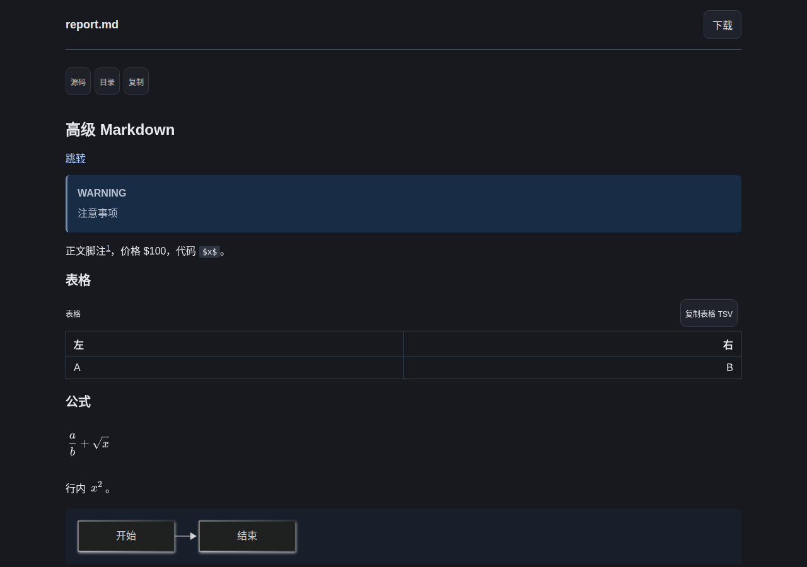
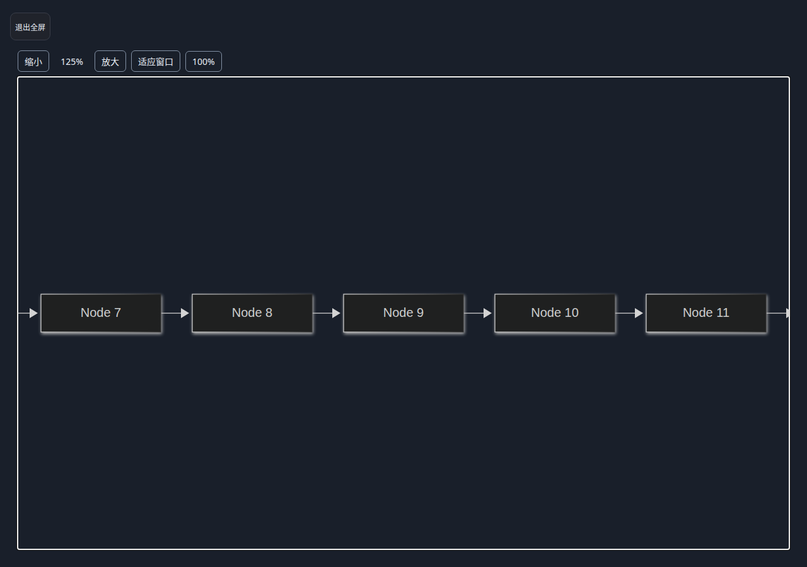
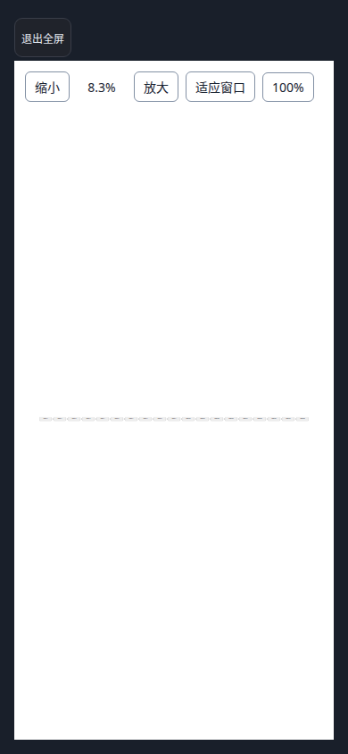
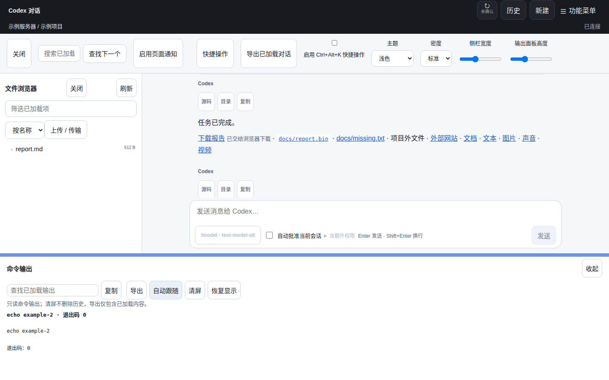
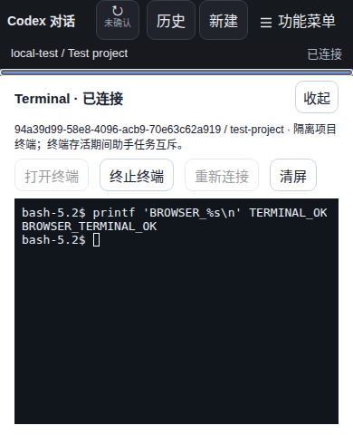

# CW 工作台本机构建部署 · 2026-11-03

[发布记录](DEPLOYMENT_STATUS.md) · [工作台范围](CW_WORKBENCH.md) · [用户指南](USER_GUIDE.md)

## Markdown 阅读简化与 Mermaid 操作（当前线上）

按用户要求跳过 GitHub Actions，通过 `scripts/deploy-cloud.py --local-build --commit HEAD --apply` 本地构建并部署源码 `91577f102e4490636e85988a30a04f7d4ac32ea1`。Worker version `88cdbff7-49ee-488f-874d-4dcc14cf06d6` 已发布到 https://r.xlogic.cc；健康、73 项线上资源字节核验及 80 项本地产物摘要记录完成。未使用或等待 Actions 制品，`ciVerified=false`，没有 Actions URL。

公式 / Mermaid 接近视口自动渲染；仅溢出或被缩小 / 裁切的元素显示全屏入口，对话不逐条显示文档工具栏。Mermaid 全屏提供缩放、拖动、适应窗口、100%、滚轮、双击和键盘操作。类型、lint、480 项 Vitest、最终整页 UI 与 Markdown 专项通过；实际生产资源及 CSP 下的 Chromium 检查通过，含长公式、大小图表、主题切换、实际缩放 / 拖动、Esc 与手机布局。API 使用合成只读文件夹具，没有在真实项目执行任务或 Shell；未重复原生 PTY、压力或跨平台测试。

D1 绑定 / 数据、配置、Secret 和现有原生下载保留，无待执行迁移；本机 Agent 保持 `ce22d38` 且服务 active，本轮未安装或重启，没有原生发行及更新通知。用户刷新网页加载新界面即可。功能源码与随后补充的部署证据提交分开记录；两者均带 `[skip ci]` 标记。

[脱敏部署、产物摘要与验证边界](assets/cw-markdown-2026-11-03/deployment.json)。以下截图仅含合成文件和图表：

## 前一轮刷新、Markdown 与全屏增强

按用户再次明确要求跳过 Actions，通过 `scripts/deploy-cloud.py --local-build --commit HEAD --apply` 部署干净源码 `aa5df2c00581c6a88308cde3af510794d7e5bdcf`。Worker version 为 `d21edceb-8060-4361-a16f-6d79f1b613a3`；健康与 73 项首页、静态资源和下载清单的线上字节核验通过，沿用原 D1、Secret、配置和下载包。本轮只改网页与静态图表资源，没有升级或重启现场 Agent，Terminal 配置保持启用，也没有原生发行或更新通知。

新增功能：文件树 / 预览 / 输出 / Terminal 的窗格全屏；Markdown 表格、代码块、Mermaid 和块公式的元素全屏及嵌套 Esc 退出；Mermaid 深浅 / 系统主题跟随与空间适配；OpenAI `\(...\)` / `\[...\]` 公式。刷新保留健康通知连接，已选会话用新的 Agent 快照取代重复 probe。

类型、lint、33 文件 / 479 项 Vitest、整页 Chromium 与 Markdown 专项通过。终端全屏的原生 PTY E2E 与 3 / 5 浏览器压力通过；后续共享全屏栈和公式扩展通过最终整页 / Markdown 专项，未再次执行整套 PTY。生产真实静态资源和 CSP 检查覆盖公式、主题动态变化、元素全屏、图表焦点内 Esc 与桌面 / 手机边界，API 使用合成只读夹具。

真实邮箱授权的已结束测试会话，三次按钮刷新为 4.857 / 3.836 / 4.848 秒，每次均无 probe、无主机通知重连；仍存在 202 / 结果查询的串行往返。样本很少且与公共资源核验有重叠，不作稳定延迟或 p95 承诺。详见 [性能分析及后续方案](CW_REFRESH_PERFORMANCE_2026-11-03.md)、[产物摘要和部署证据](assets/cw-refresh-2026-11-03/deployment.json)。本轮按用户要求跳过 GitHub Actions，`ciVerified=false`，没有 Actions URL；提交使用 `[skip ci]` 标记。

## 前一轮工作台与本机 Agent 部署

已按用户明确指示使用本机构建、跳过 GitHub Actions，发布网页 / Relay，并升级和重启本机 Agent。随后按用户要求启用本机 Terminal，将四个工作台入口移入功能菜单，并增加拖动分隔条；最终网页更新已直接部署。

| 目标                             | 实际源码 / 结果                                                                             |
| -------------------------------- | ------------------------------------------------------------------------------------------- |
| https://r.xlogic.cc 网页及 Relay | `8e2ae8a447ef599c0e33d1f25b70bad6f1eb0a8e`                                                  |
| Worker version                   | `f283c218-9d27-4601-8f75-902966955de9`，已部署，健康及公共资源字节核验通过                  |
| 本机 Linux coc-agent.service     | `ce22d38f5a3b3766439113530c7de8ced45699c9`，本机构建 0.6.1，空闲时安装，连接稳定验证 120 秒 |
| 本机 Terminal                    | `terminal.enabled=true`，空闲时重启，额外稳定验证 30 秒                                     |
| CI                               | 本次未运行 / 未等待 Actions，无 Actions URL，`ciVerified=false`                             |
| 原生公开下载 / 自动更新通知      | 沿用原清单并重核 SHA-256，未发布新原生包、未发送更新通知                                    |

网页后续两次修正仅涉及浏览器 / Worker，不再次重启 Agent；不同部署源码分别记录，不将它们描述为同一提交的 CI 配套发行。完整产物、来源摘要、二进制 SHA-256 与验证标记见[脱敏部署证据](assets/cw-workbench-2026-11-03/deployment.json)。

## 管理员访问故障恢复

用户手动执行 `npx wrangler deploy` 后出现 `STATE_MIGRATED: Restore the D1 binding; legacy state is no longer authoritative`。根配置遗漏生产 D1 绑定和模式，已迁移的 Registry 正确拒绝读取旧 DO 副本。

先用上次已部署配置恢复原 `STATE_DB`，恢复版本为 `882849c3-d4b6-4018-9d74-8c7d0b9f80ab`；随后完整部署上述新版本。原 D1 UUID、Secret、管理员身份及授权数据保留，schema 无待执行迁移，没有清库、重置迁移标记或创建替代数据库。`wrangler.jsonc` 现固定原生产绑定、`STATE_BACKEND=d1` 和 Cron，发布脚本自动沿用；本地 DO 开发 / 测试显式覆盖 legacy，D1 测试使用独立本地库。

恢复后及本机 Agent 最后一次重启后，现有 Agent 凭据访问生产请求目录均成功。真实邮箱管理员浏览器登录未自动化；用户刷新管理页后使用原身份。

## 界面及 Terminal 验证

- 477 项 Vitest、类型、lint、网页构建通过；部署工具 16 项 Agent / 15 项 cloud 回归、真实 Wrangler D1 迁移通过。
- 整页 Chromium 回归验证功能菜单收纳和自动关闭、文件树 / 预览 / 输出的实际拖动、分隔条键盘调整及偏好保存；最终窄屏边界另经整页复测。
- 完整普通 Worker E2E 通过，包含真实 Linux bubblewrap PTY、菜单入口、Shell 输入 / 输出、拖动终端高度、390×480 短屏、终止和回收；3 / 5 浏览器压力阶段均通过。使用合成项目和 Codex 协议 peer，无真实模型调用。
- 生产资源与专用 CSP 的 Chromium 检查发现并修复 `/diagram.html` → `/diagram` 重定向导致的图表防嵌入冲突，以及 KaTeX 内联字体策略。生产 Markdown / 公式 / Mermaid 桌面和手机检查通过，API 使用合成只读夹具，不操作真实项目。
- 本机 bwrap、prlimit、Bash 可用；实际原生隔离 PTY 专项通过。启用配置仅改变 terminal.enabled，其他字段语义、凭据及数据目录保持一致；SQLite 完整性和各历史表记录数核对通过。未在真实用户项目中打开 Shell。

以下截图使用合成内容：

## 保全与后续操作

通过 `scripts/deploy-agent.py --local --local-build --apply` 安装，复用二进制备份、来源 / 摘要校验、空闲检查、重启观察和失败回滚；配置及在线 SQLite 快照保存在 ignored `.local/`，没有提交凭据和现场原始证据。Terminal 按后续明确授权单独启用并重启。

云端通过 `scripts/deploy-cloud.py --local-build --apply` 构建、暂存、部署并核验。此次是明确授权的本机构建例外，不将本地二进制标为 CI 发行制品；完整跨平台和长期性能验证不在本次结论内。

刷新 CW 标签页即可加载最新功能菜单和分隔条，无需清空历史缓存。通过“功能菜单 → Terminal”进入，选择具有控制权的空闲普通 Web 会话后点击“打开终端”；仍保持项目隔离和终端 / 助手任务互斥规则。

## Terminal 全流式部署

按用户明确授权跳过 Actions，使用本地干净源码 `de93dc7ebf49df9ac6ea85a969d4300f42aac782` 同时发布网页、Relay 和本机 Agent。Worker version 为 `9938aa32-193b-4f8f-9753-58a2889239f3`；本机 Agent 二进制 SHA-256 为 `65413079c2e02ae07970663cf99c16a7bf3e891fd5569c972662d1759b2c03b8`，源码摘要为 `ea8beb4b046102b43a90ec7590252def8a9840fedf2ff4bfbddb57193ab011d7`。本次没有 Actions URL，`ciVerified=false`；不能作为已验证跨平台发行制品。

通过 `scripts/deploy-agent.py --local --local-build --allow-restart-active --apply` 与 `scripts/deploy-cloud.py --local-build --apply` 部署。用户明确允许活动会话重启。首次操作被用户中断，停在旧 Agent 已停止、候选文件尚未替换阶段；恢复旧服务后重新经脚本安装成功。网页及 Relay 发布后，旧连接未登记新增能力，专用通道正确返回 UPGRADE_REQUIRED；再次经脚本重连并完成 30 秒稳定连接核验。二进制备份和原始记录留在 ignored `.local/`；原 D1 UUID、Secret、Agent 配置 / 凭据 / 数据库保留，未发布新原生下载或更新通知。后续同类升级应先发布 Relay，再让新版 Agent 握手。

线上健康检查与 73 项首页 / assets / 手册 / 下载清单及校验和逐字节核验通过。真实邮箱身份正常续期后，读取已结束测试会话所属项目的 Terminal 元数据并验证专用 WebSocket；没有打开 Shell、接管会话、发送输入或调用模型。探测脚本初次遗漏 delivery=2 导致 HTTP 409，修正后才检查流式能力；不将此夹具错误计作产品缺陷。完整脱敏结果见 [部署证据](assets/cw-terminal-stream-2026-11-03/deployment.json)。

本地 486 项 Vitest、10 项 CTest、真实隔离 PTY 和普通 Worker / D1 完整 Chromium E2E 等结果见 [测试报告](TEST_REPORT.md)。未在线测试真实按键回显，因此不将本地 115–165 ms 样本作为生产性能承诺。刷新 CW 后通过“功能菜单 → Terminal”进入，持续输入 / 输出 / resize 走 WebSocket；创建 / 终止仍使用可靠 HTTP，首次开启仍可能等待鉴权及创建。
