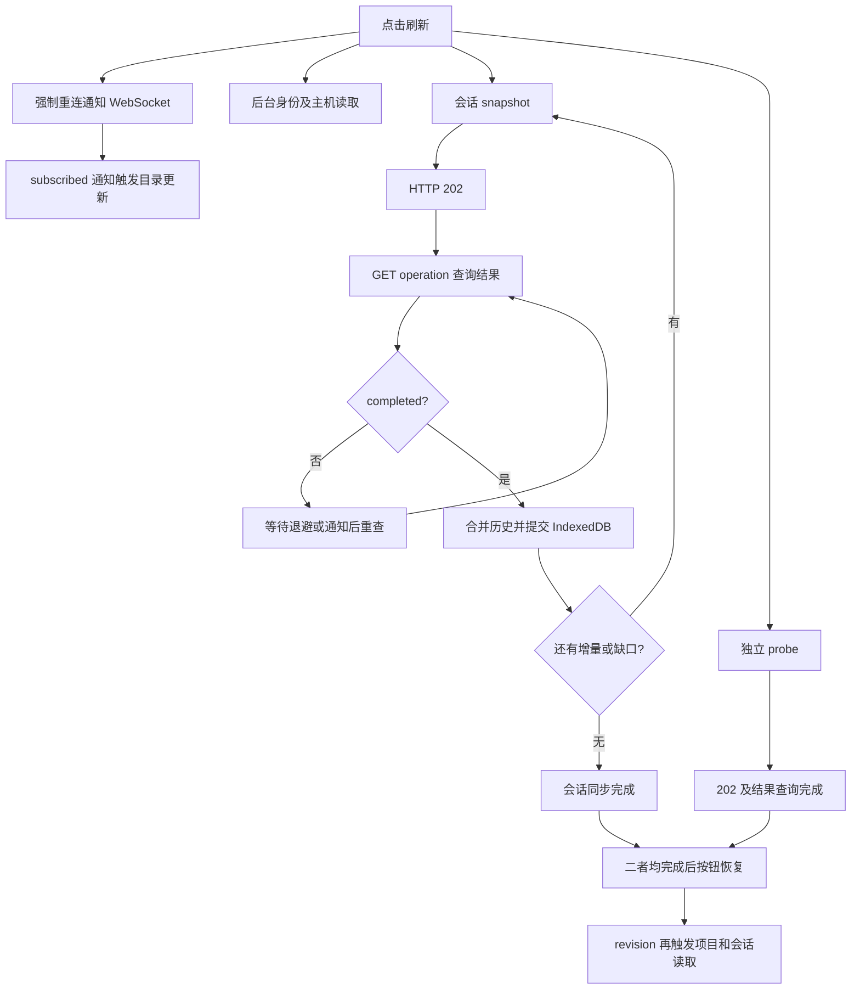

# CW 线上刷新耗时与优化方案 · 2026-11-03

[工作台](CW_WORKBENCH.md) · [部署来源](CW_DEPLOYMENT_2026-11-03.md) · [实测数据](assets/cw-refresh-2026-11-03/measurements.json)

本次对顶部“刷新状态”按钮进行线上只读测量，并分析浏览器 F5 的额外初始化成本。结论：已复现秒级按钮等待，主要可见成本来自多次网络 / Relay 往返和结果回收，不能归因于 Markdown 美化。按用户优先级，本轮实施两项网页优化：保留健康通知连接、已选会话省去独立 probe。F5 / 新开浏览器初始化优化留待后续。

## 测量范围

从本机 Ubuntu 启动 headless Chromium，复用真实邮箱授权访问线上 `r.xlogic.cc`；不注入共享 Service Token。选择此前已明确结束的测试会话，只查看历史并点击刷新，没有新建会话、调用模型、运行 Shell 或取得正在运行会话的写控制权。

线上网页源码为 `8e2ae8a`，本机 Agent 为 `ce22d38`。这是本机到线上站点的测量，不代表用户设备、运营商或全部 Cloudflare 区域。仅三次按钮样本，不能据此计算可靠 p95。

| 样本 | 按钮从点击到恢复可用 | 按钮等待期间启动的 HTTP 请求 | 新建主机通知 WebSocket |
| ---- | -------------------: | ---------------------------: | ---------------------: |
| 1    |             4.370 秒 |                           13 |                      1 |
| 2    |             5.375 秒 |                           10 |                      1 |
| 3    |             9.399 秒 |                           10 |                      1 |

这些请求包括会话快照、probe、结果查询 / 确认，以及身份、主机、项目与会话目录读取。统计按请求开始时间落在按钮等待窗口计算，包含后台请求；不能把所有请求耗时简单相加。

额外通过 Playwright API 客户端做三组快照 / probe 并行读取；该客户端连接复用方式与 Chromium HTTP/2 不完全相同，只用于理解接口成本：

| 接口样本   | 收到 202 accepted | 结果查询                                          | 结果实际可取时刻 |
| ---------- | ----------------: | ------------------------------------------------- | ---------------: |
| snapshot 1 |          2.737 秒 | 1 次，1.727 秒，completed                         |         4.464 秒 |
| snapshot 2 |          2.836 秒 | 2.473 秒 pending；等 0.250 秒；1.626 秒 completed |         7.186 秒 |
| snapshot 3 |          2.785 秒 | 1 次，1.718 秒，completed                         |         4.502 秒 |
| probe 1    |          2.737 秒 | 1 次，1.701 秒，completed                         |         4.438 秒 |
| probe 2    |          2.839 秒 | 1 次，2.766 秒，completed                         |         5.605 秒 |
| probe 3    |          2.782 秒 | 1.674 秒 pending；等 0.250 秒；1.660 秒 completed |         6.367 秒 |

表中排除了测试 helper 等待结果确认 POST 的时间。产品中的结果确认在后台发送，不应错误计入按钮关键路径。身份读取约 0.906 秒、首次邮箱主机授权恢复约 1.850 秒；后者是测试初始化步骤，不是每次暖刷新必付成本。

同期 Agent 日志中 snapshot 为 0–1 ms、probe 为 0 ms、list 为 2–3 ms。日志没有与每一条浏览器请求建立完整分布式追踪，只能说明同期未观察到秒级原生处理；不能据此给网络、鉴权、DO / D1、Agent 分配精确百分比，也不能排除大历史或资源竞争时原生处理变慢。

## 优化前时间构成

优化前，有已选会话时，`refreshView()` 在 [main.tsx](../apps/web/src/main.tsx) 中运行下列链路：

近似关系为：

`按钮时间 ≈ max(快照的所有串行分页及缓存提交, probe 的结果回收) + 少量页面调度`

每次异步读取的耗时约为：

`请求/鉴权/转发至 accepted + 结果查询往返 + 未就绪时的退避及额外查询`

1. **snapshot 与 probe 本来已并行。** 不能将二者改成 Promise.all 当作新优化；代码已经如此。快照返回已经证明本次 Agent 有实际回应，独立 probe 具有去重空间。
2. **最短路径也需要两次串行 HTTP。** [api.ts](../apps/web/src/api.ts) 的 `api()` 先收到 202，再由 `waitOperation()` 查询结果。第一次查询还是 pending 时，还要再等并发起下一次查询。当前结果查询退避依次为 250 / 500 / 1000 / 2000 ms，最大 2 秒；观察到约 5 秒或 10 秒的总时长不代表代码固定 sleep 5 秒。
3. **每次刷新都强制重建通知连接。** `recoverNotifications(true)` 即使在正常连接上也执行关闭 / 新建。新 subscribed 通知会再次触发主机 / 目录相关更新，产生连接握手、鉴权和后台请求竞争。
4. **目录刷新被放大。** 手动刷新有后台 `refresh()`，通知订阅成功还会触发 `refresh()` / revision，最后又增加 revision。已有 pending / dirty 合并会缓解部分重复，但不保证整个刷新周期只读取一次。`recoverCatalog` 在已正确初始化时有直接返回保护，不应误称每次都会重建身份缓存。
5. **落后历史需要串行追赶。** `confirmSession()` 循环获取 after 增量，每页先合并并 await `cache.writeSnapshot()`，再读下一页。页面多、缓存写慢时，每页都可能再付一轮接口成本。正常空闲会话也走同一个完整框架。
6. **按钮不等待所有后台目录更新。** 视觉上按钮结束与菜单目录更新完毕可能不是同一个时间；把后台总网络时间当成按钮等待时间会误判。

没有选中会话 / 身份尚未初始化时，会走较长的回退分支：身份刷新、目录恢复、probe、会话同步存在串行阶段，需另测冷启动。

## 优化顺序与组件范围

| 优先级  | 方案                                                                                                   | 修改范围                                   | 收益及边界                                                                                                                              |
| ------- | ------------------------------------------------------------------------------------------------------ | ------------------------------------------ | --------------------------------------------------------------------------------------------------------------------------------------- |
| P0      | 仅恢复已断开、握手失败或明确失效的通知通道；健康通道不随每次刷新重连                                   | web                                        | 样本每次可去掉 1 次通知重连及其 subscribed 放大；保留显式连接修复入口                                                                   |
| P0      | 已选会话用本次成功的在线 snapshot 作为 Agent 可达证明；未选会话仍 probe                                | web                                        | 常态减少一组 probe / operation 查询 / 确认；因原本并行，不保证按钮时间按请求数同比下降                                                  |
| P0      | 将身份/主机、项目/会话目录更新按作用域合并为一个进行中的刷新周期；订阅事件标脏，由本周期末尾最多补一次 | web                                        | 减少手动点击、订阅恢复和 revision 同时触发的重复请求；不同账号和主机不能共用结果                                                        |
| P0      | 展示“连接已确认 / 同步历史中 / 完成”，历史追赶继续渐进呈现                                             | web                                        | 避免整页像卡住；不能在没收到实际回复时标成功，也不提前推进可靠 ACK                                                                      |
| P1      | 用已有会话控制 / 历史 WebSocket 完成带 requestId 的只读刷新，返回会话状态、审批和历史水位/增量         | web + Relay；按返回字段可能扩展 Agent/协议 | 避免 202 后再查询结果的浏览器 HTTP 往返；已结束会话、未握手或连接卡死时走 HTTP fallback                                                 |
| P1 备选 | 只读 snapshot 支持有上限的直接 HTTP 应答，超出等待窗口仍返回原 202                                     | Relay，web 适配                            | 减少快速结果的额外查询；应等待多久由实测 RTT 决定，不盲定 200 ms。等待不能阻塞处理 Agent 回包的 DO gate，沿用内存并发/字节/生命周期预算 |
| P2      | 按会话 heads / revision 判定是否需要补历史；优化 IndexedDB 批量写与连续分页                            | web，必要时 Agent 元数据                   | 减少无变化历史、重复事件落盘和每页等待；必须先测本地持久化成本，保留原子缺口处理和水位安全                                              |
| P2      | 对请求阶段做 span / Server-Timing，再检查 Registry、Host DO、D1 与 Agent 连接地域                      | Relay + Agent 观测                         | 拆出 202 前约 2.8 秒到底花在哪；未实测前不迁库、不延长鉴权缓存，也不猜测是某个 Cloudflare 区域问题                                      |

P1 优先选择一个主路径，避免同时维护多套刷新协议。仅将结果轮询改为 50 ms 会增加请求数、鉴权和 Worker/DO 消耗，不能作为主要优化；仅缩短超时也不会让真实同步变快。

### 可靠性边界

- 原写请求编号、结果持久保存、ACK 与控制权证明保持原语义；刷新只读，不能重新发送业务。
- WebSocket OPEN 不等于新鲜同步。只接受当前账号 / 主机 / 会话 / Agent 实例和 requestId 对应的实际回复；超时按既有预算回退。
- 保留真实服务端鉴权、撤销和 epoch fencing。不要靠无限期缓存角色或旧快照换速度。
- 缓存与网络可以渐进呈现，但未持久保存的数据不能推进 durable checkpoint；缺口快照不能跳过原子替换。
- 仍保留总等待上限和取消。优化不增加空闲全站轮询；只为当前用户触发的未完成读取做有界恢复。

## 如何验收

先补充每次刷新 ID 和分段计时：通知恢复、identity/catalog、snapshot accepted、每次 receipt、首个实际 Agent 回复、各历史页、缓存提交、可见更新、按钮恢复。只记录 action、请求/实例关联、耗时、页数和字节数，不记录正文、Cookie 或令牌。

在同一线上环境按空闲无变化、小增量、多页追赶、已结束会话、短时断线、三/五浏览器并发分组，各组至少 30 次，再比较中位数和 p95。网页 P0 首先验证健康连接重连次数为 0、正常会话不发独立 probe、目录读取不被多源事件重复放大。端到端时间可能因网络抖动不按比例下降，不先承诺“降到 1 秒”。

P1 需在 trace 中证明快速读取消除了结果查询 HTTP 往返，目标为“当前会话一次持久通道请求/回复，或一次直接 HTTP 应答”。断线 / 无回包仍在截止时间内走 fallback，原先审批、写权限、未决意图、缓存和历史恢复回归必须继续通过。

## 浏览器 F5 的额外部分

F5 还包括 HTML / JS / CSS 请求、React 初始化、邮箱身份恢复、主机目录、作用域身份、IndexedDB 打开及历史/控制通道握手。这不是顶部按钮的同一指标。本次三次秒级数据不当作 F5 总耗时。

若用户指的是 F5，应另外记录 navigation timing、核心资源 cache 命中、首个本地历史可见时间、首次可交互和在线确认时间；保留“先展示有权限作用域内的本地内容，再在线核对”。Mermaid、公式及 xterm 都是按需引擎，不应每次刷新就预载；当前源码仍按需加载，因此暂没有证据支持优先删这些功能来解决按钮延迟。

## 本轮实施范围

- `recoverNotifications()` 保留 OPEN / CONNECTING 的通知通道，已断开通道仍恢复，原有握手超时仍生效；刷新失败时强制修复通知连接。
- 已初始化会话等待本次在线 snapshot、必要的历史追赶及 IndexedDB 提交，以实际 Agent 回复确认可达，不再并行独立 probe；未初始化会话的回退分支保留探测。快照失败不显示成功，不提前确认未持久化历史。
- 20 秒总期限、草稿、控制连接、请求去重及正常后台目录读取保持原有行为。本轮没有实现目录刷新全周期合并、阶段化进度或基于 WebSocket 的只读刷新，也没有改变 Agent / 协议 / Relay 业务。
- 同批完成 Mermaid 跟随外观、窗格 / Markdown 元素全屏，以及 OpenAI 风格行内 / 块公式支持。图表引擎仍仅在显式预览后加载；全屏不卸载内容或重建终端连接。

因原有 snapshot 与 probe 已并行，去掉 probe 主要减少网络及远端负载，不保证每次按钮时间按比例下降。HTTP accepted / operation 结果查询的两轮串行往返仍存在。后续若要显著减少等待，优先评估复用 WebSocket 的只读刷新或短等待直接结果返回，需要单独设计鉴权、关联标识、限流与降级。

## 验证与部署

本轮使用真实 Chromium 的整页合成夹具验证：漏通知历史恢复后，草稿和控制权保留、probe 次数不增加、健康主机通知连接不重建；已有断线 / 20 秒超时回归继续运行。另检查四个窗格全屏、手机边界、退出及状态保留，以及图表深浅色、系统动态变化与安全沙箱。发现并修复 Markdown renderer 函数每次重建导致代码块预览状态丢失的问题；直接切换外观的整页回归覆盖该行为。真实 Chromium → Worker → 原生 PTY 已验证全屏中可输入 / 输出、Esc 退出后仍连接，3 / 5 浏览器并发阶段通过。已从本地构建部署 `aa5df2c`，Worker `d21edceb-8060-4361-a16f-6d79f1b613a3`；健康、73 项资源字节及生产 CSP 下的 Markdown / 全屏检查通过，Agent 未修改或重启。本轮按用户要求跳过 Actions。

## 部署后实测

同一台机器、真实邮箱授权和同一已结束测试会话，三次点击结果如下；没有创建会话、调用模型、打开 Shell 或接管写权限。[脱敏原始指标](assets/cw-refresh-2026-11-03/measurements-after.json)。

| 样本 | 按钮等待 | 窗口内启动的 HTTP | probe | 新建主机通知连接 |
| ---- | -------: | ----------------: | ----: | ---------------: |
| 1    | 4.857 秒 |                10 |     0 |                0 |
| 2    | 3.836 秒 |                 9 |     0 |                0 |
| 3    | 4.848 秒 |                12 |     0 |                0 |

优化前为 4.370 / 5.375 / 9.399 秒，每次 1 个 probe、1 次主机通知重连。新的三次样本更集中，但不能据此承诺固定提速或 p95：部署后采样与公共资源字节核验有重叠，网络、背景目录读取及前一轮尚未完成的回执会影响请求窗口计数，因此也不能由 10 / 9 / 12 推断完整刷新周期的 HTTP 总量。确定验证的行为是两个重复动作均被去除，刷新仍等待实际 Agent 快照和本地历史处理。

HTTP 202 后再查询结果的等待依然明显；F5 / 新打开浏览器的启动链尚未优化，仍按用户要求优先处理常用刷新按钮。进一步降延迟以 P1 的只读 WebSocket / 短等待直接结果方案为后续重点。
