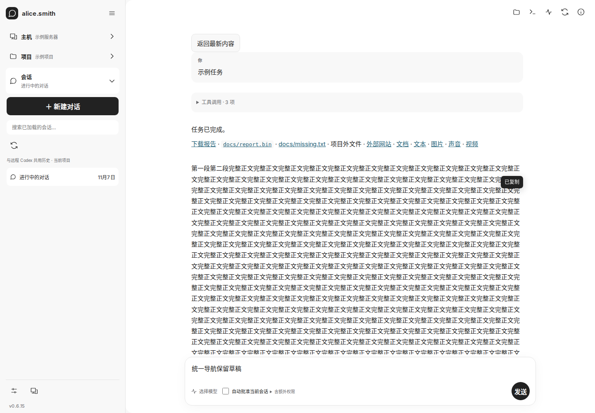
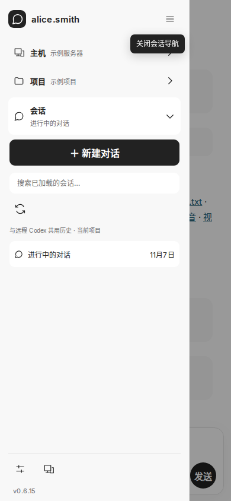

# CW 左栏版本号部署记录

2026-11-07 按用户要求仅部署网页并跳过 GitHub Actions。主站 https://r.xlogic.cc 左栏底部显示 `v0.6.15`，版本读取自 `package.json`；桌面侧栏和手机导航抽屉均可见，设置页继续显示版本。

- 网页来源：基础提交 `3d84f4036a78046f270376ddef24329a8eea0538` 加本次未提交改动，`dirty=true`；源码 SHA256 `f4e6336e667639849f59f22ee818ebbd78cb9bbb80ba322fd3bf14e884daf057`。
- Actions：本次未触发、未等待，`localBuild=true`、`ciVerified=false`。沿用 Worker 来自提交 `54e210ce04b686b818283d629bb0a8f1e6d8180f` 的 [Actions 42343337541](https://github.com/hjxxlogic/codexovercloudflare/actions/runs/42343337541)，不将其计为本次网页的 CI 验证。
- 使用 `scripts/deploy-cloud.py --local-build --allow-uncommitted --target production --web-only-from .local/deploy-cloud/42343337541/deployment.json --apply` 发布，Cloudflare 版本 `a848c597-3a0a-41ce-8e74-dda5da767a84`。
- Worker 执行模块发布前后校验一致，`index.js` SHA256 `aa9dcf461dc8e05c88c0543a8ed9aefa6c4b59affd657bea1bc5f147a1033438`。保留线上变量、Secret、下载和 Agent。
- 验证：网页构建、TypeScript、修改文件 Prettier、`git diff --check` 和现有 `test:ui:navigation` 均通过；人工查看桌面与手机抽屉截图，确认底部版本可见。线上健康检查及全部静态资源字节对比通过。
- 限制：本次为本地网页构建，未运行完整 CI、原生测试或模型任务。初次校验遇到 Cloudflare 401，经 Wrangler 刷新既有登录后重试成功。部署记录文档在发布后补写，不属于已发布的网页构建输入。

[部署身份与制品 SHA256](assets/cw-sidebar-version-20261107/deployment.json)

