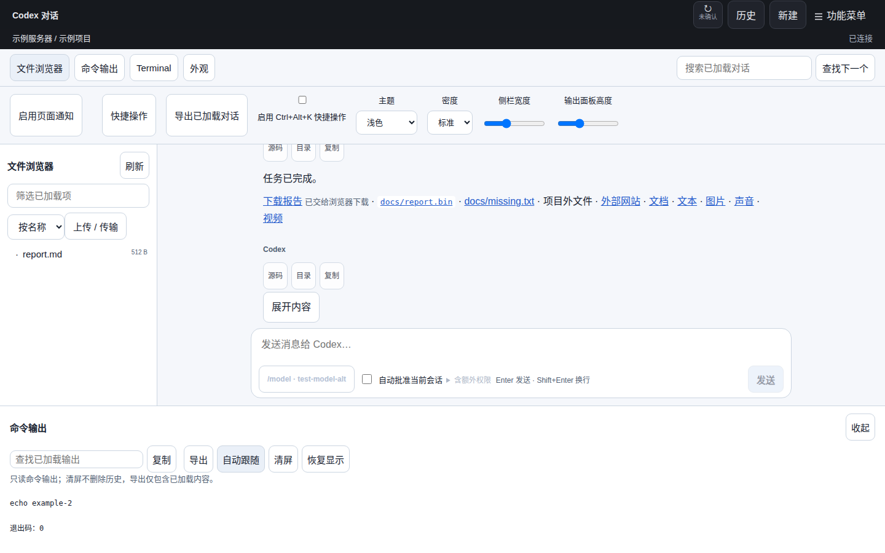
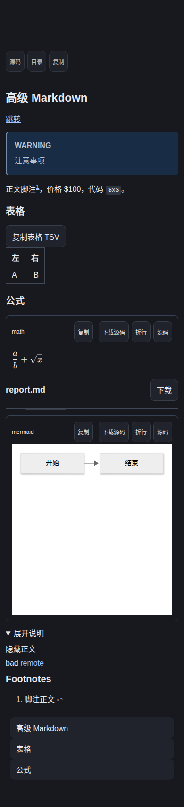
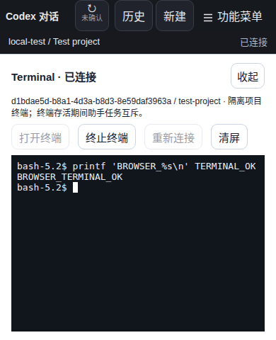
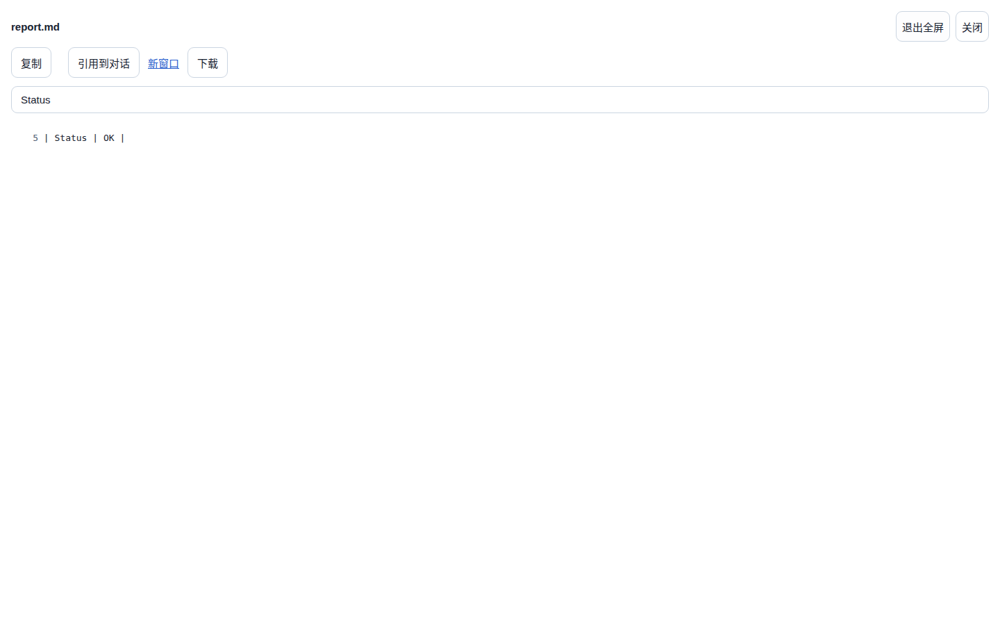
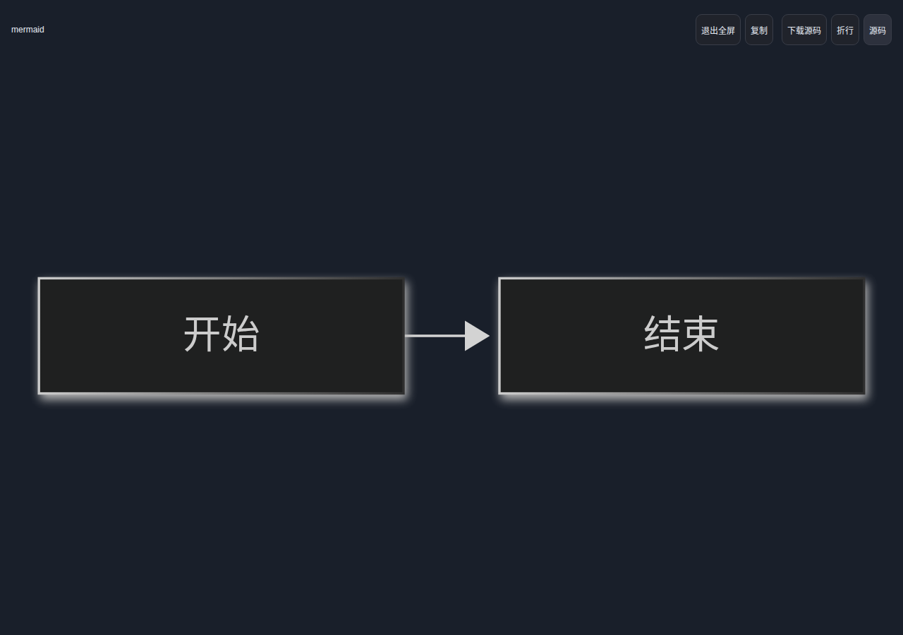
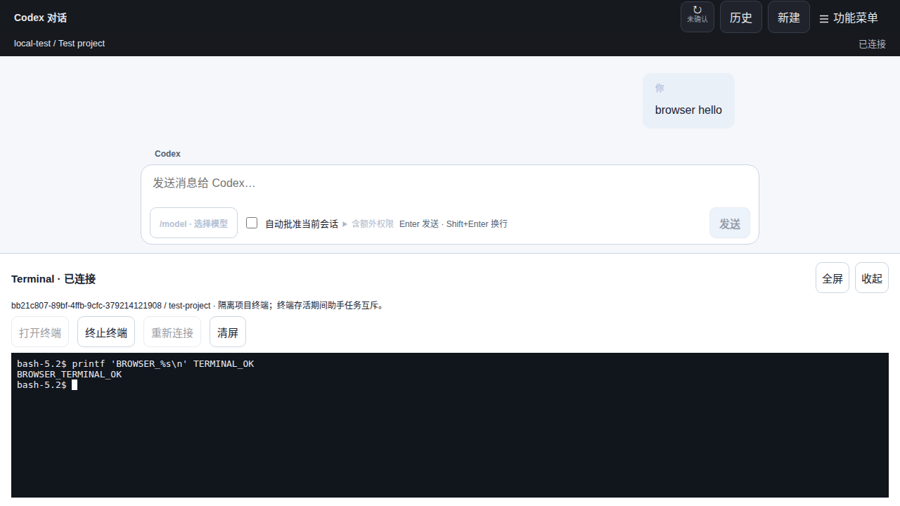

# CW 工作台实施与验收

[文档索引](README.md) · [设计目标](CW_UX_DESIGN.md) · [使用指南](USER_GUIDE.md)

2026-11-02，独立 worktree 分支 `feat/cw-workbench`，起点 `3da79b5`。用户已授权实施网页设计及 P4a 交互终端所需的原生、协议、Relay 改动。2026-11-03 已按用户明确要求使用本机构建部署网页及本机 Agent，并启用本机 Terminal；未运行这些提交的跨平台 Actions，准确来源与边界见[部署记录](CW_DEPLOYMENT_2026-11-03.md)。

## 实现范围

| 设计部分            | 当前实现                                                                                                                                                         |
| ------------------- | ---------------------------------------------------------------------------------------------------------------------------------------------------------------- |
| P0 / P1a 外观和阅读 | CW 局部主题变量、深浅/系统主题、密度、面板尺寸偏好、手机覆盖式面板；现有审批/草稿/历史逻辑保持复用                                                               |
| P1a Markdown        | GFM、脚注往返、文档作用域标题/片段、目录、五类提示块、显式折叠块、表格横向滚动/TSV、代码复制/下载/折行/按需高亮                                                  |
| P1b 公式/图表       | 共享 React Markdown AST 管线，按需 KaTeX、独立不具备同源权限的 Mermaid 沙箱；源码和错误回退、外部图片链接占位、本地字体/引擎                                     |
| P2 文件浏览         | 根/目录懒加载和分页、已加载项筛选/名称或大小排序、方向键/Home/End、手动刷新、有限文本/Markdown 预览、路径引用、独立窗口、上传窗口复用                            |
| P2 便捷操作         | 已加载对话/文件/输出查找；外观内提供快捷操作面板，可显式启用 Ctrl+Alt+K，终端/编辑区聚焦及输入法组合中不抢快捷键；导出已加载对话                                 |
| P3 命令输出         | 共享事件/正文缓存，显示命令生命周期和退出状态，手动读取缺失内容、查找/复制/导出、跟随/暂停、清屏/恢复、标题及显式后台页面通知；不增加历史订阅                    |
| P4a 真实 Terminal   | xterm 按需加载、Linux PTY + bubblewrap、项目 Web writer 验证、可靠创建/关闭、内存输入序号去重、4 KiB 输入、256 KiB 输出环、缩放/Ctrl+C、粘贴确认、断线及进程清理 |
| P4b                 | Windows / macOS 等平台未实现隔离；能力明确禁用                                                                                                                   |

多数改动在 `apps/web/`；P4a 扩展 `packages/protocol/`、`apps/relay/`、`native/` 和 CMake/测试。未引入独立后端服务、任意 RPC 转发或第二套浏览器历史库。实现没有新增数据库 schema；现场部署及本机 Terminal 的显式启用另见部署记录。

## 实施取舍与剩余建议

完整设计包含后续可选项，本实现并非全部建议的完成声明：

- 主题作用于 CW 工作台，登录/管理员与顶栏继续使用已有样式。文件浏览器与输出可收起；侧栏、文件预览、输出和 Terminal 支持拖动分隔条及键盘调整，分别保存尺寸；侧栏和输出仍保留滑块。文件浏览器、预览、输出及 Terminal 支持页面内全屏、Esc / 按钮退出和焦点隔离；原组件不卸载，原分隔尺寸保持。全屏不跨工作区或刷新保存。未实现整体旧布局开关。
- 文件预览为只读；未新增在线编辑、删除/重命名、全项目搜索、Git 管理或目录监控。上传成功后手动刷新目录；不进行后台递归扫描。目录关闭会卸载下层读取状态，再展开重新读取。
- 公式和图表在接近视口时自动渲染；源码变化去抖 120 ms，过期异步结果丢弃，未闭合及失败内容显示原文。Mermaid 配色跟随主题（包括系统动态变化及打开后的主题切换）；主题变化重建独立沙箱，仅传递白名单深/浅色值，不传入任意样式。全屏图表提供缩放、平移、适应窗口和 100%；尚无结果字节缓存或 PNG/SVG 导出。文件预览目录按打开时的标题建立，再开关可刷新。
- Mermaid 限制 32 KiB 源码 / 300 行 / 300 条边，公式 16 KiB / 100 次宏展开 / maxSize=20；并非严格的“300 节点”或可证明的“2 秒 CPU”配额。图表 DOM 与网络已隔离，但未完成设计中的可强制终止 CPU 基准方案；图表加载后设置 2 秒尽力超时并卸载未返回结果的 frame，SVG 输出限制 2 Mi 字符；这依赖浏览器调度，不宣称对恶意同步解析有硬实时保证。异常图表就地回退源码。
- 只读命令输出按原文显示 ANSI 控制序列，不执行其终端语义。真实 Terminal 禁用远端 OSC 52 剪贴板写入，不安装自动链接插件。Terminal 输入 / 输出 / resize / ACK / 心跳使用独立 WebSocket；只在存在 runtime 时建立，隐藏仍收取，切换会话/失去控制连接即清理；open/close 保留可靠 HTTP。
- 页面标题提供执行/审批提示，外观内可主动启用不含正文的后台页面通知；关闭页面后不再提醒。尚未新增会话置顶/本机别名和专门文件变更侧栏。现有差异、计划、审批和连接状态继续在原位置呈现；不新增服务端搜索/通知能力。
- Linux sandbox 只允许当前项目写入，禁用网络、不挂载 HOME，固定系统工具为只读。资源上限是每进程 rlimit；未引入 cgroup 的进程树总内存/CPU/磁盘额度，不能将其描述成虚拟机或容器级完整资源配额。

## 验证与复现

在本工作树中运行，无模型调用：

| 命令                                                                                 | 覆盖                                                                                                |
| ------------------------------------------------------------------------------------ | --------------------------------------------------------------------------------------------------- |
| `npm run typecheck` / `npm run lint` / `npm run lint:cpp` / `npm run protocol:check` | 类型、格式、生成契约一致性                                                                          |
| `npm test`                                                                           | 10 项 CTest，34 个文件 / 486 项 Vitest；含终端流式确认、Markdown、Relay writer/proof 和文件预览上限 |
| `npm run test:terminal`                                                              | 真实 Agent、创建重试、旧控制权拒绝、项目互斥、实际 PTY 输出、输入去重、关闭及 detach 后拒绝旧输入   |
| `npm run test:markdown`                                                              | Chromium 中公式/图表、脚注/内部锚点、提示块、脚本/危险链接/外部请求限制及手机宽度                   |
| `npm run test:ui`                                                                    | 工作台浅色/文件预览/路径引用/输出截图及旧 UI 完整回归，含 390×480 审批布局                          |
| `npm run test:terminal:e2e`                                                          | DO 完整 E2E 加真实 Chromium → Worker → Agent → PTY 的打开、输入、输出和关闭                         |

测试结果以 [测试报告](TEST_REPORT.md) 的当前工作台条目为准。原生 PTY 用临时项目与假的 Codex 协议进程；Shell 为实际 Bash/bubblewrap，验证项目 symlink 无法逃逸、重复输入无重复副作用、resize、Ctrl+C、退出码、输出缺口与进程回收。尚未注入 PTY 内核 write 与进程崩溃之间所有时序，也未运行未支持平台的真实交互终端。

截图在 ignored `.local/ui-stability/`、`.local/workbench-evidence/` 和 E2E 制品目录中，使用合成内容，不包含现场凭据。跨平台构建/完整视觉矩阵、输入 p95 与长会话内存基准还需 CI 或专门环境验证；不将这些列作已达标。

### 构建体积对比

在同一 Node.js 22.23.4 / 当前锁定依赖与构建工具下，将 `3da79b5` 源码解压到独立临时目录构建，与最终工作树对比。以下使用 Python gzip level 9 一致计量，包含 HTML 直接引用的入口、runtime 与样式，不是网络下载测速。

| 范围                                  | 基线 gzip | 当前 gzip | 增量     |
| ------------------------------------- | --------- | --------- | -------- |
| 首屏 JavaScript（含新增小型 runtime） | 210,502 B | 221,995 B | 11,493 B |
| 首屏 JS + CSS                         | 215,370 B | 228,594 B | 13,224 B |

本次源码对比满足设计中首屏 gzip 增量 ≤50 KiB 的建议。主入口原始文件仍约 721 kB，构建器保留 >500 kB 的体积提醒；不因此宣称加载时延或交互 p95 已达标。高亮约 154 kB、KaTeX 约 259 kB、Terminal 约 338 kB 的引擎脚本及本地字体为异步资源。Mermaid 的本地 `diagram-engine.js` 约 5.3 MB 原始 / 1.6 MB gzip，只在图表接近视口自动渲染时请求，当前体积较大是明确取舍。

### 最终截图与结果

最终类型、lint、C++ 格式、协议一致性、网页构建、Markdown 与整页 UI 均通过。DO / D1 完整 E2E 均通过，含实际终端与手机短屏验证；最后的横向工具栏样式修正另经整页 UI 定向复测。登录配置 7 项测试及远程配置/重启回归也通过，配置示例显式展示默认关闭的终端。完整日志留在 ignored `.local/` / 测试运行临时日志中，发布门禁仍须由同一提交的 CI 给出。

以下为合成测试项目，未使用现场凭据：

## 发布边界

已合并 master，并按后续明确授权直接部署本机构建，跳过本次 Actions；原生公开发行包和其他机器 Agent 未更新。本机 Agent 仅在空闲时升级 / 重启，随后启用 Terminal。此次本地构建不作为经过 CI 验证的发行制品，来源、摘要与实际验证见本次部署记录。

### 生产静态资源兼容修正

Cloudflare 静态资源会将 `/diagram.html` 重定向到 `/diagram`；原专用 CSP 只覆盖前者，使线上图表被普通页面防嵌入策略阻止。现在 iframe 直接使用规范路径，Worker 同时保护两种路径及 guest 路径，保留 opaque sandbox 和禁止网络，移除图表响应的普通 X-Frame-Options。主页面允许构建器内联的 data 字体，避免 KaTeX 字体被默认 CSP 拒绝。增加规范路径回归，并以线上资源搭配合成只读 API 验证，真实邮箱管理员登录不由该浏览器夹具覆盖。

### 菜单收纳与面板分隔条

文件浏览器、命令输出、Terminal、外观统一收纳到现有顶部功能菜单，搜索放入外观面板，删除对话上方的整行工具栏。菜单入口与工作台状态由 React portal 连接，开关菜单不卸载终端或重建工作区。四种面板分隔条支持 Pointer Events（鼠标 / 触摸）、方向键、Shift 步长、Home / End、双击还原，保存非敏感尺寸并限制窗口边界。文件浏览器增加就地关闭入口；窄屏终端保持底部覆盖且高度可调。没有新增原生、协议或数据库修改。

## 刷新与窗格增强 · 2026-11-03

顶部刷新常态保留健康通知通道，已选会话用新在线快照取代重复 probe，异常仍保留 20 秒期限与连接恢复。仅涉及网页与静态图表资源，不改 Agent / 协议 / Relay 业务。实测时间构成、已实施范围及后续往返优化见 [刷新性能分析](CW_REFRESH_PERFORMANCE_2026-11-03.md)。

全屏预览的桌面与手机合成夹具截图：

公式同时兼容 OpenAI 的 `\(...\)` 与 `\[...\]`，保持 TeX 下标 / 宏不被 Markdown 强调或转义破坏，块公式支持多行和闭合后紧接正文。未闭合时保持普通文本，完整且稳定后自动渲染；不处理代码块、行内代码及链接目标里的分隔符。

表格、代码块 / Mermaid / 公式仅在内容无法完整显示时提供元素全屏按钮，独立文件预览同样可用。全屏不重挂载表格或图表 iframe；图表通过全屏布尔值及白名单语言的布局消息适配可用空间，退出恢复原尺寸。共享全屏栈处理窗格内嵌元素的嵌套，Esc 只退出顶层，逐层恢复背景 inert / 焦点 / 滚动。图表沙箱只可向父页面请求退出其所属全屏，无业务权限。

## Markdown 阅读简化与图表操作 · 2026-11-03

对话默认不显示消息级“源码 / 目录 / 复制”，文件预览通过显式 tools 属性保留文档工具。公式和 Mermaid 直接显示结果，小公式 / 小图表无工具栏；失败显示本块源码，不影响整条消息。普通代码与表格保留已有复制等操作。

ResizeObserver、DOM 内容变化及字体加载触发溢出检测，比较实际滚动尺寸，覆盖横向超宽和代码 480 px 高度裁切；窗口或分隔条调整后重新判断。Mermaid 沙箱仅回传有限数值的自然宽度和实际渲染高度，父页面据此自适应 iframe 高度（64–480 px）及是否显示全屏入口。原始图形太宽而被缩小的情况也可进入全屏查看。

全屏图表工具栏在 opaque iframe 内实现，仅改变 SVG 的本地缩放和平移；范围 0.1%–1600%，首次适应窗口，按钮 / 滚轮 / 触摸拖动 / 双击 / 键盘均可操作。普通内嵌模式不拦截滚轮。工具栏文字随中英文界面切换，Esc 继续逐层退出，不新增应用请求或文件、网络权限。

## Terminal 流式传输 · 2026-11-03

以往通用 HTTP 202 + operation 查询及 500 ms 轮询路径的耗时分析见 [线上分析](CW_TERMINAL_LATENCY_2026-11-03.md)。新版网页仅在 Agent 报告 streaming:1 时启用终端；生命周期仍使用原端点账本，字节流使用独立 WebSocket，经既有 Agent 长连接转发。输入约 16 ms 合并，保持单一严格递增序列并等待流内确认；不会对未知写入自动重试。输出由 PTY 事件驱动，xterm 渲染后 ACK；64 KiB 在途窗口、256 KiB Agent 缓冲和暂停 PTY 读取控制压力。断开字节流不夺取会话控制权，可在空闲到期前按已渲染 offset 恢复；离线尾部不足则提示 gap。父会话断开、接管、撤权和 Agent 断开仍失效。

实现涉及网页、协议、Relay 与原生 Agent；不是只改网页定时器。Windows / macOS 仍禁用隔离终端。开启前的鉴权与可靠创建仍可能较慢，持续交互不再逐次支付 HTTP 回执查询成本；本机回显样本不等同生产网络 SLO，线上性能以实际部署后的隔离测试为准。

[脱敏本地验证结果](assets/cw-terminal-stream-2026-11-03/validation.json)；下图使用合成项目和真实隔离 Shell，无现场凭据或用户内容。

## 0.6.2 Terminal 响应

Terminal 入口将模块与只读 info 并行准备，仍需确认才开启 Shell。输入改为最多 32 个未确认帧 / 64 KiB base64 输入窗口，每帧依序 ACK；断开、ACK 错序或超时拒绝全部未知写入，不重放。原生 TCP_NODELAY 需要升级 Agent / CLI；当前能力要求 streaming:2，在线空闲没有应用心跳，60 秒宽限从断流时开始。验收、生产基线及 Actions 版本发布以 [响应记录](RESPONSE_SPEED_2026-11-03.md) 为准，旧节的 streaming:1 与单批等待是对应阶段记录。
