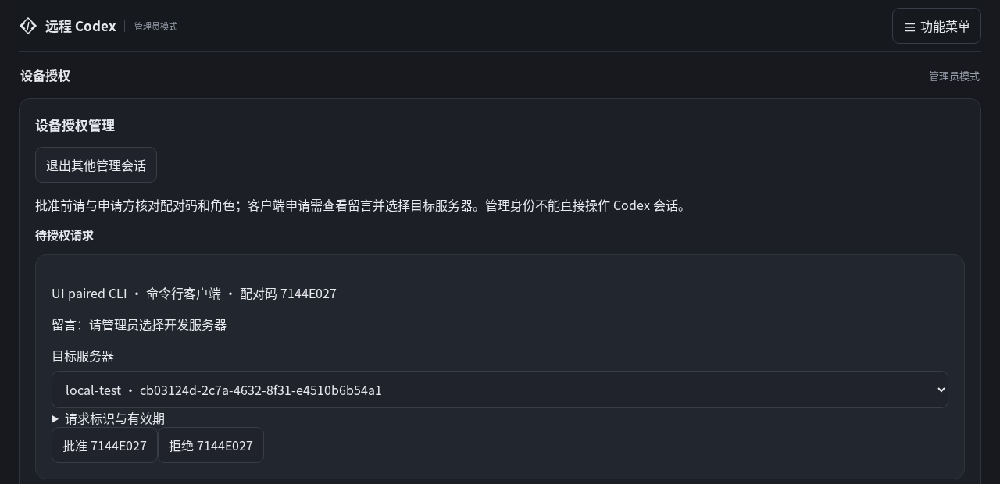
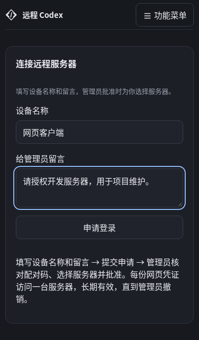
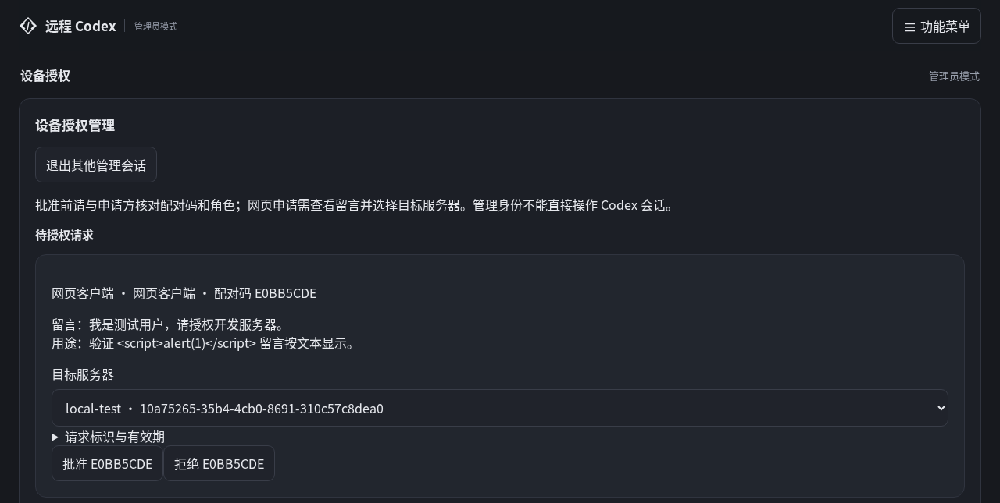
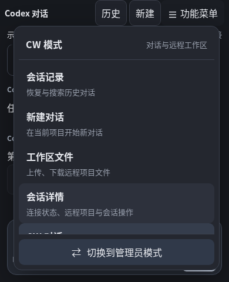
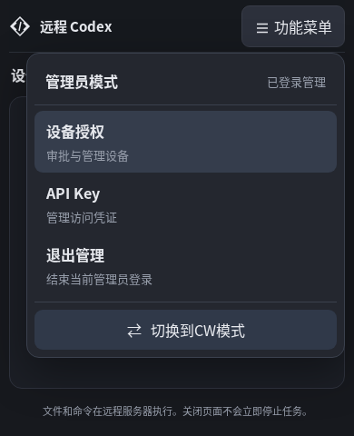
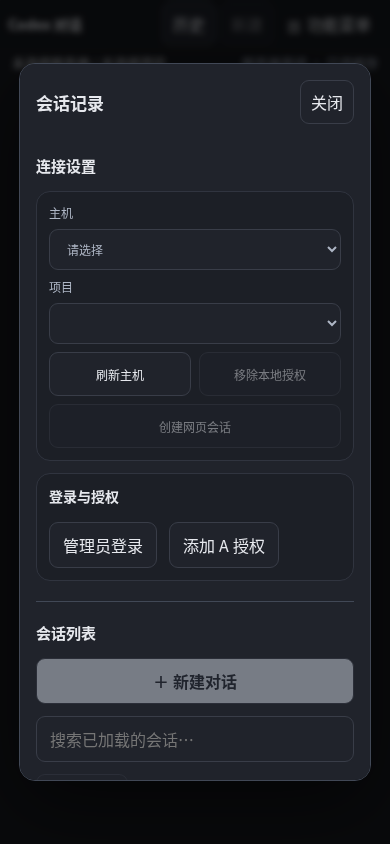
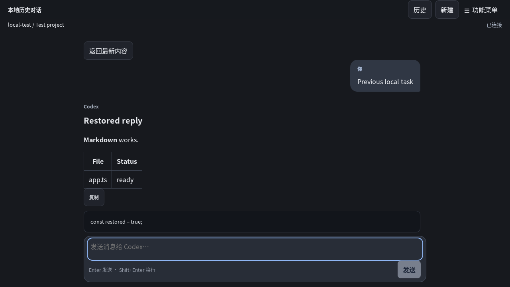
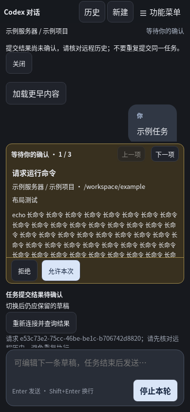
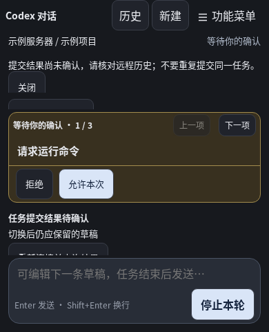
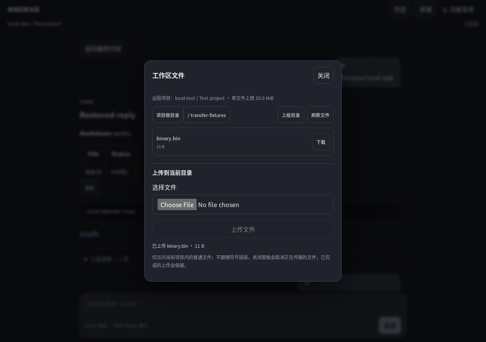

# 本机测试记录

日期：2026-10-24。0.5.2 已发布，源码标签 `v0.5.2` 指向 `e3a4e051ed825bdcb4dcd106fb133a40c04e0b7e`。当前结果见下表和 [逐项实施记录](stabilization-2026-10-24.md)。后文保留各版本历史证据；旧的“未完成”不能作为当前结论。此次未调用模型。

## 0.5.3 · 2026-10-25 · 发布与线上验收

- 发布源码 `b6f9c0d` 和标签 `v0.5.3` 已推送。Worker 版本 `6f8083b8-cfc0-4423-b3e6-bd04003cb99f` 于 UTC 00:53:48 发布至 `r.xlogic.cc`，流量 100%。现有生产密钥与用户设备授权保留。
- 提交后的干净 Ubuntu 20.04 / Debian 12 原生构建均通过；两个平台归档的程序字节与构建产物一致，源码归档与 `git archive b6f9c0d` 一致，四个程序的构建身份绑定同一提交和 sourceDigest `13808d99c604353c3da189a74dcf1f4aec6e5cec36b4eeed08c3bc82c271f570`。干净构建的 CLI 默认自动安装和空闲 Agent 后台准备 / 重启回归亦通过；包校验记录 `.local/cc-request-approval/package-verification.json`。
- 线上 JS / CSS、手册及下载清单与本地发布内容一致；健康 200、未登录业务 401、跨域登录 403、安全头、UTF-8 文档和三个归档 SHA256 均通过。实际下载的 Ubuntu 两个程序在匹配系统运行 `--version` 通过，实际下载 Debian CC 在容器中用于下述生产登录。
- UTC 00:55:55，真实管理网页与实际下载的 0.5.3 CC 完成不传 `--host` 的中文留言申请、管理员选择临时 A、CC 保存正确角色 / 目标及 0600 凭证文件、目标 / 管理接口隔离、撤销后 401。CW 同时验证多行留言按纯文本显示、未选择 / 无效服务器拒绝、管理员选目标、Secure / HttpOnly Cookie 及刷新保留。测试完成仅清理本次临时 A/CC/CW 授权并撤销临时管理会话；无页面脚本错误，未操作用户已有设备或调用模型。
- 线上证据在 `.local/cc-request-approval-deploy/online-verification.json`、`browser-verification.json`、`registry-rollout.json`、`deploy.log` 和部署版本记录，截图同目录。本轮覆盖发布与登录，不表示真实生产 Codex 任务、长期负载或 DO 休眠升级已验收；既有开发预览边界保持。

## 0.5.3 · 2026-10-25 · CC 与 CW 统一留言申请（发布前验收）

- CC 配对登录使用 `--message TEXT` 传递选填留言，不再要求服务器标识；管理员在同一设备授权页查看留言并选择服务器。CC 使用批准结果的 hostId 保存原格式的私有多授权文件；已有凭证、服务器切换及固定目标的 API Key 登录继续可用。
- `npm test` 通过：CTest 1/1、Vitest 6 个文件共 47 项。CC / CW 共用用例覆盖留言类型 / 长度、申请端 hostId 不决定绑定、缺失 / 无效 / 撤销服务器、审批失败仍待处理、重复批准、单次领取与拒绝。`npm run build`（Ubuntu 20.04 原生构建、网页、类型检查、Worker dry-run）、Debian 12 原生构建、lint / lint:cpp、三项 TLS 检查、更新器回归及发布来源门禁均通过。
- Bookworm 容器中使用新版原生程序的完整 `test:e2e` 通过：真实 CC 无 `--host` 提交中文留言、真实管理网页选择服务器、保存正确角色 / 目标和 0600 权限；旧式 `--host` 参数不覆盖管理员所选服务器，第二次登录保留原授权。原有 API Key、CW 双服务器 Cookie、多标签页、隔离与撤销、历史 / 文件 / 重连回归通过。新增申请使原单 IP 测试准备超过每分钟 10 次限额，改为给模拟浏览器分配独立测试 IP；生产限流规则保持。
- 桌面 / 手机 `test:ui` 全部通过。测试使用模拟 Codex，未调用模型；尚未宣称跨网络任务或长期负载验收。日志与截图 `.local/cc-request-approval/`。

## 2026-10-25 · CW 留言申请线上发布

- 源码 `2d1c675` 已推送至 master，Worker 版本 `3881ffd6-f618-4931-be15-b709183f277d` 于 UTC 00:34:28 发布至 `r.xlogic.cc`，流量 100%。原生下载保持 0.5.2。
- 线上首页与 JS / CSS 字节和本地构建一致；健康 200、未登录业务 401、跨域管理登录 403、安全头、UTF-8 手册字节和三个下载归档 SHA256 均通过。证据 `.local/cw-request-approval-deploy/online-verification.json` 与部署前后版本记录。
- 初始浏览器验收遇到 Registry 代码传播期间的旧申请校验；传播后 UTC 00:41:55 真实 Chromium 完成无服务器标识申请、多行留言显示、管理员选择临时 A、未选择 / 无效目标拒绝、单服务器 Secure / HttpOnly Cookie、刷新保留、管理 / 跨服务器隔离及撤销后的 401。测试仅创建独立临时 A/CW，完成后删除本次临时授权并撤销管理登录；未启动模型或操作用户已有设备。证据 `.local/cw-request-approval-deploy/browser-verification.json`。

## 2026-10-25 · CW 留言申请与审批选择服务器（发布前验收）

- CW 申请不再要求服务器标识，提交设备名称和最多 1000 字符的选填留言。管理员查看纯文本留言，明确选择未停用的服务器后批准；未选择时批准按钮不可用，拒绝无需选择目标。凭证仍按单台服务器隔离。
- `npm test` 通过：CTest 1/1、Vitest 6 个文件共 45 项。新增覆盖无目标 CW 申请、申请端 hostId 不决定授权、留言长度与类型、缺失 / 无效 / 已撤销服务器、审批失败后仍待处理、重复批准、单次领取及拒绝；CLI 仍必须在申请时指定目标。
- `npm run build:web`、`npm run typecheck`、`npm run lint` 通过。Bookworm 测试容器使用已发布 0.5.2 原生程序，真实 Wrangler / DO + Chromium 的完整 `test:e2e` 通过：多行中文留言及 HTML 按文本显示、管理员选择两台不同服务器、持久 Cookie 刷新保留、隔离 / 撤销，以及原有会话、历史、文件和重连回归。
- 同容器的 `test:ui` 通过：1280×900 桌面和 390×480 手机短视口下申请页无服务器标识，留言输入和申请按钮可见，无横向溢出；原菜单、草稿、审批和历史分页回归通过。截图在 `.local/cw-request-approval/`，以下保存申请页与审批区域截图。
- 本节记录本地验证，未调用模型；需同步发布 Worker 与网页，已有设备凭证无需重新申请。完整 `npm run build`（含原生构建、网页、类型检查、Worker dry-run）和 `test:tls` 三项信任链 / 主机名检查亦通过。

## 2026-10-25 · 功能菜单 CW / 管理员双模式

- 默认 CW 模式，只展示对话、会话和工作区功能；管理员模式只展示设备授权、API Key 与管理登录 / 退出。底部按钮切换模式，功能列表独立滚动。
- Chromium 合成 UI 回归通过：1280×900 桌面、390×480 手机短视口下检查入口互斥与底部按钮可见；键盘切换保留焦点，管理员登录 / 退出、未登录入口和授权深链接正确。切换后 CW 草稿保留，attach 计数不增加，原有授权、离线目录、分页和审批布局回归通过。日志 `.local/cw-menu-modes-ui.log`，截图 `.local/cw-menu-modes/ui/menu-{cw,admin}-{1280,390}.png`。
- 网页构建、typecheck、lint、Vitest 6 文件 43 项及 Worker dry-run 通过。测试不调用模型。
- Bookworm 隔离容器中的完整 e2e 与 UI 压力均通过：真实 Wrangler / DO、已发布 0.5.2 原生程序及 Chromium，覆盖新版管理员登录入口、设备审批、API Key、CW 多 A 授权 / 切换、会话与文件、重连及撤销；日志 `.local/cw-menu-modes/e2e.log`。
- 2026-10-25 07:46（Asia/Shanghai）源码提交 `5ddc50d7dd06ceb8fbe82740f79819c20bfa8688` 已推送并部署到 `https://r.xlogic.cc`。Worker 版本 `11bfb5cd-f498-4bc4-8892-8abeb1a0bbc4`，部署 ID `d066c48c-14f2-40c1-96d2-d5bcb5f6a830`，部署列表确认 100% 流量。部署前重新构建网页并通过 Worker dry-run、文档格式及下载归档 SHA256 检查；在线手册同步更新，原生发行仍为 0.5.2。
- 线上首页引用新 JS / CSS，字节与本地构建一致；健康 200、未登录业务 401、跨域登录 403、安全头、在线手册 UTF-8 / 文档字节、原生清单及三个归档 SHA256 全部通过。线上 Chromium 在 390×480 下验证未登录 CW / 管理员菜单入口互斥、双向切换、管理员登录表单隔离、底部按钮可见，在线手册实际字符集为 UTF-8，无页面脚本错误。证据 `.local/cw-menu-modes-deploy/online-verification.json`、`browser-verification.json`、`deploy.log`、`deployments-after.json`。线上检查使用未登录浏览器和 HTTP，授权后的交互由本地真实 Wrangler e2e 验证；本次未创建生产设备或操作既有会话，未调用模型。

## 2026-10-25 · 会话记录连接设置与滚动分页

- 连接设置移至会话记录面板顶部，覆盖主机 / 项目、创建会话、登录与授权；手机布局将选择框与操作按钮分行展示，聊天区继续保留在弹窗后方。
- Chromium UI 回归通过：两组各 600 条消息分别验证手动加载和向上滚动自动异步加载，延迟响应期间滚动事件不重复发请求，读取失败可重试，首次及后续分页均保持阅读位置，完整保留超过 400 条 / 192 KiB 的内容，已读旧页命中 IndexedDB，读至开头后不再自动请求。截图 `.local/cw-scroll-history/ui/cw-session-connections.png`、`cw-loaded-history.png`。
- 网页构建、Worker dry-run、typecheck、lint 与 Vitest 6 文件 43 项通过。自动分页未命中离线缓存时，提示放在消息区内，避免常驻全局提示挤压聊天区域。未调用模型。
- Bookworm 隔离容器中的完整 e2e 与 UI 压力最终全部通过：真实 Wrangler / DO、已发布 0.5.2 原生程序及 Chromium，覆盖调整后的登录、多 A 授权 / 切换、创建与恢复会话、桌面 / 手机布局、审批、文件、重连及撤销；日志 `.local/cw-scroll-history/e2e.log`。截图位于 `.local/cw-scroll-history/container-screenshots/`。
- 2026-10-25 07:35（Asia/Shanghai）源码提交 `299a14d00757f403c979b781d55f7a63c1708de2` 已推送并部署到 `https://r.xlogic.cc`。Worker 版本 `0f30bdd8-dd2e-410d-ba74-e679c60957c7`，部署 ID `f225e0c0-aee7-4ec8-b6a1-53938d3fecb5`，部署列表确认 100% 流量。部署前再次通过网页构建、Worker dry-run、typecheck 和 lint，三个既有下载归档 SHA256 均通过；在线手册同步更新，原生发行仍为 0.5.2。
- 线上首页引用新资源，JS / CSS 与本地构建字节一致；健康 200、未登录业务 401、跨域登录 403、安全头、在线手册 UTF-8 / 文档字节、原生清单及三个归档 SHA256 全部通过。证据 `.local/cw-scroll-deploy/online-verification.json`、`deploy.log`、`deployments-after.json`。线上范围为未登录 HTTP 与静态产物检查，交互行为由本地 Chromium / 真实 Wrangler e2e 验证；本次未创建生产设备或操作既有会话，未调用模型。

## 2026-10-25 · CW 完整显示已加载历史

- 新增 Chromium 回归在修复前复现：累计取得 450 条消息，DOM 只显示 400 条。
- 修复后 `npm run build:web` 与 `npm run test:ui` 通过。短消息、较大消息两组各 600 条，按每页 150 条连续加载，均完整有序显示；越过 400 条 / 192 KiB 后不裁剪，后续加载保留阅读锚点。返回最新恢复有界窗口，重新加载三个旧页命中 IndexedDB，无额外历史页网络请求。
- `npm run typecheck`、`npm run lint`、Vitest 6 文件 43 项通过。本次仅修改网页历史合并逻辑，浏览器使用合成 API / WebSocket；未调用模型。截图：`.local/cw-history-regression-after/cw-loaded-history.png`。
- 部署前再次通过网页构建、Worker dry-run、UI 压力及完整 e2e。宿主 Wrangler 启动不兼容，改用 Bookworm 隔离容器、已发布 0.5.2 Debian 原生包、真实 Wrangler / DO 与 Chromium，验证历史、权限、审批、文件和重连；测试工作区不包含生产凭据。日志 `.local/cw-history-deploy/e2e.log`。既有三个下载归档的 SHA256 全部通过，原生清单保持 0.5.2。
- 2026-10-25 07:17（Asia/Shanghai）源码提交 `8d40f89f54e636793025a7c89ff57cae15874fe9` 已推送并部署到 `https://r.xlogic.cc`。Worker 版本 `5b3b63ef-c56b-459a-8adf-f89cd12bd148`，部署 ID `2680ece8-0c00-4ca0-b732-2794f3a6c5b8`，部署列表确认 100% 流量。线上首页引用新 JS，JS / CSS 字节与本地构建一致；健康 200、未登录业务 401、跨域登录 403、安全头、手册 UTF-8 与文档字节、三个归档 SHA256 及原生清单均通过。证据 `.local/cw-history-deploy/online-verification.json`、`deploy.log`、`deployments-after.json`。线上使用未登录 HTTP 检查，600 条历史交互由本地 Chromium 回归验证；本次未创建生产设备或操作既有会话。

## 0.5.2 自动更新与生产发布验证

2026-10-24 23:52（Asia/Shanghai）发布至 `https://r.xlogic.cc`。Worker 版本 `e440d059-e38a-475e-ac45-0aa9261c337b`，部署 ID `b5269035-c324-4bf1-b495-db4b8bbc4242`，实际部署列表确认承接 100% 流量。提交与 `v0.5.2` 标签已推送；发行源码为 `e3a4e05`，源码摘要为 `0fee8019026de86763f2d5345da0a75dee4d681aafa3c8d480ff17485ab75329`。发布后的测试夹具/CI 与证据修正另行提交，不改写标签或线上运行产物。

- Ubuntu 20.04 / Debian 12 分别完成干净 Release 构建，两个平台包与源码包共三个归档通过 SHA256 和构建身份门禁；实际解压执行 help/version。CTest、6 文件 43 项 Vitest、格式/类型/协议、备份恢复、发布来源、真实 Codex 0.164.0 无模型初始化检查通过；clang-format 10 与 18 输出一致。
- 真实 ELF + 回环 HTTP 测试通过：Agent/CLI 手动安装、旧文件/权限保留、归档无关及穿越成员不落盘、坏 SHA256 / 错提交 / 不兼容协议拒绝、旧版不下载、配置关闭不发请求、并发更新互斥。均操作临时程序副本。
- 干净发行构建通过 CLI 命令结束自动安装；两个平台通过空闲 Agent 后台准备、释放存储并 exec。额外通过带真实原生 runtime 的检查：候选已准备，超过第一次空闲检查仍保持原进程和原程序；停止会话后才原子安装并重启。未调用模型。
- 最终真实 Wrangler/DO、原生程序及 Chromium e2e 和 UI 压力全部通过，Worker dry-run 通过；包括停止后的历史分页、审批、文件、重连、草稿、连续工具默认折叠及短视口。早期回归发现关闭中历史进程被误复用，已修复；空闲重启曾偶发超时，改为业务执行器排空后停止网络循环，最终验证通过。
- 线上安全头、JS/CSS 字节、健康 200、未登录 401、跨域 403；实际下载三个归档的 SHA256 / 源码身份、手册 UTF-8 / 浏览器字符集 / 源文件字节均通过。下载的 Agent 和 CLI 的 `update` 实际访问线上清单并返回 Already up to date，无替换现有版本。
- 线上临时 API Key 和配对 A/CC、CW Cookie、角色/目标隔离、510 条目录与中文正文分块、CW IndexedDB、CC 在线/离线缓存、恢复线程及确定性任务通过。撤销本次临时授权、退出管理后旧 Cookie 被拒绝，临时进程与凭据已清理；未修改用户已有设备、服务或 OWNER_SECRET。

远端 CI 的 ASan/UBSan 已通过。regression 的依赖安装已修复并通过（retry 0.4.3、type-check 0.4.0）；其后 TLS 夹具对所有 HTTP 请求断言业务凭据，误拒绝新加入的无凭据更新请求。发布后修正夹具为显式关闭自动更新，TLS 独立回归通过；更新网络请求由专用 ELF/HTTP 用例验证。2026-10-25（Asia/Shanghai）提交 `67e737a` 的[远端 CI](https://github.com/hjxxlogic/codexovercloudflare/actions/runs/40109322123) 完整通过：regression（构建、全部独立回归、浏览器 e2e 与 UI 压力）及 ASan/UBSan 均成功；此前失败保留为历史记录。

0.5.1 及更早版本需首次手动安装 0.5.2 才获得自动更新；安装目录须归运行用户所有且可写。保留上一版下载及部署信息，未执行生产回滚、真实 DO 休眠/升级、八小时负载、掉电或真机辅助技术验收；原有稳定化边界继续有效。

## 0.5.1 稳定化验证

| 检查                               | 本轮结果与限制                                                                                                                                                      |
| ---------------------------------- | ------------------------------------------------------------------------------------------------------------------------------------------------------------------- |
| 原生 Release 构建与 CTest          | 通过；覆盖 100000 会话目录、1.1MiB 流重建、版本内容、持久请求/上传、配置锁、HTTP/TLS 停滞、SQLite 锁等待与子进程                                                    |
| Vitest                             | 6 个文件、42 项通过；协议共享样例、认证、租约竞争、慢读者预算、事件合并、API deadline/HTML 错误                                                                     |
| 真实 Wrangler / C++ / Chromium e2e | 全部通过；安全头、真实 DO 并发附着、丢 attach ACK 保留旧控制者、任务幂等、CLI TUI、浏览器、文件、撤销和 Agent 重连                                                  |
| Chromium UI 压力                   | 通过；两次票据 503 后恢复、连续工具默认折叠、长内容连续读取、草稿刷新、丢 prompt ACK 不重发、文件审批 diff、390×844/480 下 0/1/3/10 长审批、菜单/弹窗/焦点/离线入口 |
| TLS                                | 可信证书、未知 CA、错误主机名均通过，覆盖 HTTPS/WSS                                                                                                                 |
| 备份恢复                           | 活跃 WAL、一致性、0600 权限、恢复实例锁与内容恢复通过                                                                                                               |
| 发布来源                           | 隔离 Git 仓库中匹配构建可打包；未跟踪文件脏树与陈旧提交二进制被拒绝；实际两个平台发行包及源码包另经发布验证                                                         |
| 静态与构建检查                     | typecheck、lint、lint:cpp、protocol:check、网页构建和 Worker dry-run 通过；dry-run 不发布                                                                           |
| ASan/UBSan                         | Debug 构建完成；重新构建测试后 CTest 两次通过（139.20s、42.93s）。初次测试曾反复输出 DEADLYSIGNAL、无可用堆栈并主动终止；不将该次算通过，亦未据此断言已定位根因     |

真实 Codex 0.164.0 的 `npm run test:codex` 已通过 initialize + thread/start，不调用模型；`coc-agent doctor` 对本地健康接口、真实 Codex 版本、配置/项目/磁盘与 SQLite quick_check 通过。

本次增加仓库 CI 与可选 libFuzzer harness；持续模糊测试尚未执行。首次远端 Actions 的 regression 在 npm ci 失败，本地隔离安装复现为 @humanfs/node 要求尚不存在的 @humanwhocodes/retry ^0.5.0，锁文件只有 0.4.3；不能将该次远端 CI 算作通过。随后 overrides 固定已发布的 retry 0.4.3，隔离目录 npm ci 成功安装 280 个包。生产验证见下节。四会话八小时、真实平台休眠/升级/回滚、磁盘耗尽/强制断电、Firefox/WebKit、手机软键盘、屏幕阅读器及完整对比度/200% 缩放尚未验收。

截图来自本地确定性数据，无真实凭证。短视口代表尺寸压力，不能替代真机键盘测试：

### 四会话短时存储基准

完整 JSON 见 [基准原始结果](assets/stabilization-2026-10-24/stream-benchmark.json)。在共享 Ubuntu 20.04 开发机上使用默认 SQLite WAL 耐久设置，每项最多追加 30 秒，四会话交错写入并校验尾部正文。P95 每 16 个事件采样一次；不包含网络或 Cloudflare，不代表端到端延迟。

| 增量字符 | 每会话目标 | 每会话实际字符 | 事件数 | 采样事件 P95 | CPU 秒 | RSS 峰值 | WAL 峰值  |
| -------- | ---------- | -------------- | ------ | ------------ | ------ | -------- | --------- |
| 1        | 1048576    | 1324           | 5296   | 49.72 ms     | 2.35   | 8192 KiB | 4152992 B |
| 10       | 1048576    | 4030           | 1612   | 131.48 ms    | 0.56   | 7296 KiB | 4144752 B |
| 100      | 1048576    | 54900          | 2196   | 115.57 ms    | 0.80   | 7808 KiB | 4157112 B |
| 1000     | 4194304    | 346000         | 1384   | 149.93 ms    | 0.40   | 8704 KiB | 4157112 B |

四项均 `completed=false`：时限内未达到 1MiB/4MiB 目标，只能作为短时部分负载记录。共享磁盘上的同步持久提交延迟明显，尚不能据此验收吞吐或八小时稳定性；网络心跳 P95 也未测量。功能回归另用 1.1MiB 内容完成全部重建校验，不能与这里的性能结果混为一谈。

## 0.5.1 生产发布验证

2026-10-24 23:23（Asia/Shanghai）部署到 `https://r.xlogic.cc`。Worker 版本为 `2b3ce628-db48-4bc7-b8d4-87bf27ae200b`，部署 ID `33e6c362-4a47-4c05-8d1c-b357d024cfaa`，部署列表确认承接 100% 流量。发布源码为 `4f5b9db`，源码摘要为 `60d52ecd631aa6e592ff5ab1e5320689f35fce954abad9b1634cfc5b13775e12`；提交与 `v0.5.1` 已推送远程。证据文档在发布后另行提交，不改写发行标签。

- 线上首页 CSP、nosniff、Referrer-Policy、禁止嵌入响应头，以及实际 JS/CSS 字节与构建产物一致；健康接口 200、未授权接口 401、跨域管理登录 403。
- 实际下载 Ubuntu 20.04 / Debian 12 包及源码包，三个 SHA256 均与本地发行产物一致。两个平台分别解压并在兼容系统执行 help/version；均为两个运行程序，版本 0.5.1、protocol 1、干净源码身份。手册响应 UTF-8、Chromium 字符集与源文件字节一致。
- 下载的 Debian 12 Agent/CC 与真实管理网页完成临时 API Key 直接登录、并行配对批准、CW 持久 Cookie 登录、目标主机隔离和管理接口拒绝。通过真实 Worker 双向只读历史通道验证 510 条目录分页、中文大正文分块、CW IndexedDB 与 CC 在线/离线 SQLite 缓存。
- 临时 Agent 连接确定性 Codex 夹具，通过线上 CW 恢复本地线程、提交任务并显示 Markdown/表格及默认折叠的工具。此处没有模型调用，不代表真实生产模型任务或长期负载验收。
- 撤销本次临时主机/Key/客户端授权后请求被拒绝；管理员退出后重放旧 Cookie 返回 401。临时子进程与凭据已清理，未修改用户已有设备、项目、服务或 OWNER_SECRET。

现有 Agent/CC 仍需用户升级至配套 0.5.1；旧 Agent 未完成能力协商会被拒绝控制。保留上一版下载与部署信息；本轮没有实际执行生产回滚、真实 DO 休眠/升级或八小时压力。

## 历史验证时间线

以下记录描述当时版本，不覆盖或替代上表的当前工作树结果。

## 环境

- 宿主：Ubuntu 20.04、glibc 2.31、GCC 9.4、CMake 4.2.3、Boost 1.71、OpenSSL 1.1.1f、SQLite 3.31.1、nlohmann/json 3.7.3。
- 工具：Node.js 22.17、Codex 0.164.0、clang-format 10。
- 集成容器：Debian Bookworm、GCC 12、Boost 1.74、OpenSSL 3、SQLite 3.40、nlohmann/json 3.11、真实 Wrangler/workerd 与 Playwright Chromium。
- 宿主与容器分别构建二进制，避免混用系统动态库。测试使用临时项目、凭据、端口和 DO 状态，上述本机测试未连接生产 `r.xlogic.cc`，生产冒烟另见下节。

## C++ 迁移验证

| 检查            | 证据与边界                                                                                                                                                                                      |
| --------------- | ----------------------------------------------------------------------------------------------------------------------------------------------------------------------------------------------- |
| 原生构建        | CMake 构建 `coc-agent`、`coc`、`coc-tests`，支持宿主及 Bookworm 工具链。                                                                                                                        |
| CTest           | URL / 命令校验、RPC 白名单与线程隔离、服务器权限、凭据脱敏、SQLite 去重 / 回放 / 重启、旧请求指纹顺序、私有文件权限、独占 dataDir、真实子进程双向 RPC 与审批拒绝。测试断言在 Release 下仍有效。 |
| Vitest          | 两项保留的 TypeScript 协议边界测试：TLS / 回环 URL、帧大小和未知网页命令。                                                                                                                      |
| 原生 CLI        | 端到端直接启动 `coc`，验证登录、登记码、Agent 配置、文件权限、主机 / 项目 / 会话查询、结束会话、撤销和退出登录。TUI 启动夹具验证参数与环境变量票据传递。                                        |
| 中继与网页      | C++ Agent + 真实 Wrangler + 模拟 Codex + Chromium：认证、Origin 拒绝、单次登记、项目限制、流式输出、重复 prompt 去重、审批拒绝、接管、票据复用拒绝和历史回放。                                  |
| 故障恢复        | 测试代理断开 C++ Agent 连接，保留 Codex runtime 并恢复网页历史；设备撤销关闭活动连接并停止 Agent。                                                                                              |
| HTTPS / WSS     | 临时 CA 和服务器证书：可信证书连接成功；未知 CA、错误 SAN 主机名均被拒绝；验证 owner / device Bearer 认证头。                                                                                   |
| 真实 Codex 协议 | `npm run test:codex` 使用 C++ 进程层初始化 app-server 并创建只读临时线程，不提交模型任务。                                                                                                      |
| 真实文件任务    | `npm run test:task` 使用 C++ 进程层，在临时项目创建 `proof.txt`，精确校验内容为 `coc-smoke-ok\n` 并清理；调用已配置模型。                                                                       |
| 真实原生 TUI    | `npm run test:native -- --task`：Codex TUI → 本机 Worker → DO → 宿主 C++ Agent → Codex，完成一轮只读模型对话。通用 `command/exec` 和提交后新建线程探测仍被明确拒绝。                            |

`test:e2e` 的模拟 Codex 不执行命令、不调用模型；其中 TUI 启动夹具只记录参数，不验证终端 UI。真实 TUI 和真实文件任务由独立 smoke 证明，不能相互替代。

## 发现与修复

TLS 回归测试发现 Boost 旧 RFC2818 回调在 SAN 不匹配时仍可能回退到 CN。实现改用 OpenSSL 主机名 / IP 验证参数，HTTPS 与 WSS 使用相同约束。测试证书特意使用匹配 CN、错误 SAN，防止该问题回归。

原 TypeScript 的 JSON 指纹使用字段插入顺序，nlohmann/json 默认按键排序。C++ 显式保留旧请求字段顺序，避免已有 SQLite 去重记录在迁移后发生错误冲突。数据库表结构保留，重启会将旧活动会话标记失败。

宿主无法直接运行新版 workerd，仍使用 `Dockerfile.test` 容器；未替换宿主 glibc。原 TypeScript Agent / CLI 已删除，集成工具通过子进程调用 C++ 二进制。Node.js 仅用于云端、网页和开发测试工具。

## 0.2.0 首次生产发布

2026-10-24 已发布至 `https://r.xlogic.cc`，首发 Worker 版本为 `e25cac8c-596e-4351-b319-27b2d12c5674`；后续同步发布文档及最终源码包。域名绑定到 `codex-over-cloudflare`，生产 `OWNER_SECRET` 确认为 Cloudflare `secret_text`，未提交密钥。

- 用户确认浏览器可以直接访问首页。
- HTTPS 首页和 `/api/v1/healthz` 返回 200；未登录查询主机返回 401，跨域登录请求返回 403。
- 已用 Debian 12 C++ 客户端在生产完成登录、主机查询及退出，使用独立临时凭据文件；未登记设备或调用模型。
- 下载页提供 Ubuntu 20.04、Debian 12 的 Linux x86_64 包与源码包；三个线上包均通过 SHA256 校验。
- 解压 Ubuntu 原生包后，在不含 Node.js 的 PATH 下可直接执行 CLI。

本机路由器曾缓存新域名的解析失败；发布验证仅在测试进程 / 临时容器中指定 Cloudflare 边缘地址，保留完整 HTTPS 主机名与证书校验，未修改系统 DNS。用户浏览器的正常访问独立确认域名可达。

## 下载手册编码修复

2026-10-24 复现：线上 Markdown 文件字节为正确 UTF-8，但响应头 `text/markdown` 未声明字符集。新增静态资源响应头规则，将 `/downloads/*.md` 设置为 `text/plain; charset=utf-8`。

本机真实 Wrangler + Chromium 验证通过：响应状态 200，响应头包含 UTF-8，`document.characterSet` 为 `UTF-8`，正文包含“用户手册”和“服务端、客户端与网页”，且响应字节与文档源文件一致。此次仅修改网站响应头和文档，保留 0.2.0 已发布安装包。

生产 Worker 版本 `0d8322b3-5744-4909-bcce-2aeaab02b9a5` 已通过同一 Chromium 检查，线上响应为 `text/plain; charset=utf-8`；三个安装 / 源码包的 SHA256 校验仍通过。

## 0.2.1 一次性客户端登录

2026-10-24 本机验证通过：管理员网页生成验证码和浏览器链接；C++ CLI 兑换后保存 0600 凭据；链接清除地址栏 fragment，点击登录后获得网页会话。CLI 与网页并发兑换仅一次成功，已用验证码不能复用，未登录 / 客户端角色不能生成授权。验证码 5 分钟到期，登录凭据有效 8 小时；本轮未等待完整到期时间验证。

宿主和 Bookworm 容器原生构建、CTest、Vitest、TypeScript 类型检查、ESLint / Prettier、clang-format 检查、网页构建及 Worker dry-run 均通过。完整 `test:e2e` 使用真实 Wrangler / Chromium / C++ 程序与模拟 Codex，覆盖新登录流程及原有会话、流式输出、审批、重连和设备撤销；截图保存为 `.local/login-link.png` 和 `.local/login-session.png`。以上为本机验证，生产发布结果另行记录；未调用模型。

0.2.1 已发布至 `https://r.xlogic.cc`，Worker 版本为 `d79baa69-5514-4b34-9cb3-061c367d7d5f`，发布源码提交为 `e24ea6b`。生产 Chromium 验证管理员网页生成链接、浏览器确认登录、验证码复用拒绝及客户端生成授权返回 403；实际下载的 Debian 12 C++ CLI 完成验证码登录、主机列表和退出，使用独立临时凭据。两个二进制包和源码包线上 SHA256 校验通过；在线手册 UTF-8 响应头、浏览器字符集及源文件字节一致。测试登录均已退出，未登记 / 撤销生产设备，未调用模型。

## 网页流式文字顺序修复

2026-10-24 通过延迟首帧鉴权、立即完成次帧鉴权的回归测试复现：旧 HostRelayDO 在首帧前转发次帧；网页又按到达顺序拼接，导致回复单词错位。中转现按每条 WebSocket 连接串行处理，网页按持久事件 `seq` 排序、去重后拼接。

CTest、6 项 Vitest、类型与格式检查通过。完整 Wrangler + C++ Agent + Chromium 集成使用模拟 Codex 逐字快速发送英文和中文，验证原始事件顺序、完整文字及刷新页面后的两轮历史回放；原有登录、审批、重连和撤销回归通过。单元测试另验证乱序、重复事件、不同消息与轮次边界，以及一条连接等待鉴权时其他连接仍可转发。截图：`.local/stream-order.png`。本轮未调用模型，不涉及 Agent 升级。

已部署至 `r.xlogic.cc`，最终 Worker 版本为 `1020ab0d-eee2-4a90-9ddd-697f3d8f909e`。Chromium 加载线上实际网页代码，使用隔离的 API / WebSocket 夹具验证刻意打乱的实时片段和逆序、重复历史均还原为 `Hi! What would you like to work on?`，完成状态保持空闲；该检查不操作真实生产会话，也不代表生产模型输出验收。线上用户手册 UTF-8 校验、下载页，以及保留的 0.2.1 清单、校验文件和三个发布包均验证通过。截图：`.local/stream-production.png`。

## 0.2.1 当时未完成的验收（历史记录）

- 生产 DO 休眠唤醒、跨网络会话和发布断线；HTTP 发布冒烟不覆盖这些场景。
- 4 会话持续 8 小时、P95 延迟、1 GiB 配额与慢客户端长期压力。
- CLI 再附着、Agent 重启后的旧线程恢复、超大事件分片。
- 全部审批类型、全部原生 TUI 功能、macOS / Windows 和移动浏览器兼容性。
- 组织账户、强租户隔离、端到端加密；这些不在首版本机实现范围。

复现命令见 [开发说明](DEVELOPMENT.md)。不要将本记录视为 A-01 至 A-09 全部验收完成。

## 0.3.0 统一设备授权与双程序

2026-10-24：本地程序调整为 `coc-agent` / `coc-client`，不再构建和分发旧 `coc`。项目配置和 SQLite 格式保留，认证 version 2 为不兼容升级，所有旧凭证需要重新授权。

- 宿主 Ubuntu 20.04 和 Debian 12 容器均构建两个程序；原生共享 login 接口负责参数、路径、申请 / 轮询和状态检查。
- CTest 通过；13 项 Vitest 覆盖多年后凭证仍有效、旧凭证拒绝、并发审批 / 单次领取、轮询秘密、请求过期 / 拒绝、未领取授权清理、撤销释放有效主机配额、角色 / 目标 A / 管理权限隔离，以及原有协议和流式顺序回归。多年有效性由时钟推进测试验证，不代表多年实测运行。
- 真实 Wrangler + C++ 程序 + Chromium 集成通过原生 A 自行登录、CC 多 A 私有凭证文件、管理员网页审批 CW、持久化 HttpOnly Cookie、多授权刷新保留、两个在线 A 在不同标签页独立控制、撤销后保留另一个 A 的授权、会话和中文 / 英文流式历史、审批拒绝、幂等、票据复用拒绝、Agent 重连及管理撤销关闭活动 CW / CC / A 连接。只使用模拟 Codex，不调用模型。
- TLS 测试通过可信证书连接、未知 CA 拒绝、SAN 主机名错误拒绝；真实 Codex `initialize` / `thread/start` 与原生 TUI 经完整本机中继初始化通过，未提交模型任务。沙箱最初阻止临时监听和 Codex 进程，授权后重跑通过。
- TypeScript 类型、ESLint / Prettier、clang-format 检查和完整 build / Worker dry-run 通过。Docker 生成目录的所有权已恢复后完成宿主构建。
- 截图保存在忽略目录 `.local/auth-multiple.png`、`.local/auth-session.png`。发布结果另行记录。

浏览器 Cookie 的本地期限由浏览器约束，网站在主机查询时续写；清理 Cookie 或长期未访问仍需重新申请。管理会话单独有效 8 小时。以上不覆盖真实模型任务、生产长连接负载和 DO 休眠恢复。

### 0.3.0 生产发布

已于 2026-10-24 发布至 `https://r.xlogic.cc`，Worker 版本为 `ee650082-1424-47da-babb-9442217d554b`（100% 流量），发布源码提交 `a56361e27273b105abf870d2c39c57dc861fe4fd`。

真实 Chromium 管理网页核对并批准本次临时 A / CC / CW 请求：实际下载的 Debian 12 两个程序完成登录与状态查询，CW 的 Secure / HttpOnly 长期 Cookie 在刷新后保留；CC / CW 访问管理接口被拒绝。测试后撤销本次创建的全部设备授权，确认 CC 旧凭证返回 401；未修改已有生产设备，未启动生产 Codex runtime 或调用模型。

两个发行包和源码包线上 SHA256 均与清单一致，下载目录仅提供 0.3.0；二进制包包含 `coc-agent` / `coc-client`，不含旧 `coc`。在线用户手册响应头包含 UTF-8，浏览器实际字符集为 UTF-8，正文与文档源文件字节一致。生产截图：`.local/auth-production.png`。源码和发布证据已提交推送；`v0.3.0` 标签指向发布源码提交，证据文档另作后续提交。

## 0.3.1 角色专用 API Key

2026-10-24：增加与配对审批并行的 API_KEY。CC Key 创建时固定目标 A；A Key 首次使用事务绑定自己的 A。登录返回元数据，原 Key 保存在 token 字段并直接用于鉴权。

- CTest 与 17 项 Vitest 通过，新增覆盖角色必填、CC 创建必须选 A、跨角色 / 跨 A 拒绝、直接 Bearer 鉴权、并发首次绑定只创建一个 A、十年后仍有效、只保存摘要、未使用 Key 撤销、客户端独立撤销与 A 级联撤销。
- 原生 Ubuntu 20.04 / Debian 12 编译通过。类型、ESLint / Prettier、clang-format、完整 build 和 Worker dry-run 通过；可信 TLS、未知 CA 与错误主机名回归通过。
- Wrangler + Chromium + 两个 C++ 程序新增场景通过：管理员网页生成两类 Key、环境变量 / 标准输入登录、配置中的 token 等于原 Key、A 重复登录保持绑定、CC / A 活动 WebSocket 撤销立即关闭。完整回归发现本地 workerd 偶发在已交付 4001 关闭帧后延迟结束 TCP，导致测试超时；诊断确认客户端已收发关闭帧。测试客户端设置 1 秒关闭握手期限，并明确断言收到 4001 撤销码；配对 CC 另外按实际凭证摘要精确选择。

本轮使用模拟 Codex，不调用模型；多年有效性为时钟推进验证。截图在忽略目录 `.local/api-key-management.png`。修正测试传输关闭等待后，完整端到端回归已通过，包含原配对 CC / CW / A 撤销、重连、多 A 多标签页、流式历史、审批与原生 TUI 启动。生产发布证据另行补充。

### 0.3.1 生产发布

已于 2026-10-24 发布至 `https://r.xlogic.cc`，Worker 版本 `3ea27462-6e50-488d-bde0-ad73581c7d24`，部署记录显示 100% 流量；源码提交 `9dd7a32f188d4fa8c45c843117535735593bf6b0`，`v0.3.1` 标签指向该提交。

初次生产验证时新网页与 Worker 已生效，Registry 新操作仍短暂返回 `NOT_FOUND: Unknown operation`；随后同一部署下生成 / 撤销探测成功，完整验证重跑通过。这与 Cloudflare 文档描述的 Worker / Durable Object 代码更新最终一致传播相符，未清空存储或更改已有设备身份。开发文档已补充部署后等待实际接口就绪的检查。

真实 Chromium 管理网页生成 A Key 和指定目标 A 的 CC Key；实际下载的 Debian 12 两个程序完成直接 Key 登录，配置中的 token 等于原 Key。配对 CC 与 CW 登录继续可用，CW Secure / HttpOnly 持久 Cookie 刷新保留，Key 和配对客户端均不能访问管理接口。撤销 CC Key 后旧 Key 返回 401，撤销 A Key 后本次 A 停用；本次临时设备与 Key 已清理，未修改其他生产设备，未运行生产 Codex runtime 或调用模型。

Ubuntu 20.04、Debian 12 二进制包与源码包的线上 SHA256 均与清单一致；下载清单版本为 0.3.1，源码提交与发布标签一致，二进制包含两个程序及 `--api-key` 登录支持。在线用户手册与源文件字节一致，响应头和真实浏览器字符集均为 UTF-8。截图：`.local/api-key-production.png`、`.local/auth-production.png`。本节和发布传播注意事项为源码发布后的证据补充，不改变该标签或已发布源码包。

## 0.4.0 CW 工作台与 Codex 本地历史

本机验证，不连接生产、不调用模型：

- Ubuntu 20.04 / Debian 12 原生 Release 构建、CTest、18 项 Vitest、TypeScript、ESLint / Prettier、clang-format 与 Worker dry-run 检查通过；可信 TLS、未知 CA 与错误主机名回归通过。
- 真实 Wrangler / Durable Object + 原生 Agent / Client + Chromium，使用确定性 Codex 协议夹具：既有认证、角色 / 主机隔离、审批、接管、重放、撤销、多标签页与断网重连继续通过。
- 新增历史列表 cwd 过滤、中文长摘要 UTF-8 完整性、异项目 / 异主机恢复拒绝；浏览器恢复用户 / 助手消息及工具结果，继续发送新任务；分页去重、搜索、Markdown 表格 / 代码块、安全链接、默认折叠工具、键盘提交、功能分页、Escape 与菜单自动收起通过。
- 390px 手机布局无横向溢出。截图：`.local/cw-chat-desktop.png`、`.local/cw-chat-mobile.png`、`.local/cw-chat-markdown.png`；已目视检查布局并将可能缺字的图标替换成 SVG。
- 与真实 Codex `0.164.0` 本地生成的 JSON Schema 核对 `thread/list`、`thread/read`、`thread/resume` 参数；本轮没有用真实模型生成 / 恢复实际用户对话，也没有验证超大历史。既有 256 KiB 单帧限制保留，归档和其他 cwd 的线程不在当前列表中。

需要同步更新 Worker / 网页和原生 Agent。生产验证记录另行补充。

### 0.4.0 生产发布

2026-10-24 已发布至 `https://r.xlogic.cc`。Worker 版本 `735711eb-c7f8-47bc-b49b-f02129edc4ba`，部署记录为 100% 流量；源码提交 `bf561359aaaa6186adfb82e8ad5341121886eca7`，GitHub `master` 与 `v0.4.0` 发布标签已推送并核对。

线上三个包（Ubuntu 20.04、Debian 12 和源码）SHA256 与清单及本机发布产物一致，下载清单版本 / 提交与发布源码一致；包内只有 `coc-agent` / `coc-client` 两个运行程序，已在匹配系统检查 help。在线用户手册与源文件字节一致，响应头与 Chromium 字符集均为 UTF-8。首页 / 健康检查正常，未登录业务返回 401，跨域管理登录返回 403。

真实 Chromium 管理页创建临时 A / CC Key，下载的 Debian 12 两个程序完成直接 Key 登录，CC 配对登录与 CW Cookie 登录继续通过，验证角色隔离和撤销后的 401。使用该临时 A、独立临时目录及确定性模拟 Codex 连接生产中继，新版下载 Agent 的本地历史查询 / 恢复、恢复后 CW 发送任务及流式回复、Markdown 表格、工具默认折叠、功能页切换均通过；不调用模型，不涉及用户原有设备或真实项目。临时设备 / Key 已撤销，测试 Agent 停止。截图 `.local/cw-production.png`。

本次发布只更新云端网页 / Worker 和下载包；已有远程主机须安装 0.4.0 `coc-agent` 并重启服务才能使用新增历史接口。发布证据另行提交，不改写标签或已发布源码包。

### 0.4.0 后续验证：专注聊天与工作区文件（已随 0.5.0 发布）

2026-10-24，本机源码验证，不代表生产发布。原生与网页构建、TypeScript、ESLint / Prettier、clang-format、CTest 和 18 项 Vitest 通过。真实 Wrangler 与 Chromium、确定性模拟 Codex 的端到端回归验证：

- 桌面 1280×900、手机 390×844 聊天占满可用窗口、消息独立滚动、输入框可见且页面无横纵溢出；主机 / 项目、会话记录 / 详情默认隐藏，经菜单操作后显示。历史恢复、Markdown / 折叠工具、停止、审批、重新连接和设备撤销继续通过。
- 工作区文件菜单上传、下载 150003 字节二进制内容，分成多个 64 KiB 段后逐字节一致；默认覆盖被拒绝，明确确认后替换成功。目录中的符号链接未列出，关闭面板返回专注聊天。
- 文件接口拒绝未登录、CLI 角色、未授权主机、未注册项目、越界路径及超过 20 MiB 的上传请求。CTest 另外覆盖上传所有者 / 根目录隔离、只读下载 / 禁止上传、重复段一致性、未完成文件不可见、取消保留旧文件、目标变更阻止覆盖和下载版本冲突。

截图位于 `.local/cw-chat-desktop.png`、`.local/cw-chat-mobile.png`、`.local/cw-chat-markdown.png`、`.local/cw-workspace-files.png` 和 `.local/cw-workspace-files-mobile.png`。本轮不调用模型；文件功能需同时升级网页、Worker 和 Agent。

### 0.4.0 后续验证：双向历史与客户端缓存（已随 0.5.0 发布）

2026-10-24，本机源码验证，未部署生产。原生 / 网页构建、TypeScript、ESLint / Prettier、clang-format、CTest、23 项 Vitest 和 Worker dry-run 通过；原生 TLS 回归覆盖可信 HTTPS / WSS、未知 CA 和错误主机名拒绝。

- CTest 覆盖 450 条历史分页、稳定游标与并发新增消息、消息版本补发、30 万字节中文内容逐块还原、内容版本冲突和会话隔离、负序号归档排序、长期保留及本机缓存读写 / 清理。Vitest 覆盖只读通道绑定认证会话、不占控制租约、非法指令拒绝、独立主动推送、旧版本不能覆盖新消息和 UTF-8 显示预算。
- 真实 Wrangler / Durable Object、原生 Agent / Client 与 Chromium 的完整端到端回归通过。确定性 Codex 夹具包含 510 条历史，最新十条各约 1 MiB、合计超过本地 8 MiB RPC 缓冲；验证恢复时排除完整 turns、每个本地 RPC 只读取一项、最新页优先、旧页按需读取、中文内容分块及已关闭会话读取尚未导入的历史。
- CC 经 Worker WebSocket 读取历史后写入按身份隔离的 SQLite，离线以相同参数读取缓存通过。CW 保存 IndexedDB 后，在测试主动阻断历史 WebSocket、主机 / 项目查询返回离线错误时，仍能恢复已缓存目录并显示会话内容；截图 `.local/cw-history-cache.png` 已目视检查。
- 既有登录 / 撤销、角色与主机隔离、去重、审批、独占控制 / 接管、原生 TUI 启动、断网重连、Markdown、移动布局及工作区文件回归均通过。Worker dry-run 仅打包，不上传或发布。

已与真实 Codex `0.164.0` 本地生成的协议 Schema 核对历史接口。本轮没有调用模型、读取真实用户超大历史或执行八小时长稳测试；会话总量不再触发自动清理，但磁盘、SQLite、单条本地 RPC、网络单帧与队列仍有各自限制，升级前已删除的数据不能恢复。CW 缓存恢复要求网页及中继认证仍可用，不代表完整离线 PWA。需要同时升级 Worker、网页、Agent 和 CC。

## 0.5.0 生产发布

2026-10-24 已发布至 `https://r.xlogic.cc`。Worker 版本 `e0178199-38a4-4794-a8bd-3a5274ece509`，部署记录显示 100% 流量；发布源码提交 `99e58901d120ffd6cf1658f457fdec2eb7bb0c95`，GitHub `master` 与 `v0.5.0` 标签已推送，远端标签指向该源码提交。此次同时发布此前未发布的专注聊天布局和工作区文件功能。

- Ubuntu 20.04、Debian 12 原生包及源码包的线上 SHA256 与发布清单、本机产物一致，下载清单版本为 0.5.0、提交与标签一致。两个发行版的下载程序均已在匹配系统执行 help；Debian 包内仅有 `coc-agent` / `coc-client` 两个运行程序。在线用户手册字节与源文件一致，响应头及 Chromium 实际字符集为 UTF-8。首页 / 健康检查正常，未登录业务返回 401、跨域管理登录返回 403。
- 真实 Chromium 管理页创建临时 A / CC Key，下载的 Debian 12 程序完成直接 Key 登录、CC 配对登录；CW Cookie 登录及刷新保留、管理员接口隔离和撤销后的 401 均通过。冒烟脚本最初沿用旧界面的可见控件定位，等待隐藏的主机框 / 尚未创建会话的输入框而超时；改用聊天工作区定位及功能菜单导航后，完整生产验证通过。
- 下载版 Agent 使用独立目录和确定性模拟 Codex 经生产 Worker 连接，验证 CW 原有历史恢复、发送任务和流式回复、Markdown / 工具折叠与菜单导航。新增 510 条历史场景通过生产只读 WebSocket 返回有界最新页、按游标读取旧页，以及 4096 字符中文内容块；浏览器 IndexedDB 已保存历史。下载版 CC 通过生产 Worker 读取 CLI 会话历史，随后从独立本机 SQLite 离线读取，内容一致。
- 只使用本次新建的临时设备 / Key 和项目，测试后已撤销临时授权并停止 Agent；未修改用户已有设备或调用模型。截图 `.local/cw-production.png`、`.local/auth-production.png`、`.local/api-key-production.png`。生产验证不代表八小时长稳、真实用户超大对话或 DO 休眠恢复验收。

已有远程主机和 CC 需要安装 0.5.0 原生程序，Agent 重启后才能使用新历史通道；本次未替用户更新已有主机上的服务。本节为发布后的证据补充，另行提交，不改写 `v0.5.0` 标签或已发布源码包。
