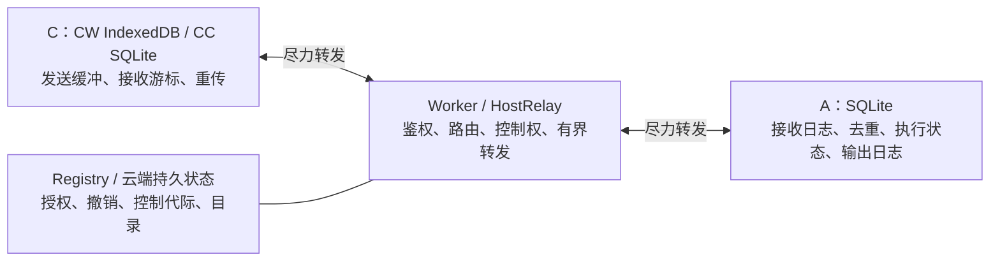

# 协议传输架构：Worker 权限控制与 A/C 端到端可靠传输

本轮验收范围补充（2026-11-01，用户指令）：仅使用本机源码实现与本地构建 / 测试，不运行 GitHub Actions；Windows 构建暂时移出本轮验收范围，不因此阻塞本机改造完成。原文的跨平台发行要求保留为后续发行事项，不能将未验证的平台标记为已通过。

状态：0.6.0 目标设计与实施计划，2026-11-01；已开始实施；当前已实现命令发布与恢复交换、独立完成日志与 transfer 正文交付、CC 输出先落盘，以及控制代际的持久隔离与 CONTROL_READY 握手、原任务取消标记和审批 runtime / version 绑定；已加入 Agent 命令 / 结果的持久全局预留和有界流退役；已加入客户端全局预留、网页缓存总量及输出背压；已加入持久历史订阅确认与尾部通知恢复；Worker 传输进度读写已全部移除，只读控制查询已迁入有界内存转发，本地取消身份已独立持久拒绝；已加入权威历史 / 正文的持久总预算；Worker 业务 Operation 正文与结果已迁入有界内存，ticket / 接管使用独立有界权限记录；其它业务与控制资源的统一预算及执行端旧业务路径清理仍待完成，完整架构及 0.6.0 尚未完成或部署。架构改造完成后统一升级版本至 **0.6.0**。A 指 Agent；C 包括网页 CW 和原生 CC。本文中的 Worker 指云端入口及 HostRelayDO / RegistryDO 整体。

本设计取代 0.5.18 中“Worker 持久登记双方发送头并随业务帧补充进度”的目标要求；[现行协议](RELIABLE_TRANSPORT.md) 继续描述已有实现。核心变化是：Worker 决定谁能向谁发送什么消息，并尽力转发；消息是否收到、是否需要补发、是否已经执行，只由 A/C 的持久状态决定。

## 1. 职责与信任边界

| 职责 | Worker | A / C |
| --- | --- | --- |
| 准入与权限 | 验证角色、主机、会话、操作权限、授权撤销 | A 继续执行项目、RPC 允许列表、沙箱和审批策略 |
| 控制权 | 权威租约、接管、控制代际与 Agent 连接代际 | 校验中继绑定的当前身份和代际，隔离旧流 |
| 消息转发 | 在线路由、帧大小限制、有界队列和限流 | 处理丢失、重复、断连及跨连接乱序 |
| 可靠性 | 不生成端到端确认，不登记传输进度 | 持久发送缓冲、连续 ACK、重传、信用和去重 |
| 数据与结果 | 不持久保存可靠通道正文、结果或发送头 | A 保存权威历史和执行记录；C 保存本端进度和待处理请求 |
| 恢复 | 恢复授权和路由，重新核验权限 | 直接交换本端持久状态并对账 |

“不可靠转发”指不承诺应用层送达、顺序恢复或执行成功，并非改用 UDP。继续使用现有 WebSocket / HTTP 与 TLS；HTTP 成功、WebSocket.send 成功、协议 Pong 都不能代替对端的持久接收确认。Worker 仍是受信任的权限边界，本方案不新增端到端加密。

云端并非完全无状态。授权、撤销记录、控制租约 / epoch、Agent 身份、目录和必要的管理元数据仍可持久化；移除的是可靠传输进度与业务补发责任。每个业务帧不再因为更新发送头、ACK 或信用而产生云端存储写入。

## 2. 权限控制不能被可靠封装绕过

Worker 在建立连接和每次转发时按现有策略校验发送者、接收者和操作范围，继续使用有失效机制的鉴权缓存。显式撤销使缓存失效并关闭对应连接；跨重连、HTTP 备用入口、读取、ACK、窗口查询及补发均须重新通过权限检查。

外层路由包含主机、会话、方向、流、操作类别和当前控制证明。主体身份来自已认证连接，由 Worker 绑定，不能采用客户端自报的 owner / authHash。Worker 校验外层操作类别与内层实际命令一致，禁止将写操作伪装成只读查询或 ACK。A 再次执行业务允许列表与本机权限检查。

控制代际属于权限状态，不属于可靠进度。旧控制端即使持有未确认命令也不能绕过接管后继续写入。普通重连可在核验原主体、流与恢复证明后恢复原逻辑流，并绑定新连接租约；接管则建立新的控制代际和流，不能继承旧端信用。旧流的结果只能由仍有对应读取权限的主体查询，不能借查询重新取得写权限。

### 2.1 控制代际的生效边界（R2）

`controlEpoch` 表示控制权代际，`connectionGeneration` 表示某次连接绑定，存储实例表示持久数据身份；三者不得互相代替。普通重连可以更换连接代际而保留原控制代际和逻辑流；显式接管必须增加 controlEpoch。

接管流程固定为：

1. Worker 在权限事务中分配单调增加的 controlEpoch，保存 pending 的控制主体 / 接管请求身份，立即拒绝旧控制端的新写入。重复接管请求返回原代际；此时只能向新 C 报告“等待 A 确认”，不能报告接管成功。
2. 新 C 通过 OPEN / RESUME 重试请求生效；Worker 每次重新核验当前 pending / active 租约，并绑定可信控制证明转发给 A。客户端自报 epoch 不授予权限。Worker 不保存或重试该数据帧。
3. A 在同一串行状态机中校验控制证明，事务提交新的 controlEpoch，同时将旧代际 `received` 但未 `started` 的命令终结为 `STALE_CONTROLLER`，保存对应结果并关闭旧流的新写入资格。旧代际已 started 的工作不重放、不声称取消，继续记录真实结果；需要中断时使用针对原任务的独立命令。
4. A 仅在事务提交后返回 CONTROL_READY，包含接管请求身份、controlEpoch、A 存储实例及本次恢复交换 ID。Worker 验证它仍匹配当前租约后将权限状态标记为 active，再向 C 转发。C 收到匹配确认后才发送新业务。A 的提交是旧命令执行隔离的生效点；Worker active 及 C 确认完成新端准入。

CONTROL_READY 丢失由 C 使用原接管身份重试；A 返回已持久保存的确认。C 退出时 pending 可以持续阻止旧端写入，后续恢复或新接管解决；已分配代际不能回退给旧端。Worker 重建从权限记录恢复 pending / active；这些权限事务及确认状态不属于数据传输 ACK 日志。A 重启须先恢复持久代际，再开放业务，不能只依赖内存 runtime 的 epoch。

A 将“检查当前控制代际 → 标记 started → 向执行器派发”与代际切换串行化；异步执行器不能把未跨过该开始边界的旧工作留在独立队列后继续执行。发生崩溃时按 started 的未知结果规则处理。

撤销在 Worker 阻止转发后即完成云端准入撤销，但不承诺 A 已同步停止待执行工作。Worker 在后续获授权的控制同步 / A 重连中附带最新撤销或控制代际；A 持久应用后终结相应的未开始命令。在此之前已送达的命令仍可能开始，界面必须区分“入口已撤销”与“A 已确认隔离”。离线 A 的立即停止不属于本协议保证；不依靠一次尽力通知宣称已经停止。

## 3. 端到端流与消息模型

逻辑流身份绑定：`hostId + sessionId + 授权主体 + A存储实例 + C存储实例 + streamId + direction + lane`。会话创建等无 sessionId 的操作使用明确的主机 / 操作作用域。连接 ID 可变化，逻辑身份与原 requestId 不随重连变化。清空数据库生成新存储实例，禁止沿用旧实例把序号归零。

以下为拟议协议语义，字段名在实现时由共享 Zod / C++ 样例固定；不能直接把它们作为当前可用 API。0.6.0 业务通道要求 `delivery: 2`，握手仅校验是否支持，不回退到旧协议。原生 update 命令及自动更新使用的发行清单 / 构建身份 `protocol` 保留现有值 `1`，原因见第 8 节；它不再单独代表业务协议兼容。存储 schema 独立演进。

| 消息 | 端点生成的内容 | 用途 |
| --- | --- | --- |
| OPEN / RESUME | 实例、逻辑流、controlEpoch、connectionGeneration、exchangeId、已发布头、连续接收位置、结果确认位置、信用代际 | 初次建立或重连对账 |
| CONTROL_READY | 接管请求身份、controlEpoch、A 实例、exchangeId | A 已持久应用控制代际，供 Worker 核验新端准入 |
| DATA / COMMAND | 流、seq、累计字节 end、原 requestId、固定 body 及摘要 | 可重传的数据 / 命令 |
| ACK / WINDOW | 连续已持久化 seq、对应字节位置、绝对信用右边界 | 确认接收并发放容量 |
| RESULT | resultStream、resultSeq、commandSeq、requestId、终态、固定摘要、正文或内容描述符 | 按完成日志传输最终结果 |
| RESULT_ACK | resultStream、连续 resultSeq、对应累计字节位置 | 确认已持久接收的连续最终结果 |
| QUERY / SYNC | 原请求身份或历史 revision / 输出 seq | 查询结果、补齐缺口 |
| RESET / ERROR | 实例冲突、数据回退、过期流或权限错误 | 停止错误流的自动恢复 |

A/C 仅公布自己的发送进度和接收进度；附带对端状态时只能作为先前观察值。Worker 不补齐、不合并、不持久化 `heads`。端点拒绝超出已发布范围的 ACK、错误实例 / 方向 / 流的确认和不合法的字节位置。计数须使用跨语言一致的安全整数范围，耗尽时显式结束流，不能回绕。

历史 revision、命令 seq、结果 seq 与 CLI RPC 输出 seq 保持独立，不能相互代替。订阅者各自确认，某个 C 的 ACK 不代表其他 C 已接收。

### 3.1 ACK 与恢复快照的区分（R1）

所有回调与响应绑定本地当前 connectionGeneration；OPEN / RESUME 另使用唯一 exchangeId，响应必须回显。退休连接、过期恢复交换的响应直接丢弃，不得更新 ACK、信用或控制状态。恢复期间暂停新业务发送，双方先提交本端发送冻结点，再读取恢复快照；当前交换完成后才重新发送，避免把恢复快照采样后的新进度误判成回退。

在线 ACK 在通过实例、流、方向和发布上界校验后只单调推进：小于已确认水位的旧 ACK 忽略；同水位的字节位置必须一致，不能用相同 seq 更改边界。WINDOW 的接收水位与信用各自合并，旧 ACK 不使仍有效的更大信用失效；信用须符合第 5 节的代际和原子预留规则。

存储回退仅由当前 exchangeId 对应的权威持久快照判定：与交换开始前本端持久保存的已确认水位比较，若对端报告更低水位或缺失已确认数据，则冻结恢复。恢复快照不是任意在线 ACK；`ACK(12)` 后到 `ACK(10)` 不触发冻结。实例变化同样停止原流自动补发，不把旧确认套用到新数据库。

## 4. 命令、确认与执行

1. 发送端先持久保存原 requestId 和固定命令内容；尚未取得信用的本地排队项不分配传输 seq。取得信用后，在同一事务分配 seq / end、固定摘要并推进已发布头，再允许网络发送。此处“已发布”表示已不可撤回地提交给传输层，网络调用尚未执行也必须按原身份补发。
2. 接收端校验身份、信用和负载，将接收记录与连续接收位置同事务提交后发 ACK。最大已见序号不能越过缺口推进 ACK；乱序缓冲必须有界。
3. 相同流 / seq / requestId / 摘要的重复消息仅返回原 ACK 或结果；身份相同而内容不同返回冲突。每条有序流按序释放执行，不能因先到后续帧而越过缺失命令。
4. 收到 ACK 后发送端停止重传命令正文，但保留原请求的待结果记录。接收端记录 `received → started → completed / failed / result_unknown`，未开始即被取消或隔离的命令可从 received 直接进入明确失败终态，执行结果独立返回。
5. 结果在 C 持久提交后才发结果 ACK 并清理本地待处理项；A 在结果未确认期间保留可查询结果。结果 ACK 丢失时，重复结果只触发再次确认，不重复 UI 操作或业务执行。

传输保证以双方存储可用、权限与流仍有效、端点持续运行且重试调度能获得执行、网络最终可完成双向交换为前提，通过持续重传达到至少一次送达，再由接收日志去重。浏览器挂起、端点退出或显式暂停期间不承诺自动送达，恢复运行并重新授权后才继续。不能承诺任意外部副作用跨进程崩溃的恰好一次执行。A 重启后已开始但无法证明完成的操作保持 `RESULT_UNKNOWN`，只能对账，不能盲目重做。沿用当前 runtime 重启终结策略；未执行命令按业务策略明确失败，不因新协议自动恢复旧进程。

去重记录清理必须独立于正文清理：已确认正文可以压缩，但须保留流实例、连续接收水位及必要的去重摘要 / 终结标记。关闭流永久拒绝旧流写入，不能因日志过期重新执行迟到命令。未确认的临时结果按第 4.2 节保留；独立历史或被显式清理的数据不可用时返回明确错误，不按新请求执行。

### 4.1 跨通道取消与审批（R3）

priority 只提供容量与调度优先，不隐含它与 normal 的执行顺序。取消必须携带目标的主体 / 控制代际 / 逻辑流及原启动 requestId；针对已经存在的 turn 还须携带 turnId。禁止把无法定位目标的请求解释为“取消当前任意任务”。审批必须绑定具体 runtime、审批 ID 和审批版本，过期目标返回明确拒绝。

- 本地尚未发布的命令：发送端事务终结该排队项，不产生 seq，也不发远程取消。发布与本地取消使用同一串行锁，不能一边删除一边发送。
- 已发布但 A 尚未接收、或已接收未开始的命令：A 持久保存针对原身份的取消标记，并将已接收项终结为 `CANCELLED_BEFORE_START`。迟到启动仍须按原 seq / body 接收以补齐传输前缀，但只返回取消结果，不派发副作用。针对未知目标的取消标记也占有界预算；容量不足时拒绝取消，不谎报成功。
- 已 started 的命令：取消映射到该目标的中断操作；收到取消 ACK 仅说明取消已持久接收。只有执行端确认目标终结才显示“已停止”；目标已完成返回实际终态，无法证明停止则返回 `RESULT_UNKNOWN` 或明确中断失败。

取消和启动的状态转换在 A 同一串行状态机内执行。已发布命令不能从 outbox 删除，即使取消先成功，也要补齐原传输序号并取得目标终态，或显式终结整个流；不能留下永久缺口。取消标记保留到目标已形成持久终态且其迟到副本可由接收水位拒绝，或整个流已按第 5.1 节关闭。新控制端针对旧端已开始任务的中断须引用准确任务身份并重新授权，不继承旧流信用。

### 4.2 结果流与正文生命周期（R5）

每个命令 lane 对应独立结果流。A 在最终结果提交事务中按完成日志顺序分配 resultSeq，保存 commandSeq / requestId、固定正文或描述符及摘要。命令 2 先完成时可获得 resultSeq=1，命令 1 后完成获得 resultSeq=2；结果确认依据 resultSeq，不依据 commandSeq。received / started 查询状态不是最终 RESULT，不占最终结果序号。

C 有界缓冲乱序结果，只在对应记录及必要正文持久保存后推进连续 resultSeq；结果缓存、已确认前缀和原请求终态同事务提交。A 仅回收 RESULT_ACK 连续前缀内的传输记录，不能根据某条较大的 commandSeq 删除其它结果。结果传输使用独立的条数 / 字节窗口，重传与重复 ACK 都不重复计费或执行。

内容描述符必须固定内容身份、revision、长度、摘要和保留类别：

- `transfer`：临时结果正文属于可靠交付内容。C 必须分块取得完整正文并校验、持久提交后才可确认该 resultSeq；仅保存引用不能 ACK。A 在收到该结果 ACK 前保留描述符和全部分块，结果 ACK 后才允许回收。
- `history`：引用 A 的权威历史，RESULT 交付的是不可变引用及业务终态。C 保存描述符即可确认；ACK 不删除历史正文。历史按独立保留 / 显式清理规则管理，不保证引用永久可读；过期返回 `CONTENT_UNAVAILABLE`，不把已完成任务改成待执行。

正常运行不因 TTL 或空间不足删除未确认的 transfer 结果；以全局背压停止新任务。明确关闭 / 放弃流或显式数据清理时须记录结果已放弃 / 不可恢复，禁止日后重新执行。大结果分块读取不消耗新的命令执行信用，但受独立读取并发、接收字节与磁盘预算约束。终态描述符和失败结果应有预留空间；无法持久记录终态时停止接收新副作用，不返回伪造成功。

## 5. 接收信用与有界资源

信用由实际接收端提供，按条数和累计 UTF-8 字节的绝对右边界约束发送；同代际的新授权可以增加边界，重复 / 乱序公告不能重复增加额度或收回已承诺的范围。接收端持久保存信用代际及承诺，恢复后不能把旧公告误当新额度。未完成命令仍占执行容量，ACK 本身不意味着执行缓冲已释放。

保留 normal / priority 分离，审批与中断有独立预留容量。初始可沿用 0.5.18 的 normal 16 条 / 2 MiB、priority 4 条 / 512 KiB 接收预算，最终参数须压测确认。ACK / WINDOW / 恢复控制帧使用有界预留通道，不消耗普通数据信用；它们不能携带任意业务写操作。

A/C 的发送缓冲、乱序缓冲、未确认结果和本地磁盘均有容量上限。容量不足时停止接收新任务并显示背压，不能丢弃已确认的未执行命令。CW IndexedDB 不可用或写入失败时，拒绝提交要求持久保证的写操作，允许只读与显式恢复；不能退化到内存队列后仍宣称可靠。

Worker 仅执行每连接 / 每主机队列预算、帧上限和公平转发；沿用 256 KiB 单帧约束，计入 JSON 转义及外层封装。慢接收端可被拒绝或断开，其未确认消息由 A/C 恢复。Worker 不保存待补发队列；可观察的排队失败返回临时错误，重建时丢失队列则由端点超时发现。

### 5.1 全局预算、预留与流退役（R4）

各端同时维护全局、会话和流级预算；上述单流初值只是上限，不保证每个新流立即获得全部额度。条数和字节分别满足下式；保留量仅统计尚未转换为实际占用的专用空间，避免重复计数：

`已占用资源 + 已发放但未消费的信用预留 + 控制/priority 保留量 ≤ 对应总预算`。

已占用资源包括命令 / 乱序缓冲、未确认结果、临时正文、取消标记及必要去重元数据。接收端发放信用时，在同一持久事务中记录新右边界、扣减全局可分配资源；接收数据时把对应预留转为已占用，不能再次扣减。预算须计入记录、索引、封装与分块元数据开销；UTF-8 正文字节 end 只是协议计量，不能直接等同磁盘占用。重复帧不重复消费；完成命令只释放执行容量，尚未确认的结果仍占结果预算，不能因为命令完成就绕过全局上限。

normal、priority、结果和 ACK / 恢复控制从真实总预算中划分资源；normal 不能借用 priority 或控制保留。给命令发信用时预留最小终态记录容量；执行中的大输出另走有界日志 / 分块预算，无法继续写入时背压执行器或明确终结任务，不以无限缓冲承接输出。磁盘配额突变 / I/O 失败属于存储故障，停止新接收且不 ACK；不能以已经公告信用为由虚报落盘成功。

信用代际在流存活期间不变，重连恢复同一份持久承诺。撤回预留必须先事务终结旧流 / 信用代际，随后拒绝该代际的迟到数据，最后释放未消费预留；不得仅因订阅超时先释放预算又接受旧信用。单纯断线不删除已确认数据或未决结果；显式放弃及订阅退役须有独立记录，并使下一次恢复收到 `STREAM_CLOSED` 或 `RESULT_UNAVAILABLE`。

流由接收端在已认证的作用域内分配单调 streamSerial；每个作用域保存分配上界、连续关闭水位、有限活跃集合及有界的离散关闭记录。相同 OPEN 身份在活跃期返回相同流；低于关闭水位或已分配但不在活跃集合的旧流永不重新开放。关闭记录不能压缩时停止分配新流，不能无限积累 tombstone。作用域整体退休后，以仍受校验的命名空间 / 授权代际拒绝旧 OPEN；不能删除最后的拒绝边界后接受客户端自报旧 ID。

旧流未决请求不得自动搬到新流；重新发起操作须有明确新意图。清理正文不改变终结水位或已执行请求的拒绝规则。各种预算数值在实现配置与测试中固定，但不能取消上述总量约束。

## 6. 重传、尾部丢失与断线恢复

存在未确认 DATA / COMMAND 时，发送端使用有抖动的指数退避和单个合并重试调度器，按原身份补发；ACK 丢失由接收端对重复帧重新确认。收到命令 ACK 后改为查询原结果，不能再次创建任务。结果由 A 保留并重传，或由 C 对原请求查询，二者共享去重语义。

尾部丢失必须由发送端未确认记录触发恢复，不能依赖“下一条业务消息带头”来发现。A 已产生历史 / 输出但 C 尚未确认时，A 保留待同步状态，在订阅有效期间重试有界通知或数据；C 根据本地连续游标补取。历史仅需保存权威日志与订阅进度，无须为每个 C 复制完整正文日志。合并通知不能跳过中间 revision。

### 6.1 持续恢复与暂停边界（R6）

有待发送命令但信用为零时，重试窗口查询，防止最后一条 WINDOW 丢失造成永久等待。本设计选择“有限快速重试 + 有未确认工作时持续慢速恢复”：快速预算耗尽后，进入有抖动的低频恢复阶段，默认每个对端 30–60 秒合并一轮，每个对端至多一个恢复交换在途，并受进程级并发与字节预算限制。排队等待信用、待命令 ACK、待结果或待正文均属于未完成工作。

慢速阶段查询或重传原身份，成功推进后按当前待办重新调度；待办清空立即停止。界面显示“等待恢复”，不能因进入慢速阶段宣告失败、成功或丢弃请求。传输未知不等于业务 `RESULT_UNKNOWN`，后者需要执行端的状态证据。普通无副作用读取仍可采用有限重试，不强制无限重试所有读取。

认证撤销、存储冲突、明确终结流或用户暂停时停止自动发送；浏览器挂起、程序退出也暂停运行时调度。持久待办在再次运行、重新授权且允许恢复后继续，不生成新身份。正常空闲无轮询只适用于没有未完成工作的情况；网络最终恢复但端点一直暂停时不承诺最终送达。上述默认时间是待实现参数，不是已验证 SLA。

正常空闲且无未确认工作时，不新增可靠协议轮询。若 C 关闭页面或订阅断开，A 停止该在线订阅的重试，保留可恢复历史；C 返回后主动 SYNC。对于已经发放且仍存在的订阅信用，A 必须保留足够恢复状态。浏览器缓存被清理、Agent 存储丢失或历史被明确清理时，返回明确的恢复边界，不能保证永久补齐。

重连顺序为：Worker 鉴权与路由绑定 → A/C OPEN / RESUME → 校验实例与控制证明 → 比较各自持久游标与信用 → 补发缺口 / 查询结果 → 恢复新数据发送。只有第 3.1 节当前恢复快照证明的持久水位回退、实例变化或已确认数据缺失才冻结自动补发并报告存储冲突；在线旧 ACK 不触发冻结。Worker 重建不参与补洞，只恢复权限与路由；云端权限状态无法恢复时必须拒绝控制，不能清零 epoch 放行。

CC 将输出持久写入本地接收日志后确认给 A，再交给本地 TUI。交付给 TUI 与本地落盘无法成为同一事务时，崩溃边界仍可能结果不明，不承诺旧 TUI 跨进程自动恢复；此限制应与当前 CC 附着规则一致。

## 7. 消息分类与适用范围

| 业务 | 目标处理方式 |
| --- | --- |
| 任务、审批、中断、CLI 写 RPC | C → A 持久命令窗口，A → C 可查询结果 |
| 历史与大正文 | A 权威日志 / revision，C 连续游标、按缺口分页与分块读取 |
| CLI RPC 输出 | A 持久输出日志，C 独立 ACK 与接收窗口 |
| 纯读取 / 快照 / 模型列表 | 请求端超时重试；按版本读取；不进入执行窗口 |
| 在线通知 / 目录变更提示 | 尽力推送，重连或刷新读取权威快照 |
| 创建 / 停止会话、项目修改、文件上传 | 逐项迁移到 A/C 原请求去重、版本 / 偏移校验和结果查询，不要求共用会话窗口 |
| 配对、授权、撤销、控制租约 | 云端权限控制事务，继续由 Worker / Registry 负责 |
| 远程配置 / 重启 | 保持独立管理员通道；执行端保留本地回执，发起端按原请求对账 |

不能仅删除会话 `heads` 就宣称整个 Worker 已无可靠业务存储。现有云端 Operation 回执、会话创建身份和上传完成状态须逐项盘点；迁移后 A 必须能从原请求找回已创建的 sessionId / 业务结果，C 必须在首次发送前保存该身份。开发期间按入口推进改造，0.6.0 验收前必须完成本轮业务范围的改造，不能把旧机制作为正式兼容路径保留。控制平面自己的事务回执不属于 A/C 数据传输日志。

实施进展（2026-11-01）：A 已加入非会话窗口写业务的原请求回执基础，执行前持久 started，按主体 / requestId、Agent instance 及 action / data 摘要拒绝重开和内容冲突；终态落盘后才回复，重启后的执行中请求固定为 RESULT_UNKNOWN。确认匹配原请求后释放正文，保留有界拒绝身份；预算为全局 128 MiB、主体 32 MiB、1024 项身份，每项执行前预留 256 KiB 加 8192 字节元数据。Worker 对携带 intent 的请求提供独立内存转发并绑定实际鉴权主体，停止及确认仍先核验会话模式。CW / CC 的完整首次意图保存和全部业务接入尚未完成，旧写路径仍待移除，P4 不因此勾选。

CC 接入进展：创建 / 观察、停止、排队、审批及项目修改已先在共享 SQLite 保存完整固定意图与 Agent 实例；终态证明匹配且本地提交后才确认。待原结果 / 确认均按原身份快速后持续慢速恢复，进程退出暂停，request 原编号继续；明确 RESULT_UNKNOWN 不转新执行。账本使用既有全局命令额度中的 32 MiB 预留，最多 32 项未确认 / 1024 项身份，结果尾部 16 项 / 4 MiB；多进程事务去重，清普通缓存保留待办。CW 及其余业务仍待接入，完整 P4 仍未完成。

CW 接入进展：网页创建 / 停止会话和项目修改已接入同样的原请求账本。首次意图先以 IndexedDB 原子 read-modify-write 占用既有 32 MiB 预留，再查询并持久绑定 Agent 实例；Web Locks 在同一主体 / 主机范围串行网络交换，并以四个全站槽限制在途交换，BroadcastChannel 唤醒其它标签页。最多 32 项未确认 / 1024 项身份，终态提交后才确认，确认后回收输入并保留 16 项 / 4 MiB 结果尾部及永久拒绝摘要；无待办停止恢复。管理员项目管理使用实际 owner 哈希及同一主机范围，云端 identity / probe 仍验证 owner 和主机有效性。上传及其余写入口、旧业务路径去除仍待完成。

## 8. 0.6.0 实施计划

### 8.1 版本与兼容性决策

本轮改造完成后，Worker、CW、coc-agent 与 coc-client 统一发布 **0.6.0**。当前处于计划阶段，不提前将现有 0.5.x 实现标记为 0.6.0 已完成。

**唯一兼容性范围是原生程序升级链路：coc-agent 优先保留自动升级，实现困难时允许退回手动 `coc-agent update`；coc-client 只要求运行 `coc-client update` 能从旧版更新至 0.6.0，不要求旧业务报错后自动更新。Agent 自动升级不是本轮发布的硬门槛，手动升级路径必须可用。** 其余不考虑向后兼容：不维护 `delivery: 1`、旧业务 API / 帧格式、双协议运行、旧传输状态恢复、旧缓存格式或旧版降级读取。新旧组件混用时明确拒绝业务操作并提示升级；旧 CW 重新加载新版资源。

不要求将旧会话、未确认命令和传输游标迁入新协议。切换前停止接收新任务，等待现有任务结束并核对未决结果；未知副作用不得自动重放。可以启用新传输存储命名空间 / schema，旧数据备份隔离，不能解释成新流。取消兼容要求不等于授权清空凭据、配置、项目、历史或生产数据库；相关数据变更须由明确的切换脚本处理，不能用删除整库代替协议重构。

### 8.2 按顺序执行的工作项

实施记录：[状态盘点与切换清单](TRANSPORT_STATE_INVENTORY.md) 列出了云端字段及各业务入口的去向。本轮已实现 CW / CC 信用后发布、恢复 exchangeId 隔离、ACK 字节边界校验、持续慢速重试、独立结果日志及 transfer 全文确认、CC 输出先落盘、delivery 查询纯内存转发，以及 Worker 预先隔离旧端、A 事务终结旧代际未开始命令、CW / CC 等待 CONTROL_READY 的接管握手；P3 已完成 Worker 传输进度读写的移除，并独立保留控制端 / Agent 代际核验；未完成的全局预算及其余云端业务收敛仍保留待办。本轮用户要求仅在本地构建 / 测试，不运行 GitHub Actions；实际发行与部署仍未执行。

以下按当前实现及本地验证记录进度，勾选必须有对应证据。

- [ ] **P0：固定边界与盘点状态。** 列出 Worker 中发送头、ACK、信用、Operation / wire 回执、归档字段及每个业务入口的依赖；区分必须保留的权限 / 控制状态和必须移出的传输 / 结果状态。输出字段去向和切换清单，覆盖创建 / 停止会话、项目修改、文件上传与配置管理；固定第 2.1–6.1 节的状态边界和全局资源预算。
- [ ] **P1：定义唯一新版协议。** 修改 `packages/protocol/src/delivery.ts`、C++ 校验及共享样例；固定实例 / 主体绑定、恢复 exchangeId、控制生效确认、取消目标、独立结果序号及保留类别、全局信用预留和错误语义。更新生成协议文档，删除旧业务帧和降级分支；未知版本在业务处理前拒绝。
- [ ] **P2：实现 A / C 可靠状态机。** 改造 `native/src/delivery.cpp`、`native/src/delivery_client.cpp`、`apps/web/src/delivery.ts` 及本地存储；实现发送前落盘、去重、持久信用、独立结果确认、尾部丢失恢复、快速 / 慢速重试、取消标记、全局预算和 CW 多标签页隔离。输出、历史和命令分别维护游标，先通过端点故障测试。
- [x] **P3：收敛 Worker。** 改造 `apps/relay/src/host.ts`，移除 `heads()`、`advanceAgentHead()` 等传输进度读写和云端补发依赖。将 `controllerHeads()` 当前承担的控制端 / Agent 代际核验单独提取，保留鉴权、接管、撤销、路由与有界背压；HTTP 与 WebSocket 使用相同权限边界。
- [ ] **P4：完成全部业务入口改造。** 创建 / 停止会话、项目、上传及管理操作使用执行端原请求去重和结果查询；创建回执须能从原 requestId 找回 sessionId。删除云端可靠业务回执依赖和旧业务路径，清理旧传输字段的写入 / 归档代码，保留控制平面事务。
- [ ] **P5：打通升级路径。** 先验证真实旧 `coc-agent update` / `coc-client update` 的下载、校验、安装与新版启动。评估 Agent 自动升级最小通路；实现困难时记录采用手动升级，不为旧握手引入业务兼容。采用自动方式时另测更新开关及空闲安装。
- [ ] **P6：验收与统一版本。** 完成第 9 节故障 / 权限 / 资源测试与选定升级路径测试；将 `package.json`、`package-lock.json` 根包版本和 `CMakeLists.txt` 统一改为 `0.6.0`，检查所有构建版本来源。更新 CHANGELOG、USER_GUIDE、ARCHITECTURE、REQUIREMENTS、RELIABLE_TRANSPORT、RELEASE 与 TEST_REPORT，移除当前文档中作为现行要求的旧协议说明，历史发布记录保留。
- [ ] **P7：准备发行与切换。** 对最终版本提交运行全部必需 CI，核对 Worker / CW、四平台原生包、源码包、发行清单与程序 `--version` 的版本 / 提交 / 摘要一致。按 8.4 节准备可审查的发布步骤与证据；实际发布和部署不属于本次写计划动作。

### 8.3 原生升级路径与手动回退

现有 `native/src/update.cpp` 在下载前要求 `release.protocol == build.protocol`，安装前还会比对候选程序的 version / commit / sourceDigest / protocol。显式 update 也使用这些校验，因此即使放弃 Agent 自动更新，本轮仍保留发行字段 `protocol: 1`，业务协议通过必需的 `delivery: 2` 独立校验，不能伪造清单或放宽完整性校验。

保留旧更新器依赖的下载地址、清单结构、平台命名、归档成员、SHA256 与候选构建身份格式，以及 TLS、来源限制、更新锁、原子替换和安装失败恢复能力。自动升级不是发布硬门槛；支持 update 命令的平台必须验证手动路径。Windows 沿用已支持的官方 ZIP 手动替换流程，不把原先不支持的 update 命令写成跨平台承诺。

**必需的手动路径：** 等待 Agent 活动任务结束，停止既有 Agent 服务，使用该服务用户执行 `coc-agent update --config <实际配置路径>`，再启动服务并核对运行版本及新版握手。client 退出旧 TUI 后执行 `coc-client update`（自定义凭据文件时使用原 `--config`），完成后重新运行。两个命令都直接下载、校验和安装，不依赖旧会话握手；manual=true 不受自动更新关闭选项阻止。安装替换不会自动切换仍运行的旧进程，不能仅凭 update 命令成功认定服务已经升级。

**可选的 Agent 自动路径：** 若能保持简单且经旧二进制验证，保留最小的旧 hello / 发布通知通路，Agent 自动发现版本、准备制品并在空闲后安装重启。该通路不放行旧业务。若需要复杂旧握手或与新版准入冲突，则在 P5 记录手动回退决定，删除此项兼容依赖，发布说明给出上述停服 / update / 启动步骤；不因自动路径不可用阻塞 0.6.0，也不误报该路径可用。

必须使用真实旧发行二进制验证两条手动 update 路径，覆盖当前部署的平台 / 版本；选择自动路径时再验证 Agent 的真实自动升级。两种方式均核对新进程 `--version`、配置 / 身份保留及新业务握手，并测试损坏包、网络中断、平台不匹配和安装失败。自动方式另测关闭自动更新及存在活动任务；手动方式验证服务已停止且没有运行中的旧 TUI。扩展 `tests/native-update.py`、`tests/fixtures/update-relay.mjs` 及发行来源校验，不以新版模拟旧消息代替真实更新器验证。

### 8.4 切换与失败处理

1. 先完成新旧二进制升级演练、所有必需 CI 和制品校验，备份需保留的数据并列明新旧存储边界。切换安排维护窗口，停止新增任务并等待旧任务结束；不要求维持旧业务在线兼容。
2. 先使旧更新器可读取且可校验的 0.6.0 完整下载包与清单就绪，再切换 Worker / CW 的新版业务协议；手动 update 所需下载通路须始终可达；只有选择 Agent 自动方式时才要求最小旧握手 / 通知通路。若现有脚本无法拆分这两个步骤，应先扩展脚本，不以临时手工发布替代。
3. Agent 按 P5 已验证的方式升级：自动方式遵守更新开关和空闲条件；手动方式等待空闲、停服、执行 `coc-agent update` 后启动服务。client 在退出旧 TUI 后执行 `coc-client update` 并重新启动。未升级组件只获得更新能力或明确业务拒绝。CW 加载新资源并使用新缓存 / 传输作用域，不自动重发旧缓存中的任务。
4. 验证全部组件版本、新会话、正常消息、断线恢复、权限撤销及云端不再写可靠进度。记录源码提交、Actions、制品摘要、运行版本、切换结果和已知限制。
5. 不提供旧程序读取 0.6.0 新状态的降级兼容。候选安装前失败可继续旧二进制；新版已经写入状态后，失败恢复采用匹配的整套组件与切换前备份，并核对切换后的副作用，不能仅回退一个二进制或重放旧待办。优先修复向前，不宣称无损回滚。

## 9. 验收与观测

| 故障 / 场景 | 必须验证的结果 |
| --- | --- |
| 丢失最后一个命令、结果、ACK 或 WINDOW，之后没有新业务 | 端点发现并恢复，或明确保留待恢复状态；不依赖 Worker 发送头 |
| 重复 / 乱序 / 内容冲突 | 连续 ACK 不跨缺口，同身份不重复执行，冲突拒绝 |
| Worker / DO 重建，丢失全部转发内存 | 通过 A/C 对账恢复；授权与控制代际仍有效隔离 |
| A 崩溃、数据库替换 / 回退 | 实例检查生效，未知副作用不自动执行 |
| CW 刷新、多标签页、存储失败；CC 断线 / 重启 | 流隔离、落盘后确认和旧 runtime 恢复边界符合约定 |
| 授权撤销、接管、过期连接、跨主机伪造 ACK | 所有传输入口拒绝越权，无结果泄露或旧控制写入 |
| normal 耗尽、慢 C、磁盘满 | priority / ACK 可用，队列有界，背压不丢已确认数据 |
| 旧新业务版本混用、旧缓存 / 状态 | 明确拒绝旧业务，无降级分支，不把旧任务导入新流重放 |
| 真实旧 coc-agent update / coc-client update | 手动升级到 0.6.0，实际运行新进程并完成新业务握手；采用 Agent 自动方式时另验自动路径 |
| 升级失败与恢复 | 未安装时保留旧程序；写入新状态后不自动以旧版读取，不重放未知副作用 |
| 在线 ACK 12→10、退休连接回调 | 旧 ACK / 回调不冻结流；当前恢复快照中的真实水位倒退才冻结 |
| 接管确认丢失、A 在代际提交前后崩溃 | 新端等待匹配确认；旧 received 命令终结，started 工作不重放 |
| 启动丢失、取消先到、本地未发布项取消 | 已取消目标不启动，不留下传输序号缺口，不取消其它任务 |
| 多流同时兑现信用、重复 OPEN、流退役 | 总占用加未消费预留不超预算；退役后拒绝旧信用，关闭元数据有界 |
| 命令逆序完成、结果乱序、大结果只收到引用 | 按独立 resultSeq 确认；transfer 正文保存完成前不 ACK，不提前删除正文 |
| 快速重试耗尽后网络恢复且无新业务 | 运行中的端点经慢速重试恢复；暂停端点保留待办并明确恢复条件 |
| 正常空闲及持续流式负载 | 无待办时无新增业务轮询，新版数据帧无云端可靠进度写入 |

测试应扩展现有 `tests/native-delivery.ts`、`tests/web-delivery.test.ts` 及 relay 鉴权 / 顺序故障测试，使用双向独立丢帧与重建注入；这里只规定验收项，未声明测试已通过。记录端点未确认条数 / 字节、最老请求年龄、重试次数、缺口、信用停顿和未知结果；Worker 记录转发拒绝、队列溢出与鉴权失败，不记录正文和凭据。

预期收益是减少每帧云端存储操作及 DO / D1 迁移的传输状态耦合；代价是 A/C 承担完整恢复协议和本地存储压力。实际延迟、写入量、存储增长和费用变化需在同负载下比较，不能仅凭架构推断节省比例。

## 10. 复审意见落实（2026-11-01）

架构复审的六项意见已整合到本设计，并给出确定规则；以下“已落实”仅指文档，运行实现与故障测试仍待完成，P0–P7 不因此勾选完成。

| 审核项 | 本次设计决策 | 位置 |
| --- | --- | --- |
| R1 ACK 乱序 / 回退 | 在线 ACK 单调合并；仅当前恢复交换的冻结快照用于回退判断 | 3.1、6 |
| R2 接管边界 | A 持久应用代际、终结旧待执行命令后确认；C 重试丢失确认 | 2.1 |
| R3 跨通道取消 | 绑定原目标，取消标记抑制迟到启动；未发布项不分配 seq | 4.1 |
| R4 全局信用 | 占用与未消费承诺合并预算；先关闭旧流再释放预留 | 5.1 |
| R5 结果回收 | 完成日志独立 resultSeq；transfer 全文落盘后确认，history 引用独立保留 | 4.2 |
| R6 最终送达 | 有待办时持续慢速恢复；暂停端点不作送达承诺 | 4、6.1 |

升级策略已按最新要求修订：client 只要求显式 update，Agent 自动更新实现困难时可采用手动 update。两者升级后版本均为 0.6.0；其它旧业务 / 状态兼容仍不在范围内。

## CW 上传原意图与恢复（2026-11-01，本机验收）

网页上传已接入独立持久账本 delivery-outbox-upload:v2，完整文件、原编号、目标 / 覆盖选择及 SHA-256 在首次网络发送前原子保存，占用既有全局命令额度中的 32 MiB 预留；单文件 20 MiB、每个主机作用域一个未解决文件、128 项永久拒绝身份。begin / finish 使用原请求账本并提交终态后确认；分块 / 状态查询沿用原上传编号和 Agent 实例，先读连续偏移，再串行发送 64 KiB 原块，丢包按原块重传。Agent 校验完整 SHA-256 后才发布；C 保存匹配大小 / 校验和的终态后释放文件正文。已确认 HTTP 结果正文从有限尾部回收时，保留身份与实例仍可查原上传回执，不再次创建或发布。

关闭面板或显式暂停保留完整正文，重新打开自动沿原意图恢复；实例变化、原暂存未知或本地正文冲突冻结，不能以新编号重试未知副作用。普通缓存清理保留可靠账本。Worker 所有文件操作使用有界内存关联，不保存上传正文或结果。已通过上传单元故障测试、真实 IndexedDB 20 MiB 落盘 / 页面重开 / 清缓存保留，以及实际 Agent + Wrangler + Chromium 的首块已落盘后回包丢失、暂停关闭面板再打开恢复与逐字节校验。其它旧写路径清理、唯一 delivery:2 及完整资源验收仍待完成，P4 尚未全部完成；Windows 构建按用户要求不在本轮验收范围。

## delivery:2 准入与历史清理隔离（2026-11-01，本机阶段）

Agent 能力协商、CW 控制连接、CC ticket / attached / delivery-ready 及主机业务 HTTP 入口均要求 delivery:2；HTTP 使用 X-CoC-Delivery: 2，浏览器 WebSocket 使用 delivery=2。缺失、旧版及未知版本在处理业务前拒绝；客户端也核验中继响应版本。发行 manifest / 原生 build 的 protocol 仍为 1，保留旧更新器通路，不代表兼容旧业务协议。

CW 已移除裸 WebSocket 写入和旧 requests 查询回退，CC 附着要求持久账本及新版 ticket；CLI request 只恢复本地保存的完整原意图，本地找不到时返回 NOT_FOUND。服务端旧业务处理分支、云端旧 Operation 存储及接收端信用代际的强制帧绑定尚未全部删除，因此 P1 / P4 仍未完成，版本未升为 0.6.0。

历史订阅在每次发送 OPEN / ACK 前核验原持久记录；保存窗口使用原记录比较与替换事务。另一进程 / 标签页清空或更改记录时，旧订阅停止，迟到窗口不能重建旧身份，也不能继续以旧内存游标确认。CC 的耐久游标从实际缓存读取，不以进程内副本代替；清理后新的订阅使用新身份。

远程配置 / 重启的执行回执最多保留 256 项永久身份，每项上限 8192 字节；新身份在文件变更或重启前预留，容量满时返回 BACKPRESSURE，原身份仍可重查。该边界不以 TTL 或清理诊断尾部重新开放旧请求；全应用控制资源的统一验收仍待完成。

## 接收端信用分配的强制绑定（2026-11-01，本机实施）

WINDOW 必须包含 Agent instance、streamSerial 和 creditGeneration；CW / CC 在建立窗口及发布序号前验证并持久保存三者。delivery-command、delivery-query、delivery-content 和 delivery-receipt 均必须携带相同分配证明，Worker 只做结构和权限检查后原样转发，由 A 在接收命令、读取结果 / 正文或推进结果 ACK 前核验原分配。错误、缺失或跨流证明不消费原命令序号，也不为未知流分配信用。

首次 OPEN 允许尚无分配证明，但只能确认结果位置 0 / 字节 0，不能夹带结果 / 正文查询；接收后沿原分配恢复。已知窗口的 OPEN 按 lane 附带 allocations，HTTP 恢复读携带相同三元组。transfer 分块响应也须与原窗口的全部分配字段一致。此改动不允许回退旧业务帧；其它旧业务路径和云端 Operation 清理仍待完成，P1 / P4 尚未整体验收。

### Worker 业务回执去状态实施记录（2026-11-01，仅本机）

HostRelayDO 的全部非 ticket / attach 请求只使用有界内存转发（128 条 / 8 MiB，pending 与完成结果各最多 20 秒），不再持久写入业务 Operation、拆分正文、wire 或到期索引。重建后临时编号返回 RESULT_UNKNOWN，C 通过持久保存的原请求身份向 A 对账。权限事务使用独立 permission_ 编号及 permission-operation / permission-wire 记录，最多 64 条待定 / 256 条总数，每条 16 KiB；get 只保存 mode / sandbox，完整会话、标题和历史不进入权限回执。权限记录、wire 和到期索引同事务保存，重建恢复到期调度；D1 离线读取 / 确认仅适用于这类权限事务。归档和恢复过滤旧 operation / part / wire 与对应 due，继续保留租约、epoch 和授权。执行端旧业务处理路径、统一资源验收及真实旧更新器验证仍未完成，P1 / P4 不提前勾选。

## 控制类写入口的唯一原请求路径（2026-11-01，仅本机）

Worker 和 Agent 对 create / stop / queue / answer、项目修改以及上传 begin / finish 强制要求原请求 intent，缺失证明在执行副作用前返回 UPGRADE_REQUIRED。读取、ticket / attach、可靠会话 OPEN 和按原上传编号 / 偏移校验的 chunk / cancel 不进入此 HTTP 原请求账本；读取携带写证明仍拒绝。两端使用同一组 23 项分类样例，Worker 保留会话模式与项目管理授权检查。

会话创建 / 外部观察不再写 create:<key> 的旧 requests / request_states 副本，成功或失败只由 transport2_operations 返回原结果；create 控制帧移除旧 key 字段。删除 GET /hosts/:id/requests/:id、control request 及相应生成协议，CLI request 只使用此前保存的完整本地原意图。外部队列和审批的 HTTP 路径已通过持久操作账本，不再进入旧网页回执或外部 submission 普通缓存；不确定的队列回复重复查询仍返回原 RESULT_UNKNOWN，不生成新提交。裸会话写入、旧 Store API / 表创建及可选持久化 TUI 分支已在下阶段移除；完整 P1 / P4 仍需唯一上传格式和资源验收。

## 会话写入唯一命令窗口（2026-11-01，本机阶段）

Worker 和 Agent 均拒绝没有持久命令窗口的会话写入（UPGRADE_REQUIRED），包括网页任务、审批 / 策略 / 中断及 CLI 初始化、线程 / 任务修改和审批答复；只读 sync / models 与 RPC 读取允许列表继续直接转发。Agent 只由带原控制证明的 OPEN 生效控制权，不再由普通帧激活待定 epoch，接收命令前核验原流所属会话。CLI 输出始终写入有界持久日志，TUI 桥必须提供持久 Store，删除无账本直发分支。

网页及外部队列 / 审批已移除旧 begin / submitted / finish 回执和 external-submission 普通缓存路径；删除旧 Store API，新库不再创建 requests / request_states 表，重复与未知结果只由原命令或 transport2_operations 账本决定。此次不删除现有机器的数据文件，发行切换的备份 / 清理仍待实施。

## 上传原始摘要与实例的强制格式（2026-11-01，本机阶段）

上传 begin 必须携带完整文件 SHA-256，并随原路径、大小、覆盖选择一起纳入持久意图摘要；begin 的 Agent 实例由必需的 HTTP 原请求证明固定。chunk / status / cancel / finish 均必须携带原 agentInstance，finish 还须携带与 begin 相同的 SHA-256。Agent 在处理前拒绝缺失或错误实例及格式不合法的摘要；发布前重新读取暂存全文校验，原摘要、finish 摘要或实际字节不一致时均不发布。相同上传身份更改内容意图返回冲突，已完成或退役身份不能重新创建暂存文件。WorkspaceFiles 必须使用持久 Store，删除内存回执实现；不导入旧的缺摘要 / 无实例业务格式。

本机验证涵盖 C++ / Zod 共享缺字段与错误格式、实例替换、重复 begin 内容冲突、暂存字节不符以及持久回执与资源承诺；仍需完成统一资源预算、真实旧程序升级与最终切换，不能据此声明 0.6.0 整体验收完成。
