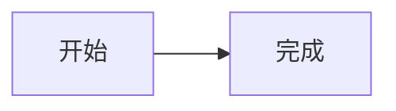

# 用户手册

[文档索引](README.md) · [开发说明](DEVELOPMENT.md) · [发布操作](RELEASE.md)

本手册描述当前源码支持的行为。实际运行版本请查看程序 `--version` 或网页版本信息。

## 快速导航

- 初次使用：[组件与权限](#组件与权限) → [安装与前置条件](#安装与前置条件) → [运行 Agent](#运行-a)。
- 客户端：[CLI](#使用-cc)、[网页](#使用-cw)、[工作台](#cw-工作台)。
- 管理：[管理网页](#管理网页)、[远程配置](#远程替换配置与重启)、[Access](#cloudflare-access邮箱授权与管理员邮箱)。
- 恢复：[断线边界](#断线与当前边界)、[历史保留](#历史保留配额与备份)、[排错](#排错)。

## 组件与权限

| 简称     | 组件                                | 职责与凭证范围                                                 |
| -------- | ----------------------------------- | -------------------------------------------------------------- |
| R        | Cloudflare Worker / Durable Objects | 登录审批、授权校验、撤销、中转                                 |
| A        | `coc-agent`                         | 运行 Codex；审批指定本机的 CC / CW                             |
| CC       | `coc-client`                        | 一份凭证仅访问一个指定 A 的客户端功能                          |
| CW       | 网页 Codex 客户端                   | 一份浏览器凭证仅访问一个指定 A 的客户端功能                    |
| 管理身份 | 网页管理入口                        | 审批 A / CC / CW 登录、查看和撤销设备；不能直接操作 Codex 会话 |

本地提供 `coc-agent` 和 `coc-client` 两个程序。A、CC、CW 使用相同的设备授权机制。每份授权独立，绑定角色和设备；CC / CW 额外绑定目标 A。不同角色的凭证不能互换。CC 控制 CLI 模式会话，CW 控制网页模式会话。

每次登录申请有效 5 分钟。批准后领取的设备凭证没有固定到期时间，直到 R 撤销。不要把配对码当作凭证；只有发起申请的程序或浏览器能够领取对应授权。审批方需核对申请方提供的配对码、设备名称、角色和留言；未指定目标的 CC / CW 由管理员选择服务器，避免批准陌生请求。

CC 在本地文件保存多份凭证；CW 为每个 A 保存独立的持久化 HttpOnly Cookie，可切换 A 及其会话。浏览器对 Cookie 有存储期限限制，网站在使用时续写；浏览器清理、隐私模式退出或长期未访问导致 Cookie 丢失时仍需重新申请。R 不会因设备离线、程序重启或关闭页面自动撤销授权。

原生 Agent / CLI 等待配对批准时，超时或断连会在原五分钟申请期限内重试同一轮询，凭原秘密重取批准结果，不重新申请；网页保持单次交付。拒绝、撤销和其他服务端错误立即停止。

### 实例显示名与管理员 Tab

Agent 与客户端均保存独立的 `displayName`。首次登录通过 `--name` 指定，未指定时默认使用本机主机名；后续登录复用已保存名称。名称去除首尾空白，长度为 1–100 个 UTF-16 单元，禁止控制字符。

```bash
coc-agent login --name '办公室服务器' --project /srv/projects/demo
coc-client login --name '我的笔记本' --message '申请开发访问'
# 已登录后修改名称，不重新签发凭证
coc-agent name '办公室服务器'
coc-client name '我的笔记本'
```

`name` 命令也可在登录前保存名称。Agent 的名称显示在主机列表、授权记录和连接日志；客户端名称显示在授权请求、已授权设备及 `status` 的 `clientDisplayName` 字段。客户端凭证条目的 `name` 仍表示目标服务器名称，用于既有 `--host` 选择；`displayName` 独立保存实例名称。客户端改名同步当前配置文件内全部授权；若某份授权已撤销或中继不可达，命令报错，可移除失效授权后重试。不同实例应使用不同 `--config`。

已运行的 Agent 改名后需重启，避免旧进程下次连接重新登记旧名称。Agent 每次连接登记配置中的名称，旧配置未设置时保留云端名称。

管理员登录后按“待授权请求、已授权设备、服务器唤醒配置、API Key 管理、管理会话”五个 Tab 操作。Tab 支持左右方向键与 Home / End；授权链接仍直接定位待授权请求。撤销其他管理会话位于“管理会话”。

### HTTP / SOCKS5 代理

两个原生程序均支持配置文件顶层 `proxy`；Agent 位于 `agent.json`，客户端位于版本 2 的 `credentials.json` 顶层。可在登录前配置：

```bash
coc-agent proxy 'http://127.0.0.1:7890'
coc-client proxy 'socks5://127.0.0.1:1080'
# 仅覆盖本次命令；login 会保存该值
coc-client hosts --proxy 'http://127.0.0.1:7890'
# 空字符串禁用
coc-client proxy ''
coc-agent proxy ''
```

优先级：`--proxy` 高于配置文件；未设置或空字符串为直连，不自动读取系统代理环境变量。`proxy` 命令持久保存配置，运行中的 Agent 需重启。支持 `http://host:port`（CONNECT）、`socks5://host:port`，`socks://` 与 `socks5h://` 为 SOCKS5 别名。端口必须显式指定；IPv6 使用 `[::1]:1080`。可选 `user:password@` 认证，特殊字符使用百分号编码。HTTP 使用 Basic，SOCKS5 使用用户名密码认证；密码仅写入私有本地配置，不输出代理 URL，不上传 Relay。应使用可信代理，代理认证本身不加密。

Agent 的 Codex 代理由 `codexProxyMode` 控制：

| 模式      | Codex 子进程行为                                                                      |
| --------- | ------------------------------------------------------------------------------------- |
| `inherit` | 原样继承 Agent 启动环境中的代理及 `NO_PROXY`；不自动把 Agent 自身配置的代理传给 Codex |
| `direct`  | 清除大小写 `HTTP_PROXY`、`HTTPS_PROXY`、`ALL_PROXY`、`NO_PROXY`                       |
| `agent`   | 清除继承代理，使用当前有效 Agent `proxy`，并设置本机绕过；Agent 代理为空时直连        |

`codexProxyMode` 省略时默认 `inherit`，适合通过启动环境提供出站代理的平台；登录保存解析后的模式。配置只接受 `inherit`、`direct`、`agent`，出现 `codexUseProxy` 返回 `CONFIG_ERROR`。

例如保留平台启动环境中的代理：

```json
{ "codexProxyMode": "inherit" }
```

使用 Agent 配置的代理：

```json
{
  "proxy": "http://127.0.0.1:7890",
  "codexProxyMode": "agent"
}
```

策略同时覆盖版本探测、会话与历史读取进程，不修改父进程环境或 Codex 配置；认证变量、`CODEX_HOME`、CA 等其他环境保留。继承只能保留 Agent 启动时已有的环境，无法补齐交互式 shell 才导出的变量。包装脚本仍可能自行修改子进程环境。修改配置后等待会话结束再重启 Agent，对新启动的 Codex 生效。代理协议支持取决于 Codex，不改变 coc-client TUI 策略。

代理覆盖登录、状态、更新下载、业务 HTTP、Agent/客户端 WebSocket、历史流及 `connect` / `attach` 的远程 TUI。TUI 通过仅监听 `127.0.0.1` 随机端口、凭票据鉴权的本地 WebSocket 转接外部流量；TLS 校验在 coc-client 访问目标服务器时完成，不修改 Codex 子进程的代理环境。未启用代理的 TUI 地址始终显式包含 `:443` / `:80`，避免 Codex 的 `invalid remote address` 错误。遇到该错误时可用 `coc-client attach <Remote session 中的完整 ID>` 重连已有会话。

本机、局域网地址自动直连：IPv4 loopback、10/8、172.16/12、192.168/16、169.254/16、100.64/10、未指定地址，以及 IPv6 loopback、link-local、site-local、ULA 和映射的 IPv4 本地地址。域名先在本机解析；任一结果属于上述范围则对本次解析结果直连，包含 `localhost`。即使选择 `socks5h://`，也需要本地 DNS 完成绕过判断；仅公网目标交给代理。DNS、隧道和 TLS 均纳入 HTTP 总超时；代理失败不会回退公网直连。Codex app-server 的本机 WebSocket、私有 Unix socket 和 stdio 通道始终直连，不受此配置影响。

## 安装与前置条件

原生程序支持 Linux x86_64，提供 Ubuntu 20.04、Debian 12 动态链接包，以及基于 musl 的全静态包 `coc-<版本>-linux-x86_64-musl.tar.gz`。选择匹配的发行版或 musl 通用包，下载并核对 `SHA256SUMS`，解压后安装：

```bash
mkdir -p "$HOME/.local/bin"
install -m 0755 coc-agent coc-client "$HOME/.local/bin/"
export PATH="$HOME/.local/bin:$PATH"
```

只运行服务器时只需安装 `coc-agent`；用户电脑只需安装 `coc-client`。运行原生程序不需要 Node.js。动态包需要对应版本的 OpenSSL、Boost.System、SQLite3、libstdc++ 和 CA 证书；用 `ldd coc-agent` / `ldd coc-client` 检查动态库。musl 包已静态链接 libc、C++ 运行库及第三方库，可在 Alpine 或 glibc Linux 上运行，无需安装 musl 或上述动态库；仍需系统 CA 证书以验证 TLS。Codex 是单独安装的外部程序，其运行依赖不包含在此静态包中。

A 必须安装并配置 Codex（已验证版本为 **0.164.0**，Agent 不强制版本号），以运行 Agent 的系统用户确认 `codex` 可以正常使用。使用 CC 的电脑同样需要安装 Codex 来运行原生 TUI，CLI 不强制版本号；CW 用户不需要安装 Codex。模型凭据、代码和命令执行留在 A 上；模型 API Key 不用于 R 登录。

从源码开发时：

```bash
npm ci
npm run build:native
npm run setup:local
npm run dev
```

开发需要 Node.js ≥22.17、C++17、CMake ≥3.16、Boost.System ≥1.71、OpenSSL、SQLite3、nlohmann/json ≥3.7。GitHub Actions 通过缓存加速构建，仍执行来源校验与完整测试。本机源码构建也可安装 ccache，并先执行 `cmake -S . -B build -DCMAKE_CXX_COMPILER_LAUNCHER=ccache` 启用编译缓存；后续继续使用上述构建命令。Ubuntu 20.04 的 workerd 容器方案见 [开发说明](DEVELOPMENT.md)。以下示例的 R 地址在本机体验时替换为 `http://127.0.0.1:8787`。

### Windows x64

原生程序支持 Windows 10/11 x64、Windows Server 2019+ 的 `coc-agent.exe` / `coc-client.exe` 构建；下载是否已发布以下载清单为准。Windows ZIP 使用静态第三方库和 MSVC 运行库，无需安装 Node.js 或单独复制 DLL。下载 `coc-<版本>-windows-x64.zip` 后用 `Get-FileHash -Algorithm SHA256` 核对 `SHA256SUMS`，完整解压到用户可写目录，并把该目录加入 PATH。

Agent 必须使用原生 `codex.exe`，不强制 Codex 版本号；已验证版本为 0.164.0。将它加入 PATH，或设置 `$env:COC_CODEX_PATH = 'C:\Tools\Codex\codex.exe'`；Agent 也可在配置中设置 `codexPath`。npm 的 `codex.cmd` 不能直接作为子进程启动路径；使用 npm 安装 Codex 时，需指向其实际原生可执行文件。先运行 `& $env:COC_CODEX_PATH --version` 确认版本；模型凭据和 Codex Windows 沙箱需按 Codex 本身要求配置。CC 的远程 TUI 使用 Windows Terminal / PowerShell。

```powershell
.\coc-agent.exe login --relay https://r.xlogic.cc --project 'C:\Projects\demo'
.\coc-agent.exe run
# 在另一台客户端电脑申请独立 CC 授权
.\coc-client.exe login --relay https://r.xlogic.cc --message '申请 Windows 开发访问'
.\coc-client.exe hosts
```

默认配置在 `%LOCALAPPDATA%\coc-agent\agent.json`、`%LOCALAPPDATA%\coc-client\credentials.json`；历史缓存在 `%LOCALAPPDATA%\coc-client\history`。`--config`、`COC_AGENT_CONFIG`、`COC_CREDENTIALS` 等显式路径仍可覆盖。凭据与 Agent 状态使用当前用户及 SYSTEM 的受保护 ACL；不要放到 FAT/exFAT 或共享给不可信用户的目录。JSON 中项目路径用 `C:/Projects/demo` 或转义反斜杠，配置文件保持 UTF-8。

Windows 支持授权、审批、Agent 会话、CC 历史和工作区文件传输；CW 聊天下载同时识别项目内的 Windows 盘符和反斜杠路径。文件接口使用 `/` 分隔项目相对路径，拒绝盘符、UNC、设备名、备用数据流、符号链接及 junction；项目必须位于本地磁盘。上传期间目录和目标可能因文件共享锁而无法移动或写入。TLS 同时加载 OpenSSL 默认信任路径和 Windows ROOT 证书库，保留主机名校验。

Windows 当前使用手动整包升级：结束会话、停止 Agent、备份配置与状态，校验新版 ZIP 后替换两个程序，再重新运行；不改变凭据或数据库。Windows 不执行自动替换，`update` 返回手动升级提示。后台常驻可由任务计划程序以同一普通用户身份运行 `coc-agent.exe run`；当前不提供 Windows Service 注册命令。源码构建和测试见 [开发说明](DEVELOPMENT.md)。

`coc-agent login` 保存 `agent.json` 时会写出全部默认选项，包括 `wakeUrl`、`codexPath`、`codexArgs`、`codexProxyMode`、`sandbox`、`terminal.enabled=false`、`externalSessions` 的四个字段及 `autoUpdate` 的 enabled / platform。默认外部入队和审批均关闭；审批地址和令牌文件为空，平台为空表示自动匹配；自动更新 Linux 默认开启、Windows 默认关闭。使用已有无令牌配置登录时，补齐缺失项并保留自定义值；不会在 Agent 运行时重写配置。完整字段示例见 `examples/agent.example.json`。

### 原生程序自动更新

以下自动更新机制适用于 Linux；Windows 按上一节手动整包升级。

管理员登录网页后，点击“Agent 更新”中的“通知所有 coc-agent 更新”。网页读取当前下载清单并提交发布版本通知；服务端仍核对版本、源码提交和全部下载包可用后才广播给所有有效主机。同一版本 / 提交重复点击不会重复广播，不同提交复用版本会被拒绝。成功提示只表示通知已提交，不表示每台 Agent 已安装；离线 Agent 在后续启动或明确重连时检查更新。仅启用自动更新的 Agent 会下载，安装仍等待所有会话及历史读取结束，不会中断现有任务。失败后可以重试，无需输入或分发所有者密钥。

Linux 默认启用自动更新。Agent 在启动、明确重连或收到发布通知时检查所连接中继的下载清单，空闲时不周期下载。候选在后台准备，所有运行会话和历史读取结束后才安装并沿用原参数重启；保持附着的空闲会话仍需结束。CLI 在成功业务命令结束后检查，下次启动使用新程序，不在 TUI 运行中替换。

在 Agent 的 `agent.json` 或 CLI 的 `credentials.json` 顶层加入以下配置即可禁止自动下载和安装，既有凭据字段保持原样：

```json
{ "autoUpdate": false }
```

也可设置 `{"autoUpdate":{"enabled":true}}`。配置不接受 `intervalHours`，出现该字段返回 `CONFIG_ERROR`。更新不调度周期下载或失败重试。Agent 的本地维护读取配置并处理已准备更新，CLI 在下次命令读取；不会因此新增云端查询。关闭后不发起新检查并丢弃待安装结果，已经发起的下载可能完成。CLI 首次登录前若要禁用，可预建 `{"version":2,"entries":[],"selected":"","autoUpdate":false}`；没有现有 Agent 配置时，首次登录后、运行前设置。

自动匹配 Linux x86_64 / Ubuntu 20.04 或 Debian 12；兼容衍生系统需明确设置 `autoUpdate.platform` 为 `ubuntu20.04` 或 `debian12`，不会猜测 ABI。musl 静态版默认始终选择 `musl` 更新包，不按宿主发行版切换到动态包。检查来自所连接中继，CLI 优先 `--relay`，否则选中主机的中继；无选中主机时使用默认地址。不向下载接口发送设备凭据，不跟随重定向，不降级或安装预发行版本，要求协议主版本一致。开发脏构建不自动更新。

程序和安装目录必须归运行用户所有、目录可写且没有组/其他用户写权限；拒绝 set-ID 程序。建议安装到该用户的 `~/.local/bin`，并让 systemd 使用相同路径。root 所有的 `/usr/local/bin` 安装不会让普通用户自动提权更新，需管理员手动安装，或改为用户目录。更新依赖系统 `/bin/tar`；无需 Node.js，不更新 Codex、系统动态库、配置、凭据或数据库。

每次安装验证归档 SHA256、候选程序 `--version` 的版本/提交/源码摘要/目标/协议及干净身份，保留权限并原子替换当前程序；旧文件保存为同目录 `<程序名>.previous`，仅保留上一版。校验失败、权限不足或网络失败会向 stderr 输出更新错误，自动检查不使当前业务命令失败。此校验依赖中继 HTTPS 和下载服务可信，不是独立发布签名。管理员仍须检查新发行版兼容性。

可以显式执行以下命令立即检查（不受自动开关限制），无需重新登录：

```bash
coc-client update --config ~/.config/coc-client/credentials.json
coc-agent update --config ~/.config/coc-agent/agent.json
```

## 运行 A

在服务器上申请自己的登录，同时创建项目配置：

```bash
coc-agent login --relay https://r.xlogic.cc --name build-server \
  --config ~/.config/coc-agent/agent.json \
  --project /srv/projects/my-project --project-id my-project
```

终端显示管理网页地址和配对码。将请求交给管理员，在网页核对并批准。程序自动领取 A 专用凭证，写入权限为 `0600` 的配置文件，并输出 A 标识。无需安装 CC 或生成登记码。

```bash
coc-agent status --config ~/.config/coc-agent/agent.json
coc-agent run --config ~/.config/coc-agent/agent.json
```

出现 `Agent connected` 后即可供授权客户端使用。默认配置路径为 `~/.config/coc-agent/agent.json`，可通过 `--config` 或 `COC_AGENT_CONFIG` 指定。已有非空凭证时拒绝再次登录，避免意外覆盖身份。首次登录可以不提供 `--project`，先启动空项目 Agent，再登记目录。

配置示例见 [agent.example.json](../examples/agent.example.json)。`projects` 数组用于首次导入，每项包含唯一的 `id`、显示名 `name` 和真实绝对路径 `path`；允许空项目启动，项目数量无固定配额。首次启动或执行项目命令时，项目登记原子保存到 `dataDir/projects.json`；之后使用项目命令或 CW 管理，不再编辑配置里的初始化数组。备份时同时保存配置和整个 dataDir。项目登记必须包含当前 `journal`、`retiredIds` 和请求保留时间；不支持的目录格式返回 `UNSUPPORTED_STORAGE_VERSION`，不自动转换。`codexPath`、`codexArgs` 和 `sandbox` 仍由服务器配置，客户端不能修改，变更这些设置需要重启。

### 一个 Agent 管理多个项目

每个系统用户默认运行一个常驻 Agent，同一电脑上的不同用户可以各自运行。每个实例具有独立 hostId、凭证和数据目录，不按机器名称合并；建议命名为“机器 / 用户”。以下命令管理 `--config` 或 `COC_AGENT_CONFIG` 指定的实例，不会启动第二个常驻 Agent：

```bash
coc-agent login --name '开发机 / alice'
coc-agent admin-email alice@example.com
coc-agent run
# 另一个终端
coc-agent project list
coc-agent project add /home/alice/work/first --mkdir --name 'First' --project-id first
coc-agent project add . --name 'Current directory'
coc-agent project browse /home/alice/work
coc-agent project rename first 'First project'
coc-agent project remove first
```

项目变更无需重启。Agent 未运行时，本机命令取得实例状态锁后直接更新登记；Agent 运行时通过私有本地控制通道提交并检查活动会话。取消注册只删除登记，不删除文件或历史；有活动会话或文件操作时拒绝移除，需先结束对应会话。已移除 ID 不可重新使用，以免将历史关联到另一目录。项目路径不能原地修改。同一实例不能登记重复或父子重叠目录；目录丢失或访问失败时显示不可用，其余项目继续运行。

管理员邮箱与 `accessEmails` 分开。管理员邮箱通过 Cloudflare Access 验证后可以直接访问并管理对应 Agent；普通获授权邮箱仍只能使用项目。`coc-agent admin-email ''` 解除本机关联。系统管理员可在 CW 管理员模式的“项目管理”中设置邮箱覆盖值，或恢复 Agent 配置；覆盖值优先。配置中的 `adminEmail` 在连接时同步，命令立即注册到 Relay。

CW 在连接设置提供“项目管理”，支持列表、浏览目录、添加已有目录、显式创建目录、改名、取消注册。系统管理员在管理员模式的“项目管理”页操作任意 Agent。新增项目对该实例的已有授权使用者可见；不提供项目级 ACL。

CC 普通登录可查看项目；管理操作先使用管理员身份配对。已打开 CW 时，切换到终端提供的 `#manager=...` 链接也会立即显示配对页面，无需刷新：

```bash
coc-client login --manager --host AGENT_ID
# 打开终端显示的网页，用 Agent 管理员邮箱或平台管理员登录，核对并输入配对码
coc-client project list --host AGENT_ID
coc-client project browse /home/alice/work --host AGENT_ID
coc-client project add /home/alice/work/second --mkdir --host AGENT_ID
coc-client project rename PROJECT_ID 'Second project' --host AGENT_ID
coc-client project remove PROJECT_ID --host AGENT_ID
```

CC 的目录路径必须是目标机器的绝对路径；本机 Agent 命令允许相对路径。`coc-client projects` 保留为旧列表命令。管理配对不能使用 API Key 或本机普通 `approve` 代替身份验证；管理凭证限目标 Agent，有效期 30 天，可在已授权设备中撤销。管理员邮箱变更、平台密钥轮换或相关管理员邮箱配置失效后，原管理凭证不能继续使用；普通配对不会自动升级。

变更命令打印 requestId 和 revision。网络中断后，使用完全相同参数加 `--request-id ORIGINAL_ID --revision ORIGINAL_REVISION` 重试；显式 requestId 必须同时指定 revision。Agent 为本机控制和各个已认证主体分别绑定原请求，整个实例最多保留 1024 项请求身份；最近 16 条且 4 MiB 以内的结果可直接取回。结果退出尾部后返回 RESULT_UNAVAILABLE，同一原编号仍不能重新执行；更改原参数返回 IDEMPOTENCY_CONFLICT。额度耗尽返回 BACKPRESSURE，列表仍可读取，回收通过单调 revision 屏障拒绝旧编号；记录受一周及容量清理策略约束。CW 可恢复原请求，或刷新核对后提交明确的新意图；版本冲突需先刷新，不能自动覆盖其他管理员的修改。创建目录前已持久保存 started 并预留结果空间；中途退出后保持 RESULT_UNKNOWN，须核对项目与目录，不能自动重做。目录创建后若登记保存失败，可能留下目录，不会自动删除它。

CoC 隔离实例授权，文件系统隔离由操作系统保证。不需要额外配置 allowedRoots；浏览和创建目录以目标 Agent 的系统用户身份执行，平台管理员也不能绕过系统权限。不同 Agent 访问同一个共享目录时没有跨实例执行锁。现有会话沙箱、审批和项目文件访问限制继续有效。

每个 `dataDir` 只能运行一个 Agent。先前台确认运行正常，再参考 [systemd 模板](../examples/coc-agent.service) 设置实际运行用户、HOME、Codex PATH 和配置路径。A 只建立出站 WSS，不要将 Codex app-server 直接暴露到公网。

### 离线自动唤醒

每台 Agent 可关联一个唤醒 URL。URL 应由独立于休眠服务器的服务提供，收到 HTTP GET 后负责开机或启动 Agent；本项目只访问该 URL，不直接发送局域网唤醒包。该地址必须能从 Cloudflare 中继访问。

管理员在“设备授权管理 → 服务器唤醒配置”为服务器填写 URL 并保存，服务器离线时也能配置。管理员设置优先于 Agent 设置；保存空值可禁用该主机唤醒，点击“使用 Agent 配置”恢复使用 Agent 提供的地址。

Agent 持有者也可在登录后执行，无需运行 Agent 服务：

```bash
coc-agent wake-url 'https://wake.example/start?key=YOUR_SECRET' --config ~/.config/coc-agent/agent.json
# 清除 Agent 提供的地址；管理员覆盖配置仍然有效
coc-agent wake-url '' --config ~/.config/coc-agent/agent.json
```

命令立即更新云端，并保存本地 `wakeUrl`；运行中的 Agent 需重启以重读本地配置。也可直接编辑配置文件的 `wakeUrl`，重启后随连接注册；未配置该字段的旧 Agent 不清除云端地址。URL 可能包含访问密钥，注意命令历史，并优先通过权限为 `0600` 的配置文件设置。

已授权 CW 选中离线主机时请求一次唤醒，通过通知或手动刷新检查上线状态；上线后重新加载项目和会话。需要再次唤醒时使用连接设置中的“重试唤醒”，仍受服务端一分钟限流，不设置后台状态轮询或唤醒重发。CC 的 `projects / sessions / connect / attach / stop / request / history` 访问若发现主机离线，会请求唤醒并等待最多 60 秒恢复；明确返回 `HOST_OFFLINE` 的 HTTP 操作恢复后只重试一次，保持请求标识。`status / hosts` 发现已配置的离线主机时也触发唤醒并返回结果，无需等待上线。`history --offline true` 只读本地缓存。

中继通过已授权客户端的 `POST /api/v1/hosts/:id/wake` 代为访问已登记地址；客户端不能指定其他 URL。URL、查询参数和唤醒服务响应正文不下发给 CW / CC；普通主机列表仅返回 `wakeConfigured`。管理员登录本身不能调用客户端唤醒接口。Agent 使用 `POST /api/v1/agent/wake-url`，管理员使用 `POST /api/v1/admin/hosts/:id/wake-url` 配置，JSON 为 `{"wakeUrl":"..."}`；管理员传 `null` 恢复 Agent 配置，传空字符串禁用。

唤醒 URL 最长 2048 字符，要求 HTTPS、无 URL 用户名密码和片段；HTTP 仅允许 `localhost / 127.0.0.1 / [::1]` 本地开发。请求保留 TLS 验证，不携带中继凭证或浏览器 Cookie，不跟随重定向，10 秒超时，只有 2xx 视为成功。每主机一分钟最多访问一次，多个 CW / CC 共用持久化限流，失败也限流；在线时不访问。成功仅表示唤醒服务接受请求，不保证主机一定上线；超时、未配置或唤醒失败会显示错误，可稍后重试。需要更新 Worker、网页及相关原生程序；没有登记 URL 的主机保持原有行为。

### 批准指定到本机的客户端

将 `coc-agent status` 返回的主机 `id`（也就是配置中的 `hostId`）交给申请方。CC 在配对登录时传 `--host A_ID`，CW 在申请表填写“目标服务器 ID（选填）”。持有对应 Agent 配置的人可以查看并明确处理这些申请，无需管理员密钥：

```bash
coc-agent requests --config ~/.config/coc-agent/agent.json
coc-agent approve REQUEST_ID --config ~/.config/coc-agent/agent.json
coc-agent reject REQUEST_ID --config ~/.config/coc-agent/agent.json
```

执行 `coc-agent run` 时会立即在后台检查待审批申请，运行期间收到申请变化通知时检查一次。发现明确指定本机的新 CC / CW 申请，会向终端标准错误输出请求 ID、配对码、角色、名称、留言、到期时间，以及带当前配置路径的批准／拒绝命令。核对后在另一个终端执行提示命令即可，无需停止 Agent；systemd 运行时在服务日志中查看提示。

同一申请在本次运行中只提示一次，重启后仍待处理的申请会再次提示；需要重看可随时执行 `coc-agent requests`。检查不自动批准，也不等待终端输入。网络检查使用独立后台线程，单次超时 5 秒，不阻塞会话或连接处理；中继暂时不可用或旧中继不支持时输出失败提示，下一次真实通知、重连或显式 requests 命令可重试，连续失败不重复刷屏。

`requests` 返回目标为本机、尚未处理且未过期的 CC / CW 申请，包含请求 ID、配对码、角色、名称、留言和到期时间。先与申请方核对，再把请求 ID（不是配对码）传给 `approve` 或 `reject`。不会自动批准；申请仍在 5 分钟后过期。批准后凭证只交付给原申请程序或浏览器，直到管理员撤销。

这些命令使用配置中的中继地址和 Agent 凭证；支持 `COC_AGENT_CONFIG`，可在 Agent 服务运行或停止时执行，不占用运行目录锁。已绑定的 Agent API Key 也可使用；凭证撤销或主机停用后不能审批。Agent 看不到也不能批准其他 A、未指定目标的客户端或新 Agent 申请；不能修改申请的目标。管理员与 Agent 同时处理时仅一次成功。

## Agent 邮箱关联

在管理员网页的“Agent 邮箱关联”页签，为指定服务器填写邮箱（每行一个，无固定数量配额），点击“保存关联邮箱”。这些邮箱通过 Cloudflare Access 验证后，同一邮箱在所有 CW 浏览器中都能看到并访问该 Agent，无需逐浏览器配对；授权限于 CW 和该主机，不授予 CC 或管理权限。邮箱本地部分区分大小写，域名统一为小写；不支持通配符或整域授权。访客入口和无邮箱的 Service Token 不获得这项权限，原有独立配对授权继续有效。

Agent 本地也支持 `agent.json` 中的 `"accessEmails": ["user@example.com"]`。启动 / 重连时同步这一默认列表；配置省略该字段时保留云端既有值，设为空数组可清空本地来源。已有运行 Agent 可以直接执行命令注册并保存，不需要中断任务：

```bash
coc-agent access-emails user@example.com another@example.com --config /path/to/agent.json
# 清空本地来源的列表
coc-agent access-emails --config /path/to/agent.json
```

管理员保存的列表优先于 Agent 本地列表；“清空关联邮箱”保存空的管理员覆盖以禁止自动关联，“恢复 Agent 邮箱配置”删除管理员覆盖。移除关联时，所有仅通过该关联获得的 CW 凭据失效，相关浏览器连接关闭；不会停止 Codex 任务。独立配对的邮箱授权不随关联删除而撤销，可在“已授权设备”单独撤销。撤销关联产生的授权也会从管理员有效列表中移除该邮箱，Agent 重连不会自动重新授权。关联邮箱可以在用户首次登录前配置，但只有服务端验证的邮箱身份才能取得 CW 凭据；主机停用后不能继续访问。使用本地配置 / 命令需要升级 Agent 和 Relay，管理员网页配置只要求升级 Relay / 网页。

## 使用 CC

填写设备名称和留言申请访问，无需事先获取服务器标识：

```bash
coc-client login --relay https://r.xlogic.cc --name my-laptop --message "我是项目维护者，请授权开发服务器"
```

`--message` 选填，最多 1000 字符，可说明身份、期望服务器和用途。终端显示授权网页地址和配对码；管理员查看留言、选择服务器后批准，CC 自动登录并保存管理员选定的目标。未传 `--host` 时由管理员选择目标；`--host` 也用于已授权服务器切换、其他业务命令和 API Key 登录。再次为另一个 A 执行登录会保留原凭证。同一个 R / A 在本地保存一份当前凭证，重新登录会替换本地记录，R 中的旧授权仍需管理员单独撤销。

已知 A 标识时可明确指定，由该 Agent 或管理员批准，目标不能改绑：

```bash
coc-client login --relay https://r.xlogic.cc --host A_ID --message "请目标服务器批准"
```

CC / CW 核对中继返回的目标；指定目标必须得到匹配授权，不允许被管理员任意改绑。

```bash
coc-client hosts
coc-client use --host A_ID
coc-client status
coc-client projects
coc-client connect --project my-project
coc-client sessions
coc-client stop A_ID~SESSION_ID
```

`hosts` 仅查询本地已授权的 A，各 A 使用自己的凭证；失效授权单独显示错误，不影响其他 A。登录成功后默认选中新 A；`use` 持久保存默认选择，也可在每条命令传 `--host A_ID`。同名主机或跨 R 选择不明确时，使用 A 标识并追加 `--relay`。

`connect` 创建 CLI 会话并启动本地 Codex TUI。代码和命令运行在远程 A 的项目中。当前尚不支持重新附着已有 CLI runtime；`attach` 会返回明确的限制错误，先检查原任务状态，不要盲目重发。

默认凭证文件为 `~/.config/coc-client/credentials.json`，权限 `0600`，可通过 `--config` 或 `COC_CREDENTIALS` 指定。不要复制到其他设备或提交 Git。

## 使用 CW

1. 打开 R 网站，在“连接远程服务器”填写设备名称和“给管理员留言”，点击“申请登录”。可留空服务器标识；支持在“目标服务器 ID（选填）”指定 A，交给对应 Agent 或管理员批准。留言选填，最多 1000 字符，可说明身份、期望的服务器和用途，请勿填写密码等秘密。
2. 将页面上的配对码和请求信息交给审批方；指定目标时，对应 Agent 可用上述命令批准，管理员也可批准同一目标。未指定目标时，管理员在“设备授权管理”核对留言并选择服务器后批准。原页面自动完成登录并选中该服务器。
3. 从顶部“历史”或“功能菜单 → 会话记录”打开会话面板，在顶部“连接设置”选择在线 A 和项目；点击“创建网页会话”开始。以后可通过菜单中的“新建对话”开始，或打开“会话记录”恢复本地历史。
4. 聊天区区分你的消息和 Codex 回复，支持 Markdown 标题、列表、表格、代码块和链接；工具输出、计划、代码差异与状态默认折叠，点击展开。遇到命令或文件审批时检查详情并明确允许或拒绝。
5. 执行中在输入框旁点击“停止本轮”；通过“功能菜单 → 会话详情”查看连接状态、项目和会话 ID，或执行结束会话、重新连接 / 接管。

`/downloads` 前缀下的下载资源在 Worker 中默认免 Access 认证；Cloudflare 应用需为该路径前缀另配 Bypass。

访客入口 `/guest` 自动跳转到 `/guest/`，保留查询参数，提供完整 CW 界面和流程，无需 Cloudflare 邮箱认证。静态资源、API 和 WebSocket 均使用 `/guest` 前缀（例如 `/guest/assets/…`、`/guest/api/v1/…`、`/guest/ws/v1/…`），仍须经过 CoC 配对审批或持有有效 CoC 凭据才能访问主机、会话和文件。没有凭据、主机不匹配、凭据已撤销或跨域请求会被拒绝。访客凭据使用 `coc_guest_…` Cookie，限定在 `/guest` 路径；普通邮箱入口的 Cookie 与访客 Cookie 分开使用。

Cloudflare 侧也必须为 `/guest` 及其子路径、`/downloads` 前缀配置公开例外或路径应用的 Bypass 策略，覆盖静态资源、API 与 WebSocket；Worker 的免认证规则不能跳过上游 Access。普通 `/` 及其 API / WS 继续现有邮箱与 Service Auth 规则；访客授权不自动关联邮箱，不提供邮箱自动管理员登录。

顶部“功能菜单”默认进入 CW 模式：有 CW 授权时提供会话记录、新建对话、工作区文件、会话详情及 CW 对话；未登录时提供 CW 对话与登录授权。存在已验证邮箱身份时，CW 功能菜单还提供“登出”，按钮文字后显示当前登录邮箱，便于核对将退出的身份；点击跳转到 `https://r.xlogic.cc/cdn-cgi/access/logout`，结束 Cloudflare Access 邮箱登录；没有邮箱时不显示该项。管理员模式仅展示设备授权、API Key 和登录后的退出管理，管理员登录表单也只在该模式出现。两种模式通过菜单底部的切换按钮互换，切换后菜单保留打开，短视口中功能列表独立滚动、切换按钮保持可见。切换保留当前 CW 会话连接和草稿；刷新默认回到 CW 模式，设备授权链接直接进入管理员模式。切换只改变界面，不授予管理或设备权限。选择功能、点击外部或按 Escape 会关闭菜单。主机 / 项目选择、刷新主机、新建会话、添加 A 授权和移除本地授权位于“会话记录”面板顶部的“连接设置”，下方展示会话列表；管理员登录与退出通过管理员模式操作。

在“功能菜单”底部的“语言 / Language”选择“中文”或“English”，即可切换 CW 和管理员界面，默认中文。选择保存在当前浏览器，刷新后保留，同源标签页同步；浏览器禁止本地存储时仍可在当前页面切换。切换即时生效，保留当前会话连接、草稿与审批状态。页面标题、按钮、无障碍标签和日期格式随语言更新；对话原文、用户填写的名称、命令、路径与服务器返回的原始错误详情不自动翻译。

在普通 CW 会话输入 `/model` 并发送，或点击输入框下方的 `/model · 选择模型`，打开模型选择面板。列表从当前 Agent 的 Codex `model/list` 按需读取，支持刷新和分页，不调用模型；选择后从下一条消息开始使用该模型，输入框下方显示后续消息模型。选择按中继、凭证身份、主机和会话保存到本机，刷新后恢复；本机选择不会在浏览器之间同步。正在执行或提交结果待确认时不能切换，不会中断任务。读取失败可重试；模型不可用时由 Codex 返回错误，不静默改用其他模型。`/model` 命令本身不会作为任务发送给模型。外部观察会话须在原客户端切换模型。需要同时更新网页、Worker 和 Agent。

点击发送后立即显示“正在发送给 Codex…”；收到提交确认或本轮开始通知后显示“已发送，等待 Codex 回复…”，收到本轮回复内容后显示“Codex 正在回复…”，本轮结束后移除提示。需要审批时显示“等待你的确认”；连接断开时提示等待重连确认，提交结果不明时保留原有查询提示，避免重复发送。外部会话入队仍以队列提示为准，不表示已执行。

聊天输入使用 Enter 发送，Shift + Enter 换行；中文输入法确认候选时不会发送。执行中禁止重复发送，可停止本轮。消息自动跟随新输出，向上查看历史后暂停跟随，回到底部恢复。聊天区在桌面和手机均占满可用窗口，消息独立滚动、输入框保持可见；聊天时不显示主机 / 项目选择、会话列表、状态详情、快捷键说明或页脚。菜单中的“会话记录”和“会话详情”按需打开弹窗，选择会话后自动关闭；也可用“关闭”、Escape 或点击遮罩返回聊天。审批、执行中断和连接异常仍直接显示，防止遗漏必要操作。

向上滚动接近消息顶部时会加载更早内容；滚动条已在顶部时，继续向上滚动滚轮也会触发加载，读取失败后可用同样方式重试。加载期间不重复请求，历史全部读完后停止加载；也可点击“加载更早内容”。

聊天消息中的文件路径可直接单击下载，包括正文、行内代码、代码块、展开的工具输出及 Markdown 文件链接。相对路径按当前会话项目根目录解析，项目内绝对路径和 `file:///` 路径也可下载；`文件:行号:列号`、`文件#L行号` 会自动去除定位后缀。含空格的路径请使用 Markdown 链接（例如 `[报告](<docs/my report.pdf>)`）。普通网页链接仍在新标签打开，项目外路径不提供下载。单击后显示下载状态，成功时交给浏览器保存；不存在、目录、符号链接、超限或权限错误会显示失败原因，可再次单击重试。沿用 CW 文件接口鉴权及 20 MiB 上限，不需要模型执行下载命令。

通过“功能菜单 → 工作区文件”浏览当前主机所选项目的目录。点击目录进入，或用“上级目录”返回；普通文件可下载到浏览器。上传时先选择本地文件，可修改“保存为”的相对路径；父目录须已存在。默认禁止覆盖，确需替换时勾选“覆盖已有文件”并确认。单文件上限 20 MiB，支持二进制文件和空文件；目录列表每页 100 项，点击“加载更多文件”继续。暂不支持上传整个目录、创建目录或打包下载目录。

文件操作使用已授权 CW 凭证和 Agent 配置的项目根目录，不依赖活动对话或模型。只读 Agent 允许浏览和下载，禁止上传；路径不能越出项目，也不跟随符号链接。网页发送前将完整文件、目标路径、覆盖选择及 SHA-256 原子保存到本机 IndexedDB，再绑定 Agent 存储实例；存储失败不发送。上传先写临时文件，逐块确认连续偏移，完整 SHA-256 校验通过后才发布；覆盖前重新核对目标是否变化。下载期间文件变化会报错，应重新下载。

点击“暂停传输”或关闭面板保留原上传意图和完整正文；再次打开工作区文件会沿用原编号、Agent 实例及连续偏移恢复。确认发布结果且本机提交后才释放文件正文。普通历史缓存清理保留待上传文件。每个主机作用域最多一个未解决上传，最多保留 128 项身份；容量不足拒绝新上传。Agent 重启、存储实例改变或原暂存文件丢失时会显示待核对，不自动生成新上传或覆盖目标；先核对实际文件与校验和。Agent 会清理无操作超过 10 分钟的暂存资源，但保留未知 / 已退役身份，不重新开放旧编号；强制终止 Agent 遗留的 `.coc-upload-*` 临时文件需停机后人工核对。浏览和下载会显示项目中运行用户可读的普通文件（含隐藏文件），应只授权可信设备，并谨慎选择包含凭据的项目。此功能需要同时更新网页、Worker 和原生 Agent。

会话列表读取 A 运行用户的同一 Codex home，按更新时间展示当前项目的非归档交互会话，与该用户本地 Codex 共用历史；可搜索已加载的标题 / 摘要并“加载更多”。其他项目、其他系统用户、其他 Codex home 和归档线程不会混入。网页选择已有活动 CW 会话时重新附着；关闭 / 失败或原生 Codex 历史线程会创建新 CW runtime，恢复原 threadId 及对话内容，并强制使用 A 的项目目录、sandbox 和用户审批策略。如果线程正在其他终端或 IDE 中运行，遇到 active writer 锁会自动切换为外部会话：只读同步已有消息，通过队列向原客户端发送后续输入。无需先结束原客户端。

### 操作外部 Codex 会话

Agent 必须与原客户端使用同一系统用户、同一 `CODEX_HOME`，项目目录必须匹配。CW 在历史记录中选择线程；正常恢复只有在明确的 active writer 错误时降级为外部观察。连接、约两秒一次刷新与历史分页使用只读 API，不获取 writer 锁。显示的是 Codex 已落盘的消息，可能晚于原终端的实时输出；原客户端尚未保存的内容无法读取。只接受 Codex 的 `paginated` 历史接口，其他模式返回 `EXTERNAL_HISTORY_UNSUPPORTED`；单个本地 RPC 仍受原有帧大小限制，超限会提示错误。

默认仅可浏览。需要远程入队时，在 Agent 配置中明确开启并重启 Agent：

```json
{
  "sandbox": "workspace-write",
  "externalSessions": { "allowQueue": true }
}
```

只读 Agent 即使开启该开关也不能入队。队列输入由原客户端消费并执行，沿用原客户端自身的 sandbox、网络和审批设置；开启共享服务审批接入后，可在 CC / CW 提交审批决定。Agent 的策略不能覆盖外部 writer。确认原客户端设置符合预期后再开启。原客户端版本或状态不支持队列时会返回错误；“已加入队列”不表示已执行，也不保证原客户端会立即消费。

外部会话执行中仍可点“加入队列”。消息按稳定 item ID 更新，同一条增长中的回复不会重复追加全文；大内容继续分块读取。停止此连接仅停止 Agent 观察进程，原客户端继续运行，已入队消息保留；不支持中断或接管外部 writer；远程审批需按下一节接入原共享服务。网络故障时保持原 request ID 查询结果，不能将未确认请求换新 ID 自动重发。

CC 可显式连接为观察模式，无需启动本地 TUI：

```bash
coc-client threads --project PROJECT_ID --host A_ID
coc-client observe THREAD_ID --project PROJECT_ID --host A_ID
coc-client history SESSION_ID --host A_ID
coc-client queue SESSION_ID --host A_ID --message "下一步检查测试" --request-id stable-request-id
coc-client request stable-request-id --session SESSION_ID --host A_ID
coc-client stop SESSION_ID --host A_ID
```

外部输出按当前轮已观察内容的起点持续回读；新轮出现后才推进起点。每次本地 RPC 仍只读取一个分页条目，不缓存整轮历史。输出仍取决于原 Codex 的落盘时机，不能把历史观察当作原服务的实时通知流。

`observe` 返回新的 CLI 观察会话 ID；`history` 读取最新已同步内容，支持已有分页、分块及离线缓存。`queue` 输出请求 ID；同 ID 同内容返回既有结果，不重复入队，同 ID 不同内容被拒绝。若入队应答丢失，同 ID 重试只查询 pending queue 来确认；已被原客户端消费时保留 `RESULT_UNKNOWN`，请核对原客户端历史。CC / CW 会话及请求保持角色隔离。

### 无人值守外部会话的远程审批

外部 session 的审批必须连接**原来的同一个 app-server**，不能从历史或消息队列恢复。已在共享 app-server 中运行的终端 / IDE 会话，可以在不结束任务的情况下接入；只有独占 stdio、未开放服务连接的现有进程无法热插拔审批转发。此时页面明确显示“审批在原客户端”，不能把消息入队视为已经解决审批。无人值守前请先完成一次远程审批验证。

配置默认关闭；需 workspace-write Agent 明确开启：

```json
{
  "sandbox": "workspace-write",
  "externalSessions": {
    "allowQueue": true,
    "allowApprovals": true,
    "approvalEndpoint": "",
    "approvalTokenFile": ""
  }
}
```

Linux 不填 endpoint 时，连接 `$CODEX_HOME/app-server-control/app-server-control.sock`；未设置 CODEX_HOME 时使用 `~/.codex`。也可显式填写 `unix:///绝对路径/app-server-control.sock`。socket 必须归 Agent 用户所有，且禁止其他用户访问；仅接入已有服务，不启动或停止原服务，不覆盖其 sandbox 或审批策略。Agent 验证 thread 已在该服务加载且项目匹配后订阅；不匹配时不会冷恢复该线程。

Windows 使用显式的本机 WebSocket endpoint；Linux 也支持此方式。例如先在 Codex 电脑启动共享服务，再由本地终端连接该服务：

```bash
codex app-server --listen ws://127.0.0.1:4500
codex --remote ws://127.0.0.1:4500
```

上述命令须在运行原生 Codex 的同一台 Windows 主机上执行，不能用另一个 WSL 实例中的服务代替。Windows 不能使用空 endpoint 或 Unix socket；仅开启 `allowApprovals` 不会自动给既有原生 Codex 增加 WebSocket 监听。若现有线程未在该 WebSocket 服务中加载，需先在原客户端妥善结束本轮，再规划切换；仅启动另一个 app-server 并改地址不能接入旧服务中的审批。

然后把 Agent 的 `externalSessions.approvalEndpoint` 设为 `ws://127.0.0.1:4500`。只接受本机 loopback 地址或私有 Unix socket；不会自动暴露公网端口。共享服务启用 capability-token 鉴权时，给服务配置 `--ws-auth capability-token --ws-token-file PATH`，Agent 的 `approvalTokenFile` 填同一令牌文件路径，本地终端用 `--remote-auth-token-env ENV_NAME` 提供令牌。令牌不发送给 Relay / CC / CW。

页面显示“可远程审批”才代表已接入。已有待审批会在订阅时重放，新请求实时转发；原客户端或另一连接处理后会清除远程待办。CW 可处理命令执行、文件变更和本轮额外权限请求：命令 / 文件只批准本次，额外权限只授予请求列出的 network / fileSystem 权限且限本轮，不授予永久或整会话权限。文件审批同步原服务可提供的变更详情；较大详情通过对话中的工具记录分块展开，请核对后再决定。MCP 表单、工具输入及其他不兼容交互会显示需要原客户端处理；生物验证等绑定原设备的请求不转移。不会自动放行或把不支持的请求自动拒绝。

CC 使用观察会话 ID 处理待办：

```bash
coc-client approvals SESSION_ID --host A_ID
coc-client approve SESSION_ID --host A_ID --approval-id APPROVAL_ID --runtime-id RUNTIME_ID --approval-version APPROVAL_VERSION --request-id stable-approval-request
coc-client reject SESSION_ID --host A_ID --approval-id APPROVAL_ID --runtime-id RUNTIME_ID --approval-version APPROVAL_VERSION --request-id another-stable-request
coc-client request stable-approval-request --session SESSION_ID --host A_ID
```

`approval-submitted` 仅表示决定已提交，最终以原 app-server 的解决通知及执行结果为准；其他客户端也可能先处理。相同 request ID 不重复发送；同一审批已提交后，不允许换 ID 再发相反决定。断线结果不明时先查询，不自动重发。审批连接每 15 秒尝试恢复，并重新获取仍待处理的请求。断开观察只关闭 Agent 自己的连接，不自动拒绝外部审批，不中断原任务，也不关闭共享服务。既有普通 Agent 会话的审批超时规则不变。

在“会话记录”顶部的“连接设置”点击“添加 A 授权”可再次留言申请，由管理员选择另一个 A；也可填写目标 A，由该 Agent 或管理员批准。已有授权保留；下拉列表仅展示本浏览器已授权的 A。刷新或重新打开浏览器后，可选择原 A 与网页会话，恢复保留的历史和当前状态。不同标签页可以选择不同 A，R 根据请求目标选择对应 Cookie，不依赖全局当前凭证。

秘密凭证不放入 URL 或 JavaScript 本地存储；HttpOnly Cookie 对页面脚本不可读。CW 不能通过改写 A 标识访问其他主机，也没有审批设备登录的权限。

回复按持久事件序号排序、去重后拼接。网页只支持文本输入和命令 / 文件审批；其他补充问题或 MCP elicitation 会明确拒绝，不隐式同意。CLI 与网页会话不能跨模式控制。

## CW 工作台

顶部“功能菜单”统一提供“文件浏览器”“命令输出”“Terminal”“外观”，选择后自动收起菜单。“搜索已加载对话”放在外观面板内。外观可选择深色、浅色、跟随系统及标准/紧凑密度，调整侧栏宽度和输出高度。文件浏览器右边缘、文件预览左边缘，以及命令输出 / Terminal 顶边提供可拖动分隔条，分别记住宽度和高度；聚焦分隔条可用方向键调整，Shift 加大步长，Home / End 调到界限，双击恢复默认尺寸。尺寸受窗口边界限制；这些非敏感偏好保存在当前浏览器。文件浏览器、文件预览、命令输出及 Terminal 标题栏提供“全屏”，可铺满网页视口，按“退出全屏”或 Esc 返回原尺寸；全屏时键盘焦点留在当前窗格。切换不重新读取文件或重建 Terminal，收起窗格、切换工作区或从全屏文件树打开预览会退出全屏。全屏状态不跨刷新保存，不等同于浏览器 F11 模式。“外观”内可打开快捷操作面板、显式启用 Ctrl+Alt+K，或导出已加载对话（可能不完整）；快捷键不抢终端或编辑区的按键。页面标题显示执行/审批提示；页面通知默认关闭，可主动启用，只在页面后台时提醒新的审批或已观察到的任务结束，不附带正文，关闭页面后不再提醒。手机上文件树和预览覆盖对话区域，可用功能菜单、文件浏览器的关闭按钮或关闭预览返回对话。

文件树逐目录展开、分页读取，筛选与排序只覆盖已加载项。方向键、Home/End 和 Enter 可浏览或展开条目；刷新重新读取当前文件树。点击文本/Markdown 文件打开侧栏预览，最多读取 1 MiB；较大文件和其它类型使用下载或独立预览。预览支持复制路径、行号、本文件查找及“引用到对话”，引用只把路径放入草稿，需要自己发送。对话中的文本文件链接也可直接预览，Ctrl/Command 点击保留新窗口；上传/传输仍使用既有窗口和恢复流程，上传后可手动刷新文件树。

对话、侧栏及独立 Markdown 预览共用格式化组件，支持 GFM 表格/任务列表/删除线、脚注往返、提示块和折叠块；文件预览可打开标题目录。代码可复制、下载、折行及按需高亮；表格可复制为 TSV。文件预览提供文档级源码、目录和复制。示例：

````markdown
> [!NOTE]
> 这是提示块。

:::details 展开说明

这里是折叠内容。

:::

行内公式 $E=mc^2$，显示公式：

$$
\frac{a}{b}
$$


````

公式兼容 `$...$`、`$$...$$`，以及 OpenAI 风格的 `\(...\)` 行内公式和 `\[...\]` 块公式（可多行，单独一行的 `=` 不会被当成标题，结束分隔符后可紧接正文）；代码和链接目标中的分隔符保持原样，流式未闭合公式暂按普通文本显示。公式与 Mermaid 直接渲染，无需点击预览。接近视口时自动加载引擎，流式源码稳定约 120 ms 后处理；语法错误、超限或依赖加载失败时就地显示原文和提示。公式最多 16 KiB，Mermaid 最多 32 KiB / 300 行并限制 300 条边。原始 HTML、MDX、远端图片自动请求及图表回调不开放；外部图片显示链接。图表配色跟随外观的深色、浅色或系统设置；已打开的图表也随主题切换重新渲染，独立预览窗口同步其它标签页保存的主题。图表运行在不能访问页面、凭据或网络的独立沙箱内。表格、代码块、公式仅在内容横向溢出或被高度限制裁切时显示元素“全屏”；Mermaid 的原始尺寸超出显示区或高度上限时提供此入口，小图表不占工具栏。调整窗口、窗格或字体加载完成后会重新判断；全屏期间始终保留退出按钮。图表全屏时提供“放大 / 缩小”“适应窗口”“100%”，支持滚轮围绕指针缩放、鼠标或触摸拖动、双击适应窗口；键盘 + / - 缩放、方向键平移、Home 适应窗口、0 恢复原始尺寸。普通内嵌显示不出现这些操作，滚轮继续用于页面滚动；退出不重载图表。支持在已全屏的预览窗格内再次展开元素，Esc 先退出元素，再退出窗格；图表内部聚焦时同样支持 Esc。

“命令输出”是助手任务的只读输出，可查找、暂停跟随、清屏/恢复及导出已加载片段；不会运行输入，也不另建历史订阅。清屏不删除历史，导出不代表完整日志。

### 交互式 Terminal（Linux）

Linux Agent 配置 `sandbox: "workspace-write"`、`"terminal": { "enabled": true }`，并由系统安装 `/usr/bin/bwrap`（bubblewrap）、`/usr/bin/prlimit` 和 Bash；内核必须允许 bubblewrap 建立所需命名空间。默认关闭，Windows / macOS 暂不支持；启用配置但隔离环境无法启动时，终端退出并保留错误输出，不退回普通 Shell。配置修改后按原有流程重启 Agent，并保留凭据和数据库。

在空闲、具有项目控制权的普通 Web 会话中选择“功能菜单 → Terminal”，再确认“打开终端”。它提供真实 Shell 输入、PTY 尺寸适配和 Ctrl+C；多行粘贴再次确认。终端只挂载当前项目为 `/workspace`，系统运行文件只读，不挂载主机 HOME、其它项目或网络；不会继承 Agent 的凭据、代理或 Shell 初始化文件。因此不适合直接执行联网安装或依赖主机个人环境的命令。

终端存活期间占用项目执行资格，助手任务会返回 PROJECT_BUSY；助手正在运行时也不能开启终端。收起面板保持终端和流式连接；“终止终端”会结束进程及其子进程。切换会话、结束控制连接、控制权移交或 Agent 断开会清理终端；在线空闲不依赖应用心跳；流式连接断开后最多保留 60 秒恢复宽限。控制权丢失后不能继续输入；“重新连接”按已渲染字节位置接续仍存在且仍获授权的 runtime，不自动重放按键。终端已退出时先终止/清理当前 runtime，之后才能新开。

输入、输出、窗口尺寸与确认通过独立 WebSocket 持续传输。Agent 报告 `streaming:2` 后才能开启终端，不支持时显示升级提示；配套升级和连接顺序见 [发布操作](RELEASE.md)。创建 / 关闭仍使用可靠 HTTP 操作；首次开启的鉴权与创建等待不属于流式回显。Terminal 菜单支持提前准备，模块下载与只读能力读取并行；这不会提前开启 Shell。浏览器约 16 ms 合并输入，最多 32 个未确认帧 / 64 KiB base64 输入在途，不逐批等待上一 ACK；确认仍按 seq 有序匹配，压力过大时暂停发送，未知输入不重放。PTY 有输出即推送，实际回显仍受网络影响。原生 Agent / CLI 启用 TCP_NODELAY，减少小包等待；此项需升级原生程序。

流式输出最多 64 KiB 未确认，xterm 渲染完成后才释放窗口；在线消费者较慢时 Agent 暂停 PTY 读取，压力会传回 Shell。独立终端连接断开后，PTY 最多等待 60 秒重连，期间只保留有限尾部；重连有缺口会明确提示。Agent 重启后 runtime 不恢复，未确认按键不能自动重发。

终端输入和完整日志不持久化到浏览器；输出只在 Agent 内存保留最近 256 KiB，落后会提示截断。单次输入最多 4 KiB，全 Agent 最多 4 个 runtime（含短期退出记录），每项目最多一个活跃终端。隔离进程有 CPU、内存、进程、文件大小和描述符限制，详见架构说明；这些为进程级限制，不是整个项目的 cgroup 总量限制。终端能修改项目文件；结束终端不会撤销已经发生的修改。

## 刷新、续接与断开清理

CW 历史保存在浏览器 IndexedDB，已缓存的旧页再次打开优先本地读取。首次读取、缓存被清理或历史代际变化仍需请求 Agent；不预先下载全部历史正文。

在对话底部继续滚动只核对当前会话，不重复刷新主机、项目目录。刷新最多等待 20 秒，超时后按钮恢复并提示重试。正常切换或结束会话触发的请求取消不作为错误提示；真正请求超时仍会显示。

结束会话后，网页收到 closing 会继续查询最终状态；确认后显示“会话已结束”。60 秒仍未确认则显示“结束状态待确认”，请刷新核对，无需重复结束。刷新、查询不会重新提交结束操作。AGENT_NEGOTIATING 表示 Agent 连接尚在协商，应等待连接就绪后重试，并不等于本机 Agent 必须升级。

同一项目同时打开多个会话时，只允许一个会话取得写权限，其余显示“只读会话 · 同项目已有写会话”，可继续查看历史，不能发送模型任务、切换模型、审批或停止轮次。关闭当前写连接后，在读会话点击“获取写权限”显式重试；不会自动抢占另一个会话。不同项目独立分配写权限。Agent 原有执行互斥继续保留，断开写连接不代表正在执行的任务已结束。

会话状态刷新直接读取快照；身份、目录和命令回执恢复在后台进行，这些辅助步骤不阻塞刷新按钮。健康通知连接在刷新时保留，断开时恢复；同步失败后触发连接修复。已选会话使用本次成功的 Agent 在线快照确认可达，省去重复 probe；尚未初始化会话时仍保留探测。不会把本地缓存当成刷新成功。网络或 Agent 的快照本身仍可能超时，20 秒总等待限制继续保留。

结束写会话后，Relay 根据 Agent 确认的 closing/closed 结果或 sessionClosed 事件释放项目写权限，不必等待旧浏览器连接完成关闭；旧连接随即失去变更权限，历史通道继续可读。

模型任务已由当前快照确认完成时，迟到的发送确认不会再次显示“等待 Codex 回复”；此前的空闲快照不能确认后续任务已完成。

切换会话后，先前会话的 SESSION_CLOSED 连接错误会清除；当前会话连接失败仍会显示提示。

### 网页断网后恢复控制连接

网页控制连接断开后先进行三次快速重试，之后每 30–60 秒抖动重试；网络恢复或重新显示页面可提前恢复，健康连接不新增周期请求。恢复沿用原控制身份和未确认消息记录，不创建新任务。重连确认在断网时丢失也能使用同一用户、当前随机控制凭证及原消息流继续恢复；其他设备确实接管后，旧端仍须显式接管。若遇到 `STALE_CONTROLLER: Resume proof does not match the original controller`，刷新网页，在原会话点击“重新连接”，不要先清理浏览器缓存。认证撤销、项目只读和其他设备接管不会自动重试抢占。

### 与 Codex `/resume` 对齐的会话名称

CW 按线程 ID 合并当前项目的 Codex 线程和 CoC 会话，优先显示 Codex 名称，未命名时显示 Codex 预览；目录缺少可用名称和预览时才回退旧 CoC 标题。恢复生成的新连接不覆盖 Codex 名称。对比时须使用同一系统用户、`CODEX_HOME`、提供方与目录；刷新状态重新读取目录，不修改 Codex 线程名。

### CW 欢迎页续接与断开清理

已验证邮箱用户在 CW 欢迎页可查看该邮箱在所有已授权服务器上的进行中会话，按最近活动排序，点击“恢复并继续”后进入对应服务器和项目。目录会读取全部分页；服务器离线或查询失败会单独提示，可点击“刷新会话”重试。列表只包含当前邮箱归属且状态为 ready 的 Web 会话，服务器访问授权仍是前提；正在其他浏览器控制的会话继续使用现有接管确认。

邮箱归属由 Relay 从已认证账号传给 Agent，在创建或连接会话时保存。没有邮箱归属的会话需由对应邮箱连接一次后才会归入列表；欢迎页不会展示无法确认归属的会话。

关闭 CW 或控制连接断开后，无邮箱 Web 会话保留 **30 分钟**，有邮箱 Web 会话保留 **1 小时**；开启“自动批准当前会话”的会话不自动清理。重新成功连接会重置断开计时。清理由 Agent 每 30 秒维护一次，到期中断任务、关闭会话进程并保留历史，不删除历史记录。Agent 与 Relay 断线也视为断开。未连接过的新会话从创建时开始计时；CLI 仍使用 30 分钟保留期。手动结束会话始终有效。

## 可靠会话通信

完成能力协商后，CW / CC 会在本机保存未确认命令，按 Agent 的可用执行窗口发送；未确认结果按原请求身份取回。审批和中断保留独立容量。网页“停止”必须绑定原任务身份；Agent 已给出 turnId 时还须匹配该 turn。暂未取得身份时先刷新状态，系统不会改为中断其它当前任务。本机尚未发送的任务可直接取消，不产生远程指令。历史消息继续由 Agent 保存，浏览器缓存用于快速展示；发现对端有新进度时自动补读，不需要反复手动重连。正常空闲不新增周期业务轮询。

“刷新状态”可在原 WebSocket 卡住时通过独立读取补回消息和当前状态，保留现有控制端。发送新消息或向下滚到底部请求刷新时会回到最新内容；布局变化不会在仍位于底部时误触发较早历史模式。普通请求错误不会清空登录或草稿；明确认证拒绝仍须重新登录。清理工作区历史不会删除未确认命令。复制浏览器标签页使用独立发送流，原标签页刷新可恢复自己的缓冲。

原 CC 的 TUI 进程在网络短暂断开后可接续原会话，补回未确认输出；这不等同于允许新 TUI 进程附着已有 CLI runtime。Agent 进程重启时，尚未执行的缓冲命令明确失败；已开始但不能证明完成的命令提示结果不明，需核对原任务，不能盲目重发。数据库实例改变或确认进度回退也会停止自动补发。

当前业务只接受 `delivery:2`，Agent、Relay 和客户端须配套使用。手动升级前等待任务空闲、停止旧服务，更新后再启动，不强行重启活动会话。详细边界见 [可靠传输协议](RELIABLE_TRANSPORT.md)。

## 断线与当前边界

| 情况                    | 行为                                                                             |
| ----------------------- | -------------------------------------------------------------------------------- |
| 网页短暂断线            | 自动重连，先同步再允许发送                                                       |
| A 网络断线              | 退避重连，Codex runtime 不立即退出                                               |
| 客户端持续离线          | 无邮箱 Web / CLI 保留 30 分钟，有邮箱 Web 保留 1 小时；自动批准会话豁免          |
| 审批无人响应            | 默认等待 10 分钟，随后拒绝                                                       |
| Agent 重启 / Codex 退出 | 原活动会话标记失败，可从 CW 本地历史恢复持久线程；原进程与未完成任务不会自动继续 |
| 提交后结果不明          | 不自动再次执行，先检查原会话与文件                                               |

每个 Agent 最多启动 16 个会话 Codex 进程，另外预留 4 个临时历史读取进程；关闭中的进程在异步资源释放后归还名额。超额创建返回 BACKPRESSURE，不保存新会话；可先结束闲置会话，等退出后再创建。Agent 登记、关联邮箱、主机 WebSocket、Registry 通知连接及待处理登录申请仍受机器资源和平台容量约束；同项目默认一次只执行一个轮次。项目目录受单帧预算约束，项目登记、原请求、已移除 ID、结果及原子替换副本共用 16 MiB 计量预算，最多保留 1024 个已移除 ID；超限先拒绝新变更。权威历史默认受全局 256 MiB、单会话 64 MiB 等逻辑预算约束；期限和容量清理见 [数据保留](HISTORY_STORAGE.md)，不能回收足够空间时明确背压，已清理且无法回源的数据不会自动恢复。普通 Codex RPC 最多每进程 64 条 / 2 MiB、整个 Agent 512 条 / 16 MiB；输入队列另有限额，条数或计量字节满时拒绝新请求，中断和审批回复有独立预留。资源拒绝不会启动新任务；超时或进程退出后的未确认操作保持 RESULT_UNKNOWN，不能据此自动重做。单帧最多 256 KiB、网络队列最多 8 MiB，单条本地 Codex RPC 仍受约 8 MiB 缓冲限制；这些是单次处理限制，不是会话总大小限制。代码和模型凭据保留在服务器，但 Cloudflare 可见中转内容，目前没有端到端加密或不可信多用户的系统级隔离。

### 当前会话自动批准

CW 打开可控制的会话后，可手动勾选“自动批准当前会话”。默认关闭；开启后自动允许该会话中受支持的命令执行、文件修改及本轮额外权限请求，包括请求的网络 / 文件系统权限。“含额外权限”可展开查看范围和 Agent 确认的设置状态。仅用于你信任的任务，额外权限仍受服务器和原 Codex 策略约束。

设置由 Agent 保存到当前会话；刷新、切换页面或关闭网页不会关闭该会话的设置，重新打开后从 Agent 恢复。其他会话默认关闭。审批通道不可用时不自动放行，已提交决定不因重连或重复同步再次提交。关闭开关停止之后的自动答复，停止会话清除开关；已发送决定不能撤回。结果未知时核对原请求，不重复提交。

不支持远程答复的交互仍需在原客户端处理。外部会话只有在 Agent 已配置共享审批接入、且当前会话显示可远程审批时才能开启；不会自动修改 Agent 的 sandbox、`allowApprovals` 或原 Codex 设置。没有启用此开关时继续逐项手动批准 / 拒绝。

### 大会话与客户端缓存

Agent 保存权威历史。Cloudflare Worker / Durable Object 负责授权、控制状态和双向转发，不保存历史正文。打开会话先取得最新一页（最多 200 条、正文约 96 KiB）；向上滚动到消息区顶部附近时自动异步加载更早内容，也可点击“加载更早内容”；读取期间显示加载状态并阻止重复请求，失败或断线后可重试。加载结果完整合并旧消息并保留阅读锚点，连续加载会累积显示已加载消息。在线读取和读取本地缓存的行为一致，加载越多占用的浏览器内存越多。“返回最新内容”回到有条数和字节上限的实时窗口，旧内容可以重新读取。超长内容显示读取按钮，每次最多读取 4096 个 Unicode 字符；“展开更多”累积读取，已经展开的正文保留；每一块按修订号保存到本地，重复阅读优先复用。执行和审批通过原有控制连接进行，读取历史不取得控制权。

CW 会记住上次选择的主机、项目和打开的会话。刷新页面或重新打开同一站点后，先确认主机仍在当前授权列表内，再从对应凭证身份的本地存储恢复原对话、已缓存消息和该会话草稿；无需再打开会话记录手动选择。主机离线时恢复已缓存会话并保持只读，未缓存内容等待上线。当前项目已移除时回到可用项目，不恢复该项目会话；切换或重新签发凭证不会读取旧身份保存的会话状态。会话已结束时查看历史；控制权冲突仍须手动处理，刷新不会自动接管、创建新会话或重发任务。

浏览器 `localStorage` 仅保存上次主机 ID，作为通过中继认证后的选择提示；项目和会话元数据、草稿、历史与待确认请求保存在按身份隔离的 IndexedDB 中，凭证仍由 HttpOnly Cookie 管理。移除本地授权后不再自动选择该主机；手动取消主机选择也会清除选择提示。清理站点数据会清除这些记忆，禁用或耗尽本地存储时可能无法恢复，但仍可手动选择已授权主机进行在线阅读。

CW 使用当前浏览器的 IndexedDB 保存已读取消息、历史页、内容块及主机 / 会话目录，按站点、凭证身份、主机和会话隔离。Agent 离线时，在仍可访问网页和完成中继认证的条件下，可选择已缓存会话查看已有内容；未缓存页面等待 Agent 恢复。浏览器配额、隐私模式或清理站点数据可能使缓存不可用，页面会提示并继续支持在线读取。“清理本机会话缓存”只清理该会话的浏览器副本。移除凭证和远程撤销不能擦除设备上已经保存的数据；需要时清理站点数据。缓存不作为唯一历史副本。普通缓存不足时会按需回收可重建的历史分页副本和按需正文块，之后访问可能需要联网重读；已确认事件、历史游标、订阅证明、草稿与原命令不自动删除。切换会话、刷新与返回最新不主动清空这些数据。CW 逻辑预算、浏览器站点配额和设备剩余空间分别限制存储容量。新事件和修订仍通过服务器同步，已缓存旧页不重复下载。

CC 保留原生 Codex TUI，通过额外的只读双向连接自动缓存连接期间的最新历史。以下命令读取历史并写入本机 SQLite，也适用于已结束的 CLI 会话：

```bash
coc-client history SESSION_ID --host A_ID
coc-client history SESSION_ID --host A_ID --before CURSOR
coc-client history SESSION_ID --host A_ID --seq CONTENT_SEQ --offset 0
coc-client history SESSION_ID --host A_ID --offline true
coc-client cache-clear SESSION_ID --host A_ID
```

`history` 输出 JSON，使用返回的 `cursor` 向前分页（归档游标可能为负数），使用 `contentSeq` 和 `nextOffset` 读取大内容；离线读取需要相同参数的页面此前已缓存。`cache-clear` 清理当前凭证和主机下的全部 CC 历史缓存，不影响 Agent。默认缓存位于 `~/.config/coc-client/history/<身份摘要>/agent.db`；可用 `COC_HISTORY_DIR` 或 `--cache-dir PATH` 指定根目录。SQLite 文件权限为 `0600`、身份目录为 `0700`，凭证原文不写入缓存。退出登录不自动删除缓存，新凭证不会复用旧凭证的缓存。

历史缓存不改变原生 TUI 的历史界面或 CLI 跨会话恢复策略。超过网络单帧的原生 RPC 结果通过 `history` 分块读取，不会因该结果断开整台 Agent。模型上下文窗口与磁盘空间仍受各自限制。

## 历史保留、配额与备份

Agent 历史、未决操作和交付积压默认最多保留一周，容量压力可能提前清理；运行中的任务及必要预留受保护，仍受硬预算约束。`retainedRecords: 0` 不关闭期限和压力清理。正文、订阅或请求过期会明确报错，不能自动重做原操作。完整配置、客户端恢复凭证及不可恢复内容见 [数据保留与恢复](HISTORY_STORAGE.md)。

CW / CC 保存已读取内容；未读正文不会自动完整下载，缓存不是永久备份。需要长期保存请导出已加载对话，并另行备份 Codex 会话和项目文件。SQLite 删除释放可复用页，不自动缩小文件。

## 本地退出、撤销与恢复

本地删除凭证：

```bash
coc-client logout --host A_ID
coc-agent logout --config ~/.config/coc-agent/agent.json
```

CW 在“会话记录”顶部选择 A 后点击“移除本地授权”。这些操作只删除本地保存的凭证，**不撤销 R 上的授权、不停止任务**。清除 A 的本地凭证前先单独停止常驻 Agent；运行中的进程可能仍持有原凭证。

真正停用设备时，在管理网页撤销对应凭证：

- 撤销 CC / CW：拒绝后续请求，并关闭使用该凭证的连接；其他客户端授权继续有效。
- 撤销 A：禁用主机，使其全部 CC / CW 授权失效，并关闭主机及相关客户端连接；Agent 收到撤销码后停止本地会话并退出。
- 需要重新接入时重新申请并批准登录；A 重新登录会产生新主机标识，客户端需要针对新 A 重新授权。

撤销不回滚已经发生的代码修改，也不保证所有外部进程已退出，需要时在服务器检查。有效 Agent 登记数无固定数量配额；同一物理机器可运行多个独立身份、配置和 dataDir 的实例。

## 管理网页

打开 R 网站，进入“功能菜单”，点击底部“切换到管理员模式”，在管理员登录表单输入所有者密钥。管理员模式提供设备授权、服务器唤醒配置、API Key 和登录后的“退出管理”；未登录时需先认证。设备申请的授权链接直接进入此模式。本地开发密钥在 `.local/owner-secret`；生产使用独立密钥，不能分发给客户端。管理员会话有效 8 小时，与长期设备凭证分开。

待授权请求、已授权设备、服务器唤醒配置和 API Key 列表按表格展示，一行对应一条记录，操作按钮位于对应行。手机窄屏可在表格区域左右滑动查看全部列；键盘用户可聚焦该区域后按左右方向键滚动。请求 / 授权标识可在名称列展开查看；空列表显示对应提示。

“设备授权管理”展示待授权请求的设备类型、名称、配对码及有效期；CC / CW 请求还展示申请留言。核对后，管理员为未指定目标的 CC / CW 请求明确选择一台未停用的服务器，再点击批准；未选择时不能批准，没有服务器时需先授权服务器 Agent。可选择已授权但暂时离线的服务器，连接和创建会话仍需等待 Agent 在线。也可直接拒绝申请，无需选择服务器。请求页面会自动刷新。已授权设备列表可单独撤销凭证，不显示秘密凭证。API Key 登录仍校验创建 Key 时绑定的目标。

CC / CW 可以主动指定目标 A，对应 Agent 或管理员均可批准；管理页锁定该目标，不能改绑。未指定目标的申请继续仅由管理员选择服务器，客户端无需事先获取 A 标识。

管理员登录本身不授予 A 访问权；要在同一浏览器使用 Codex，在功能菜单底部点击“切换到CW模式”，另外申请 CW 授权。切换模式不会退出管理员登录或断开当前 CW 会话。

### API_KEY 登录（与配对审批并行）

管理员可在“API Key 管理”输入名称并选择使用程序：`coc-agent` 或 `coc-client`。创建 CC Key 必须同时选择目标 A，创建后不能修改角色或目标。A Key 首次使用时创建并绑定自己的 A，之后使用同一个 Key 总是返回该 A，不会重新创建或改绑。未使用的 A Key 不占主机配额。

完整 Key 仅在生成后显示一次；请立即复制保存，列表只显示名称、角色、绑定 A 和创建时间。API_KEY 本身就是访问凭证，不用于换取另一份长期密钥。持有 Key 即可访问其限定功能，不绑定某台电脑或安装实例。它与配对审批得到的独立凭证并行，均长期有效直到 R 撤销。

登录时增加 `--api-key`，程序会隐藏终端输入；也支持通过标准输入或 `COC_API_KEY` 环境变量提供。不要将 Key 作为命令行参数，以免留在命令历史或进程列表中。

```bash
# 按提示输入 A Key；首次仍需配置项目
coc-agent login --api-key --relay https://r.xlogic.cc --project /srv/projects/my-project
# 输入 CC Key；--host 必须与管理员创建 Key 时选定的 A 一致
coc-client login --api-key --relay https://r.xlogic.cc --host <A-ID>
```

登录后原样将 API_KEY 保存到原有 `0600` 配置文件，后续 `run`、`status`、`connect` 等命令无需再次输入。无人值守时可由秘密管理服务注入 `COC_API_KEY`，登录完成后移除环境变量。共享 Key 的多个程序共用同一身份，撤销会影响所有持有者；需要独立撤销时请分别生成 Key。

管理员在网页撤销 Key 后，已有连接立即关闭；撤销已绑定的 A Key 会停用对应 A，并使其全部 CC / CW 授权失效。已授权设备列表中撤销同一身份效果一致。未使用的 A Key 也可撤销。本地 `logout` 仅删除本地副本，不撤销 R 中的 Key。原有配对审批登录方法继续支持，0.3.0 设备凭证无需重新登录。

## 管理表格：折叠、上次看到与排序

“已授权设备”可选择“按 Agent 折叠”或“按 CW/CC 折叠”，点击分组展开明细。Agent 视图按服务器标识归组，列出该 Agent 授权和其全部 CW/CC 授权；CW/CC 视图列出各客户端获授权连接的 Agent。邮箱 CW 按邮箱归组，其他客户端按角色及设备名称归组；同名分组不证明是同一物理设备，每条授权仍保留独立标识和撤销按钮。这里展示授权关系，不代表当前在线连接数。

“上次看到”是服务端最近成功验证该设备凭据的时间，同一凭据最多每分钟写入一次；邮箱授权聚合其派生浏览器的成功认证。时间不是协议心跳、在线保证或任务进度，持续 WebSocket 业务而未重新认证不会使时间前移；已有授权在首次成功认证前显示“暂无记录”，不回填虚构历史。读取管理列表本身不更新设备时间，也不新增空闲轮询。

待授权请求、已授权设备、服务器唤醒配置与 API Key 管理的每列表头均可点击排序；首次点击升序，再次点击切换降序，箭头指示当前方向，键盘 Enter / 空格也可操作。时间按时间戳、文字按当前语言及数字自然顺序排序，无记录的时间始终排在最后；“操作”列按按钮文字排序，相同时按名称排序。设备分组表头同时排序分组及其明细：组级授权时间、上次看到采用组内最新时间，明细保留各授权的时间。排序在浏览器内执行，不修改授权、不触发网络请求；管理会话页目前无列表，无需排序。

## Cloudflare Access、邮箱授权与管理员邮箱

启用 Access 的站点先验证邮箱；首次取得主机授权后，同一邮箱可在其他浏览器恢复访问，不同步历史缓存和草稿。管理员邮箱可取得 owner 管理身份，但控制 Codex 仍需要对应主机的会话访问授权。

原生 Agent / CLI 使用共享 Service Token 通过入口，实际权限由 CoC 凭据决定。独立部署可配置可信 origin 和 `cloudflareAccessFile`，或使用成对的 `CF_ACCESS_CLIENT_ID` / `CF_ACCESS_CLIENT_SECRET` 环境变量覆盖入口凭据；不改变可信 origin 范围。

入口配置、变量优先级、共享 Token 的提交例外、Allow / Service Auth 策略、邮箱认领、退出与故障排查见 [Access 接入说明](cloudflare-access-coc-auth.md)。本地 `npm run dev` 显式关闭 Access。

## 连接授权与撤销

当前云端使用原生 DO 存储。HTTP 请求和 WebSocket / 逻辑通道握手验证授权，稳定数据沿用连接绑定。授权变更通过控制事件关闭失效连接，到期由生命周期事件关闭；重新连接重新授权。关闭入口不自动取消已开始任务。

`INVALIDATION_PENDING`（503）表示权限可能已修改、旧连接关闭尚未确认；服务端保留事件并重试，请刷新状态，不能当作修改回滚。详见 [连接授权契约](WORKER_CONNECTION_AUTHORIZATION.md)。

## 远程替换配置与重启

平台管理员在“杂项 → 远程配置与重启”选择主机、刷新在线目标，可管理支持 `configuration-v1` 的 Agent 和当前在线 CLI。配置完整替换，最大 64 KiB，以 SHA-256 revision 防止并发覆盖；内容包含凭据，应显式读取并及时清除页面编辑器。

目标端保留私有 `.remote.previous` 备份及原请求回执。超时重试原编号，不能把重启回执理解为新进程已启动。重启会结束当前 runtime / TUI，必须明确确认中断；失败时在目标机恢复备份。完整步骤与接口见 [远程配置](REMOTE_CONFIGURATION.md)。

## 查看运行版本

登录管理页面后，打开“Agent 运行版本”Tab，可查看已授权服务器的连接状态和正在运行的 coc-agent 版本。版本来自 Agent 当前连接的构建上报；在线但 Agent 未上报时显示“未上报”，离线或状态未知时不把旧版本当作正在运行的版本。“刷新状态”可重新读取，无需重启 Agent。

“杂项”Tab 集中放置辅助管理功能，目前包含“Agent 更新”和“远程配置与重启”。通知发送期间切换到其他管理 Tab，再回来仍能查看发送进度和结果，不会因切换而重新提交。各 Tab 支持键盘左右方向键、Home / End 切换，手机上可横向滑动标签栏。

CW 和管理员模式的“功能菜单”底部均显示“网站版本”，登录前也可查看。该值属于当前加载的网页构建，页面未刷新时可能仍是旧网站版本；它不代表 Agent 版本或下载页的最新原生版本。

## 诊断与数据库备份

### 原生命令与查询

```bash
coc-agent --version
coc-client --version
coc-agent doctor --config /path/agent.json
coc-client doctor --host HOST_ID
coc-client sessions --host HOST_ID --cursor LAST_ID
coc-client connect --host HOST_ID --project PROJECT_ID --request-id STABLE_ID
coc-client request STABLE_ID --host HOST_ID
coc-client request STABLE_ID --host HOST_ID --session SESSION_ID
coc-client history SESSION_ID --seq SEQ --offset 0
coc-client history SESSION_ID --seq SEQ --offset 4096 --revision REVISION
```

`--version` 为 JSON，含版本、提交、源码摘要、协议和能力；Agent / CLI 启动及 doctor 仅要求 `codex --version` 成功并返回非空输出，doctor 显示实际版本；其他版本仍需兼容所用 app-server API。doctor 检查配置、Codex 可执行性、TLS、项目权限、磁盘与 SQLite，不调用模型；数据库只读检查也拒绝不支持的版本或缺失的当前历史账本。HTTP DNS 解析使用系统 `/usr/bin/getent`，请保留发行版 libc-bin。CLI 在启动 TUI 前检查本机 Codex 可执行性，不强制版本号。

目录响应是 `{data,nextCursor}`，每页最多 100 条。大内容首块自动保存 revision；后续内容缓存也绑定 revision，正文变化返回 `CONTENT_CHANGED`，从 offset 0 重新读取。CLI 历史观察连接会独立重连，缓存故障不终止 TUI。CLI 仍不支持接管已附着的 CLI runtime；请先结束旧会话再新建。

HTTP 每次请求的截止时间为 30 秒。`HTTP_TIMEOUT`、`RESULT_UNKNOWN` 或任务提交后断线均不能证明任务未执行。保留原请求 ID，先查询/核对历史；不要重新生成 ID 提交同一任务。

凭证通过同目录 0600 临时文件、fsync、原子发布与父目录 fsync 保存；并发登录/切换由锁拒绝，提示 `CONFIG_BUSY`。项目根目录不能重复、互为父子或通过符号链接规范化到相同目录；升级前合并这类别名配置。

### 权威数据库备份与恢复

```bash
python3 scripts/state-backup.py backup --data-dir /path/data --file /safe/snapshot.db
# 恢复前停止 Agent，并先另做当前状态备份：
python3 scripts/state-backup.py restore --data-dir /path/data --file /safe/snapshot.db
```

备份使用 SQLite 在线备份 API，包含 WAL 中已提交数据，备份及全新恢复数据库权限均为 0600，拒绝覆盖既有备份。恢复使用与 Agent 相同的实例锁；Agent 运行时拒绝恢复。恢复历史不会恢复 Codex 进程或回滚项目文件。秘密配置、Codex home 和工作区需要独立备份；不要只复制活动数据库的 `.db` 文件。

会话停止后读取未缓存的历史页时，使用独立只读 Codex 进程，不向正在退出的运行进程发送历史请求。

## 排错

先运行 `coc-agent doctor` 或 `coc-client doctor`，核对实际版本、配置、Codex、TLS、目录权限和磁盘。Agent 不在线时检查其运行用户、HOME、PATH、项目目录及服务日志；Access 故障按 [接入说明](cloudflare-access-coc-auth.md) 检查入口策略和 CoC 凭据。

`RESULT_UNKNOWN`、超时、过期或断线不能证明任务未执行。保留原编号，用 `coc-client request REQUEST_ID` 或网页原请求恢复核对结果，不自动换编号重复业务。Agent 实例变化、权限拒绝或本地存储失败会停止自动恢复。命令、结果和上传的详细规则见 [可靠传输协议](RELIABLE_TRANSPORT.md)。

手动更新运行中的 Agent 后须自行重启服务。回退前先停止进程并备份状态；二进制回退不回退数据库或工作区，不应将新库直接交给不兼容程序。具体见 [发布操作](RELEASE.md)。

## 支持的格式与错误

项目只接受当前格式，不自动迁移既有状态。配置含 `codexUseProxy` 或 `autoUpdate.intervalHours` 时返回 `CONFIG_ERROR`；SQLite 接受完整当前结构及 `user_version` 为 `0` 或 `1`，不因缺少版本标记拒绝无邮箱会话；已有库不改版本。缺列、未知版本或项目目录缺少当前日志字段时返回 `UNSUPPORTED_STORAGE_VERSION`。浏览器缓存记账必须为 `commandAccounting:2`，不匹配时事务失败并保留数据。DO 若存在未完成的 `expiryMigration` 标记返回 `UPGRADE_REQUIRED`，不补齐索引或清除标记。

外部历史只接受 `paginated`，历史退休协议只接受版本 2；Terminal 的 HTTP `read/input/resize` 返回 `UPGRADE_REQUIRED`，请使用 `streaming:2` WebSocket。CoC 邮箱授权通过申请批准、restore 或显式认领有效的无邮箱网页凭据建立；尚无邮箱授权时，可在登录页使用“关联旧授权”。无邮箱会话由用户连接后归属当前邮箱；未连接前不出现在该邮箱的欢迎页。

遇到格式错误时先停止相关实例并保全配置、数据和未决请求，核对组件及备份格式；不要通过删除库、缓存或更换请求身份绕过错误。部署和数据恢复必须单独规划，源码更新不代表已转换运行中的状态。

本地部署仅在明确要求跳过 CI 时使用 `--local-build`；同时要求不提交源码时增加 `--allow-uncommitted`，构建保留未提交标记与源码摘要，不作为 CI 验证制品。Worker／网页部署保留现有原生下载；Agent 部署等待空闲、备份并验证，详见[发布操作](RELEASE.md)。
