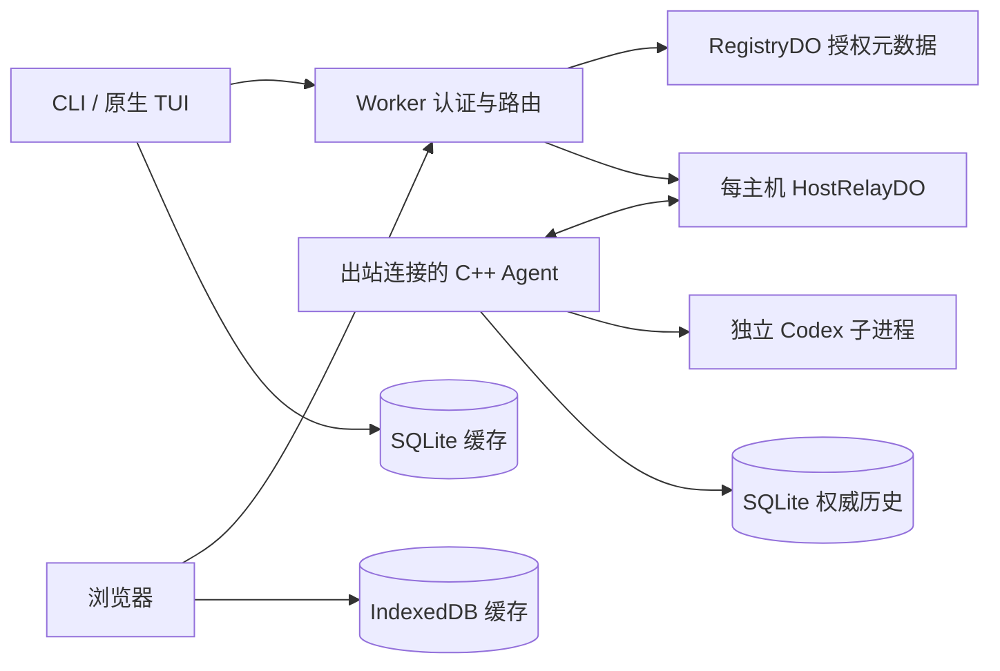

# 项目完整评估与改进建议

> 本文保留整改前评估基线；后续实现、验证与剩余验收见 [稳定化实施记录](stabilization-2026-10-24.md)。

评估日期：2026-10-24（Asia/Shanghai）。评估版本：0.5.0。源码基线：`6d184efa5bc46f4acd29997024428604898a1a9f`。开始评估时工作树无已跟踪文件变更。

## 1. 总体判断

项目已形成可实际使用的个人远程 Codex 工作台：设备配对和 API Key、按主机与客户端角色授权、CLI 原生 TUI、网页对话和审批、远程项目文件传输、权威历史与客户端缓存均有实现，并有较完整的确定性集成测试。C++ 本机程序与 Cloudflare 中继的技术分工适合“无公网 IP、个人自托管、可信设备”的目标，现阶段没有充分理由重写语言栈或拆成更多服务。

**建议继续定位为开发预览版，先完成可靠性修复，再扩大功能范围。** 当前主要短板不是功能数量，而是容量边界、连接状态机、失败恢复和运维可诊断性。本轮复现了静态页面安全响应头缺失、会话列表过大断开 Agent、原生 HTTP 超时无效等问题；这些问题即使全部现有常规测试通过，也仍会影响真实长期使用。

| 维度       | 评估                               | 主要依据                                                            |
| ---------- | ---------------------------------- | ------------------------------------------------------------------- |
| 核心功能   | 主要使用闭环已具备                 | 双入口、授权、任务、审批、停止、历史、文件传输均有实现与集成验证    |
| 架构匹配   | 适合当前个人规模                   | Agent 出站连接；每主机一个 DO；本机执行和保存权威历史               |
| 安全基础   | 边界意识较好，存在应优先修复的缺口 | TLS、角色限制、服务端沙箱、路径防护良好；静态安全头与接管并发有问题 |
| 实现质量   | 可继续演进，复杂度开始集中         | 单事件循环简化并发；Agent 和 React 根组件承担过多状态转换           |
| 恢复能力   | 部分具备，尚不完整                 | CW 回放与显式历史恢复有效；CLI 再附着不支持；网页失败分支不完整     |
| 容量与性能 | 有边界设计，缺少长期证据           | 历史分页有界，但会话目录无分页；流式投影写放大和跨 DO 鉴权需实测    |
| 工程与运维 | 测试基础较好，发布与诊断仍偏人工   | 缺少仓库内 CI 工作流、指标、自动兼容检查与可验证的构建来源绑定      |

本报告未发现足以据此断言“未经认证即可执行任意命令”的证据，也不把个人信任模型缺少多租户隔离、端到端加密视为现版本漏洞。它们属于产品边界。

## 2. 范围、方法与验证结果

审查覆盖 `native/`、`apps/relay/`、`apps/web/`、`packages/protocol/`、`tests/`、构建与发布脚本、示例配置以及现有需求、架构、使用和测试文档。除了静态阅读，本轮执行了构建、常规测试、完整本地端到端回归及隔离故障探测。

本轮未部署、未访问生产业务接口、未读取生产凭证、未调用模型，也未修改功能代码。现有 [测试记录](TEST_REPORT.md) 中的生产发布与真实 Codex 验证属于既有证据，不作为本轮重新验证的结果。

### 2.1 本轮执行

| 项目                               | 结果与边界                                                                                                          |
| ---------------------------------- | ------------------------------------------------------------------------------------------------------------------- |
| `npm run build:native`             | 通过；宿主 Release 构建                                                                                             |
| `npm test`                         | 通过；CTest 1 个测试入口，Vitest 4 个文件、23 项测试；CTest 入口内部包含多组断言，不能理解为只测一个场景            |
| `npm run typecheck`                | 通过                                                                                                                |
| `npm run lint`、`npm run lint:cpp` | 通过                                                                                                                |
| `npm run build`                    | 通过；包括网页构建、类型检查和 Worker dry-run，不发布                                                               |
| `npm run test:tls`                 | 通过；可信证书、未知 CA、错误主机名场景                                                                             |
| 容器内原生构建                     | 通过；独立 `.local/build-audit` 目录，避免混用宿主动态库                                                            |
| `npm run test:e2e`                 | 最终完整通过；真实 Wrangler/DO、C++ 程序、Chromium、确定性 Codex 夹具                                               |
| HTTP 停滞探测                      | 本机服务器接受连接后不返回响应；客户端到第 32 秒仍未退出，随后主动结束探测                                          |
| 静态页面响应头探测                 | 真实本地 Wrangler 首页返回 200，但 CSP、`X-Content-Type-Options`、`Referrer-Policy` 均缺失                          |
| 大会话目录探测                     | 1,500 条合成会话的列表响应超过单帧上限；实际 Agent 收到 `list` 后关闭上行连接，未交付结果                           |
| 租约并发探测                       | 调用实际 `HostRelayDO.acquire()`，用串行事务存储桩与延迟 Agent 确认复现两个非接管请求都成功；未声称已在生产 DO 复现 |
| 网页附着失败探测                   | Chromium 加载本次构建，API 夹具返回附着 503；失败后 6.5 秒仍只有一次附着尝试，与代码缺少重试分支一致                |
| 网页离线入口探测                   | Chromium 已保存目录缓存后，夹具将 hosts 改为离线；刷新后选中主机为空，离线主机 option 的原生 `disabled` 为 true     |
| 项目别名探测                       | 调用实际 C++ 配置校验器；同一规范化目录配置为两个不同项目 ID 被接受                                                 |

环境：宿主 Node.js 22.17.0、glibc 2.31；完整运行时测试使用已有 `coc-local-test` Bookworm 容器和本机已有 Chromium 缓存。容器内 Node.js 为 22.23.2。首次端到端执行缺浏览器缓存，第二次被已有截图文件权限阻止；最终在容器临时源码副本中、只读挂载构建产物与浏览器后完整通过。这两次中止属于测试环境问题，未计为产品缺陷。

没有执行八小时负载、生产 DO 休眠/升级恢复、磁盘耗尽/掉电、Firefox/WebKit、真实 Codex 模型任务或全面依赖漏洞扫描。因此本报告不提供生产 SLA、全部协议兼容或“无安全漏洞”承诺。

### 2.2 证据与优先级约定

- **实测确认**：在本轮本地测试中观察到；具体使用真实组件还是夹具会单独说明。
- **代码确认**：能从当前实现直接确定的行为，本轮未做完整运行时复现。
- **待验证风险**：有具体设计或代码依据，但实际影响和规模需要测量。
- **P1**：建议下一次稳定性发布前完成；影响核心可用性、安全防线或恢复正确性。
- **P2**：随后的稳定化工作；涉及规模、耐久性、兼容和维护成本。
- **P3**：体验或文档优化，可按产品需求安排。

本报告的优先级是整改优先级，与需求文档中的 P0/P1 功能交付标签不是同一套含义。

## 3. 功能评估

| 能力           | 当前实现与评价                                                                   | 建议                                                                       |
| -------------- | -------------------------------------------------------------------------------- | -------------------------------------------------------------------------- |
| 设备登录与撤销 | A/CC/CW 分角色、按 A 绑定；一次领取；永久可撤销凭证；API Key 不额外兑换令牌      | 保留模型；补设备最近使用时间、重命名、轮换和过期策略选项；管理会话单独处理 |
| 主机和项目     | 最多 5 台有效主机，每台最多 20 个项目；路径由 Agent 配置                         | 补真实离线时的缓存入口、能力/版本展示、重复或重叠项目目录检查              |
| CLI            | 可复用原生 TUI，允许有限 RPC，文本输入和服务端策略受到约束                       | CLI 再附着/显式恢复应优先于附件；客户端启动 TUI 前检查兼容版本             |
| CW 对话        | Markdown、工具折叠、停止、基本审批、历史恢复、移动尺寸布局已具备                 | 补状态不明的请求处理、恢复错误分支、草稿保存、稳定请求 ID                  |
| 审批           | 命令与文件审批支持允许/拒绝；超时拒绝；未知交互明确拒绝                          | 根据真实任务频率补用户问答/MCP elicitation；逐类建能力矩阵，保持默认不批准 |
| 历史           | Agent SQLite 保存权威记录；seq/revision、分页、内容块、惰性 Codex 历史导入较完整 | 会话目录也要分页；修复离线入口；补缓存配额、损坏与迁移测试                 |
| 文件传输       | 相对路径、普通文件、64 KiB 分段、20 MiB 上限、显式覆盖、设备绑定上传             | 当前范围合理；补提交结果查询与耐久性，避免立即扩展为完整文件管理器         |
| 控制权         | 票据单次消费、持久 epoch、显式接管                                               | 修复附着进行中的竞争、失败回滚和 CLI 不支持再附着时的破坏性行为            |
| 运维           | 有 systemd 示例、下载打包、TLS 测试和手册                                        | 增加 `doctor`、结构化元数据日志、统计、备份恢复演练和发布门禁              |

需求覆盖判断：F-01/F-03 和主要 F-05/F-06 流程基础较好；F-04 缺少真正的 starting/closing 状态和最后活动信息；F-07 的网页交互类型不完整；F-08 至 F-10 仍受下面的租约、重连和请求恢复问题影响；F-12 有认证与入口限流，但并未形成完整的 WebSocket 业务配额；F-13 的指标与诊断明显不足。A-07、A-08 等休眠与长期负载验收仍不能因常规测试通过而视为完成。

优先补齐“恢复、可靠提交、可诊断”三类能力，再考虑模型/推理强度选择、全文搜索、附件和更多平台。组织账户、多用户协作、强隔离、端到端加密应独立立项，因为它们会改变当前信任边界。

## 4. 架构评估

### 4.1 应保留的设计

这个边界划分有实际收益：云端不需要访问内网；Agent 负责最终沙箱和项目选择；每个任务 runtime 独立；持久事件不依赖 DO 内存；客户端缓存按凭证身份隔离。没有必要为了当前至多 5 台主机的规模引入额外数据库、消息队列或微服务。

安全实现值得保留的部分包括：原生 TLS 信任链和主机名检查；Cookie 的 HttpOnly/SameSite/Secure；管理与业务角色分离；票据绑定模式与凭证；Agent CLI RPC 白名单；子进程参数数组；文件操作逐级 `openat`/`O_NOFOLLOW`；SQLite 参数绑定、WAL 与 dataDir 单实例锁。它们比仅依赖网页按钮隐藏或中继检查更可靠。

### 4.2 需要收紧的边界

**控制平面与数据流的资源边界尚不完整。** 一条 Agent WebSocket 同时承载会话控制、流式事件、历史和文件响应。某个结果超大、鉴权缓慢或队列满时，影响可能扩散至同一 A 的所有会话。应先实现逻辑通道的队列、限额和调度，再决定是否需要物理拆分连接。

**RegistryDO 同时位于管理路径和每帧转发路径。** 这是为了及时撤销，但单所有者 Registry 实际成为所有主机的共享依赖。建议用主机授权版本、显式撤销通知、短期有界缓存与定期复核组合优化；优化前必须定义可接受的撤销生效时限，不能简单取消鉴权。

**恢复需要明确区分四种对象：连接、控制租约、运行进程、持久线程。** 当前字段常把它们压缩成 `ready/running/epoch`。将状态机显式化能减少“连接已恢复但无法操作”“进程正在初始化却显示 ready”“操作已执行但前端认为失败”等歧义。

**兼容性不能只依赖同时升级。** 本机 Agent、CLI、网页、Worker 和 DO 有不同更新时刻，浏览器还可能保留旧代码。建议加入最小协议版本、能力集合和构建版本协商，并把存储格式版本与网络协议版本分开。

## 5. 优先整改项

### A01 · P1 · 会话目录无分页，长期使用可断开整台 Agent

**实测确认。** [Store::sessions](../native/src/store.cpp) 第 120 行读取所有会话；[Agent::control](../native/src/agent.cpp) 第 241 行原样返回；[Connection::send](../native/src/socket_impl.hpp) 第 124 行附近在消息超过 `max_frame` 时直接 `finish()`。会话与历史长期保留，因此目录最终会越过上限。

本轮构造 1,500 条常规字段的关闭会话，带结果封装的 JSON 为 **382,577 字节**，大于 **262,144 字节**单帧上限。独立真实 Agent 探测也观察到 `list` 后上行连接关闭且未收到结果。具体触发条数取决于字段长度，1,500 只是本轮样本，不是系统容量承诺。

影响不止列表失败：HostRelayDO 会在 Agent 断开时关闭客户端连接；每次重新加载目录都可能再次触发。`check_busy()`、启动恢复和线程冲突检查也扫描全部历史会话，成本会随总量增长。

**建议**：为会话元数据建立结构化可索引字段，支持按项目/模式/状态过滤、稳定游标分页和响应字节预算；运行时冲突检查只查活跃集合。控制结果序列化前返回明确的单请求错误，不因一个过大响应关闭共享上行。不要通过自动删除权威历史来规避问题。

**验收**：至少 10 万条历史会话、4 个运行会话；目录每页有界、只读分页不影响任务；主动注入超大控制结果时其他会话继续工作。

### A02 · P1 · 静态首页绕过 Worker，安全响应头未实际生效

**实测确认。** [Worker](../apps/relay/src/index.ts) 第 101 行附近为静态响应设置 CSP、`nosniff` 和 `no-referrer`；但 [Wrangler 配置](../wrangler.jsonc) 第 12 行仅让 `/api/*`、`/ws/*` 优先进入 Worker。[静态 `_headers`](../apps/web/public/_headers) 只配置了下载文档字符集。

真实本地 Wrangler 请求 `/` 返回 200，三个头均为 `null`。Cloudflare 官方说明匹配静态资源时默认先返回资源，仅指定路径执行 Worker-first；本项目的首页因此不会经过该头部设置代码。[官方路由说明](https://developers.cloudflare.com/workers/static-assets/routing/worker-script/)

这表示 CSP 内容限制和防嵌入等防线缺失，并非本轮已经证明存在可利用的 XSS。现有 Markdown 渲染仍有默认转义和 URL 过滤保护。

**建议**：优先将通用安全响应头写入静态 `_headers`，保留现有静态资源路由效率；如果选择所有静态请求先进入 Worker，需同时评估调用开销。验证 CSP 对当前 CSS、Markdown 和文件下载流程的兼容性。

**验收**：真实 Wrangler 与预发布环境分别检查 `/`、JS/CSS 和下载页；检查防 iframe 嵌入和正常 UI 行为。不能仅单测 Worker 的 `fetch()` 返回值。

### A03 · P1 · 附着租约存在并发窗口，失败也可能破坏现有控制端

**并发窗口经组件探测确认；失败路径经代码确认。** [HostRelayDO::acquire](../apps/relay/src/host.ts) 第 251 行先取 WebSocket 快照，再进行存储事务；冲突条件为 `lease.active && sockets.length && !takeover`。首个请求写入 active 后，尚在等待 Agent 的 attach 确认时，第二个请求仍可能看不到已认证控制连接，因此也获准。

本轮使用实际方法、串行事务存储桩和延迟确认，两个 `takeover=false` 请求分别取得 epoch 1、2，并都向 Agent 发出 attach。epoch 校验通常仍会挡住过时控制消息，所以不应把这一结果描述为“已证明两个控制端可长期同时执行”；已确认的问题是第二个请求无需显式接管便可抢占进行中的附着。

另外，该方法在 Agent 确认之前就增加持久 epoch 并关闭旧控制端，没有失败补偿。Agent 对已有 CLI runtime 明确返回 `CLI_REATTACH_UNSUPPORTED`，因此对 CLI 进行接管可能先断开正常旧端，再告知新端不支持操作。

**建议**：租约记录增加 pending/active、唯一连接身份和 pending 期限，事务只依据权威租约判断竞争；Agent 确认后完成切换，失败时做带版本条件的补偿。对 CLI 再附着能力在申请票据阶段提前检查。

**验收**：并发双附着只能一个成功；接管确认超时、Agent 拒绝和旧连接延迟 close 都不破坏正确租约；在真实 DO 中补做竞争测试。

### A04 · P1 · 原生 HTTP 的 30 秒超时没有覆盖同步 I/O

**实测确认。** [network.cpp](../native/src/network.cpp) 第 40 行起使用同步解析、连接、TLS 握手和 `http::write/read`，却依靠 `beast::tcp_stream::expires_after(30s)` 设定期限。Beast 的该超时机制用于异步操作；本机安装头文件和 [官方超时说明](https://www.boost.org/doc/libs/latest/libs/beast/doc/html/beast/using_io/timeouts.html) 均支持这一判断。

本轮让回环服务器接受连接后保持沉默，实际 `coc-client status` 在 32 秒时仍运行。探测到此主动终止，未把它夸大为已测得无限等待。相同实现用于登录和轮询，外层“5 分钟登录有效期”也不能中断一次卡住的同步请求。

**建议**：将解析、连接、握手、发送和接收改为受统一 deadline 控制的异步流程，超时取消解析器并关闭 socket；保留同步外部命令接口也可以，但内部必须可取消。

**验收**：DNS/连接/TLS/响应头/响应体分别停滞，均在明确期限内返回可识别错误；中断后没有残留线程、子进程或 socket。

### A05 · P1 · 真实主机离线后，刷新页面可能无法进入已有缓存

**代码与浏览器夹具确认。** [main.tsx](../apps/web/src/main.tsx) 第 1,189 行附近使用 `<option disabled={!h.online}>`；刷新初始化时主机选择为空。缓存目录加载又依赖先设置 `host`，因此当 `/hosts` 正确返回 `online:false` 时，用户无法选择该主机来进入 IndexedDB 中已有的历史。本轮 Chromium 探测先保存目录缓存，再切换 hosts 响应并刷新；等待离线标签加载后，原生 `option.disabled` 为 true、当前主机值为空。没有在该定向探测中以真实 Agent 停机替代 API 夹具。

现有 [端到端缓存测试](../tests/e2e.ts) 第 1,056 行附近只阻断历史 WebSocket 和 projects 请求，没有把 `/hosts` 中该主机改为离线，所以测试通过并不能覆盖这一真实入口问题。这不同于完整离线 PWA 缺失：即使网页与中继认证都仍可访问，也会受到禁用主机选项影响。

**建议**：允许选择已授权的离线主机，显示“离线，只读缓存”，仅禁用新建、恢复运行和提交任务；目录缓存不应被在线业务请求的失败覆盖。保存最近主机/项目选择时仍需校验当前身份。

**验收**：先缓存会话，再真正停止 Agent，确认 `/hosts` 为离线，刷新网页后通过正常 UI 读到缓存；未缓存内容明确提示不可用，不能误启用发送。

### A06 · P1 · 网页控制连接在申请票据失败后停止自动恢复

**代码与浏览器夹具确认。** [main.tsx](../apps/web/src/main.tsx) 第 404 行起的 `connect()` 仅在 WebSocket `onclose` 中安排下一次连接；第 480 行的 HTTP/票据失败 catch 只显示“无法连接”，不再调度重试。

典型场景是 Agent 断线后，网页先尝试附着，此时 Agent 尚未重连，票据接口返回 503；之后 Agent 恢复，控制连接仍停在失败状态。独立历史连接可能继续重试并显示内容，进一步造成“看起来恢复了却不能发送”的体验。浏览器定向探测中首次附着 503 后等待 6.5 秒，仍仅有一次请求；结合代码可确认该分支没有自动重试。

**建议**：统一连接状态机，对暂时离线、网络错误和限流进行带抖动退避；认证撤销、会话关闭和控制冲突进入不同的终态。所有退出分支要取消计时器并停止过期请求。

**验收**：Agent 离线 60 秒再恢复，网页无需刷新或接管即可恢复原有合法控制；永久拒绝不得形成无穷请求循环；按需求测量恢复 P95。

### A07 · P1 · 请求结果不明时，端到端幂等与用户恢复流程不完整

**代码确认。** [HostRelayDO::command](../apps/relay/src/host.ts) 第 75 行在 12 秒超时；[CodexProcess::request](../native/src/process.cpp) 第 199 行单次 RPC 等待 20 秒，创建/恢复会话还包含多阶段初始化及最多十项归档导入。中继可能已经返回 `RESULT_UNKNOWN`，Agent 后续才成功。

[网页 HTTP 封装](../apps/web/src/api.ts) 和 [原生 HTTP 封装](../native/src/network.cpp) 都在每次调用内生成新幂等键；网页 prompt 也即时生成新 requestId，发送后清空输入，不持久保存待确认请求。服务端确实能去重同一 ID，但用户在丢失响应后重新点击或重新输入，会形成新逻辑请求。现有实现没有自动重发未知任务，这是优点；缺口是无法可靠查询或继续原请求。

此外，Agent 在项目、容量、忙碌等前置验证完成前调用 `Store::begin()`，失败后记录仍为 NULL。再次使用同一 ID 会得到 `RESULT_UNKNOWN`，即使此前从未向 Codex 提交过副作用。

**建议**：由操作层生成并保存稳定 ID；建立 received/validated/submitted/completed/failed/unknown 请求状态，增加查询接口。可确定未执行的失败应缓存明确错误；跨进程副作用后的不确定状态不能直接删除去重记录。创建耗时较长时返回操作句柄，避免简单延长所有网络超时。

**验收**：注入“执行前失败”“Codex 接受后丢响应”“Agent 成功但 HTTP 超时”“浏览器刷新”，同一逻辑任务最多提交一次，并有可恢复结果或明确的人工核对入口。

## 6. 中期实现与可靠性改进

### A08 · P2 · 流式历史投影有累计重写成本，可能阻塞全部会话

**代码确认机制，性能影响待量化。** [Store::project](../native/src/store.cpp) 第 186 行用 JSON 字符串拼接更新完整 `delta`，每次追加都重新写当前累计正文。对同一消息的 n 个等长碎片，累计处理量会呈平方级增长趋势。16 KiB 以上转成内容引用只减少网络结果，并没有消除数据库中的累计重写。

每个事件还写原始日志和投影，SQLite 操作在 Agent 的单一 Asio 事件循环中同步执行；`busy_timeout=5000`、目录扫描、上传 `fsync` 也可能拖延该循环。实际是否突破延迟指标需要基准，不能仅凭复杂度断言当前已不达标。

建议原始增量作为事实日志，按时间/字节阈值合并投影或使用分块正文；把有界存储工作交给单独串行执行队列。以 1/10/100 字符增量、1 MiB 及更大正文、4 会话并行测量事件 P95、CPU、WAL 增长和心跳延迟。保持原始事件、投影更新与游标一致性。

### A09 · P2 · 每帧跨 DO 鉴权和不完整背压放大共享故障

**代码确认机制，容量影响待量化。** [host.ts](../apps/relay/src/host.ts) 第 330、358 行为 Agent 每帧及每个接收客户端调用 Registry。一个会话同时有控制和历史连接时，单条事件通常需要三次串行授权查询。CLI 同一通知还可能同时走历史事件与原始 RPC。按连接串行处理解决了乱序，却也让同一 Agent 上行的其他会话和控制结果排在慢操作之后。

已实现的 8 MiB 入站排队和原生发送队列有价值，但 DO `send()` 只按单个输出与 `MAX_QUEUE` 比较，不能证明浏览器出站积压总量有界；pending HTTP 控制请求、已授权历史连接和短期归档进程也缺乏统一的主机级预算。临时归档进程没有计入四个任务 runtime 的限制。

建议建立每主机/会话/连接的数量、字节和并发预算，预留停止与审批控制流量，慢读者单独断开。减少逐事件持久化鉴权查询前，应以授权版本和撤销时限做安全约束。定期 alarm 与应用层 ping 会带来唤醒和调用开销，不能把采用 Hibernation API 等同于已实现低成本空闲；可结合平台支持的自动响应能力评估，但必须实测恢复语义。[官方 WebSocket/休眠说明](https://developers.cloudflare.com/durable-objects/best-practices/websockets/)

### A10 · P2 · CLI 内容缓存未绑定版本，可能拼接不同快照

**代码确认。** [cli.cpp](../native/src/cli.cpp) 第 96 行的内容请求没有传 `revision`，缓存键只包含会话、seq 和 offset；[Store::content](../native/src/store.cpp) 已支持版本检查，网页也会传 revision，但 CLI 没使用。

如果输出仍在增长，或先前离线块来自旧版本，不同 offset 的内容可能属于不同修订。CLI TUI 的额外历史连接第 226 行关闭回调为空，没有重连；首次页面响应还会直接覆盖此前收到的 tail，需补实时事件与快照交错测试。

建议提供 `--revision` 或由工具自动保存首块版本，缓存键包含版本；发生 `CONTENT_CHANGED` 时明确重新读取。自动历史连接应独立恢复，合并时保留较新 revision，缓存失败不应干扰 TUI 生命周期。

### A11 · P2 · 本地凭证配置写入不是原子替换

**代码确认。** [save_private](../native/src/common.cpp) 第 49 行使用 `O_TRUNC` 直接覆盖已有文件；权限和禁止符号链接做得较好，但没有临时文件替换、文件/父目录 fsync 或多进程写锁。

写入中断、磁盘满或同时运行两次登录/切换可能损坏 JSON 或丢失一部分授权。建议在同目录创建 0600 临时文件，完整写入并 fsync 后 rename，再 fsync 父目录；为读改写加锁。测试 ENOSPC、短写、进程中止和并发操作，保证原文件或新文件至少一个完整可读。

### A12 · P2 · 项目执行互斥按 ID 判断，不能识别相同目录

**配置接受行为实测，互斥缺口代码确认。** [agent_config](../native/src/common.cpp) 只要求项目 ID 唯一，会规范化路径但不检查重复目录；[check_busy](../native/src/agent.cpp) 第 466 行只比较 projectId。因此同一路径登记为两个 ID，两个会话都可能通过忙碌检查；父子目录也可能有相同文件冲突。

这需要本机管理员配置，不是未授权客户端任意改路径的漏洞。建议拒绝重复规范化根目录，并明确重叠目录规则；运行互斥以规范化工作区身份为依据。文件覆盖也应纳入项目写入冲突策略，或明确提示与运行任务并发修改的后果。

### A13 · P2 · 文件提交还缺可靠的结果查询和更强耐久性

**代码确认；竞争/掉电影响未实测。** [WorkspaceFiles](../native/src/files.cpp) 有良好的路径和分段校验，但 finish 成功后删除上传状态，响应丢失时重试只能得到 `UPLOAD_NOT_FOUND`；只能靠人工刷新核对。文件 `fsync` 后发布，未对父目录 fsync。覆盖采用先比较版本再 `renameat`，两者之间仍存在本机其他写入者修改目标的窗口，不能等同于原子比较交换。

建议保存短期完成结果和校验摘要，支持查询上传状态；发布后同步父目录。对本机不合作写入者，明确并发覆盖语义，必要时使用保留旧版本/备份策略；不要宣称一般的 stat+rename 能完全避免并发更新丢失。现有强杀残留临时文件已在手册披露，可增加安全的启动清理或诊断命令。

### A14 · P2 · 协议与能力版本没有形成实际协商

**代码确认。** 中继发送 `v:1`，但主要接收分支不校验或协商它；认证 version 2 与业务协议不是同一概念。C++/Zod 手写并行验证，HTTP 返回和内部控制帧多处用 `any`/任意 JSON；`webCommandSchema` 也没有覆盖实际全部运行路径。`process.cpp` 初始化还报告 `coc-web/0.2.1`，与当前项目版本不同。

建议定义有鉴别字段的控制请求、响应和事件类型，明确未知字段策略、字节上限与安全整数范围；生成两端共享的协议样例做一致性测试。运行时握手报告 build/protocol/capabilities，先拒绝不兼容组合再创建进程。JSON Schema/代码生成适合减少重复，但不必为小协议引入重型 RPC 框架。

### A15 · P2 · 管理员退出只清 Cookie，服务端会话仍有效

**代码确认。** [index.ts](../apps/relay/src/index.ts) 第 190 行认证后直接清除 `coc_admin`，没有调用 [RegistryDO](../apps/relay/src/registry.ts) 已有的 `logout` 删除记录。旧管理令牌可继续使用到八小时期限；这与设备凭证故意采用“本地忘记不撤销”的产品语义应分开讨论。

建议管理员退出撤销当前管理会话，提供撤销其他管理会话的方式；如所有者密钥轮换需要使旧管理会话失效，应配套会话版本策略。不要因此改变文档已明确的 A/CC/CW 本地 logout 语义。

### A16 · P2 · 错误原因与运行指标不足

**代码确认。** `wrangler.jsonc` 关闭 observability；Codex stderr 重定向 `/dev/null`；网络和进程回调多处 catch-all 后只关闭连接/进程，主页面健康检查只返回 `{ok:true}`。HostRelayDO 将 Agent 错误统一包装为 HTTP 409，难以区分输入错误、忙碌、内部故障和暂时不可用。

建议增加结构化元数据日志和分层错误码：连接阶段、退出码/信号、构建版本、请求耗时、队列水位、活跃进程、历史体积、存储错误和审批超时；记录 requestId/sessionId 便于关联，但不记录正文/令牌。Codex stderr 可做有界缓冲和脱敏，按显式诊断操作提取。增加不触发模型调用的 `doctor`，验证配置、Codex 版本、TLS、项目权限、磁盘与数据库。

数据库出错时应停止接收新副作用、保护已有数据并明确报告原因，不能依赖异常冒泡或笼统重连。上线前演练磁盘满、锁等待、子进程异常和授权失效，而非只检查 healthz。

## 7. 代码组织、测试与发布建议

### 7.1 按职责拆分，优先拆状态而非只拆文件

[main.tsx](../apps/web/src/main.tsx) 约 1,725 行，集中设备管理、项目选择、会话、两类 WebSocket、IndexedDB 和渲染；[agent.cpp](../native/src/agent.cpp) 约 866 行，集中启动、RPC 策略、归档、幂等、审批与生命周期。文件长度本身不是缺陷，真正风险是跨模块状态只能依靠闭包和调用顺序维护。

建议逐步抽取：

- 网页：授权管理页面、连接状态机、会话控制、只读历史同步、缓存适配器、聊天视图；先为状态转换定义 reducer/显式事件。
- Agent：RuntimeManager、CodexAdapter、RequestJournal、HistoryService、WorkspaceFiles、RelayTransport；维持一个权威运行状态入口。
- 协议：把目前 `any` 的管理数据、控制响应与 WS envelope 改成具体类型；建立错误码与 HTTP 状态映射。
- 缓存：HistoryCache 增加 close/dispose、schema 升级和存储配额处理，避免每次会话切换都只打开连接而没有显式释放；清理与正在同步的写入之间定义语义。

不要同时替换存储格式和所有状态机。先补可复现失败用例，再逐步抽取，保留既有端到端行为。

### 7.2 测试缺口与建议矩阵

现有测试的优势是使用真实本机程序、真实 Wrangler 和真实 Chromium，覆盖了不少容易遗漏的认证、路径和消息顺序问题。短板是快速成功路径和单次故障更多，长期状态、交错竞争及失败提交较少。

| 优先级 | 新增场景                                  | 必须观察的结果                                   |
| ------ | ----------------------------------------- | ------------------------------------------------ |
| P1     | 真实资源路由的安全头                      | 首页确实得到 CSP 等头，而非 Worker 函数单测通过  |
| P1     | 并发 attach、失败 takeover、迟到 close    | 只有一个合法控制者；失败不破坏旧租约             |
| P1     | 1,500/10 万历史会话与超大控制响应         | 分页有界，不关闭共享 Agent 连接                  |
| P1     | HTTP 各阶段黑洞                           | 有效超时和取消，命令可退出                       |
| P1     | `/hosts` 真离线、刷新与缓存读取           | 离线主机可选，缓存可读，副作用入口禁用           |
| P1     | 票据接口暂时 503、Agent 离线 60 秒        | 控制连接自动恢复，状态与历史一致                 |
| P1     | 各阶段丢 ACK、重启、重复相同请求          | 不重复执行，能查询结果，未执行失败不伪装 unknown |
| P2     | 磁盘满、数据库锁、进程 SIGKILL            | 有界失败、数据不静默损坏、错误可诊断             |
| P2     | 慢读者、突发流、4 会话 8 小时             | 内存/队列有界，测量 P95 与撤销时间               |
| P2     | DO 休眠唤醒、Worker/DO 更新、协议新旧组合 | 路由、epoch、票据与能力检查正确                  |
| P2     | CLI 内容修订、快照/实时交错、缓存连接断线 | 内容不混版本，较新事件不被旧页覆盖               |
| P2     | Firefox/WebKit 与真实移动设备             | 基础任务、对话框、输入法、审批、下载正确         |

本轮发现也说明测试应验证用户真实可达的路径：模拟 projects 离线却保持 host 在线，会漏掉缓存入口；测正常互斥不等于测并发附着；TLS 通过不等于超时有效；大历史分页通过不等于会话目录也有界。

### 7.3 CI 与构建来源

当前仓库未见 `.github/` 工作流；不能由此推断外部 CI 一定不存在，但仓库本身没有提供可复用的自动门禁。建议固定镜像/工具版本，按层运行格式和类型、C++/Vitest、TLS、Wrangler/浏览器测试；发布候选再跑长稳、真实 Codex 无模型协议检查及经明确安排的模型任务检查。C++ 增加 ASan/UBSan 构建和解析/状态机模糊测试，避免仅依赖 Release 测试。

[package-release.py](../scripts/package-release.py) 直接复制指定目录的二进制，源码包取 `git archive HEAD`，清单提交号也取 HEAD。脚本没有验证二进制确由该提交构建，也不拒绝脏工作树；如果 build-dir 陈旧，清单仍会声称对应新提交。当前发布文档要求先构建和提交，这是流程保障，尚不是机器验证。

建议构建时嵌入版本、提交、目标平台和协议能力，提供 `--version`；打包校验与 HEAD 一致，核验干净源码及完整平台产物。将网页构建和下载包准备合为发布候选流水线，避免 `build:web` 清空下载目录后误部署不完整产物。补签名/可验证来源、备份恢复与回滚演练；校验和只证明拿到的文件一致，不能单独证明构建来源。

### 7.4 文档一致性

现有文档较完整，但“初始基线 + 多轮追加”已经造成理解成本：

- README 仍称超大 Codex 输出会终止 runtime；0.5.0 已将本地约 8 MiB RPC 缓冲与 256 KiB 网络帧分开，并为部分超大内容提供引用/分块。需按具体消息路径描述，不能一概而论。
- REQUIREMENTS 非目标仍列“文件上传下载”，末尾却已追加实现的工作区传输需求。
- TEST_REPORT 顶部仍写 0.2.1，并保留“未发布”章节及旧的未完成项；后文又记录 0.5.0 已发布及历史恢复。虽然有时间顺序，读者容易把旧状态当当前结论。
- ARCHITECTURE 保留目标状态机、持久审批、兼容窗口和指标描述，但部分仍未实现。标注“目标基线”有帮助，最好再给逐项状态表。

建议维护一份当前能力/限制/验证状态表，旧发布记录保留在独立时间线。每项核心需求关联实现位置、测试入口、最后验证版本和未覆盖范围。审计发现修复时同步更新用户手册、架构和测试证据，不能只增加 CHANGELOG。

## 8. 建议路线与验收门槛

### 第一阶段：稳定性修复版本

先处理 A01–A07：目录分页与错误隔离、安全响应头、租约事务、可取消 HTTP、离线缓存入口、网页恢复状态机、稳定请求身份与结果查询。功能范围保持聚焦，所有修复配套上节失败测试。此阶段完成后，才能更有把握支持日常长期使用。

### 第二阶段：容量与运维

处理流式存储成本、通道预算、CLI 缓存修订、配置原子写、工作区互斥、上传完成查询、协议协商和元数据观测。建立 CI、构建来源校验、数据库备份/恢复工具，实测 4 会话 8 小时、慢端、大目录和故障注入。

### 第三阶段：有依据地扩展功能

优先 CLI 显式线程恢复、常见网页用户问答交互、可控模型/推理选项、全文历史搜索和归档导出。浏览器/平台支持按真实需求逐个验收。跨模式切换、附件、组织账户和端到端加密应单独设计，不把它们夹带进可靠性修复。

建议稳定版门槛：P1 全部关闭且有自动回归；八小时负载、DO 重建、升级/回滚和备份恢复有记录；错误不造成自动重复任务；页面和 CLI 能解释“任务是否运行、控制是否有效、结果是否已确认”；安装包版本与源码可追溯。未达到的门槛在发布说明中明确列出，不用单一测试通过率替代。

## 9. 定向探测复现说明

本轮探测使用临时合成状态、模拟网络对端和本次编译产物，不操作用户会话。探测程序位于本机 `/tmp/coc-audit-*.{cjs,cpp}`，属于临时审计工具，未加入仓库长期测试套件；正式修复时应将关键场景转为可维护回归。即使临时文件被清理，以下步骤仍描述了必要前提与观察点。

1. **超大会话目录**：在独立 SQLite 中写入 1,500 条关闭会话，包含 id/projectId/mode/sandbox/state/running/createdAt/threadId；以模拟 Codex 版本响应启动实际 Agent；本地 WS 对端发送 hello 和 `control/list`。观察无 result 交付且连接关闭。另直接调用 Store 序列化结果，核对字节数与 `max_frame`。
2. **HTTP 超时**：启动只接受 TCP 连接而不发送响应的回环服务；用仅包含合成 token 的临时 CC 凭证运行 `status`；32 秒检查子进程仍存活，再结束进程及监听。
3. **静态响应头**：用当前构建的网页和当前 wrangler 配置启动临时本地 Worker；请求 `/`，读取三个安全头。无需登录或真实 Agent。
4. **租约竞争**：加载实际 HostRelayDO，替换 DO 基类和存储为最小桩；存储事务串行，socket 列表为空，Agent attach 确认暂缓。依次启动两个尚未完成的 `acquire(session,false)`，放行确认；两者分别取得 1、2。
5. **网页恢复**：Chromium 加载当前 dist 网页；以同源 API 夹具提供授权主机、项目、新建会话，对 attach 返回 503；记录调用次数。另在缓存已有目录后把 hosts 响应改为 offline 并刷新，检查是否能正常选择该主机。

这些探测证明具体边界行为，不替代生产负载、真实模型和完整安全渗透测试。总体建议是保留现有组件分工，以这些失败场景驱动下一轮稳定化。
