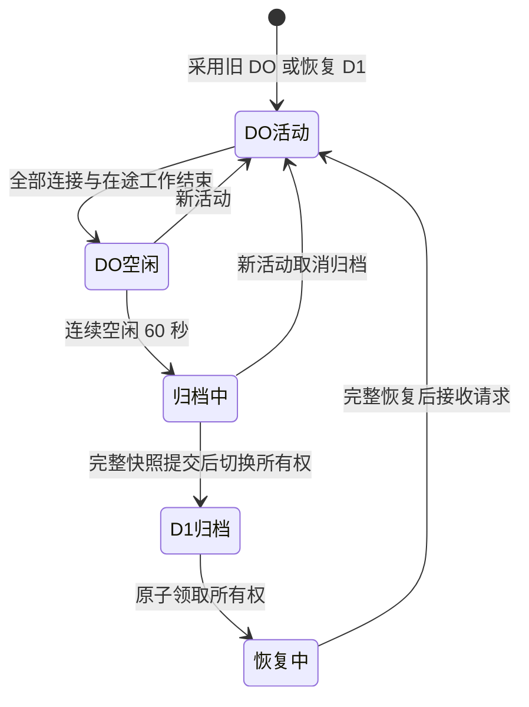

# D1 / DO 会话方案评估 · 2026-10-29

## 判断与问题证据

D1 适合共享目录与不活动主机归档；活动会话状态继续交给其所属 DO。此前把 DO 本地 KV 操作逐项映射到远程 D1，使握手、历史请求、回执与清理争用同一个 scope 修订号；即使串行化后不再冲突，远程访问仍在每个控制阶段的关键路径上。增加握手等待时间不能消除这项开销。

Cloudflare 说明单个 D1 数据库一次处理一个查询；不同主机使用不同 scope 只能隔离数据，不能隔离一个数据库的写入吞吐。[D1 FAQ](https://developers.cloudflare.com/d1/reference/faq/)。D1 另有查询数、参数数和执行时限等限制，[平台限制](https://developers.cloudflare.com/d1/platform/limits/)。DO 原生存储的输入 / 输出门与 D1 远程访问不是相同的并发机制，[DO 存储 API](https://developers.cloudflare.com/durable-objects/api/sqlite-storage-api/)。这些平台事实支持减少在线 D1 访问；并不能单独证明某一次生产断线的具体原因。

| 路径                 | 旧方案风险                                 | 调整后                                                   |
| -------------------- | ------------------------------------------ | -------------------------------------------------------- |
| 控制、握手、历史请求 | 多轮 D1 事务、分片读写和 scope CAS 排队    | 活动状态由 DO 原生事务持久化                             |
| 休眠后恢复           | 重读 D1 并更新 presence / alarm            | 读取 DO 本地标记与持久状态                               |
| 离线结果             | 活动和离线状态混用同一份 D1 数据           | 权威位置决定路由，归档副本完整后才可读                   |
| 归档中重连           | 清理与新的操作可能交错                     | 分页复制，新活动取消未发布归档                           |
| 附着结果迟到         | 断开的控制者可能遗留 active / pending 租约 | 释放对应 reservation，保留最大 epoch，拒绝激活已关闭连接 |
| 通知丢失             | HTTP 请求完成仍一直等待通知直至超时        | 仅对原回执有界查询，不重发命令                           |
| 多次独立断线         | 订阅 / 历史通道的重试次数累积耗尽          | 成功握手后重置连续失败计数                               |

## 性能对比与边界

用相同真实 SQLite SQL 测试夹具执行 20 个并发 `projects` 控制请求，并在 Agent 回应前重建 Host 实例：原提交 `b7ef5b7` 准备了 **569 条主机 D1 SQL 语句**；新代码对主机会话 D1 的访问为 **0**，本地持久结果完整恢复。此指标包括 batch 内语句，不等于 569 次网络往返；没有将夹具耗时当作生产延迟或节费测量。新测试还让 D1 写入失败，以检查活动操作不依赖远程写入。

该比较隔离了主机会话存储，授权方法使用测试夹具；生产仍保留真实 Registry 授权查询、五秒活动缓存、撤销通知和服务端权限检查。没有延长授权缓存、使用副本鉴权或在 D1 故障时放行过期权限。

代价是活动 DO 保留持久状态，归档时产生一次完整快照复制，冷激活需要从 D1 恢复。短线重连使用 60 秒宽限避免抖动。Agent 或订阅连接持续存在时不会归档整个主机；这属于活动状态，而非通过无条件周期清理降低成本。费用和跨地区实际延迟仍需生产观测。

## 权威切换

归档、恢复和清理故障的源数据与进度都持久化。`@location` 防止读取半成品；恢复与离线确认 / Cron 在 CAS 中竞争，冲突后必须重新检查所有权。发布后、删除本地数据前崩溃的恢复路径专门验证了“离线已确认结果不能复活”。详细机制与备份边界见 [D1 / DO 说明](d1-relay-state.md)。

## 仓库测试与发布要求

- `tests/host-lifecycle.test.ts`：旧 D1 恢复、旧 DO 接入、空闲宽限、分页归档、重新连接取消、复制 / 恢复 / 删除中断、在线回执路由、离线 GC 与激活竞争、权威副本缺失时拒绝服务。
- `tests/d1-state.test.ts`：真实 SQLite CAS / 隔离及活动并发控制的零主机 D1 访问断言；授权和迁移旧回归继续执行。
- `tests/relay-order.test.ts`：回执分片读取与结果更新的快照竞争、迟到附着、reservation 释放、epoch 单调递增、原有控制接管 / 背压 / 撤销校验。
- `tests/web-operation-recovery.test.ts`、`tests/web-api.test.ts`：漏通知、临时回执读取失败、有界超时、取消后迟到结果不被确认、原业务身份不变。
- `tests/d1-migration.ts`：真实 Wrangler 下旧模式切换、60 秒空闲归档、重启后领取结果、离线确认与重新激活后的 epoch / 回执一致性。
- `.github/workflows/checks.yml`：完整单元回归、旧 / 新模式原生与浏览器集成、sanitizer、Ubuntu 20.04、Debian 12、musl、Windows x64；单独命名 D1 迁移和 E2E 步骤并保留证据。

这些测试不调用模型，不更改生产数据。上线前仍须等待精确源码提交的全部必需 CI 作业成功，并通过已校验的 CI 产物部署。此评估不宣称真实 CW 邮箱登录、生产连续运行或断网重连已经验收。

## 最终 CI 结果

功能源码 `fc89396aedee08eea8110376b5e206a9d72155e1` 的 [Actions 40866589978](https://github.com/hjxxlogic/codexovercloudflare/actions/runs/40866589978) 六项必需作业全部成功；真实空闲归档、重启、再激活和两种模式的完整原生 / 浏览器回归均通过。已核验下载的 D1 验收制品摘要，[完整证据](assets/d1-active-session-2026-10-29/ci.json)。随后已授权部署 CI Worker / web 产物，版本 `b7d06f6b-387d-49b3-866f-b84a227c446d` 接收 100% 流量，健康、资源一致性和公开入口检查通过；未重启现有 Agent，真实生产 CW 稳定性仍需使用中验收。[部署证据](assets/d1-active-session-2026-10-29/deployment.json)。
