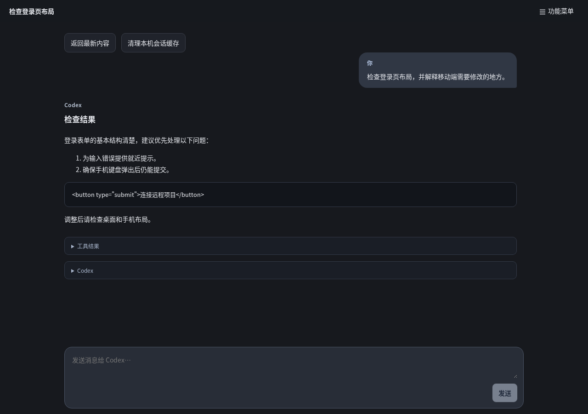
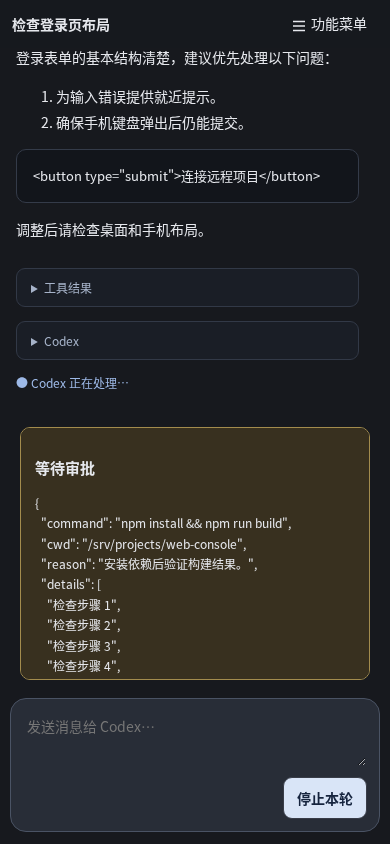
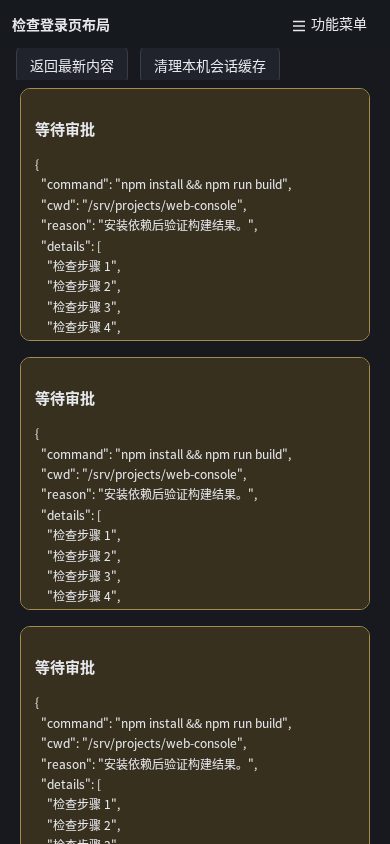
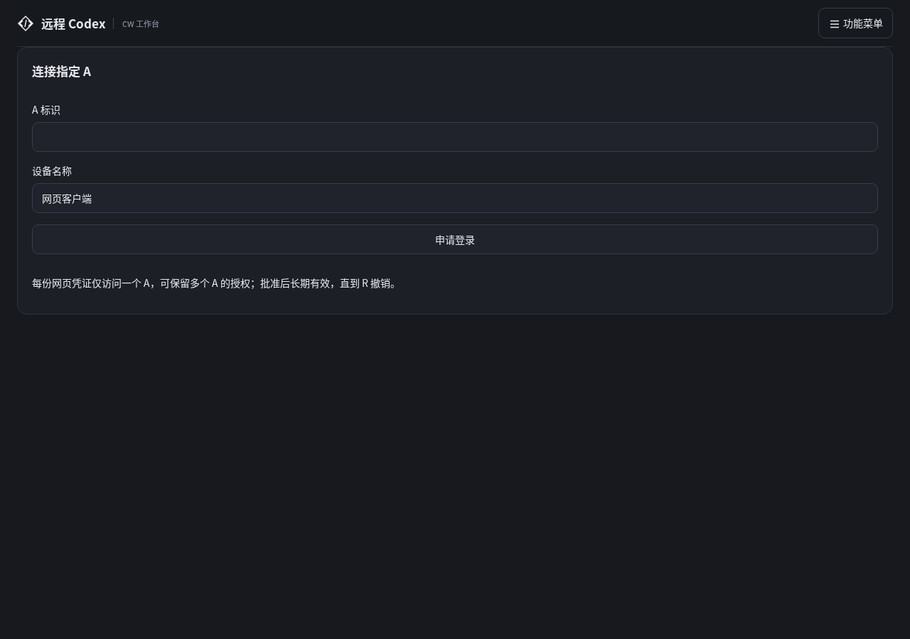

# WC 网页 UI 评估与改进建议

> 本文保留整改前评估基线；后续实现、验证与剩余验收见 [稳定化实施记录](stabilization-2026-10-24.md)。

日期：2026-10-24。源码基线：`6d184ef`，项目版本 0.5.0。本文沿用请求中的 WC 文件名，评估对象是项目中称为 **CW 的网页客户端**。

## 1. 结论

当前 UI 的优势是专注聊天：默认隐藏管理信息，用户消息与助手回复有区分，Markdown 可读，工具输出可折叠，输入区固定在底部。建议保留这个方向。

主要问题是**把必要上下文也隐藏了，同时让一些低频维护操作占据了显眼位置**。用户能看到回复，却不容易持续确认“正在操作哪台服务器、哪个项目、任务处于什么状态、接下来能做什么”。审批、恢复和文件传输这些需要明确决策的流程，仍较接近底层接口的呈现方式。

推荐目标是：**默认简洁，关键状态常驻，复杂内容渐进展开，重要操作始终可达。** 优先解决状态和任务流程，再调整字体、间距和颜色。现阶段不建议把页面改成默认展开的多栏管理后台。

| 维度       | 当前表现                                      | 建议方向                                     |
| ---------- | --------------------------------------------- | -------------------------------------------- |
| 视觉风格   | 深色、克制、较统一；小字号较多                | 保留配色基调，提升阅读字号与操作层级         |
| 信息架构   | 入口集中，但聊天、导航、管理混在一个菜单      | 高频操作直接可见，设备和凭证管理放入次级区域 |
| 远程上下文 | 聊天主界面只有标题，主机/项目主要在设置或详情 | 顶部增加紧凑的主机、项目和连接状态           |
| 对话阅读   | 普通消息较好；长内容变成“读取内容/下一块”     | 保持完整消息语义，分页与分块由界面处理       |
| 审批       | 醒目的颜色，但内容是 JSON，按钮可能藏在滚动区 | 摘要、影响范围、详情、固定操作区             |
| 历史查找   | 可搜索已加载记录；不同来源的列表行为不同      | 统一列表与搜索语义，明确查看和继续对话       |
| 状态恢复   | 有错误/重连文字，但缺少清晰的状态与动作对应   | 区分连接、任务、控制权、缓存和提交结果       |
| 移动端     | 普通聊天布局可用，多审批时存在可达性问题      | 审批总区域限高，保护消息、输入和停止操作     |

## 2. 评估依据与边界

本轮阅读了 [main.tsx](../apps/web/src/main.tsx)、[style.css](../apps/web/src/style.css)、[files.tsx](../apps/web/src/files.tsx)、[history.ts](../apps/web/src/history.ts)、[events.ts](../apps/web/src/events.ts) 及现有浏览器测试，并查看既有桌面、手机、文件传输截图。

同时使用当前网页构建，在已有 Chromium 测试容器中做了独立 UI 检查：首次访问、中文聊天、历史弹窗、文件面板、菜单超时、单个/三个待审批请求。API 与 WebSocket 均为本地合成数据，未连接生产、未调用模型。本轮截图只包含示例主机、路径和文本，可以随文档保存。

| 场景                     | 本轮观察                                                                   |
| ------------------------ | -------------------------------------------------------------------------- |
| 桌面 1280×900            | 登录表单几乎铺满宽度；聊天区顶部显示缓存维护按钮，缺少常驻主机/项目信息    |
| 手机 390×844、一个长审批 | 审批卡约 253 px 高，操作按钮需在卡片内部滚动后才能看到；输入区仍在屏内     |
| 手机 390×844、三个长审批 | 消息区仅约 32 px 高；输入区顶部约 898 px、底部约 1032 px，超出 844 px 视口 |
| 短视口 390×480、三个审批 | 输入区底部约 704 px，仍超出视口；这是缩短视口模拟，不是实际手机键盘测试    |
| 菜单打开后不操作         | 4.4 秒后已自动关闭；对应代码中的 4 秒计时器                                |
| 点击文件弹窗内侧空白边距 | 弹窗关闭；原因是该位置的点击目标也是 dialog 元素                           |
| 本轮浏览器执行           | 完成上述场景，未捕获 pageerror；这不代表无可用性问题                       |

截图与测量属于当前构建的真实渲染；三个审批是人为构造的布局压力场景，不表示日常任务一定产生三个同时审批。没有进行真实用户访谈、眼动/任务耗时研究、屏幕阅读器测试或 iOS/Android 真机键盘测试。下文把“实测问题”“代码可确定行为”和“设计建议”区分说明。

上一份 [完整项目评估](audit-2026-10-24.md) 已讨论离线入口、自动重连和请求结果不明的后端/状态逻辑；本文聚焦它们如何在界面上让用户理解和处理。

## 3. 应保留的界面设计

- 聊天区默认占主要空间，历史、文件和详细信息按需展开，适合手机和长对话。
- 用户消息靠右且有背景，助手回复以正文形式呈现，阅读角色容易区分。
- Markdown 表格、代码块、换行和工具折叠已具备基础支持；不应为了视觉效果削弱安全渲染。
- 原生 `dialog`、`details`、按钮和表单提供了较好的语义基础；现有 `focus-visible`、输入标签、中文输入法组合态判断、减少动态效果偏好应保留。
- “停止本轮”和“结束会话”已经是不同操作；文件覆盖也要求明确确认。这些区分要继续加强。
- 手机布局使用 `100dvh`、独立消息滚动和安全区底部间距，基础选择合理；需要继续处理多个固定区域的高度竞争。

当前桌面聊天示例：



## 4. 优先改进：上下文、审批与恢复

本文 P1 表示优先解决的操作正确性和可达性问题；P2 表示效率、理解和阅读优化；P3 表示可后续安排的偏好与增强。

### UI-01 · P1 · 在聊天顶部常驻远程目标

**现状**：`main.tsx` 的聊天 topbar 主要显示线程名称或“Codex 对话”；项目在会话详情，主机在连接设置。正常已连接时输入区也不显示连接状态，页脚的远程执行说明只在非聊天页面出现。

**影响**：多个主机、多个标签页或相似项目名称时，用户缺少直接核对目标的位置。远程命令执行界面需要比普通聊天更清楚地呈现操作对象。

**建议**：保留两行以内的紧凑头部：第一行会话标题，第二行“开发服务器 / 管理控制台 · 已连接”。上下文可点击展开完整路径和切换入口；手机标题截断，但主机和项目应有可辨识名称。完整 ID 留在详情中并提供复制。

新建、恢复会话、审批和上传确认都重复显示相关远程目标。不要只靠颜色或悬浮提示说明目标，也不要每条消息都重复显示完整路径。

**验收**：不打开菜单即可判断主机、项目与是否可控制；两个不同主机的标签页视觉可区分；切换项目后旧会话和草稿不会被错误归入新项目。

### UI-02 · P1 · 审批改为可理解的决策卡，并固定操作区

**现状**：审批区直接 `JSON.stringify(a.params)`，然后排列“允许/拒绝”按钮。实测一个长审批就会让按钮落到卡片内部滚动区下方，屏幕上只看到 JSON 和另一个“停止本轮”按钮。

**建议的审批结构**：

1. 标题说明动作，例如“请求运行命令”或“请求修改 3 个文件”。
2. 显示主机、项目/工作目录、请求原因；命令用完整可复制的等宽文本，不能只显示截断后的危险操作。
3. 文件审批显示路径、变更类型和可展开的 diff；原始参数放在“技术详情”中。
4. 卡片底部固定“拒绝”和“允许本次”按钮。只有后端确实提供对应授权范围时才使用这样的标签，不能凭 UI 扩大为永久授权。
5. 提交后显示“正在提交决定”；成功显示已允许/已拒绝，过期或被另一端处理显示明确状态。

等待审批时主状态应为“等待你的确认”，不要继续只显示“Codex 正在处理”。摘要必须准确忠实于请求，未知字段保留在详情中，不应由前端猜测命令安全性。



### UI-03 · P1 · 为审批队列设总高度预算，保障停止操作可达

**实测问题**：当前每个 `.approval` 都有 `flex-shrink:0` 和 `max-height:30dvh`，多个卡片纵向堆叠。三个审批把输入区推到手机视口之外，而外层 `.chat-workspace` 隐藏溢出。限制每张卡片高度并不能限制整个审批队列的高度。

**建议**：聊天中只显示一张当前审批卡与“待确认 3 项”；可切换前后项或打开独立审批列表。总审批区域有统一限高，正文滚动，标题与按钮固定。停止任务入口保持可达；避免为腾空间隐藏拒绝按钮，或引入没有安全语义的“全部允许”。

在非常矮的视口中，可将审批提升为专用全屏面板，底部保持决定按钮，并清楚标注所处主机和会话。面板不应在用户输入中途无预告地抢走焦点。

**验收**：0/1/3/10 个请求、超长命令、错误横幅同时出现时，手机上仍可完成明确决策和停止任务；页面的唯一恢复办法不能是旋转屏幕或刷新。



### UI-04 · P1 · 对话框的内部空白不应触发关闭

**实测问题**：`dialog` 的点击处理只判断 `e.target === e.currentTarget`。点击对话框内侧 padding 也满足条件，因此会关闭。文件组件卸载时会 abort 传输，偶然点击空白就可能取消操作。

**建议**：区分真正的背景点击与对话框内容/内边距点击，可用独立内容容器或边界坐标判断。传输进行中，关闭按钮和 Escape 应有一致语义：要么明确确认取消，要么将任务转为可继续观察的后台传输；后者需要真正把传输生命周期移出面板，不能只改提示文字。

保持可见的关闭按钮；关闭后焦点回到菜单按钮或其他仍存在的合理触发点。菜单项点击后会卸载，不能假设浏览器一定能将焦点恢复到原菜单项。

**验收**：点击标题区、内容区和四周内边距不关闭；点外部背景按约定关闭；传输取消前后状态明确；键盘打开、关闭、继续操作不丢失焦点。

### UI-05 · P1 · 区分连接、任务、控制权和缓存状态

**代码可确定行为**：当前 `status` 同时承担连接文字和“本机会话缓存已清理”成功提示，`busy` 主要只有运行/空闲两种。大部分错误显示在一个全局红色横幅中；“重新连接 / 接管”合成一个按钮，但二者的影响不同。已结束会话仍沿用可输入但不能发送的 composer。

建议分四类呈现，不必全部增加一行 UI：

| 状态               | 呈现位置与文案示例                           | 可用操作                                   |
| ------------------ | -------------------------------------------- | ------------------------------------------ |
| 已连接且空闲       | 头部“已连接”，输入区正常                     | 发送                                       |
| 任务运行           | 对话末尾“正在执行：检查构建”，输入区显示停止 | 停止；允许编辑下一条草稿但说明暂不可提交   |
| 等待审批           | 审批卡与主状态“等待你的确认”                 | 查看、允许、拒绝、停止                     |
| 网络中断           | 就近状态条“连接已断开，任务可能仍在远程执行” | 重连、查看已有内容；禁止自动重发任务       |
| 被另一设备控制     | 头部“只读观察”，说明控制权                   | 显式接管，确认后才操作                     |
| Agent 离线但有缓存 | “服务器离线 · 显示本机缓存”，附同步时间      | 查看缓存；禁止新建执行                     |
| 会话结束           | 历史只读提示取代无效发送区                   | 返回历史；支持时显式恢复并继续             |
| 结果未确认         | 显示在对应待提交消息旁                       | 查询状态、保留草稿，不能直接等同于发送失败 |
| 缓存清理成功       | 短暂的 `role=status` 提示                    | 不修改连接状态                             |

“重试”必须按动作区分：读取历史可重试，提交任务结果不明时应先查状态。重连与接管拆成不同按钮，接管应明确会影响哪个会话。错误码可放在“错误详情/复制诊断信息”，默认用中文说明原因及下一步。

### UI-06 · P1 · 保存草稿，给提交过程独立的消息状态

**现状**：发送后立即 `setText('')`；切换所选会话也清空输入。响应丢失或切换误操作时，用户需要重新输入，且不容易判断上一条是否执行。键盘提示只放在 title 中，手机用户通常看不到。

**建议**：按身份、主机、项目/会话保存草稿；可从内存方案开始，持久保存需说明本机存储及清理语义。提交后保留一条“正在提交”的本地消息，使用稳定请求 ID 与确认结果关联；确定未提交才提供安全的重试，结果不明时先查询。不要因为本地乐观显示就宣称远程已开始执行。

输入区随内容增长至设定上限；桌面保留 Enter 发送、Shift+Enter 换行与组合输入保护，并提供可见提示。手机可优先让 Enter 换行、用明确发送按钮提交，是否默认如此需做输入任务测试。长文本显示剩余容量或接近上限提示，避免突然无法继续输入。

## 5. 导航、历史与阅读改进

### UI-07 · P2 · 菜单减少导航成本，关闭行为可预测

当前已登录菜单最多同时出现会话记录、新建对话、工作区文件、会话详情、CW 对话、连接设置、设备授权、API Key，混合了导航、立即执行操作与管理员功能。

建议头部保留“历史”“新建”两个高频入口及“更多”，文件仍可放在更多中；手机用有可访问名称的紧凑按钮。管理入口集中为“设备与访问管理”，普通会话用户看到明确的管理员入口即可，不必把管理页面与聊天操作并列。

实测打开菜单后不操作，4.4 秒时已经关闭。代码还在鼠标移出 nav 时立即收起。保留“选中后收起、Escape 退出、点击外部收起”的快捷行为；若保留自动收起，指针或键盘焦点仍在菜单中时不计时，并避免短暂移出立即关闭。使用普通 `nav` 和按钮并无问题，不必为了样式套用不完整的 ARIA menu 模式。

可选增加 `Ctrl/Cmd+K` 查找会话/操作，但不能作为唯一入口。页面返回行为也应明确：后续可将主要页面状态映射到 URL，让浏览器后退关闭当前页面/面板而不是直接离开应用；需保留现有授权链接的含义。

### UI-08 · P2 · 历史记录统一为“找得到、看得懂、可继续”

**现状**：运行会话一组、Codex 本地线程另一组；有的条目只有“进行中的对话”和时间，有的有标题/预览。前者按 session ID 搜索，后者按名称、摘要、ID 搜索。占位符诚实地写“搜索已加载的会话”，但用户仍难以快速找到多天前的任务。点击某些条目会恢复/创建 runtime，另一些只是查看已结束记录。

建议统一列表项：标题或首条任务摘要、最后活动时间、状态、项目、缓存标记；按最近活动排序，并可按今天/昨天/更早分组。一个线程对应多个运行记录时避免无解释的重复项。搜索至少对所有当前可见条目使用一致的名称/摘要规则；全量搜索是后续服务端能力，不应仅改文案就声称支持。

“查看历史”和“恢复并继续”采用可区分入口或标签，恢复过程中显示目标项目与进度。空列表、无搜索结果、正在加载、网络失败分别呈现；不能因 `threads` 为空就忽略仍存在的 session 条目而提示“暂无历史”。

“加载更早内容”目前切换成旧页，新的旧页覆盖消息窗口；“下一块”也替换当前内容块。这与常见连续聊天阅读方式不同。建议向上加载时保留锚点和当前可视消息，内存使用有界窗口/虚拟列表；若暂时继续按页浏览，就提供清楚的前后页与所在位置，不能让用户误以为历史消失。

### UI-09 · P2 · 把缓存管理从消息正文中移走

聊天区顶部长期显示“返回最新内容”和“清理本机会话缓存”，视觉权重接近主要操作。在正常已位于最新消息时，返回按钮没有必要；缓存清理属于低频维护，不应成为对话开头最显眼的动作。

建议将缓存信息与清理移入会话详情的“本机存储”，清理前解释“仅删除此设备副本，远程历史保留”；有离线使用需求时提醒清理后的影响。“返回最新”仅在用户离开底部或浏览旧页时出现，做成靠近消息区底部的小浮动按钮；收到新内容时显示数量或“有新回复”，不要强制跳到底部。

### UI-10 · P2 · 大回复与工具输出保持内容语义

大于内容阈值的助手回复现在进入通用 `details`，显示“读取内容/下一块”，并以 `pre` 展示。这把传输分块暴露给读者，也丢失了普通回复的 Markdown 阅读体验。

建议大回复仍显示为“Codex 回复”，预览后提供“展开更多”；按需读取在后台完成，分段结果有连续阅读与加载状态。对特别大的内容可提供专用阅读面板或导出，避免一口气加载全部正文。版本变化时显示“内容已更新，重新加载”，不要把不同时刻的片段无提示混合。

工具摘要从“工具操作/工具结果”提升为“运行 npm run typecheck · 已完成”或“修改 3 个文件”；展示退出状态、耗时（有后端数据时）和首个错误。失败摘要保持可见，完整输出默认折叠。diff 采用增删行视图，命令和代码提供复制按钮，复制后有轻量确认；不要增加自动执行代码入口。

## 6. 首次使用、文件与管理页

### UI-11 · P2 · 首次连接说明使用用户语言

首次访问直接显示“连接指定 A”“A 标识”，说明里又出现 R、A；这些是项目协议缩写，首次用户需要先查文档。截图中桌面登录表单宽约 1,230 px，输入框与提交按钮过长，层级接近。

建议将标题改为“连接远程服务器”，字段改为“服务器标识”，附“从服务器登录结果或管理员处获取”。设备名称说明为“供管理员识别这台浏览器”。显示简短的三步流程：填写服务器 → 提交申请 → 管理员核对配对码并批准。管理员登录提供独立且可发现的次级入口。

配对等待页突出配对码、目标服务器、设备名称和剩余时间；完整请求 ID 放入详情。过期、拒绝、网络重试分别提供动作。桌面表单建议收窄到约 440–520 px；手机保留单列满可用宽度。管理员身份不等于会话访问权限，应以一句明确说明解释后续还需为浏览器授权。



### UI-12 · P2 · 文件操作突出目标与传输结果

文件面板已有路径、大小、显式覆盖和进度，基础良好。建议增加：

- 面板头显示主机名与项目名；路径做可点击面包屑，根目录用“项目根目录”，避免 `/` 被误认为服务器文件系统根。
- 文件与目录用一致图标和名称层级；长文件名允许查看完整名称；超限文件的下载禁用旁说明原因。
- 传输显示文件名、已传/总量、进度条和状态；只有实际测量后才显示速率和剩余时间。
- 覆盖确认显示完整远程相对路径和目标项目；区分“已取消”“传输失败”“提交结果待确认”。浏览器发出下载动作只能提示“已交给浏览器下载”，无法保证用户最终保存到磁盘。
- 目录读取失败时只显示失败及重试，不同时显示“没有可传输文件”和“Agent 只读”。当前初始 `writable=false`、entries 为空，在 list 失败后可能把未知状态显示为只读和空目录。
- 初期继续采用单文件传输；多文件队列、拖放、后台传输应作为后续功能，配套冲突和取消语义后再开放。

### UI-13 · P2 · 管理页面减少长 ID，强化角色和影响范围

设备和 Key 列表以“可读名称 → 角色 → 目标主机 → 状态/时间”为主；完整标识折叠并可复制。待授权请求将配对码、目标、角色和申请名称分字段显示，不只拼成一段文字；当前授权链接指向的请求应自动定位和突出。

将 A/CC/CW 展示为“服务器 Agent / 命令行客户端 / 网页客户端”，协议缩写留在详情。撤销单个客户端与停用整台主机使用不同的确认文案，并准确显示影响范围；不要把普通拒绝审批、结束会话和撤销访问做成相同的危险按钮样式。

Key 创建后保留一次性展示、复制、隐藏，增加“已复制”反馈及剪贴板失败的人工选择方式。成功提示不打印 Key，诊断与截图也不包含真实 Key。以可读信息辅助判断，不能削弱现有角色和授权校验。

## 7. 视觉与无障碍建议

### UI-14 · P2 · 建立少量可复用的视觉规则

现有深色底、浅色文字、蓝灰强调色可以继续使用。建议以 CSS 变量统一背景、表面、边框、正文、次级文本、强调、警告和危险色；区分主要操作、次级操作、危险操作，而不是所有按钮都采用同一种灰底边框。

建议起点（需实测，不是规范硬性要求）：

| 元素         | 建议                                                      |
| ------------ | --------------------------------------------------------- |
| 正文         | 15–16 px，行高约 1.6–1.8；移动输入可从 16 px 起评估       |
| 次级说明     | 12–13 px；时间和重要状态避免长期使用 10 px                |
| 正文列宽     | 大屏可尝试约 760–880 px；代码和 diff 可单独展开更宽视图   |
| 间距         | 采用 4/8/12/16/24/32 px 的有限档位                        |
| 移动主要触点 | 以至少 44×44 CSS px 作为舒适性设计目标                    |
| 强调色       | 发送、新建等主要动作统一强调；警告色专用于待确认/风险状态 |
| 动画         | 仅用于状态过渡；继续尊重减少动态效果偏好                  |

44 px 是这里的体验建议；WCAG 2.2 的 Target Size (Minimum) AA 条款是 24×24 CSS px，并有间距等例外，不能把建议尺寸误报为通用合规底线。[W3C 目标尺寸说明](https://www.w3.org/WAI/WCAG22/Understanding/target-size-minimum.html)

浅色主题和跟随系统可作为 P3；应先解决字号、状态和结构。没有实际测量全部前景/背景组合，因此本文不声称现有颜色已通过或违反对比度标准。

### UI-15 · P2 · 从“有 ARIA”推进到可完成任务

现有输入 `aria-label`、焦点边框、`role=alert/status`、`role=log` 是良好基础。建议按完整操作路径检查：键盘登录、选项目、发消息、读工具输出、处理审批、打开/关闭文件面板，以及被接管后恢复。

重点包括：

- 弹窗初始焦点合理，Tab 不跑到背景，Escape 与关闭按钮一致，关闭后焦点回到可用元素；原生 dialog 提供基础能力，仍需验证当前动态卸载流程。[W3C 模态对话框模式](https://www.w3.org/WAI/ARIA/apg/patterns/dialog-modal/)
- 状态变化不强制抢焦点；复制成功、上传进度、重连、任务结束可由辅助技术获知。[W3C 状态消息说明](https://www.w3.org/WAI/WCAG22/Understanding/status-messages.html)
- 不直接假设 `aria-live=polite` 的消息容器适合逐字流式输出。需要用真实屏幕阅读器检查是否频繁重读整段；可保留视觉流式更新，将朗读状态按阶段或完整段落节流。
- 信息不只依靠颜色：连接状态、成功/失败、审批结果都有文字。禁用按钮说明原因，而不是仅降低透明度。
- 320 px 宽、文本放大 200%、高对比度设置、软键盘与安全区都要单独检查。桌面缩小窗口不能替代手机真机测试。

## 8. 推荐布局示意

以下是建议的信息结构，不是已经实现的界面。保持单列聊天默认布局，高频入口直接可见，详情按需展开。

```text
桌面
┌──────────────────────────────────────────────────────────┐
│ 检查登录页布局                         历史  新建  更多  │
│ 开发服务器 / 管理控制台 · 已连接                          │
├──────────────────────────────────────────────────────────┤
│                    可滚动对话正文                        │
│    用户任务                                              │
│    Codex 回复 / 代码 [复制]                              │
│    ▸ npm run typecheck · 已完成                           │
│                              [有新回复 · 返回最新]       │
├──────────────────────────────────────────────────────────┤
│ 待确认 1 / 3 · 运行命令            [查看全部]              │
│ 项目、命令、原因；可展开详情             [拒绝][允许本次] │
├──────────────────────────────────────────────────────────┤
│ 输入任务或保留下一条草稿…                                │
│ Enter 发送 · Shift+Enter 换行                [发送/停止]  │
└──────────────────────────────────────────────────────────┘
```

手机保留两行紧凑头部；历史、文件使用足够大的抽屉/全屏面板；审批只展示当前项，决定按钮固定。代码块内部可横向滚动，页面整体不应横向滚动。没有审批时不占审批区域，位于最新位置时不显示“返回最新”，不让辅助控件长期挤占正文。

## 9. 实施顺序与验收

| 阶段     | 范围                                                           | 依赖与规模                                                                   |
| -------- | -------------------------------------------------------------- | ---------------------------------------------------------------------------- |
| 第一批   | UI-01 远程上下文、UI-02/03 审批结构和高度、UI-04 对话框关闭    | 主要前端；审批字段需逐类型核对。规模中等，优先回归移动布局和键盘             |
| 第二批   | UI-05 状态、UI-06 草稿/提交、UI-08 历史行为                    | 状态拆分主要前端；可靠提交与结果查询依赖协议/Agent。规模中到大，不能只改文案 |
| 第三批   | UI-07 导航、UI-09 缓存入口、UI-10 工具与大回复、UI-11 首次连接 | 可分小批上线；历史连续阅读与大内容处理需保持内存有界                         |
| 持续完善 | UI-12 文件、UI-13 管理、UI-14/15 视觉与无障碍                  | 每批变更同时做，不把无障碍留到最后一次集中补救                               |

建议抽取 `WorkspaceHeader`、`ConversationView`、`ApprovalQueue`、`Composer`、`HistoryPanel`、`ConnectionStatus` 等组件，并把连接/任务/缓存状态分开管理。抽取的目的应是让状态和交互边界可测试，不只是缩短 main.tsx。

建议验收场景：

| 场景               | 通过标准                                                    |
| ------------------ | ----------------------------------------------------------- |
| 多主机标签页       | 不打开详情即可辨别当前服务器和项目                          |
| 首次访问           | 不需要先阅读协议术语，就能理解标识来源和管理员批准步骤      |
| 菜单慢速阅读       | 指针或键盘焦点仍在菜单内时不突然关闭                        |
| 多审批/超长审批    | 390×844 和短视口下允许、拒绝、停止都可达；不能无意整批批准  |
| 文件传输时误点空白 | 内部 padding 不关闭；主动关闭按约定取消或转后台并有明确反馈 |
| 发送中断网         | 草稿/待确认消息不丢；不将未知结果自动重新执行               |
| 离线刷新           | 可选离线主机并查看已缓存记录，清楚标明未同步和不可执行      |
| 历史向上加载       | 阅读锚点稳定，返回最新操作可见，旧消息不会无解释消失        |
| 大回复             | 分块不暴露为难以连续阅读的独立技术操作；加载和失败状态明确  |
| 键盘/辅助技术      | 无焦点陷阱，重要状态可获知，流式输出不会持续打断操作        |
| 移动真机           | 软键盘、横屏、系统字号放大后输入与审批按钮仍可操作          |

上述建议以“目标明确、决定可理解、异常可恢复”为验收重点。点击数、完成时间和错误率应通过后续用户任务测试建立基线，本报告不凭截图虚构量化提升。

本次交付为 UI 评估文档与四张合成数据截图；未修改网页功能或样式。截图探测脚本位于临时 `/tmp/wc-ui-review.cjs`，后续修复应将多审批布局、dialog 内边距和状态反馈等场景纳入长期浏览器回归。
